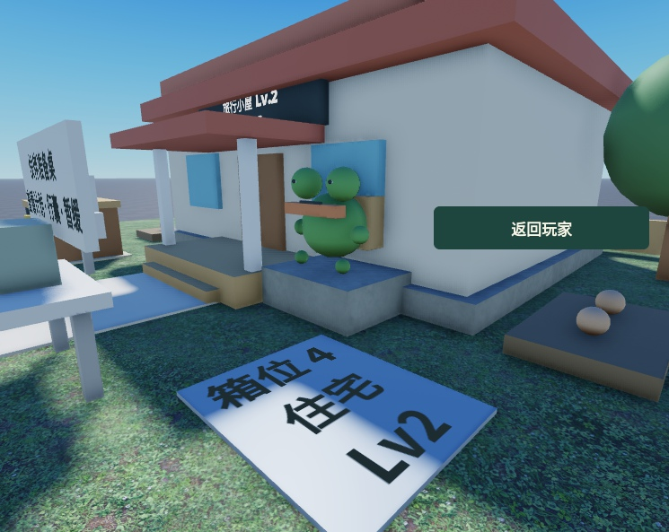

# 伙伴白模与归家循环

本阶段只处理伙伴可见性与“归家自动入库 → 休息 → 再次准备”。工程在 `F:\HunyueRoblox\TravelBuddy`；规则沿用已确认的自主出游方案，没有制作正式美术、拍卖、休闲旅游或离线多趟。历史 DOCX 保留，本文件与 04～06 的最新实施状态作为后续基准。

## 为什么此前没看见伙伴

海蛙白模已存在：`ServerStorage.Game.Resources.Models.TravelBuddy.Frog`。它包含 16 个基础零件，约 3.15×3.20×2.50 studs，Play 后才克隆到自己的运行地块。Edit 模式没有玩家与业务运行副本，因此地图上不会预摆四个伙伴。

此前白模较小、没有姓名牌，初始视角朝向港口；从正面查看住宅又容易被准备桌告示牌挡住。现在岛上提供“查看伙伴”，短暂切换到斜侧视角，显示后返回玩家镜头；可点击“返回玩家”提前结束。船远离港口后，这个入口改为“查看伙伴旅途”，打开已有 2D 观察窗。

这是当前白模海蛙，不是最终角色美术。看书、散步与操作船只的正式动作仍待制作。

## 玩家能理解的运行流程

| 阶段 | 服务端逻辑 | 岛上表现 |
|---|---|---|
| 准备 | 有行囊补给、空箱位、可用船且未暂缓，保存路线和准备截止时刻 | 伙伴在准备桌附近等待，小船留在码头 |
| 出发 | 到期扣除一份行囊补给，预约一格箱位，保存航次及已抽好的收获 | 伙伴在船上，船离港并逐渐淡出 |
| 归家 | 到航次 EndAt，将预约位置换为一个封箱，特产和明信片入库，保存永久结算标识 | 船从远处靠岸，伙伴回到岛上；通知收获已存放 |
| 休息 | 截止时刻为 EndAt＋本航次保存的休息时长 | 当前仍是基础白模站位与待机，没有睡觉或生活动作 |
| 再次准备 | 休息、靠岸时间结束后再次检查补给、箱位、船和暂缓状态 | 条件满足时回到准备桌；条件不足时留在岛上等待 |

正式休息 180 秒，Studio 当前倍率 0.05，因此休息 9 秒。在线和离线都从实际归家时间开始计算；离线时不会为了动画等玩家上线，也不会从上线时刻重置休息。

“查看收获”读取最近一趟的归家摘要，只标记已读，不发奖、不扣补给、不成为下一趟旅行的前置条件。伙伴不会自行开箱、出售或上架。封箱内部内容与实际价值继续保密，品质可见的目标方案尚未接入。

## 离线与存档边界

当前只补完已保存准备计划触发的航次，或已经出发的一趟航次。下一份准备从当前加载时刻开始，不追溯连续执行多趟；离线多趟补算单独作为下一阶段。

业务数据升为 v4，沿用原存档名称和 Storage 后端。v1～v3 的合法存档迁移保留金币、材料、封箱、物品、图鉴、暂停状态、准备计划、随机流与旧操作收据；旧 Claimed 只改成 Settled，不再发奖、不重置休息；旧 Returned 到时自动结算一次。坏档不猜补，也不重置用户资产。

本阶段只保存并展示最近一次归家摘要，没有实现多趟未读汇总或完整旅行历史。

## 模型与逻辑的边界

- Domain 只管理时间、补给、容量、奖励与存档，不访问模型、图片、Remote 或玩家对象。
- World 服务通过资源模板和站位锚点播放表现；船淡出或归航结束不触发发奖。模板缺少姓名牌时也不影响资产逻辑。
- 伙伴运行模型通过 `Role=Companion` 和 `OwnerUserId` 标识；镜头寻找自己的伙伴，不依赖模型必须叫 Frog。更换外观仍需保留模板的 PrimaryPart、原点及约定锚点。
- “查看最近收获”采用 `MarkReturnRead`；开箱、升级、购买、装取行囊等资产操作仍由服务端检查所属关系、距离、版本和操作收据。
- GUI 结构和模型外观保存在原生 rbxmx；客户端只绑定、改文本和显示状态，不运行时重排界面。

## 当前验证

本地 Domain 38 项行为测试、服务联调、四人地块隔离与模型演出检查、原生 UI 与手机布局检查、配置工具与底座检查通过；完整构建编译 64 个脚本。Studio 在线观察已记录 Voyaging → Returning → Resting → Preparing → 新 Voyaging，未读收获没有阻塞第二趟。

离线重进与伙伴最终显示复核进行中，最终结果写入本节及 `.qa/return-20261013/verification-final.json`。没有进行真实手机性能压测，也不把本地四人隔离检查称为本轮新做的四客户端现场联机。

## 后续顺序

1. 离线多趟：按完整时间轴推进，最多三趟，补给耗尽、箱满或暂缓时停止。
2. 岛内生活：休息、看书、短距离散步，支持航海准备中断生活活动。
3. 封箱处置：可见品质、开箱与保留；拍卖方式、定价、时长讨论后再接入整箱拍卖。
4. 美术样板：先替换一个伙伴、一个住宅和一套 2D 旅途，验证替换接口后再批量制作。
