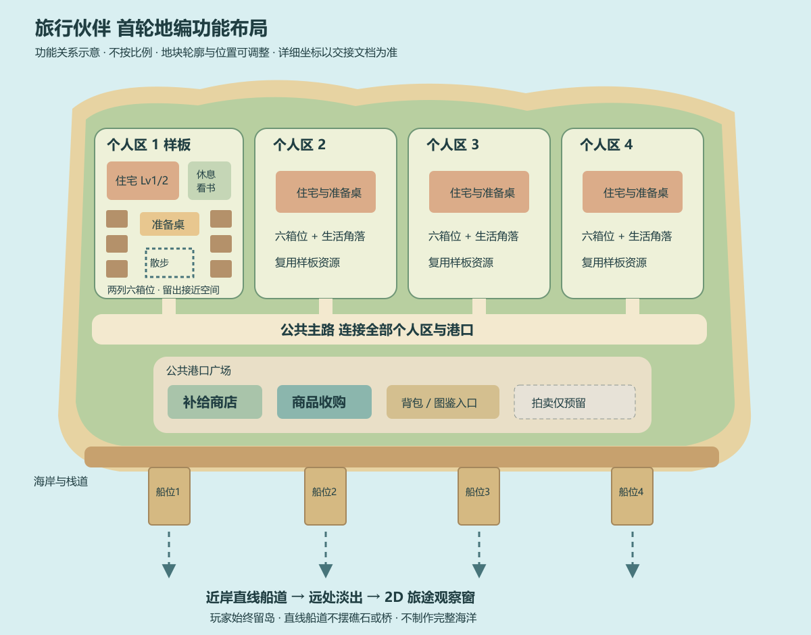
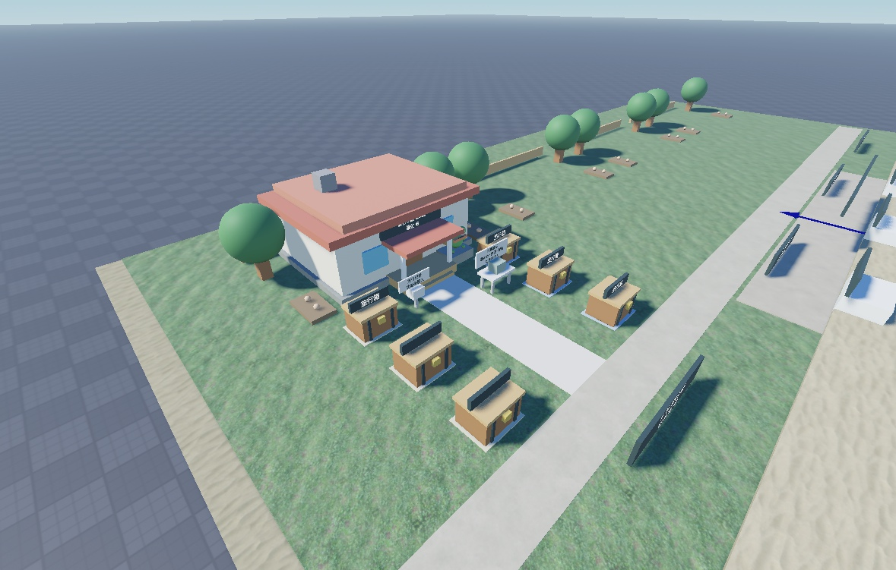

# 旅行伙伴 Blender 地编场景制作交接

本轮制作目标是：**一座四人共享的海岛，四个独立个人地块，一个公共港口；先完成岛屿结构和一个个人区样板，再复用到另外三块地。** 玩家在岛上经营，伙伴自主生活和出游。建模重点是玩家能走动、看见伙伴、操作设施的主岛，以及船只离返港的近岸区域。

游戏工程名为 `TravelBuddy`，此前方案也使用“海箱旅蛙”名称。第一位伙伴是海蛙。本文可直接交给 Blender 建模助手或地编人员使用；功能要求、当前白模参考和制作建议分别标明。岛屿最终轮廓、美术比例和道路宽度仍可调整。

## 1 先理解玩家每天在岛上做什么

玩家到公共补给商店买补给，再到**自家准备桌**装入行囊。伙伴自行选海域、准备出发、操船离港；玩家留在岛上，可以开关 2D 旅途观察窗。伙伴归家后，封箱自动放到个人箱区，特产和明信片自动入库。玩家选择开箱、保留封箱、出售开出的物品，以及升级住宅和船。

伙伴空闲时会休息、看书和短距离散步。没有行囊补给、箱满、暂缓出游时，生活空间仍然有用。地点愿望也在准备桌设置，只影响未来新计划，不需要另外建造派遣大厅或愿望建筑。

场景需要让人自然走通这条路线：

**公共补给店 → 自家准备桌 → 观看码头出发／伙伴生活 → 自家箱区 → 公共收购台 → 回家升级与再次准备。**

没有“手动派遣后才能出发”和“到领奖台领取后才发奖”的门槛。旧方案、旧标牌里出现这类文字时，不作为新地编的设计依据。

## 2 本轮范围与功能状态

| 内容 | 场景必须支持什么 | 当前状态 |
|---|---|---|
| 四人共享主岛 | 四个可区分的个人地块，公共道路与港口 | 已有白模与基础实现 |
| 个人经营区 | 住宅、准备桌、船位、箱区，所有入口能步行接近 | 已有模板与锚点 |
| 住宅升级 | Lv1、Lv2 使用同一住宅位置，箱位容量从 3 增到 6 | 已有逻辑；按最大等级留空间 |
| 船只升级 | 小木船、帆船能独立替换；Lv2 解锁近海 | 已有逻辑与离返港演出 |
| 伙伴生活 | 休息点、阅读点、四个短散步点，独立阅读道具 | 已接入，后续阶段由用户自测 |
| 封箱展示 | 数量可变，每箱有品质显示，内容与实际价值保密 | 已接入，后续阶段由用户自测 |
| 地点愿望 | 复用自家准备桌，在途时也能设置未来偏好 | 已接入持续偏好，存档 v6 |
| 公共售卖 | 补给商店与商品收购台有不同外形和站立区 | 已有独立入口 |
| 拍卖 | 预留一块容易辨认的场地与可替换台体 | 交易规则与程序尚未接入 |
| 岛屿边界 | 海岸、台阶、码头边缘有清晰视觉提示 | 落水、越界处理仍需后续程序与用户验证 |
| 远方旅途 | 3D 近岸接到 2D 观察窗 | 不制作玩家可登陆的远方 3D 地图 |

离线多趟和收获汇总已实现，行囊最多三份。它们影响箱位和设施的使用频率，不要求新增离线建筑或扩大到完整海洋。

**本轮不制作**种菜系统、吃饭消耗、串门玩法、独立休闲旅游场景和正式拍卖交易。第一轮住宅先完成外观、门前空间与升级替换；可进入室内没有列入当前制作任务。

截至本次交接，浅滩正式 2D 图片仍有加载故障，尚未确认显示通过，详见 [12 阶段记录](12_浅滩2D旅途样板_美术与接入.md)。这不改变本轮 3D 地编范围，也不要求通过改岛屿模型处理图片故障。

## 3 岛屿布局与动线



[可编辑的 SVG 示意图](assets/Blender地编_功能布局示意.svg)

上图是**功能关系示意，不按比例，不是最终坐标图**。采用四个人区沿海岸展开、公共道路连接港口的起稿方式。可以把岛形改得自然、弯曲一些，但保留四个可用地块、公共往返路线和各船的通道。当前白模坐标另列在第 8 节。

### 岛体和海岸

岛体、草地、沙滩、礁石与栈道分件制作。轮廓适合从玩家视角辨认，避免仅从俯视图好看、落到地面却全被植被挡住。海岸用沙滩、岩石或低围栏形成边界线；需要可走的斜坡、台阶和码头连接处另留简单碰撞。

首轮可以沿当前约 **166×87 studs 的岛体水平范围**起稿。这个值是旧白模的外包尺寸参考，不是最终岛形，也不包括向外延伸的船道。近岸海面表现不必做成一张巨大的高密网格；海水由 Studio Terrain、水面材质或独立低面表现承接，接入时选一种主方案，避免重复水面。

### 四个个人区

每个个人区都必须包含以下可用空间，不能只预留一栋房子：

| 空间 | 地编要求 |
|---|---|
| 住宅区 | 按 Lv2 最大外轮廓留位，升级不压住准备桌、通路或生活区 |
| 准备桌 | 独立桌体、玩家站位、伙伴准备站位；出游期间玩家仍能走到这里 |
| 六个箱位 | 首级只使用三个，其余预留；每个箱子均能单独接近、打开和显示品质牌 |
| 生活角落 | 休息处、阅读处，留出海蛙身体与独立书本的位置 |
| 短散步路线 | 四点闭环，连线之间平顺、无遮挡；不穿过桌椅、箱子或邻居地块 |
| 个人船位 | 容纳两级船、伙伴船上站位及升级交互；与陆上道路视觉连通 |
| 地块识别 | 门牌、路缘、植被或围栏帮助辨认归属，保留公共道路通行 |

四个地块应拥有相近的可用面积和到公共设施的便利程度。可以复用房屋、箱子与家具，通过少量植物或路边装饰变化区分，避免做成四套完全独立的大资源包。

**当前散步使用锚点之间的直线插值，没有寻路避障。** 因而正式家具也要让出 `Walk1 → Walk2 → Walk3 → Walk4 → Walk1` 每一段；不能依赖伙伴自动绕开栏杆、楼梯或石头。生活点也应给玩家留观察空间。

### 公共港口

补给商店用补给箱、行囊或棚布建立识别；商品收购台用货物台面、金币或价签建立识别；拍卖预留区用独立台体和空地表达用途。三者不能做成无法区分的同款小摊。

背包和图鉴当前也有公共入口，需要保留可接近的位置。可以做成小柜台、告示板或陈列架，不要求新建大型商店或博物馆。正式文字交给 Studio 的 SurfaceGui／BillboardGui，Blender 中保留牌面，避免把价格、玩家名、品质或倒计时烘焙进贴图。

公共道路连接商店、箱区、住宅、准备桌和码头。**起稿建议**：主路净宽 6～8 studs、个人支路 4～6 studs；它们是待角色比例校准的制作建议，不是当前配置或验收通过值。装饰伸出、碰撞和柜台前站人后，仍要保留有效通行宽度。

### 船道和镜头

每艘船从 `ShipAnchor` 到 `DepartureEnd` 走直线，归航沿同一路线返回。当前没有中途转弯、自动避障和掉头演出。码头前不布礁石、拱门、跨海桥或挡船栏杆；帆船上方也要留空。

自然海岸允许调整，但弯曲的出港水道不能仅靠美术实现。需要转弯路线时，应单独安排程序改动。玩家能看见离港、回家即可，不需要把航道继续做成可探索海洋。

住宅前、生活角落、箱区和船位之间避免用高树冠、厚告示牌遮住伙伴。需要同时考虑地面玩家镜头、查看伙伴的斜侧镜头，以及四块地同时有人时的整体可读性。

## 4 美术方向与资源拆分

历史 03 美术方案的基础方向是**低多边形加柔和手绘质感、Q 版比例、明亮低饱和的治愈卡通**。场景用简洁大形体表达结构：草地与海水偏柔和蓝绿，沙滩、木材和布面偏暖色，重点入口用少量色彩区分。最终调色与轮廓先用一个个人区确认，再批量制作。

可沿用原方案的起稿色板：海洋蓝 `#4A90D9`、沙滩暖黄 `#F5DEB3`、青蛙绿 `#7CB342`、珊瑚橙 `#FF8A65`、贝壳白 `#FAFAFA`。它们是美术参考，不是必须逐像素匹配的材质参数；灯光和实际海水表现需要在 Studio 中一起调整。

已制作的 2D 样板可提供身份线索：绿蛙、橙色围巾、棕色背包；木船升级为白帆、浅蓝横条的帆船。保持这些线索的一致性，不要求把平面插画直接做成高密雕刻。

| 资源 | 首轮数量与版本 | 为什么要独立 |
|---|---|---|
| 岛体、草地、沙滩、岸石 | 分块组成一座岛 | 轮廓、材质和行走碰撞需要分别调整 |
| 道路、广场、栈道、码头 | 一套可复用模块 | 修改动线时不牵动整座岛 |
| `HomeLv1`／`HomeLv2` | 两个住宅版本，先精做一个地块 | 运行时按等级替换，不能焊死在岛体上 |
| `PreparationStation` | 一个资源，复用四份 | 准备桌独立交互与伙伴站位 |
| `ShipLv1`／`ShipLv2` | 木船、帆船各一份 | 升级、出港、归航与淡出需要整船移动 |
| `Container` | 一份中性封箱，运行时数量变化 | 每人 0～6 箱，不能合并进码头或地块 |
| 品质牌 | 独立牌面／挂载空间 | 普通、生活、精良由程序控制显示，不暗示箱内价值 |
| 海蛙与 `ReadingBook` | 伙伴和书分别维护 | 伙伴会移动，书仅在阅读时展示 |
| 休息／阅读家具 | 一套生活区小件 | 不与生活点位和伙伴焊成一个对象 |
| 补给摊、收购台、拍卖台 | 各一套独立外观 | 各自入口可识别，后续拍卖可独立接入 |
| 树、岩石、栏杆、路灯 | 少量不同轮廓，重复使用 | 控制重复制作、材质与场景复杂度 |

封箱外观不摆出内部商品、货物数量或金币总值。即使给箱体增加美术变化，也不能让差异变成未定义的收益提示。品质以独立标牌为主，箱子本身保持可复用。

### Blender 工程建议层级

以下是便于制作与导出的**建议 Collection 结构**，不是程序会自动识别的 Roblox 层级：

```text
TravelBuddy_Island
├─ World_Static
│  ├─ IslandBody / Grass / Beach / Rocks
│  ├─ Roads / HarborPlaza / Boardwalk / Docks
│  ├─ Hub_Appearance
│  └─ Decor_Instances
├─ Assets
│  ├─ HomeLv1 / HomeLv2
│  ├─ PreparationStation
│  ├─ ShipLv1 / ShipLv2
│  ├─ Container
│  └─ LifeFurniture / ReadingBook
├─ Placement_Preview       地块内仅作摆放预览的实例
├─ Anchors_Reference       Empty／标记，记录名称和朝向
└─ Collision_Reference     简单几何代理，可独立隐藏
```

住宅和船不能把两个等级重叠合并后一起导出；树木可在 Blender 中用实例摆放，但需核对所选导出格式对实例的处理。场景中的预览住宅、预览船和预览箱不是永久静态资产，Studio 接入时由运行模板生成，避免出现两套重叠副本。

## 5 外观 碰撞 与锚点的职责

**外观负责看起来是什么，碰撞负责哪里能走，锚点负责在哪里站立、交互和生成。** 三者分别维护。美术可更换网格，玩法逻辑仍使用稳定锚点。

| 层 | Blender 交付 | Studio 接入 |
|---|---|---|
| 外观 | 独立可见网格、材质、贴图 | MeshPart／Model；装饰外观通常不承担行走碰撞 |
| 碰撞 | 简单盒、坡面等代理，单独 Collection | 用简单 Part 或合适网格碰撞设置处理；检查楼梯、岸边、码头接缝 |
| 锚点 | 有名称和方向的参考 Empty／定位标记 | 由接入人员建立或保留实际 BasePart、Prompt、PrimaryPart 和属性 |

Blender Empty 不是现有代码要求的 BasePart，导入一套同名 Empty 也不等于交互已经接好。锚点一般透明、固定、无碰撞；保留名称、父子层级和朝向后，才可与已有程序接通。

当前模板的拆分程度不同：`Container` 已拆开外观、碰撞与交互；准备桌、生活区和商品收购台已有外观／锚点拆分，但准备桌与收购台部分碰撞仍在 Appearance 内。住宅、船及部分公共柜台仍有旧结构。**不能直接把所有旧节点一并移到 Appearance 里。** 例如船的 `FrogAnchor`、准备桌的 `CompanionAnchor` 由程序按直接子节点读取，移动层级会断开接入。需要重构时先由程序适配，不能写成所有资源已经完成三层拆分。

## 6 必须保留的 Studio 接入约定

### 固定岛屿层级

```text
Workspace.Game
├─ World.TravelIsland                  Model
│  ├─ Ground / Decor                   外观分类可调整
│  ├─ Hub                             Folder
│  │  ├─ ShopAnchor                   BasePart
│  │  ├─ SellAnchor                   BasePart
│  │  ├─ InventoryAnchor              BasePart
│  │  ├─ CollectionAnchor             BasePart
│  │  └─ SaleCounter.Appearance        收购台可替换外观
│  └─ Plots                           Folder
│     ├─ Plot1                        Folder
│     │  ├─ HomeAnchor                BasePart
│     │  ├─ PreparationAnchor         BasePart
│     │  ├─ ShipAnchor                BasePart
│     │  ├─ SpawnAnchor               BasePart
│     │  ├─ DepartureEnd              BasePart
│     │  ├─ ContainerSlots            Folder，Slot1～Slot6 为 BasePart
│     │  ├─ LifeAnchors               Folder，Rest／Read／Walk1～Walk4
│     │  └─ LifeArea.Appearance       可替换生活区外观
│     └─ Plot2 / Plot3 / Plot4         同类地块结构
└─ Runtime                            Folder，运行时由程序管理
```

前五个地块锚点与六个箱位是当前启动使用的节点。`LifeAnchors` 可按生活区样板提供；存在该目录时，程序优先用世界里的点位，因此正式地编应提供完整的 Rest、Read 和四点路线。旧岛没有这个目录时，会尝试用 `CompanionLifeArea` 模板按 HomeAnchor 对齐补上，不要同时摆两套生活家具。

四个地块按当前服务器临时分配，离开会释放。不要把 2334 账号、玩家名字或某一存档等级做进静态模型。空地景观可保留，住宅、船、伙伴和箱子的运行副本由程序决定。

### 可替换模板约定

模板库为 `ServerStorage.Game.Resources.Models.TravelBuddy`，对应本地资源目录见第 11 节。模板需保留 `Template=true`、可克隆属性和正确的 PrimaryPart／pivot；这些由 Studio 接入，不能只靠 FBX 对象名替代。

| 模板 | 必须保留或对齐的内容 |
|---|---|
| `HomeLv1`、`HomeLv2` | 同一地面定位基准；Root／PrimaryPart；升级交互；`FrogAnchor` 回退站位。施工牌如保留，名称与 GUI 约定一起保留 |
| `ShipLv1`、`ShipLv2` | 同一水线与方向基准；Root／PrimaryPart；根下 `FrogAnchor`；船升级 Prompt。帆、桅杆与船体作为整船外观移动 |
| `PreparationStation` | Root／PrimaryPart；准备桌交互；根下 `CompanionAnchor`；玩家可接近的位置 |
| `Container` | 根下 `Root`、`InteractionAnchor/OpenContainerPrompt`、`QualityAnchor`；独立 `Collision` 与 `Appearance` |
| `ContainerQualityBadge` | 独立模板；Root 与品质 GUI 预设状态，不把品质或价值烘焙进箱体 |
| `Frog` | 稳定 pivot、PrimaryPart；当前模板面朝本地 +Z。本轮不要求先绑定骨骼和制作正式动作 |
| `ReadingBook` | 跟随伙伴 pivot；局部偏移对齐伙伴手前，独立于角色内部零件名称 |
| `CompanionLifeArea` | 根下 `PivotPart`、`LifeAnchors` 与 `LifeArea`；外观在 `LifeArea/Appearance`，原点按 HomeAnchor 对齐 |
| `PlotRuntime` | 当前为空 Folder 模板，属于程序容器，不是需要制作的场景模型 |

准备桌、出售与开箱入口都检查玩家距离。尤其收购台提示范围为 12 studs，服务端出售范围为 14 studs；准备桌也使用本人锚点的 14 studs 范围。不要把锚点藏在厚柜体深处，或让玩家只能站在有效范围外。其他设施的逻辑范围不能代替现场可达性检查。

旧船模板中的 `Voyage` 和 `ClaimReturn` Prompt 已禁用兼容；新招牌不再写“确认派遣”或“先领取奖励”。

现有交互需要保留 `ProximityPrompt` 上的 `TravelAction`，例如 `Bag`、`HomeUpgrade`、`ShipUpgrade`、`OpenContainer`。1 号样板里的 `BoardingAnchor`、`CompanionPrepareAnchor`、`TravelRecordAnchor` 目前不是 World 服务消费的入口，不要把它们当成已接好的自动登船／走路／领奖系统。

## 7 尺度 朝向 与导出

### 项目尺度约定

第 8 节所有坐标与尺寸都使用 **Roblox studs**，顺序为 X、Y、Z；Y 是高度。Blender 默认 Z 向上，不能把这组坐标原样当作 Blender XYZ。

起稿可以约定 **1 个 Blender 长度单位代表 1 stud**，这是本项目制作约定，不是 FBX／glTF 的自动换算保证。导出包附一个已知 10 单位边长的参考立方体和朝向标记；Studio 导入后核对为 10 studs，再固定这一批资源的单位、缩放和轴向设置。参考立方体不进入正式运行场景。

若手动把表中坐标转换到 Blender，可使用一致的规划映射：`X_B=X_R，Y_B=-Z_R，Z_B=Y_R`。这样 Roblox 的 +Z 在 Blender 中对应 -Y。**它只用于规划；导出器和导入器的轴变换另行记录，避免再旋转一次。**

各住宅等级共用住宅基准，各船等级共用水线基准，各封箱共用底部中心基准。Root 不随屋顶高度、帆高或招牌位置变化。当前住宅正面、船头和海蛙正面均朝模型本地 +Z；不要直接用 Roblox CFrame 的 LookVector（-Z）当作这些外观的前向。导出前清理异常缩放、镜像负缩放与法线，保留有意义的对象名，记录必要的 modifier 应用结果。

### 文件与材质

保留可继续编辑的 `.blend` 源文件；交付 Studio 3D Importer 支持的 FBX 或 glTF 包，按固定岛屿与独立动态资源分批。静态岛体可以分块，但不要把所有内容合成一个大网格。贴图放独立目录，记录用途和相对路径，不依赖 Blender 本机绝对路径。

Blender 的复杂节点、程序化材质、灯光与几何节点效果不能假设在 Roblox 中原样重现。需要的颜色与材质效果应烘焙／整理成可导入资源，或在 Studio 中配置。先用简单材质确认轮廓、比例和拆分，再投入完整贴图。

优先复用材质与重复装饰，减少看不见的背面细节和过多透明树叶。当前没有冻结整岛面数、材质数、贴图总量或 LOD 距离；交付时记录每件及整岛统计，由用户在目标设备验收后确定预算。

03 美术方案可供起稿的**历史预算目标**如下，单位 tris 为三角面数，不是 Blender 多边形数，也不是 Roblox 平台硬限制：

| 单件资源 | 原目标 | 原贴图参考 |
|---|---:|---|
| 地形拼块 | ≤1,000 tris | 原方案未按每块另定贴图规格 |
| 单级住宅 | ≤4,000 tris | 1024×1024 |
| 单级船 | ≤3,500 tris | 1024×1024 |
| 普通／生活封箱 | ≤600 tris | 512×512 |
| 精良封箱 | ≤800 tris | 512×512 |
| 小装饰 | ≤500 tris | 按复用材质与图集统一安排 |
| 海蛙 | ≤3,000 tris | 1024×1024，绑定不是本轮地编前置 |

原方案还写过整场景 ≤30,000 tris，但四个地块、四套伙伴船只和最多 24 箱同时出现时，不能把上述单件上限全用满后仍宣称满足总量。首轮先做中性封箱一份、独立品质牌，不因三种品质先制作三套高成本箱体。后续预算根据实际同时可见资源重新分配；旧“LOD 齐全”没有规定级数或切换距离，不据此虚构硬指标。

导入时需要核对层级、单位、朝向、pivot 与每个拆分资源，再接碰撞和锚点。静态地编导出时关闭不需要的动画与骨架；具体导出设置和 Studio 的 Scale Unit、World Forward、World Up、Imported Pivot 一起记录。官方依据核对于 2026-10-14：[3D Importer](https://create.roblox.com/docs/studio/importer)、[导出要求](https://create.roblox.com/docs/art/modeling/export-requirements)、[建模规格](https://create.roblox.com/docs/art/modeling/specifications)、[MeshPart 与碰撞](https://create.roblox.com/docs/parts/meshes)、[性能设计](https://create.roblox.com/docs/performance-optimization/design)。

## 8 当前白模尺寸与坐标参考

以下来自游戏工程当前 `.rbxmx` 与 `TravelWorldService`，属于**白模参考，不是美术定稿**。此前生成脚本和历史截图并不完全等同于这些文件；Studio 中手工岛也可能继续有调整。接入前以本次保留的实际场景再核对。

### 主要体积

| 对象 | 当前参考值，studs | 使用方式 |
|---|---|---|
| 岛体底座 | 166×8×87 | 水平约 166×87，最终可改自然轮廓 |
| 主屋 Lv1 | 主体 16×7×13；底座 17×0.9×14 | 屋顶、台阶也占空间，不能只按主体留地 |
| 主屋 Lv2 | 主体 20×7×15；底座 21×0.9×16 | 外观含屋顶／门前构件约 22×11.5×20.75 |
| 两级船共同船体 | 10×1.6×15 | 以完整帆船检查码头上空与船道；Lv2 外观高度约 12.05 |
| 个人码头 | 14×0.7×18 | 不含外围通道、船体与船道 |
| 封箱外观 | 约 4.5×2.93×3.83 | 不含实体标牌和透明碰撞代理 |
| 准备桌外观 | 约 4×3.4×2.5 | 还要加玩家、伙伴和提示牌空间 |
| 海蛙外观 | 约 3.2×3.13×2.75 | 当前模板几何参考；不锁死正式角色比例 |

外观包围尺寸按当前基础零件估算，已排除透明锚点、碰撞代理和实体标牌。它们与历史 07 阶段的测量口径不同，不把数字差异当成正式角色改版。

### 四个地块

| 地块 | 横向中心 X | HomeAnchor | PreparationAnchor |
|---|---:|---|---|
| Plot1 | -54 | (-54, 2.04, -19) | (-49, 2.12, -2) |
| Plot2 | -18 | (-18, 2.04, -7) | (-13, 2.12, 10) |
| Plot3 | 18 | (18, 2.04, -7) | (23, 2.12, 10) |
| Plot4 | 54 | (54, 2.04, -7) | (59, 2.12, 10) |

四块地的准备桌相对 HomeAnchor 均为 `(+5, +0.08, +17)`。1 号地块调整过，不能把其余三块的 Z 坐标机械复制给它。若新地编统一四块结构，保留锚点名称并同步调整整套位置。

其余船位等在四块地采用共同规则，`x` 表示各地块横向中心：

| 节点 | 当前坐标／关系 |
|---|---|
| `ShipAnchor` | (x, 2.10, 67.5) |
| `SpawnAnchor` | (x, 5.10, 16)，这是角色生成定位，不是道路地面高度 |
| `DepartureEnd` | (x, 2.10, 164) |
| 码头 `Ground.DockN` 中心 | (x, 2.35, 50) |
| 近岸船道 | ShipAnchor ↔ DepartureEnd，当前直线长 96.5 |
| 船道朝向 | 上述锚点当前无旋转；船按同姿态往返插值，没有自动掉头 |

### 箱位与生活点

下表均为**相对该地块 HomeAnchor 的偏移**：

| 点位 | X 偏移 | Y 偏移 | Z 偏移 |
|---|---:|---:|---|
| Plot1 Slot1～3 | -10 | +0.08 | 依次 +13、+21、+29 |
| Plot1 Slot4～6 | +10 | +0.08 | 依次 +13、+21、+29 |
| Plot2～4 Slot1～3 | -10 | 0 | 依次 +13、+18、+23 |
| Plot2～4 Slot4～6 | +10 | 0 | 依次 +13、+18、+23 |
| Rest | +15 | +0.75 | +11 |
| Read | +15 | +0.75 | +16 |
| Walk1 | -2 | 0 | +14 |
| Walk2 | +1 | 0 | +14 |
| Walk3 | +1 | 0 | +20 |
| Walk4 | -2 | 0 | +20 |

Rest 与 Read 当前 yaw=-90°，模型本地 +Z 朝世界 -X。四个 Walk 点由程序按连线计算伙伴朝向；地编应提供平面可通过的闭环。座面高度和正式伙伴脚底需一起校准，不能把参考锚点位置误认为座椅底部。

### 公共区

| 节点 | 当前坐标 | 现状 |
|---|---|---|
| `Hub.ShopAnchor` | (-23, 3.2, 29) | 仍是有外观／碰撞的旧柜台 Part，不是已拆好的纯透明点 |
| `Hub.InventoryAnchor` | (23, 3.2, 29) | 同上，正式替换需要保留可用交互并处理旧可见柜体 |
| `Hub.CollectionAnchor` | (0, 3.2, 29) | 同上 |
| `Hub.SellAnchor` | (-10, 3.2, 23) | 已是透明、无碰撞的独立锚点 |
| 拍卖台主体 | (0, 3.2, 36)，12×2.4×3 | 预留白模，不能视为已接入交易 |



上图用于理解房屋、门前通路与两列箱位的关系，属于历史白模截图；不代表正式美术，也不替代当前坐标表。

## 9 建议制作顺序与交付内容

| 阶段 | Blender 产出 | 决定什么 |
|---|---|---|
| 第一轮 结构 | 岛体、海岸、道路、四个地块边界、公共区、四个船位粗模 | 轮廓、尺度、玩家往返与船道能否成立 |
| 第二轮 个人区样板 | 一个完整地块，含两级住宅预留、准备桌、六箱位、生活角落和码头 | 比例、风格、空间是否相互冲突 |
| 第三轮 模块资源 | 住宅两版、船两版、箱体、桌体、家具分件 | 升级和数量变化能否独立替换 |
| 第四轮 公共港口 | 补给商店、收购台、背包／图鉴入口、拍卖预留外观 | 外形辨认与公共往返动线 |
| 第五轮 复用和装饰 | 复制到四块地，少量树岩、栏杆、路灯 | 全岛一致性、遮挡与资源复用 |

每轮保留一个可继续编辑的 `.blend`，不要只有效果图。首份交付至少包括：

- `.blend` 源文件，Collection、对象、材质命名清楚。
- 固定岛屿与独立住宅／船／箱等分开的 FBX 或 glTF 导出包。
- 贴图及材质用途表；程序化外观说明哪些已烘焙、哪些交给 Studio 配置。
- 俯视图、玩家视角、一个个人区近景，标注哪些是草案或完成样板。
- 资产清单：名字、用途、数量／复用关系、主要尺寸、pivot、前向、面数和材质数。
- 锚点位置与方向说明；碰撞代理独立，明确哪些部分需要在 Studio 补建。

文件名可用 `TravelBuddy_Island_Blockout_v01.blend`、`TravelBuddy_PersonalPlot_Sample_v01.blend`、`HomeLv1`、`HomeLv2`、`ShipLv1`、`ShipLv2`、`Container`。这是本轮建议命名，游戏资源键仍按第 6 节保留。

## 10 可直接交给 Blender 助手的首轮指令

```text
请为 Roblox 游戏“旅行伙伴 TravelBuddy”制作首轮海岛结构粗模。

玩法：四名玩家共享一座岛，每人有自己的住宅、准备桌、六个箱位、
个人船位和伙伴生活空间。玩家经营岛屿，伙伴自主准备出游与归家；
玩家留岛，远方旅途使用2D观察窗，不做可进入的远方3D关卡。

本轮只做：自然岛体、海岸沙滩、主路、四个个人区的空间预留、
公共港口的补给店/商品收购台/背包与图鉴入口/拍卖预留区粗模、
四座码头与笔直离返港通道。先把一个个人区摆完整，再复用到四块地。

个人区必须按最大容量留位：住宅Lv2外轮廓、独立准备桌、最多六只箱子、
休息点、看书点、Walk1至Walk4短闭环。散步目前没有寻路避障，
四段连线不能穿家具、箱子或栏杆。准备桌在伙伴出游期间仍须可达。

岛体参考旧白模水平约166×87studs；两级船共同船体约10×15studs，
码头参考14×18studs，海蛙约3.2studs高。以上是参考，不锁死最终外形。
采用统一尺度并附10单位参考立方体；说明Blender到Roblox的单位和轴向，
不要把Roblox的Y高度坐标直接当成Blender Y。

风格先用简洁低模、温暖柔和海岛配色，少量可复用树木、石头、栏杆。
住宅、船、箱、准备桌、家具与柜台分别独立，不与岛体合并。
外观网格、碰撞代理、锚点参考标记使用不同Collection；保留清楚命名。
先给俯视与玩家视角粗模预览，不批量精雕，不创建新经济规则或游戏脚本。

不要制作种菜、吃饭消耗、串门、旅游地图或正式拍卖流程。
交付可编辑.blend、分模块导出包、俯视图和资产/锚点清单。
具体接入名称与当前坐标以《14_游戏与Blender地编场景交接》为准。
```

## 11 工程接入与保存位置

| 内容 | 当前路径 |
|---|---|
| 游戏工程 | `F:\HunyueRoblox\TravelBuddy` |
| 本地静态岛参考 | `src/Workspace/TravelIsland.rbxmx` |
| 服务端模型模板 | `src/ServerStorage/Game/Resources/Models/TravelBuddy/` |
| 世界与模板接入代码 | `src/ServerScriptService/Server/Game/Services/TravelWorldService.lua` |
| 玩法权威逻辑 | `src/ServerScriptService/Server/Game/Domain/TravelDomain.lua` |
| 美术与模型归库说明 | `docs/资源导入归库流程_ResourceWorkflow.md` |
| 正式玩法配置 | `design/config/workbooks/TravelConfig.xlsx` |
| 2D 原图风格参考 | `design/art/travel/shallow/` |

**默认 `default.project.json` 没有映射本地 `src/Workspace` 岛屿**，因此只替换本地岛文件，不会自动更新 Studio 中的手工场景。`build.project.json` 才包含该静态岛的构建映射。保持 `ignoreUnknownInstances=true`，按当前场景的实际归库方式保存，再接入模型模板和锚点。

**不要运行旧的 `scripts/game/build_travel_world.py` 来覆盖正式地编。** 它不能完整重建当前手工修改：住宅、箱位、准备桌、收购台等已有后续变化。生成脚本是历史开发工具，当前交接以实际 `.rbxmx` 和程序读取的层级为准。

导入后的静态场景归 `Workspace.Game.World`，可升级／生成的模板归 `ServerStorage.Game.Resources`，运行副本归 `Workspace.Game.Runtime`。在 Play 副本中改出来的模型，不能当作模板已经保存。Blender 文件、导出文件与 Studio 保存分别管理。

后续上传及授权使用用户指定的 `yangshulin2334`；图片／网格个人上传到群组体验时，需要核对目标体验的使用权限。不要把上传成功等同于已在游戏中显示。

## 12 由用户在 Studio 确认的接入清单

- 四块地均能完整使用；Lv2 住宅、六只箱子、生活家具同时摆放不挤占道路。
- 出生后能看懂个人区与公共区，到补给店、准备桌、箱区、收购台的路线连续。
- 准备桌、开箱与升级入口能靠近；大招牌、柜体和碰撞不会挡住交互。
- 看书时海蛙和书没有穿进座椅，四段散步路线不穿模、不跨危险高差。
- 两级船 pivot、水线、伙伴船上站位一致，往返船道不穿岸、码头或装饰。
- 住宅／船升级替换后，朝向、脚底／水线和交互位置不漂移。
- 箱子增减与品质牌显示正常，封箱外观没有泄露物品、数量或实际价值。
- 装饰不遮挡玩家镜头、伙伴观察镜头和公共招牌；真实设备上再确定性能预算。
- 模板、固定锚点与碰撞保存到正确位置；重连 Rojo 后手工资源保留。
- 海岸防落水、越界回收与必要提示由程序另行接入，不能仅凭可见栏杆视为完成。

本次交付只整理场景制作与接入要求，没有修改 Blender 场景、游戏代码或模型，也没有运行游戏测试。现场比例、碰撞、镜头、多人和设备效果仍由用户验收。

## 来源与继续阅读

- [玩家职责与 Demo 游戏闭环](05_玩家职责与Demo游戏闭环.md)：经营与陪伴分工。
- [3D 主岛与 2D 旅途表现方案](06_3D主岛与2D旅途表现方案.md)：场景范围；其中实施表部分为历史登记。
- [商品收购台](08_商品收购台_实现与自测.md)：独立收购入口与外观拆分。
- [离线多趟与收获汇总](09_离线多趟与收获汇总_实现与自测.md)：容量、归家与玩家处理封箱。
- [伙伴岛内生活](10_伙伴岛内生活_实现与自测.md)：生活锚点、独立道具与无寻路样板。
- [封箱品质展示](11_封箱品质展示_实现与自测.md)：箱体、品质牌、碰撞与保密边界。
- [地点愿望](13_地点愿望_实现与自测.md)：准备桌复用与持续偏好。
- 历史 `03_美术需求方案_Demo自主出游版.docx`：基础美术方向；旧派遣、领取和导出约定不能覆盖后续规则。
- 当前工程的 `TravelIsland.rbxmx`、各模型模板与 `TravelWorldService.lua`：本文件锚点约定与尺寸来源。

资料基准截至 2026-10-14。先做结构粗模与一个个人区样板，再依据用户确认的比例、动线和风格扩展整岛。
