# 右侧通行证模块更新操作手册

本文记录右侧 `Limited Event` 通行证模块的更新流程，主要覆盖：

- `EternalSpin.xlsx` 转盘奖励。
- `EternalReward.xlsx` 右侧通行证等级奖励。
- `gacha.xlsx` / `Resource/Egg` 活动蛋。
- `EternalShop.xlsx` 活动商店。
- `goods.xlsx` 右侧通行证付费商品。
- `resource.xlsx` 活动货币图标。
- `HudGui` / `EternalGui` 界面图标。
- `Server_EternalComponent.lua` 赛季号、右侧活动商品 id。
- `Client_EternalComponent.lua` 右侧活动商品 id 引用。

相关详细字段规则可参考同级文档：

- [[左侧battlePass通行证更新]]
- [[商店宝箱更新操作手册_执行版]]
- [[新关卡更新操作手册_执行版]]

> 注意：本文中的 id 和数值示例来自当前模拟流程。正式更新时必须以最新 Excel、Studio 模型名、网页端开发者商品 id 为准。

## 0. 操作总顺序

建议按下面顺序操作，避免配置互相引用时找不到 id。
1. 通行证的**BattlePass界面**只更新**宠物**、**遗物宝箱**（这个宝箱是shop里的，直接去拿对应ID即可）、**遗物**和**角色**。所以需要先去更新这些资源，再修改EternalReward表
2. 更新通行证的**Spin界面**UI，分别是：转盘遗物图标、活动币图标x3、活动券图标。先去更新**EternalSpin**表的**icon**字段，以及**1个遗物**对应的 **奖励** 字段。在Studio中**HudGui**、**EternalGui**的UI图片。
3. 更新**EternalShop**表
4. 单次更新一共**9个宠物、1个强力角色、4个遗物**
5. 更新**resource**表的**图标**字段，活动币 和 活动转盘券
6. **代码 Server_EternalComponent.lua** 更新**SEASON 加 1**
7. 更新**goods**表 **ID**  和  **商品id** 字段 。找到 **类型（程序填）** 字段是 **eternalBP** 和 **eternalCoins**的两行数据，复制新增一下，然后改  **ID**  和  **商品id** 字段
	1. **代码 Server_EternalComponent.lua**更新，全局搜索就的两个ID 替换成新增的ID即可。分别是0个和1个
	2. **代码 Client_EternalComponent.lua**同理，全局搜索就的两个ID 替换成新增的ID即可。分别是8个和6个
		1. 代码 Client_EternalComponent.lua 还需要改一下 蛋的**ID**，把上一个但的ID 更新为最新的，一共是4 处
8. 整理本次右侧活动所需资源：转盘遗物图标、活动币图标x3、活动券图标、蛋、宠物、宝箱、商店物品。
9. 先更新被引用的基础资源表，例如 `relics.xlsx`、`relics_gacha.xlsx`、`pet.xlsx`。
10. 更新 `EternalSpin.xlsx`。
11. 更新活动蛋：`gacha.xlsx` + Studio 的 `ReplicatedStorage/Resource/Egg`。
12. 更新 `EternalShop.xlsx`。
13. 更新 `EternalReward.xlsx`。
14. 更新 `resource.xlsx` 的两个货币图标。
15. 更新 `goods.xlsx`，新增右侧通行证相关的两个付费商品。
16. 在 Studio 中更新 `HudGui` 和 `EternalGui` 的图标。
17. 修改 `Server_EternalComponent.lua` 的 `SEASON` 和 goodsID。
18. 修改 `Client_EternalComponent.lua` 中右侧活动高级通行证、双倍活动币的商品 id 引用。
19. 保存 Excel，执行 `.\config_export.bat`。
20. 进 Studio 测试右侧活动入口、BattlePass、Spin、Shop、购买和奖励领取。

## 1. 文件位置

配置表默认路径：

```text
D:\AI\Codex\Codex_Obsidian\10_Projects 项目\Roblox\1巅峰进化项目交接\KaPibala\config
```

常用表：

| 文件 | 用途 |
| --- | --- |
| `EternalSpin.xlsx` | 右侧活动转盘奖励、显示概率、权重、转盘图标 |
| `EternalReward.xlsx` | 右侧活动通行证等级奖励 |
| `EternalShop.xlsx` | 右侧活动 Shop 页商品 |
| `gacha.xlsx` | 右侧活动蛋配置 |
| `relics.xlsx` | 遗物配置 |
| `relics_gacha.xlsx` | 遗物宝箱配置 |
| `pet.xlsx` | 宠物配置 |
| `resource.xlsx` | 活动券、活动币等资源图标 |
| `goods.xlsx` | Roblox 开发者商品配置 |

代码位置：

```text
D:\AI\Codex\Codex_Obsidian\10_Projects 项目\Roblox\1巅峰进化项目交接\KaPibala\src\ServerStorage\Script\Server\Component\Server_EternalComponent.lua
```

## 2. 奖励格式规则

`EternalReward.xlsx`、`EternalShop.xlsx`、`EternalSpin.xlsx` 的奖励字段都使用同一套奖励格式，规则与 `BPReward.xlsx` 一致。

```text
a_b_c
```

| 段位 | 含义 |
| --- | --- |
| `a` | 奖励类型 |
| `b` | 对应配置表里的 id |
| `c` | 发放数量 |

多个奖励用英文井号连接：

```text
a_b_c#a_b_c
```

常用奖励类型：

| 类型 | 含义 | 对应表 |
| --- | --- | --- |
| `1` | 普通资源 | `resource.xlsx` |
| `2` | 宠物 | `pet.xlsx` |
| `3` | 药水 | `boosts.xlsx` |
| `4` | 遗物 | `relics.xlsx` |
| `6` | 遗物宝箱 | `relics_gacha.xlsx` |
| `7` | 角色 | `character.xlsx` |

示例：

| 写法 | 含义 |
| --- | --- |
| `1_6_20` | 发放 `resource.xlsx.id=6` 的资源 20 个，一般是活动券 |
| `1_7_15000` | 发放 `resource.xlsx.id=7` 的资源 15000 个，一般是活动币 |
| `2_272_1` | 发放 `pet.xlsx.id=272` 的宠物 1 个 |
| `4_178_1` | 发放 `relics.xlsx.id=178` 的遗物 1 个 |
| `6_24_1` | 发放 `relics_gacha.xlsx.id=24` 的宝箱 1 个 |

## 2.1 遗物模型和类型前置规则

右侧活动的 `EternalSpin.xlsx`、`EternalShop.xlsx`、`EternalReward.xlsx` 都可能引用遗物或遗物宝箱。更新这些奖励表之前，先确认 `relics.xlsx` 和 `relics_gacha.xlsx` 中被引用的遗物已经配置正确。

如果 `relics.xlsx.模型` 有值，这个值必须来自 Studio：

```text
ReplicatedStorage/Resource/Relics
```

操作规则：

1. 先在 Studio 的 `ReplicatedStorage/Resource/Relics` 下找到遗物模型。
2. 复制该模型对象名，填到 `relics.xlsx.模型`。
3. 再根据模型实际部位填写 `relics.xlsx.类型`。
4. `模型` 和 `类型` 必须对应，不能只复制旧值。

类型对照：

| 类型值 | 含义 | 填写依据 |
| --- | --- | --- |
| `1` | 背饰 | 翅膀、背部装饰等 |
| `2` | 颈部 | 项链、挂饰等 |
| `3` | 腰带 | 腰带类模型 |
| `4` | 手部 | 手部装备、手套等 |
| `5` | 帽子 | 头部帽子类模型 |
| `6` | 鞋子 | 鞋子、脚部装备 |
| `7` | 武器 | 武器模型 |

检查点：

| 检查项 | 通过标准 |
| --- | --- |
| 只给图片 | `relics.xlsx.模型` 留空 |
| 给了模型 | `relics.xlsx.模型` 能在 `ReplicatedStorage/Resource/Relics` 找到同名对象 |
| 类型字段 | `relics.xlsx.类型` 与模型实际部位一致 |
| 宝箱引用 | `relics_gacha.xlsx.遗物id` 引用的遗物都已存在 |

这条规则同样适用于右侧活动 Shop 里直接售卖的遗物、转盘里的遗物奖励、以及宝箱里包含的遗物。

## 3. 更新 `EternalSpin.xlsx`

`EternalSpin.xlsx` 控制右侧活动 `Spin` 页的转盘奖励。

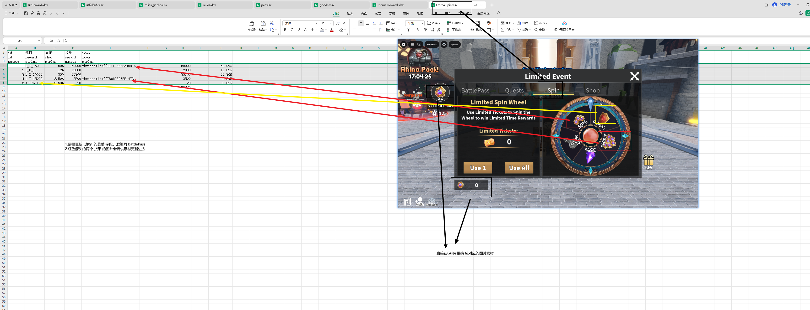

字段说明：

| 字段 | 说明 |
| --- | --- |
| `id` | 转盘格子 id，按原表顺序维护 |
| `奖励` / `reward` | 转盘实际发放奖励，格式同 `BPReward.xlsx` |
| `显示` / `show` | UI 上展示的概率文案，例如 `50%`、`12%`、`0.5%` |
| `权重` / `weight` | 实际抽取权重 |
| `icon` | 转盘格子上显示的图片素材 id |

操作步骤：

1. 打开 `EternalSpin.xlsx`。
2. 更新 `奖励` 字段，写入本期转盘要发的资源、遗物、宠物或宝箱。
3. 检查 `显示` 和 `权重` 是否匹配当前策划概率。
4. 如果格子需要显示独立图标，把美术提供的图片上传后，填入 `icon` 字段。
5. 截图里红色箭头标出的两个货币图片，需要换成当前赛季的新素材。
6. 表格右侧如有辅助计算区域，只用于核对总权重和概率，不要误删。

检查点：

- `reward` 中引用的 id 必须已经存在于对应配置表。
- `show` 是给玩家看的显示概率，`weight` 是实际抽取逻辑，二者不要混淆。
- 转盘内图标、左下角持有数量图标、入口处活动币图标要保持同一套素材。

## 4. 更新活动蛋

右侧活动 Shop 顶部有一个 `Limit Egg` 区域，涉及 `gacha.xlsx` 和 Studio 中的 `ReplicatedStorage/Resource/Egg`。

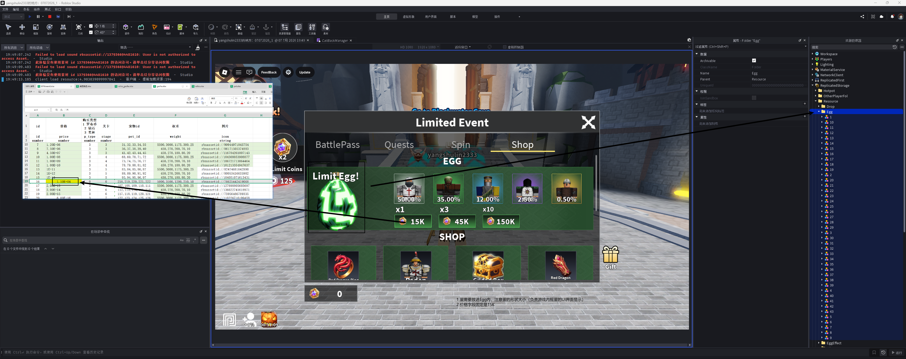

操作步骤：

1. 在 Studio 中打开 `ReplicatedStorage/Resource/Egg`。
2. 导入或复制本期活动蛋模型。
3. 调整蛋模型的形状、大小和朝向，保证它在右侧活动 Shop UI 中显示正常。
4. 蛋模型名称需要与 `gacha.xlsx` 中对应的蛋 id 保持一致。
5. 回到 `gacha.xlsx`，更新当前活动蛋对应行。
6. `price` 价格按当前规则固定为 `15K` 的基础价格，UI 上 `x3`、`x10` 会对应显示 `45K`、`150K`。
7. `pet_id` 填本期活动蛋可抽出的宠物 id。
8. `weight` 填宠物权重，格式参考旧活动蛋。
9. `icon` 填本期蛋图标素材 id。

风险点：

- Studio 里 `Resource/Egg` 的模型名和 `gacha.xlsx.id` 不一致，会导致 UI 或抽奖显示异常。
- 蛋模型太大、太小或朝向不对，会在 Shop UI 里显示不专业。
- `price` 目前按截图规则固定为 `15K`，除非策划明确改价，不要自行改成其他值。

## 5. 更新 `EternalShop.xlsx`

`EternalShop.xlsx` 控制右侧活动 `Shop` 页下面的商品列表。

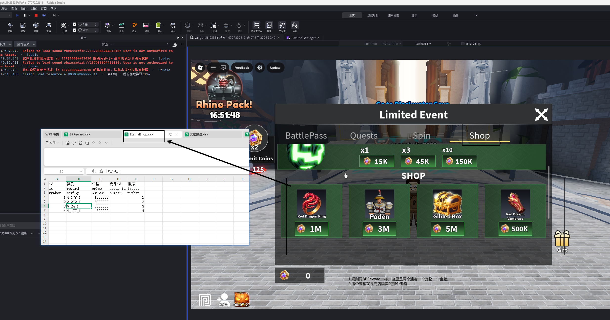

当前规则：

- 奖励格式同 `BPReward.xlsx`。
- 本期 Shop 示例结构是：两个遗物、一个宠物、一个宝箱。
- 这里的宝箱就是 Shop 页面里售卖的那个宝箱，通常引用 `relics_gacha.xlsx`。

字段说明：

| 字段 | 说明 |
| --- | --- |
| `id` | Shop 商品配置 id，按顺序维护 |
| `奖励` / `reward` | 售卖内容，使用 `a_b_c` 格式 |
| `价格` / `price` | 使用活动币购买时的价格 |
| `商品id` / `goods_id` | 如果该商品走 Roblox 付费商品，再填对应商品 id；普通活动币购买可为空 |
| `排序` / `layout` | Shop UI 展示顺序 |

操作步骤：

1. 打开 `EternalShop.xlsx`。
2. 按本期 Shop 规划更新每一行 `reward`。
3. 遗物写 `4_遗物id_数量`。
4. 宠物写 `2_宠物id_数量`。
5. 宝箱写 `6_宝箱id_数量`。
6. 按策划要求调整 `price`。
7. `layout` 控制显示顺序，一般按从左到右递增。

检查点：

- `reward` 里的 id 必须在 `relics.xlsx`、`pet.xlsx` 或 `relics_gacha.xlsx` 中存在。
- 如果 Shop 奖励是遗物，先确认 `relics.xlsx.模型` 与 `relics.xlsx.类型` 已按 `Resource/Relics` 规则配置正确。
- Shop 中显示的图标来自奖励配置本身，发现图标不对时优先回到对应表检查 `icon`。
- 价格显示使用活动币图标，所以活动币图标也要同步更新。

## 6. 更新 `EternalReward.xlsx`

`EternalReward.xlsx` 控制右侧活动 BattlePass 页的等级奖励，逻辑与 `BPReward.xlsx` 一致。

字段说明：

| 字段 | 说明 |
| --- | --- |
| `id` | 通行证等级 |
| `免费奖励` / `reward1` | 免费档奖励 |
| `付费奖励` / `reward2` | 付费档奖励 |
| `经验值` / `exp` | 升到该等级需要的经验 |

操作步骤：

1. 打开 `EternalReward.xlsx`。
2. 按右侧通行证奖励描述表逐级填写。
3. `id` 对应游戏内通行证等级，不是普通自增配置 id。
4. 免费奖励填 `reward1`。
5. 付费奖励填 `reward2`。
6. 奖励格式使用 `a_b_c`，多个奖励用英文 `#` 连接。
7. `exp` 根据本期通行证等级节奏填写。

示例：

| 奖励 | 写法 |
| --- | --- |
| 活动券 20 个 | `1_6_20` |
| 活动币 200 个 | `1_7_200` |
| 宠物 1 个 | `2_宠物id_1` |
| 遗物 1 个 | `4_遗物id_1` |
| 宝箱 3 个 | `6_宝箱id_3` |

检查点：

- 免费档和付费档不要填反。
- 右侧通行证 UI 中等级显示必须与 `EternalReward.xlsx.id` 对应。
- 如果某一级没有奖励，按旧表规则处理，不要随意写空字符串。

## 7. 更新 `goods.xlsx`

右侧活动需要在 `goods.xlsx` 新增两行数据。

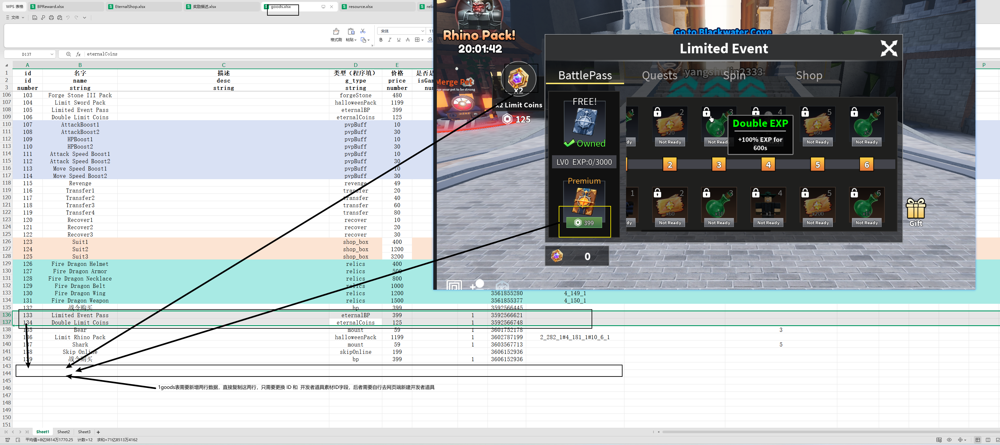

用途通常是：

| 商品 | 参考 `g_type` | 说明 |
| --- | --- | --- |
| 右侧活动高级通行证 | `eternalBP` | 购买后解锁右侧活动付费档奖励 |
| 双倍活动币 | `eternalCoins` | 购买后活动币收益或显示按当前逻辑翻倍 |

操作步骤：

1. 打开 `goods.xlsx`。
2. 找到上一期右侧活动的两行，例如 `Limited Event Pass`、`Double Limit Coins`。
3. 复制这两行到表尾。
4. 新行 `id` 按表尾继续递增，不能重复。
5. `name` 可沿用旧名称，也可按本期活动命名。
6. `g_type` 直接复制旧行，分别保持 `eternalBP` 和 `eternalCoins`。
7. `price`、`limit` 等字段按旧行复制，除非策划明确改价。
8. `商品id` / `goods_id` 需要去 Roblox 网页端创建新的开发者商品，再把新商品 id 粘贴到这里。
9. 其他字段按旧行复制即可。
10. 记录这两行的 Excel 内部 `id`，后面 `Server_EternalComponent.lua` / `Client_EternalComponent.lua` 里替换的是这个内部 `id`。

注意：

- `goods_id` 不是 Excel 自增 id，而是 Roblox 网页端创建出来的开发者商品 id。
- 代码里 `buy_goods(...)` 和 `pay_list[...]` 使用的是 `goods.xlsx.id`，不要误填成网页端 `goods_id`。
- 每次新活动建议创建新的开发者商品，不要直接复用旧活动商品 id，除非同事确认可以复用。
- 新增两行后，需要在游戏内购买流程测试能否拉起正确商品。

本期截图示例：

| 商品 | 旧 id 示例 | 新 id 示例 | 用途 |
| --- | ---: | ---: | --- |
| 右侧活动高级通行证 | `133` | `141` | `eternalBP` |
| 双倍活动币 | `134` | `142` | `eternalCoins` |

正式更新时，以当前 `goods.xlsx` 表尾最新两行 id 为准。

## 8. 更新 `resource.xlsx` 的两个货币图标

右侧活动有两个核心资源：

| resource id | 名称 | 用途 |
| --- | --- | --- |
| `6` | `Ticket` / 活动转盘券 | 用于 Spin 抽奖 |
| `7` | `Limit Coins` / 活动币 | 用于 Shop 购买、通行证显示 |

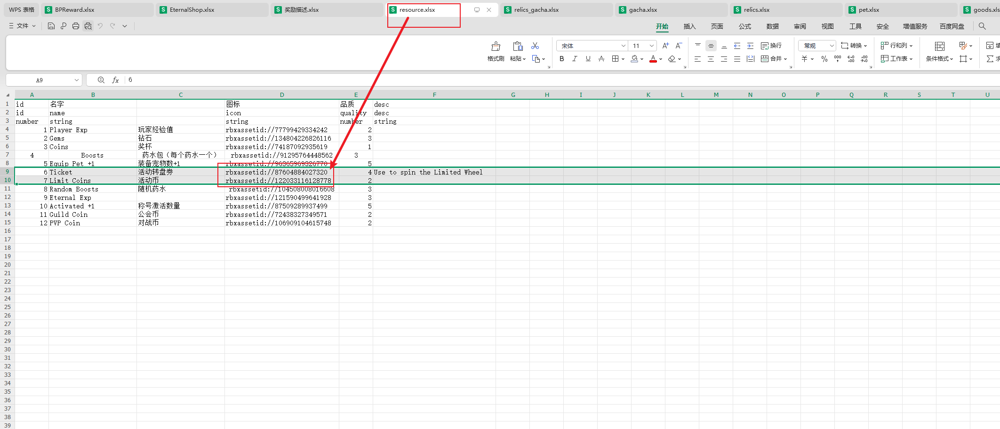

操作步骤：

1. 打开 `resource.xlsx`。
2. 找到 `id=6` 的 `Ticket`。
3. 将 `icon` 更新为本期活动券素材 id。
4. 找到 `id=7` 的 `Limit Coins`。
5. 将 `icon` 更新为本期活动币素材 id。
6. 其他字段无需更改。

检查点：

- `resource.xlsx` 只改两个 `icon` 字段。
- 不要改 `id`，否则所有奖励格式里的 `1_6_x`、`1_7_x` 都会失效。
- UI 里手动替换的图片要与 `resource.xlsx` 中配置的素材保持一致。

## 9. Studio 中更新 `HudGui` 图标

右侧活动入口在 HUD 上有活动图标、活动币数量等显示，需要手动替换图片。

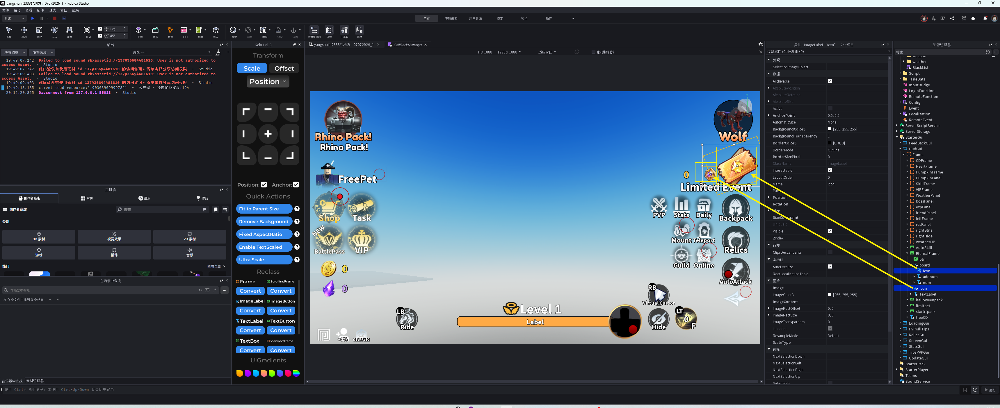

操作步骤：

1. 打开 Roblox Studio。
2. 进入 `StarterGui/HudGui`。
3. 找到右侧活动入口相关节点。
4. 替换截图中标出的活动图标和货币图标。
5. 确认图片尺寸、位置、透明度正常。
6. 运行游戏，确认 HUD 上显示的是新素材。

检查点：

- HUD 入口图标不要只改一处，进入活动面板后的同类图标也要同步。
- 如果 UI 显示旧图，先确认 Studio 手动图标，再确认 `resource.xlsx` 是否已导出。

## 10. Studio 中更新 `EternalGui` 图标

`EternalGui` 里也有活动券、活动币和入口图标，需要同步替换。

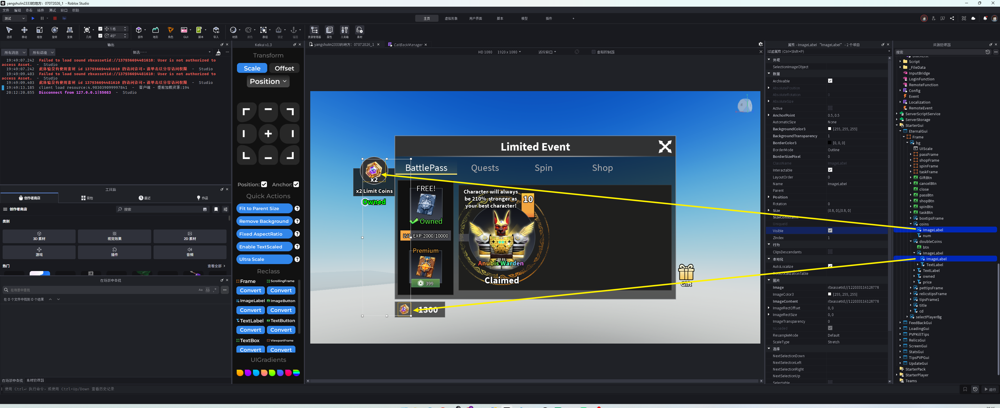

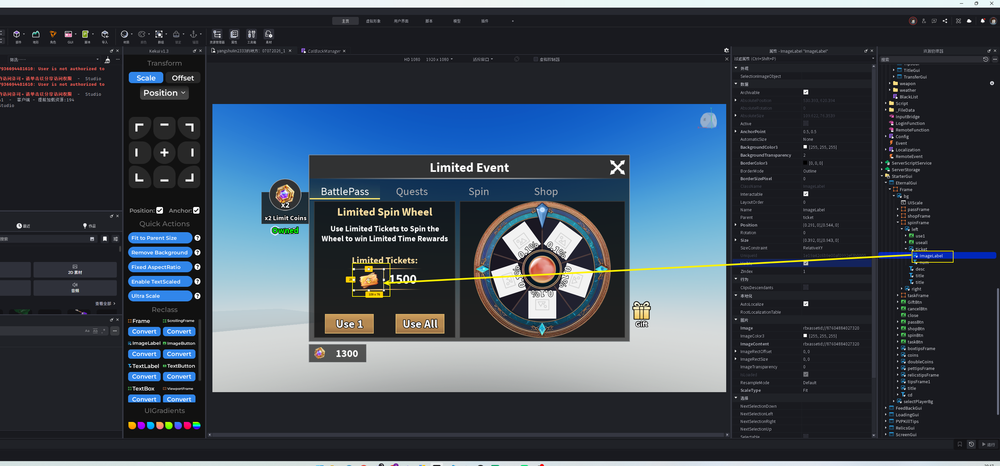

操作步骤：

1. 在 Studio 中进入 `StarterGui/EternalGui`。
2. 检查 `BattlePass` 页左侧奖励展示、付费档购买按钮、活动币显示。
3. 检查 `Spin` 页活动券图标和持有数量图标。
4. 将所有旧活动素材替换为本期活动素材。
5. 保持图片大小、锚点、层级和位置不乱。
6. 运行游戏，切换 `BattlePass`、`Spin`、`Shop` 三个页签确认显示正常。

检查点：

- `HudGui` 和 `EternalGui` 都要改，不要只改其中一个。
- `Spin` 页的转盘格子图标来自 `EternalSpin.xlsx.icon` 或奖励默认图标，和 GUI 固定图标不是同一类配置。
- 手动 UI 图标改完后，仍要执行配置导出，否则配置表图标不会同步到游戏逻辑。

## 11. 修改代码赛季号和 goodsID

右侧活动赛季号和商品 id 都有代码引用。这里不能只改 `SEASON`，还要把上一期右侧通行证商品 id 替换成本期 `goods.xlsx.id`。

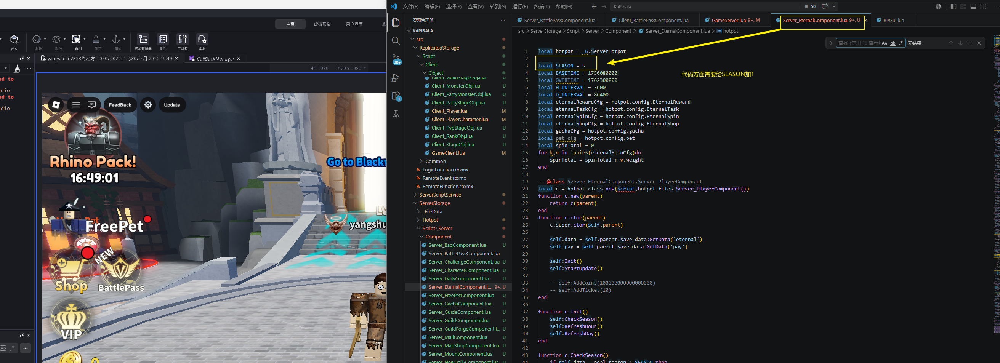

### 11.1 修改 `Server_EternalComponent.lua`

文件：

```text
D:\AI\Codex\Codex_Obsidian\10_Projects 项目\Roblox\1巅峰进化项目交接\KaPibala\src\ServerStorage\Script\Server\Component\Server_EternalComponent.lua
```

参考图：

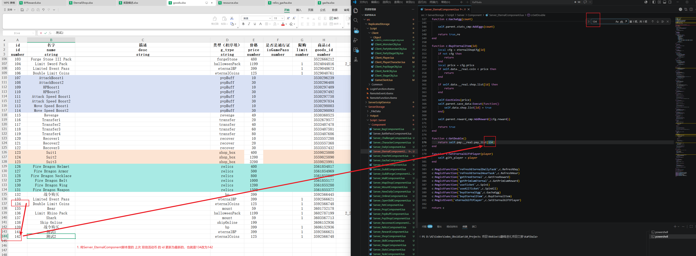

操作步骤：

1. 打开 `Server_EternalComponent.lua`。
2. 找到：

```lua
local SEASON = 5
```

3. 将数字加 `1`，例如本次从 `5` 改成 `6`。
4. 全局搜索上一期双倍活动币商品 id，例如截图中的 `134`。
5. 将该值替换成本期 `goods.xlsx` 中双倍活动币那一行的内部 `id`，例如截图中的 `142`。
6. 保存文件。
7. Rojo 同步后进入游戏测试右侧活动数据是否进入新赛季状态。

检查点：

| 检查项 | 通过标准 |
| --- | --- |
| `SEASON` | 已从上一期赛季号加 1 |
| goodsID / 双倍活动币 id | 已从上一期 id 替换成本期 `goods.xlsx.id` |
| 旧 id 搜索 | 旧双倍活动币 id 不再残留在 `Server_EternalComponent.lua` 的右侧活动逻辑中 |

### 11.2 修改 `Client_EternalComponent.lua`

文件：

```text
D:\AI\Codex\Codex_Obsidian\10_Projects 项目\Roblox\1巅峰进化项目交接\KaPibala\src\ReplicatedStorage\Script\Client\Component\Client_EternalComponent.lua
```

参考图：

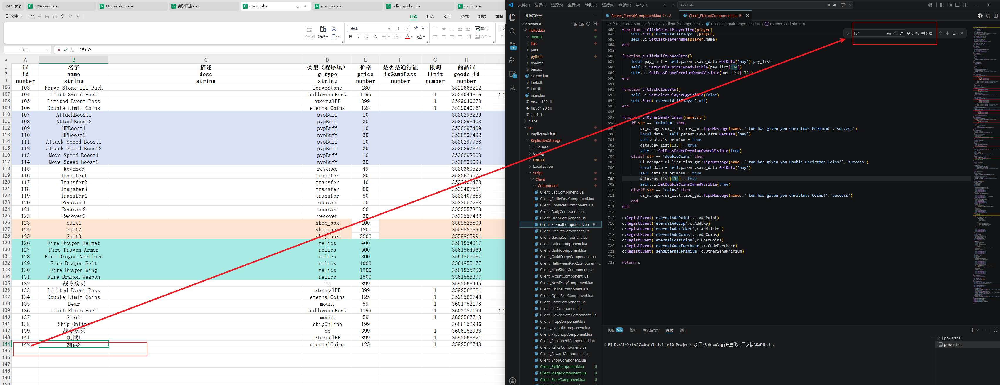

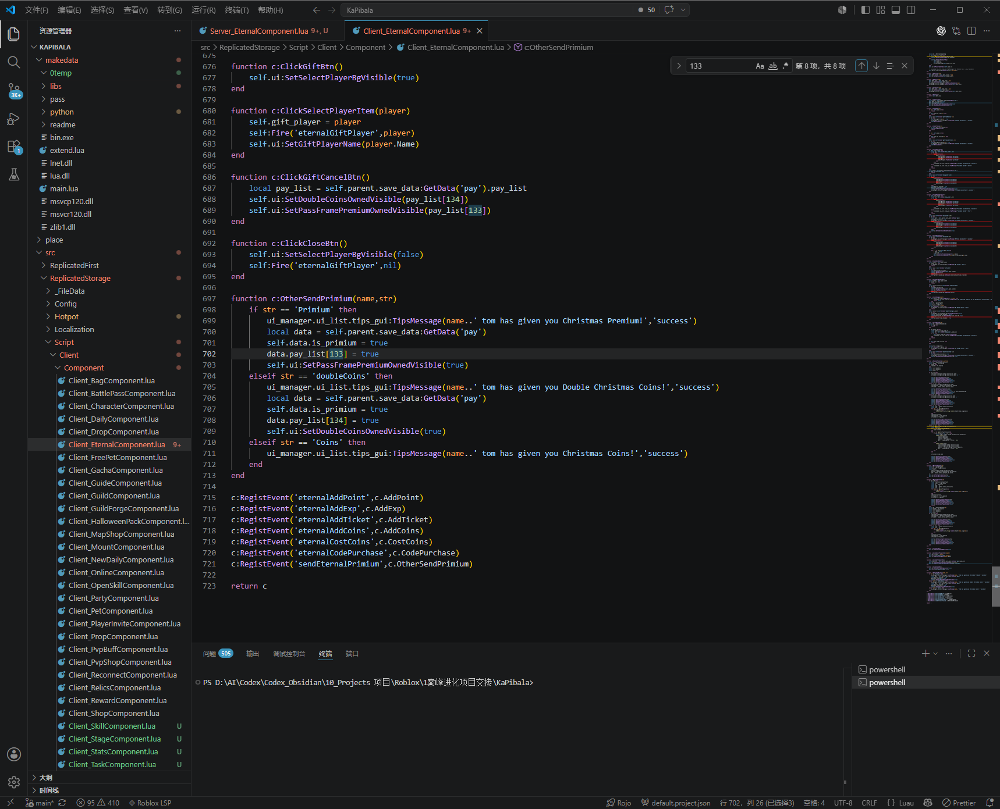

操作步骤：

1. 打开 `Client_EternalComponent.lua`。
2. 全局搜索上一期双倍活动币 id，例如截图中的 `134`。
3. 按截图口径，双倍活动币相关位置共有 `6` 处，需要全部替换成本期双倍活动币 `goods.xlsx.id`，例如 `142`。
4. 全局搜索上一期右侧活动高级通行证 id，例如截图中的 `133`。
5. 按截图口径，高级通行证相关位置共有 `8` 处，需要全部替换成本期高级通行证 `goods.xlsx.id`，例如 `141`。
6. 两组加起来共 `12` 处需要更新。
7. 替换后再次搜索旧 id，确认旧值不再残留在右侧活动逻辑里。

常见位置：

| 旧 id 示例 | 新 id 示例 | 含义 | 常见代码形态 |
| ---: | ---: | --- | --- |
| `133` | `141` | 右侧活动高级通行证 | `pay_list[133]`、`buy_goods(133)`、赠送高级通行证逻辑 |
| `134` | `142` | 双倍活动币 | `pay_list[134]`、`buy_goods(134)`、赠送双倍活动币逻辑 |

检查点：

| 检查项 | 通过标准 |
| --- | --- |
| 双倍活动币 id | 旧 id 的 6 处已替换成本期 id |
| 高级通行证 id | 旧 id 的 8 处已替换成本期 id |
| 总替换数量 | 共 12 处，与截图口径一致 |
| 旧 id 搜索 | 旧 `133` / `134` 不再残留在右侧活动购买、拥有状态、赠送逻辑中 |

注意：

- 该值用于区分右侧活动赛季，忘记加 1 可能导致玩家沿用旧活动进度或领取状态。
- 本节里的 `141/142` 是截图示例，正式操作时以当前 `goods.xlsx` 表尾最新两行 id 为准。
- `goods.xlsx.id` 和 `goods.xlsx.goods_id` 不能混淆。这里代码替换的是 Excel 内部 `id`，不是网页端商品 id。
- 当前截图口径明确需要改 `Server_EternalComponent.lua` 和 `Client_EternalComponent.lua`。不要只改服务端 `SEASON`。
- 我在代码里也看到 `Client_EternalComponent.lua` 存在 `SEASON` 字段；如果测试发现客户端 UI 状态没有刷新，再找同事确认客户端 `SEASON` 是否也需要同步。

## 12. 保存并导出配置

所有 Excel 保存后，在项目目录执行：

```powershell
.\config_export.bat
```

执行位置：

```text
D:\AI\Codex\Codex_Obsidian\10_Projects 项目\Roblox\1巅峰进化项目交接\KaPibala
```

导出前检查：

| 检查项                  | 要求                                                              |
| -------------------- | --------------------------------------------------------------- |
| `EternalSpin.xlsx`   | 奖励、显示概率、权重、icon 已更新                                             |
| `EternalReward.xlsx` | 免费档、付费档、经验值已更新                                                  |
| `EternalShop.xlsx`   | Shop 商品奖励、价格、排序已更新                                              |
| `gacha.xlsx`         | 活动蛋价格、宠物池、权重、icon 已更新                                           |
| 遗物资源                 | 有模型的遗物，`模型` 来自 `Resource/Relics`，`类型` 与模型部位一致                   |
| `goods.xlsx`         | 新增 `eternalBP`、`eternalCoins` 两行，`goods_id` 已填新开发者商品 id         |
| `resource.xlsx`      | `id=6`、`id=7` 的 icon 已更新                                        |
| Studio UI            | `HudGui`、`EternalGui` 图标已替换                                     |
| 代码                   | `Server_EternalComponent.lua` 的 `SEASON` 已加 1                   |
| 代码 goodsID           | `Server_EternalComponent.lua` 的旧双倍活动币 id 已替换成本期 `goods.xlsx.id` |
| 客户端商品 id             | `Client_EternalComponent.lua` 中 6 处双倍活动币 id、8 处高级通行证 id 已替换     |

导出后如果 Studio 没同步，优先尝试：

1. Rojo 断开连接。
2. 重新连接。
3. 重新运行游戏。

## 13. 测试清单

### 13.1 BattlePass 页

- 右侧活动入口能打开。
- `BattlePass` 页等级奖励显示正确。
- 免费档奖励与 `EternalReward.xlsx.reward1` 对应。
- 付费档奖励与 `EternalReward.xlsx.reward2` 对应。
- 付费通行证按钮能拉起正确开发者商品。
- 付费通行证购买、拥有状态、赠送逻辑都使用本期高级通行证 id。
- 新赛季玩家领取状态不会沿用旧赛季。

### 13.2 Spin 页

- 转盘格子奖励显示正确。
- 转盘格子图标是新素材。
- 活动券图标是新素材。
- 活动券数量显示正常。
- `Use 1`、`Use All` 能正常消耗活动券。
- 抽奖结果符合 `EternalSpin.xlsx.reward`。

### 13.3 Shop 页

- 活动蛋显示正确。
- 蛋模型大小、朝向、图标正常。
- `x1`、`x3`、`x10` 价格显示为当前规则价格。
- 下方 Shop 商品显示正确。
- 遗物、宠物、宝箱奖励能正确购买和发放。
- 有模型的遗物能正确展示，且挂载/展示类型与 `relics.xlsx.类型` 一致。
- 活动币图标和数量显示正常。

### 13.4 付费商品

- `goods.xlsx` 新增两行 id 不重复。
- `goods_id` 是 Roblox 网页端新建的开发者商品 id。
- 右侧高级通行证购买成功后能解锁付费档。
- 双倍活动币购买成功后效果正确。
- 关闭赠送选择、他人赠送高级通行证、他人赠送双倍活动币后，UI 状态显示正确。

## 14. 高风险点

1. `EternalReward.xlsx.id` 是右侧通行证等级，不是普通配置自增 id。
2. `EternalSpin.xlsx.show` 是展示概率，`weight` 才是抽取权重。
3. `relics.xlsx.模型` 如果有值，必须来自 `ReplicatedStorage/Resource/Relics`，不能随便填显示名。
4. `relics.xlsx.类型` 必须和模型实际部位一致，否则可能导致挂载位置或展示逻辑错误。
5. `resource.xlsx.id=6` 和 `id=7` 只能改 `icon`，不要改 id。
6. `goods.xlsx.goods_id` 必须来自 Roblox 网页端新创建的开发者商品。
7. `EternalShop.xlsx.reward`、`EternalReward.xlsx.reward1/reward2`、`EternalSpin.xlsx.reward` 都用同一套 `a_b_c` 奖励格式。
8. `gacha.xlsx` 的活动蛋 id 要和 `ReplicatedStorage/Resource/Egg` 的模型名一致。
9. 只改 Excel 不执行 `config_export.bat`，游戏里可能还是旧配置。
10. 只改 `resource.xlsx` 不改 Studio GUI，固定 UI 上仍可能显示旧图。
11. 只改 `HudGui` 不改 `EternalGui`，进入活动面板后仍可能显示旧图。
12. 忘记修改 `Server_EternalComponent.lua` 的 `SEASON`，会导致新活动与旧活动进度混用。
13. 忘记修改 `Server_EternalComponent.lua` 的 goodsID / 双倍活动币 id，会导致双倍活动币效果仍读取旧商品状态。
14. 忘记修改 `Client_EternalComponent.lua` 中 6 处双倍活动币 id、8 处高级通行证 id，会导致购买、拥有状态或赠送逻辑仍指向旧活动商品。
15. 把网页端 `goods_id` 填进代码，而不是填 `goods.xlsx.id`，会导致 `buy_goods` 或 `pay_list` 判断失效。
