# 商店宝箱更新流程（协作整理版）

> 本文用于记录“商店宝箱”更新流程。  
> 之前的文档主要是“更新关卡地图 / 新关卡配置”，本文件单独记录商店宝箱，避免后续交接时把两个流程混在一起。

## 0. 文档状态

| 项目 | 状态 |
|---|---|
| 文档用途 | 商店宝箱更新流程交接 |
| 当前状态 | 已记录：强力角色、遗物、遗物宝箱、商品参数绑定 |
| 关联项目 | `KaPibala` |
| 默认项目目录 | `D:\AI\Codex\Codex_Obsidian\10_Projects 项目\Roblox\1巅峰进化项目交接\KaPibala` |
| 默认配置目录 | `D:\AI\Codex\Codex_Obsidian\10_Projects 项目\Roblox\1巅峰进化项目交接\KaPibala\config` |
| 不混入内容 | 新关卡地图、怪物、宠物、扭蛋、传送门等关卡更新流程 |
| 相关参考 | [[新关卡更新流程_协作整理版]]、[[新关卡更新操作手册_执行版]] |

## 1. 记录原则

1. 只记录商店宝箱相关流程，不把关卡地图更新步骤混进来。
2. 先按实际操作记录，再整理成可执行手册。
3. 表格字段、Studio 对象名、资源路径必须能互相对应。
4. 示例值和正式规则要分开写，不能把测试数据当上线规则。
5. 不确定内容先标记“待确认”，不要写成确定结论。

## 2. 本流程需要确认的信息

后续操作时，优先把下面这些信息补齐。

| 类型 | 需要确认 |
|---|---|
| 配置表 | 商店宝箱涉及哪些 Excel 表 |
| Studio 资源路径 | 宝箱模型、展示位置、触发块、UI 资源分别在哪里 |
| 资源来源 | 美术会提供哪些模型、图片、icon、特效 |
| 命名规则 | 宝箱模型、配置 id、触发块名字是否需要一一对应 |
| 奖励规则 | 宝箱奖励内容、概率、价格、购买条件怎么配置 |
| 测试方式 | 如何在 Studio / 游戏内快速验证宝箱 |
| 发布风险 | 哪些配置改错会影响线上购买、奖励、显示或数据 |

## 3. 当前已知奖励构成

商店宝箱奖励当前已知包含：

1. 一个强力角色。
2. 四个“遗物”素材。

本流程先按“1 个强力角色 + 4 个遗物”的宝箱结构记录。当前所有具体 id、名字和数值都属于模拟走流程用的示例，正式上线时必须按实际素材、最新表格和同事确认规则重新填写。

## 4. 强力角色资源添加

### 4.1 Studio 资源路径

强力角色模型放到：

`ReplicatedStorage/Resource/character`

当前模拟用的模型变量名：

`strong001`

正式更新时：

1. 美术或外包提供强力角色模型。
2. 将角色模型添加到 `ReplicatedStorage/Resource/character`。
3. 模型变量名只要不重复即可。
4. 角色显示名后续根据素材风格让 AI 生成。
5. `character.xlsx.模型` 必须填写 Studio 中实际的模型变量名。

参考图：

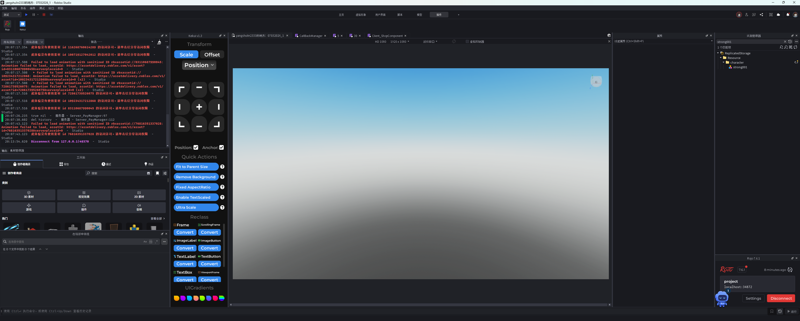

### 4.2 命名检查

| 检查项 | 通过标准 |
|---|---|
| 模型路径 | `ReplicatedStorage/Resource/character` 下存在强力角色模型 |
| 模型变量名 | 不与已有角色模型重名 |
| Excel 对应 | `character.xlsx.模型` 与 Studio 模型变量名完全一致 |
| 当前模拟名 | `strong001` |

## 5. `character.xlsx` 强力角色配置

### 5.1 文件位置

`config/character.xlsx`

完整路径：

`D:\AI\Codex\Codex_Obsidian\10_Projects 项目\Roblox\1巅峰进化项目交接\KaPibala\config\character.xlsx`

### 5.2 新增强力角色行

在 `character.xlsx` 中新增一行强力角色数据。

当前模拟数据：

| 项目 | 模拟值 |
|---|---|
| 角色 id | `121` |
| 模型变量名 | `strong001` |
| 百分比 | `2.2` |

注意：以上是模拟值。正式更新时，id、模型名、百分比都要按实际资源和配置规则确认。

参考图：

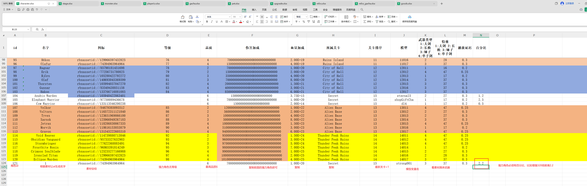

### 5.3 字段填写规则

| 字段 | 操作规则 | 当前备注 |
|---|---|---|
| `id` | 接 `character.xlsx` 当前最大 id 继续递增 | 当前模拟为 `121` |
| `名字` | 根据角色素材风格让 AI 生成 | 不使用模型变量名当正式显示名，除非项目要求 |
| `图标` | 美术素材提供，上传后填 `rbxassetid://...` | 当前模拟可临时沿用旧图 |
| `等级` | 强力角色无等级 | 留空 |
| `品质` | 强力角色用最高品质 | 当前截图为 `6` |
| `伤害加成` | 复制或参考前面的强力角色配置 | 不按普通关卡角色曲线处理 |
| `血量加成` | 复制或参考前面的强力角色配置 | 当前理解是复制强力角色旧规则 |
| `所属关卡` | 复制前面强力角色的归属写法 | 当前截图为 `Secret` |
| `关卡排序` | 最新关卡编号 +1 | 例如当前最新普通关卡为 14，则填 `15` |
| `模型` | 填 Studio 中模型变量名 | 当前模拟为 `strong001` |
| `武器类型` | 根据角色素材实际武器填写 | 1 大剑，2 长枪，3 锤子，4 单手剑 |
| `特效` | 根据武器类型填写 | 规则沿用角色表：十位对应武器类型，个位通常按项目规则 |
| `播放延迟` | 根据武器类型填写 | 例如武器类型 3 对应 `0.3` |
| `百分比` | 强力角色必须有值 | 当前模拟为 `2.2` |

### 5.4 当前注意点

1. 强力角色必须有 `百分比`，否则可能不会按强力角色逻辑生效。
2. `等级` 不填，和普通关卡 7 个角色不同。
3. `品质` 当前按最高品质 `6` 处理。
4. `关卡排序` 不是当前关卡编号，而是“最新关卡 +1”。
5. `模型` 字段必须和 `ReplicatedStorage/Resource/character` 下的对象名一致。
6. 当前 `百分比=2.2` 的具体数值含义还需要后续和同事确认，文档先记录为模拟值。

### 5.5 检查清单

| 检查项 | 通过标准 |
|---|---|
| id | 不重复，接当前最大 id 递增 |
| 模型 | `character.xlsx.模型` 与 Studio 对象名一致 |
| 百分比 | 已填写 |
| 等级 | 强力角色不填等级 |
| 品质 | 填最高品质 |
| 关卡排序 | 最新关卡 +1 |
| 武器类型 / 特效 / 播放延迟 | 三者按角色武器一致配置 |

## 6. `relics.xlsx` 遗物素材配置

### 6.1 文件位置

`config/relics.xlsx`

完整路径：

`D:\AI\Codex\Codex_Obsidian\10_Projects 项目\Roblox\1巅峰进化项目交接\KaPibala\config\relics.xlsx`

当前假设商店宝箱奖励是“4 个遗物 + 1 个强力角色”，所以在 `relics.xlsx` 中新增 4 行遗物数据。

参考图：

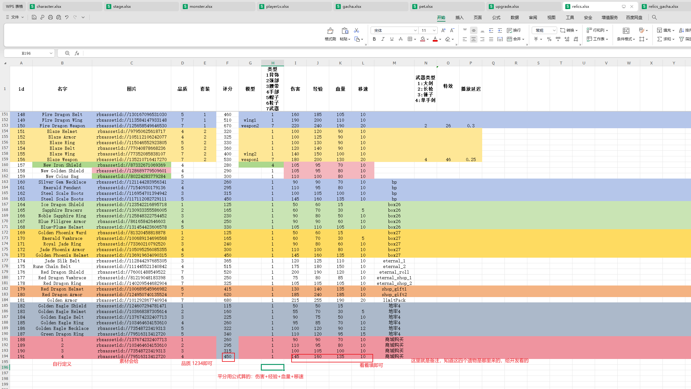

补充参考图：

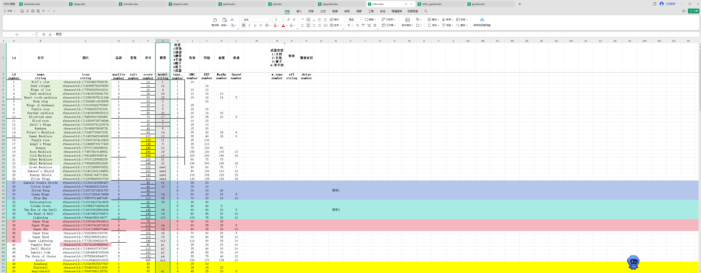

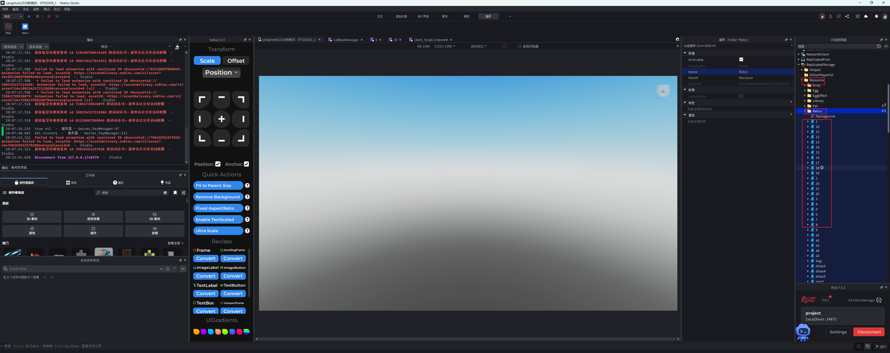

### 6.2 字段填写规则

| 字段 | 操作规则 | 当前备注 |
|---|---|---|
| `id` | 接 `relics.xlsx` 当前最大 id 递增 | 当前模拟为 `188`、`189`、`190`、`191` |
| `名字` | 自行定义，或根据遗物素材让 AI 生成 | 正式名不要直接写 `1`、`2`、`3`、`4` |
| `图片` | 美术素材提供，上传后填 `rbxassetid://...` | 如果美术只给图片，这里必须填 |
| `品质` | 当前四个遗物按 `1`、`2`、`3`、`4` 填即可 | 后续若运营有品质要求，以正式需求为准 |
| `套装` | 没有套装时可留空 | 如果宝箱遗物属于套装，需要和同事确认套装 id |
| `评分` | 看着填写，保证和品质、属性强度大致匹配 | 当前没有明确公式 |
| `模型` | 只有图片时不填；有具体模型时填 `Resource/Relics` 下的模型变量名 | 必须和 Studio 里的对象名完全一致 |
| `类型` | 按遗物实际模型部位填写 | 必须和 `模型` 对应，不能随便填默认值 |
| `伤害` | 看着填即可 | 可结合平均公式和同档遗物参考 |
| `经验` | 看着填即可 | 可结合平均公式和同档遗物参考 |
| `血量` | 看着填即可 | 可结合平均公式和同档遗物参考 |
| `移速` | 看着填即可 | 可结合平均公式和同档遗物参考 |
| 备注列 | 写清楚遗物来源 | 当前截图备注为 `商城购买`，方便开发知道这批遗物来自商店宝箱 |

### 6.3 图片遗物和模型遗物的区别

这里是容易混淆的点，必须分开处理：

| 素材情况 | `模型` 字段 | `类型` 字段 | 后续动作 |
|---|---|---|---|
| 只给图片，没有 3D 模型 | 不填 | 当前按 `1` 填 | 主要靠 `图片` 显示 |
| 给了具体 3D 模型 | 填 `Resource/Relics` 下的模型变量名 | 按模型实际部位填写 | 还需要做模型绑定，流程后续补充 |
| 给的是翅膀模型 | 填 `Resource/Relics` 下对应翅膀对象名 | 填 `1`，即背饰 | 需要确认绑定到角色背部的方式 |
| 给的是武器模型 | 填 `Resource/Relics` 下对应武器对象名 | 填 `7`，即武器 | 还要检查武器类型、特效、播放延迟等字段是否需要同步 |

当前用户补充的规则是：如果美术只给图片，`模型` 不填，`类型` 填 `1`。如果给的是具体模型，则根据模型属于哪个部位填写对应类型。

### 6.4 `模型` 字段和 `类型` 字段的对应规则

如果 `relics.xlsx.模型` 有值，这个值不是随便自定义的名字，而是来自 Studio：

`ReplicatedStorage/Resource/Relics`

操作规则：

1. 先在 Studio 的 `ReplicatedStorage/Resource/Relics` 下找到遗物模型。
2. 复制该模型的对象名，填到 `relics.xlsx.模型`。
3. 再根据这个模型的实际部位填写 `类型`。
4. `模型` 和 `类型` 必须互相对应，例如翅膀模型就不能填成项链类型。

类型对照：

| 类型值 | 含义 | 填写依据 |
|---|---|---|
| `1` | 背饰 | 翅膀、背部装饰等 |
| `2` | 颈部 | 项链、挂饰等 |
| `3` | 腰带 | 腰带类模型 |
| `4` | 手部 | 手部装备、手套等 |
| `5` | 帽子 | 头部帽子类模型 |
| `6` | 鞋子 | 鞋子、脚部装备 |
| `7` | 武器 | 武器模型 |

这一段是上线前必须检查的点。`模型` 填错会导致资源找不到；`类型` 填错会导致模型挂载位置或展示逻辑不对。

### 6.5 检查清单

| 检查项 | 通过标准 |
|---|---|
| 新增行数量 | 本次宝箱 4 个遗物，对应新增 4 行 |
| id | 不重复，接当前最大 id 递增 |
| 图片 | 有 `rbxassetid://...` |
| 模型 | 只给图片时留空；给模型时填 `Resource/Relics` 下实际模型变量名 |
| 类型 | 与 `模型` 对应的实际部位一致 |
| 属性 | `伤害`、`经验`、`血量`、`移速` 看着填，但不能明显低于或高于同档异常值 |
| 备注 | 能看出这批遗物来自商店购买或商店宝箱 |

## 7. `relics_gacha.xlsx` 遗物宝箱配置

### 7.1 文件位置

`config/relics_gacha.xlsx`

完整路径：

`D:\AI\Codex\Codex_Obsidian\10_Projects 项目\Roblox\1巅峰进化项目交接\KaPibala\config\relics_gacha.xlsx`

新增遗物后，需要在 `relics_gacha.xlsx` 中新增或更新一个宝箱配置。这个表用于把“宝箱”和“遗物/强力角色奖励”绑定起来。

参考图：

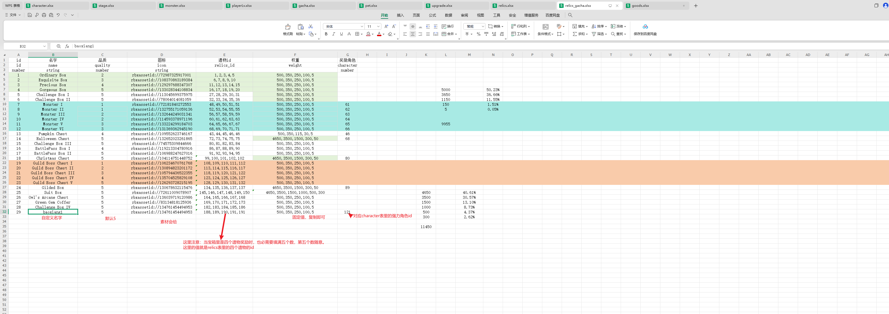

### 7.2 字段填写规则

| 字段 | 操作规则 | 当前备注 |
|---|---|---|
| `id` | 接当前最大 id 递增 | 当前模拟为 `29` |
| `名字` | 自定义宝箱配置名 | 当前模拟为 `baoxiang1` |
| `品质` | 默认填 `5` | 当前截图备注为默认 5 |
| `图标` | 美术素材提供，上传后填 `rbxassetid://...` | 宝箱展示 icon |
| `遗物id` / `relics_id` | 填 `relics.xlsx` 新增的 4 个遗物 id | 用英文逗号分隔，例如 `188,189,190,191` |
| `权重` / `weight` | 固定值，复制即可 | 当前先沿用旧配置，不自行发明 |
| `奖励角色` / `character` | 填 `character.xlsx` 中强力角色 id | 当前模拟为 `121` |

### 7.3 关键理解

本次宝箱总奖励结构是 5 个奖励位：4 个遗物 + 1 个强力角色。

1. `relics_id` 只填 4 个遗物 id，例如 `188,189,190,191`。
2. 第 5 个奖励位是强力角色，不写进 `relics_id`，而是写在 `character` 字段。
3. `character` 必须对应 `character.xlsx.id`，不能填模型名。
4. `relics_id` 使用英文逗号 `,`，不要使用中文逗号 `，`。

### 7.4 检查清单

| 检查项 | 通过标准 |
|---|---|
| 宝箱 id | 不重复，接当前最大 id 递增 |
| 遗物 id | 全部来自 `relics.xlsx` 新增的 4 行 |
| 强力角色 id | 来自 `character.xlsx` 新增强力角色行 |
| 权重 | 与上一组同类宝箱规则一致 |
| 分隔符 | `relics_id` 使用英文逗号 |

## 8. `goods.xlsx` 商品参数绑定

### 8.1 文件位置

`config/goods.xlsx`

完整路径：

`D:\AI\Codex\Codex_Obsidian\10_Projects 项目\Roblox\1巅峰进化项目交接\KaPibala\config\goods.xlsx`

`goods.xlsx` 本质上是 Roblox 开发者商品配置表。这里的 `商品id` 与 Roblox 后台开发者商品一一对应，是框架本身的购买入口配置。本次主要不是新增商品，而是修改已有商店宝箱商品的 `其他参数` 字段。

参考图：

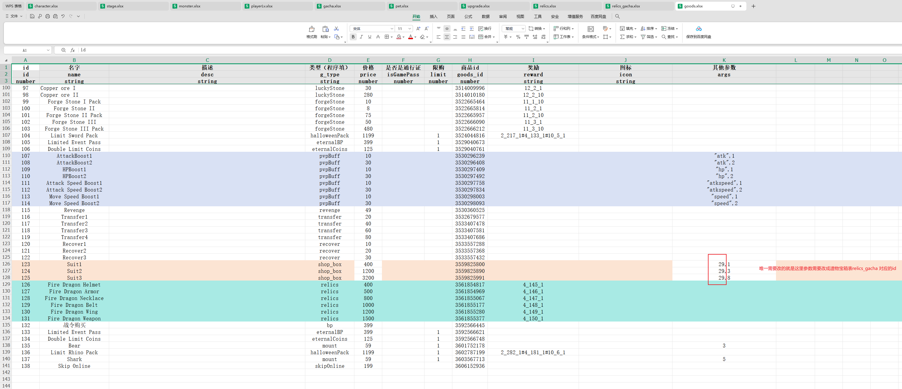

### 8.2 本次需要改的行

当前主要修改 `id=123`、`id=124`、`id=125` 这三行，对应 `Suit1`、`Suit2`、`Suit3`。

| `goods.xlsx.id` | 名字 | 需要修改字段 | 示例值 | 说明 |
|---|---|---|---|---|
| `123` | `Suit1` | `其他参数` / `args` | `29,1` | `29` 对应 `relics_gacha.id` |
| `124` | `Suit2` | `其他参数` / `args` | `29,3` | `29` 对应 `relics_gacha.id` |
| `125` | `Suit3` | `其他参数` / `args` | `29,8` | `29` 对应 `relics_gacha.id` |

### 8.3 字段理解

`其他参数` 当前按下面结构理解：

`遗物宝箱id,购买数量或档位数量`

例如：

| 示例 | 当前理解 |
|---|---|
| `29,1` | 购买 `relics_gacha.id=29` 的宝箱 1 次或 1 份 |
| `29,3` | 购买 `relics_gacha.id=29` 的宝箱 3 次或 3 份 |
| `29,8` | 购买 `relics_gacha.id=29` 的宝箱 8 次或 8 份 |

第二个数字的准确业务含义还需要同事确认，但执行时应沿用原有 `1`、`3`、`8` 档位，只替换前面的宝箱 id。

### 8.4 检查清单

| 检查项 | 通过标准 |
|---|---|
| 商品行 | 只改本次需要绑定的 `123`、`124`、`125` |
| `args` 第一位 | 等于本次 `relics_gacha.id` |
| `args` 第二位 | 沿用原商品档位，不随意改 |
| `商品id` | 不改 Roblox 开发者商品 id，除非运营或后台商品发生变化 |
| 价格 | 不随意改，除非确认商店价格需求 |

## 9. `Client_ShopComponent.lua` 代码同步修改

### 9.1 文件位置

`src/ReplicatedStorage/Script/Client/Component/Client_ShopComponent.lua`

完整路径：

`D:\AI\Codex\Codex_Obsidian\10_Projects 项目\Roblox\1巅峰进化项目交接\KaPibala\src\ReplicatedStorage\Script\Client\Component\Client_ShopComponent.lua`

这一步的作用是让商店 UI、购买按钮、奖励预览都指向本次新的商店宝箱配置。

### 9.2 需要准备的 id

修改代码前，先从配置表确认下面几个值。

| 名称 | 来源 | 当前模拟值 | 用途 |
|---|---|---|---|
| 宝箱 id | `relics_gacha.xlsx.id` | `29` | 奖励预览、鼠标悬停提示、宝箱 UI 数据来源 |
| 1 档商品 id | `goods.xlsx.id` | `123` | 购买 1 次或 1 份 |
| 3 档商品 id | `goods.xlsx.id` | `124` | 购买 3 次或 3 份 |
| 8 档商品 id | `goods.xlsx.id` | `125` | 购买 8 次或 8 份 |
| 宝箱标题 | `relics_gacha.xlsx.名字` | `baoxiang1` 或正式名 | 商店界面 title |
| 宝箱图标 | `relics_gacha.xlsx.图标` | `rbxassetid://...` | 商店界面 icon |

注意：这里的 `123/124/125/29` 都是当前模拟值。正式更新时，以当次 `goods.xlsx` 和 `relics_gacha.xlsx` 的实际值为准。

### 9.3 修改点 1：`c:ClickShopBox(count)`

在 `c:ClickShopBox(count)` 函数中，根据购买数量选择对应的 `goods_id`。

需要把这里的 `goods_id` 更新为本次 `goods.xlsx` 中对应的商品 id。

当前模拟关系：

| `count` | `goods_id` |
|---|---|
| `1` | `123` |
| `3` | `124` |
| `10` | `125` |

参考图：

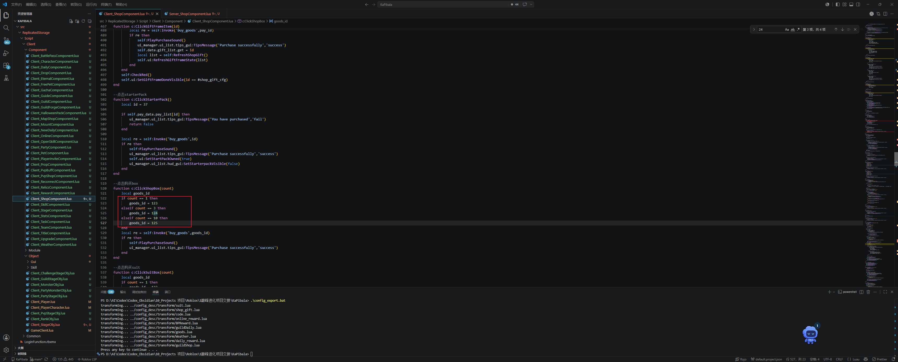

检查点：

1. `count == 1` 对应 `goods.xlsx` 的 1 档商品。
2. `count == 3` 对应 `goods.xlsx` 的 3 档商品。
3. `count == 10` 当前代码对应第三档商品，但 UI 上显示可能是 `x8`，这里需要以后和同事确认命名是否只是代码历史遗留。
4. 三个 `goods_id` 必须和 `goods.xlsx.id` 一致，不是 Roblox 后台的 `商品id` 字段。

### 9.4 修改点 2：`c:MouseEnterRelicsItem(idx,isSuit)`

在 `c:MouseEnterRelicsItem(idx,isSuit)` 函数中，当前写法类似：

```lua
local cfg = relice_gacha_cfg[29]
```

需要把 `29` 改为本次 `relics_gacha.xlsx.id`。

参考图：

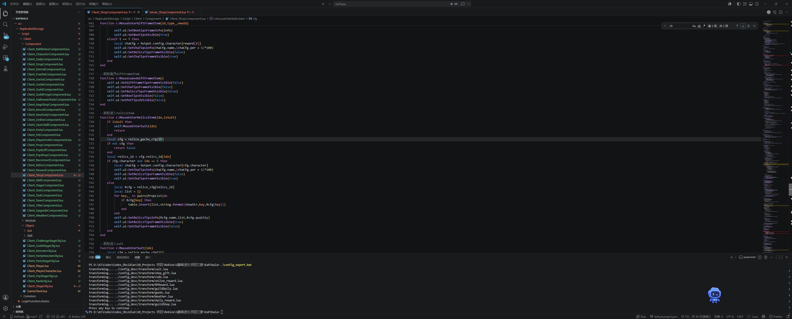

检查点：

1. 鼠标悬停宝箱奖励时，读取的是本次宝箱配置。
2. `relice_gacha_cfg[...]` 里的数字必须等于 `relics_gacha.xlsx.id`。
3. 如果这里没改，购买可能是新宝箱，但鼠标提示还显示旧宝箱奖励。

### 9.5 修改点 3：`c:LoadEgg()`

在 `c:LoadEgg()` 函数中，需要同步两个地方。

第一处是商品 id：

```lua
local id1,id3,id10 = 123,124,125
```

第二处是宝箱 id：

```lua
local gacha_id = 29
```

这两处分别对应：

| 代码字段 | 来源 | 当前模拟值 |
|---|---|---|
| `id1` | `goods.xlsx` 1 档商品 id | `123` |
| `id3` | `goods.xlsx` 3 档商品 id | `124` |
| `id10` | `goods.xlsx` 第三档商品 id | `125` |
| `gacha_id` | `relics_gacha.xlsx.id` | `29` |

参考图：

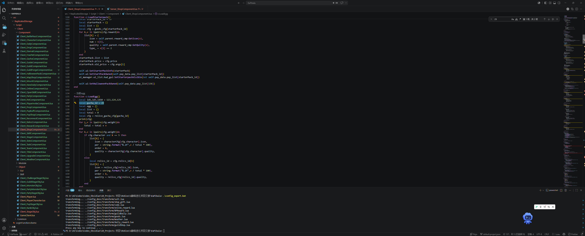

检查点：

1. `gacha_id` 与 `relics_gacha.xlsx.id` 一致。
2. `id1/id3/id10` 与 `goods.xlsx.id=123/124/125` 这类商品行一致。
3. 商品价格、按钮档位、奖励预览必须来自同一组宝箱配置，不能出现“按钮买新宝箱、预览显示旧宝箱”的情况。

### 9.6 修改点 4：商店宝箱 `title` 和 `icon`

商店界面中宝箱展示区域的 `title` 和 `icon` 也要同步更新。

对应关系：

| UI 对象 | 配置表来源 | 填写规则 |
|---|---|---|
| `title` | `relics_gacha.xlsx.名字` | 显示本次宝箱名称 |
| `icon` | `relics_gacha.xlsx.图标` | 显示本次宝箱图标 |

参考图：

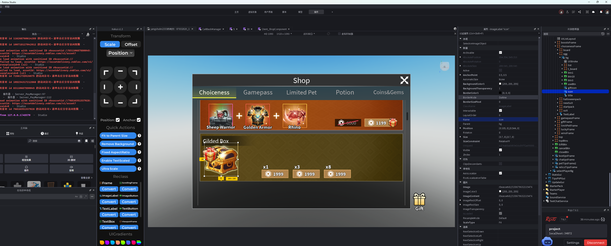

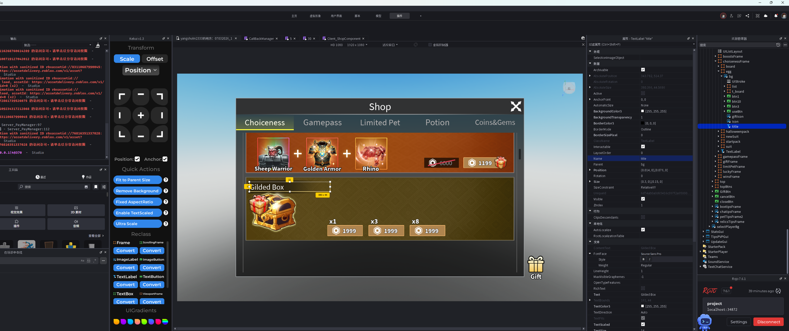

检查点：

1. `title.Text` 与 `relics_gacha.xlsx.名字` 一致。
2. `icon.Image` 与 `relics_gacha.xlsx.图标` 一致。
3. 如果只改了购买 id，没有改 title/icon，玩家看到的宝箱名称或图片可能仍是旧宝箱。

### 9.7 代码修改总检查清单

| 检查项 | 通过标准 |
|---|---|
| `ClickShopBox` | 三个购买档位使用本次 `goods.xlsx.id` |
| `MouseEnterRelicsItem` | `relice_gacha_cfg[...]` 使用本次 `relics_gacha.xlsx.id` |
| `LoadEgg.gacha_id` | 等于本次 `relics_gacha.xlsx.id` |
| `LoadEgg.id1/id3/id10` | 等于本次三档 `goods.xlsx.id` |
| `title` | 显示 `relics_gacha.xlsx.名字` |
| `icon` | 显示 `relics_gacha.xlsx.图标` |
| 预览/购买一致性 | 商店展示、鼠标提示、购买实际发奖都指向同一组宝箱 |

## 10. 商店宝箱配置表记录

| 表名 | 用途 | 当前状态 |
|---|---|---|
| `character.xlsx` | 配置宝箱奖励里的强力角色 | 已记录 |
| `relics.xlsx` | 配置宝箱奖励里的 4 个遗物 | 已记录 |
| `relics_gacha.xlsx` | 绑定遗物宝箱、遗物 id、强力角色 id、权重 | 已记录 |
| `goods.xlsx` | 绑定 Roblox 开发者商品与遗物宝箱 id | 已记录 |
| `Client_ShopComponent.lua` | 同步宝箱 id、商品 id、title、icon | 已记录 |

## 11. Studio 操作记录

本节用于记录 Roblox Studio 中需要操作的对象、路径和检查点。

| 操作对象 | Studio 路径 | 检查点 |
|---|---|---|
| 强力角色模型 | `ReplicatedStorage/Resource/character` | 模型变量名不重复，并与 `character.xlsx.模型` 一致 |
| 遗物图片 | Excel `relics.xlsx.图片` | 美术给图后上传，填 `rbxassetid://...` |
| 遗物模型 | `ReplicatedStorage/Resource/Relics` | 如果 `relics.xlsx.模型` 有值，必须和这里的模型变量名一致，并且 `relics.xlsx.类型` 与模型部位一致 |
| 商店宝箱入口 | `Client_ShopComponent.lua` 和商店 UI | 宝箱 id、商品 id、title、icon 都与配置表一致 |

## 12. 测试与验收记录

本节用于记录宝箱更新后的测试方式。

| 测试项 | 通过标准 | 当前状态 |
|---|---|---|
| 宝箱显示 | 商店里能看到对应宝箱、图标和价格 | 待测试 |
| 商品绑定 | `goods.xlsx.args` 指向本次 `relics_gacha.id` | 待测试 |
| UI title/icon | 商店显示名和宝箱图标与 `relics_gacha.xlsx` 一致 | 待测试 |
| 悬停提示 | 鼠标移入奖励项时，提示内容来自本次宝箱配置 | 待测试 |
| 宝箱购买 | 三个档位都能触发正确购买流程 | 待测试 |
| 奖励发放 | 能发出 4 个遗物和 1 个强力角色 | 待测试 |
| 遗物显示 | 图片遗物能正常显示；模型遗物后续按绑定规则验证 | 待测试 |
| 强力角色 | 奖励角色 id 与 `character.xlsx` 一致，模型能正常显示 | 待测试 |
| 概率/权重 | 权重使用旧规则复制，不出现明显异常 | 待测试 |
| 数据保存 | 购买后奖励写入玩家数据，重进仍存在 | 待测试 |

## 13. 待问同事的问题

| 优先级 | 问题 | 原因 |
|---|---|---|
| 高 | 商店宝箱奖励是否固定为 `4 个遗物 + 1 个强力角色`？ | 影响 `relics_id` 和 `character` 的填写方式 |
| 高 | `relics.xlsx` 只有图片时，`类型=1` 是否固定？ | 当前按用户记录执行，但上线前需要确认规则来源 |
| 高 | 如果遗物给的是 3D 模型，具体绑定流程是什么？ | 用户提到后续还要绑定，不能漏 |
| 高 | `relics_gacha.xlsx.weight` 固定值从哪里复制？ | 权重直接影响奖励概率 |
| 高 | `goods.xlsx.args` 第二位 `1/3/8` 的准确含义是什么？ | 关系到商品档位和购买数量 |
| 高 | `ClickShopBox` 里 `count == 10` 对应 UI 上 `x8` 是否是历史命名？ | 避免后续维护时把第三档商品改错 |
| 高 | `title/icon` 是手动改 UI 对象，还是后续应该改成代码自动读取 `relics_gacha`？ | 影响以后每次更新是否需要手动改界面 |
| 高 | `character.xlsx.百分比=2.2` 的准确含义是什么？ | 强力角色强度和宝箱价值相关，不能靠猜 |
| 高 | 强力角色 `所属关卡=Secret` 是否固定？ | 避免宝箱角色归属配置错误 |
| 中 | 遗物 `评分` 和 `伤害/经验/血量/移速` 是否有正式公式？ | 当前是“看着填”，上线前最好有依据 |
| 中 | 是否有固定测试账号或 GM 指令？ | 方便验证但不能污染线上数据 |
| 中 | 是否有上线前专门检查项？ | 宝箱通常关系到奖励和付费，风险高于纯展示资源 |
