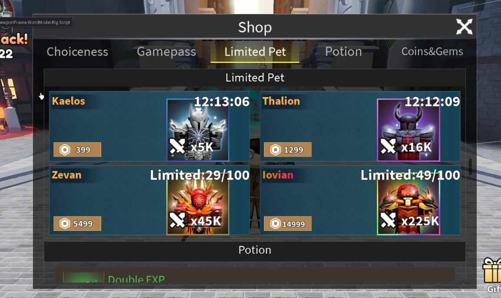

# 商店宠物更新

> 本文记录商店限时宠物更新流程。当前先整理 `pet.xlsx` 与 `goods.xlsx` 的配置关系，后续如果涉及 Studio 资源、商品创建后台或测试流程，再继续补充。

## 0. 资料与路径

配置表默认位于：

`D:\AI\Codex\Codex_Obsidian\10_Projects 项目\Roblox\1巅峰进化项目交接\KaPibala\config`

当前涉及表：

| 表 | 用途 |
|---|---|
| `pet.xlsx` | 新建或更新商店宠物本体数据 |
| `goods.xlsx` | 配置商店里展示、价格、商品 id、购买参数 |

参考截图：



## 1. 更新顺序

按下面顺序做，避免 `goods.xlsx` 指向不存在的宠物 id。

1. 先在 `pet.xlsx` 新建或确认商店宠物。
2. 记录每个商店宠物的 `id`、`名字`、`模型`、`icon`。
3. 再更新 `goods.xlsx` 的商店商品行。
4. 在 `goods.xlsx.其他参数` 里绑定对应的 `pet.xlsx.id` 和带光效后的宠物图片。
5. 保存 Excel。
6. 执行配置导出。
7. 进入游戏商店验证 Limited Pet 页面。

## 2. `pet.xlsx` 更新规则

### 2.1 字段说明

当前相关字段：

| 字段 | 英文字段 | 作用 |
|---|---|---|
| `id` | `id` | 宠物唯一 id |
| `名字` | `name` | 宠物显示或配置名 |
| `获取途径` | 空表头 | 商店宠物填 `直购` |
| `模型` | `model` | 宠物模型名 |
| `品质` | `quality` | 宠物品质 |
| `加成%` | `value` | 宠物加成数值 |
| `icon` | `icon` | 宠物图标 |
| `最强百分比` | `value_per` | 当前商店宠物暂不处理 |

### 2.2 新建商店宠物

在 `pet.xlsx` 末尾新增商店宠物行。

当前示例：

| 字段 | 示例 | 操作规则 |
|---|---|---|
| `id` | `307`、`308`、`309`、`310` | 接上一只宠物递增 |
| `名字` | `商店宠物1` | 可按正式宠物名修改 |
| `获取途径` | `直购` | 商店直购宠物固定填这个 |
| `模型` | `shop1`、`shop2`、`shop3`、`shop4` | 对应商店宠物模型资源 |
| `品质` | `5` | 当前商店宠物示例均为 5 |
| `加成%` | `5000`、`16000`、`45000`、`225000` | 按该档商店宠物强度填写 |
| `icon` | `rbxassetid://...` | 宠物图标或带光效图标 |

### 2.3 `pet.xlsx` 检查清单

| 检查项 | 通过标准 |
|---|---|
| `id` | 不重复，且能被 `goods.xlsx.其他参数` 引用 |
| `名字` | 与 `goods.xlsx.名字` 保持一致 |
| `获取途径` | 商店宠物填 `直购` |
| `模型` | 与项目资源中的商店宠物模型名一致 |
| `品质` | 按本期设计填写，当前示例为 `5` |
| `加成%` | 与商店展示的 Boost 档位匹配 |
| `icon` | 使用正确宠物图片 |

## 3. `goods.xlsx` 更新规则

### 3.1 字段说明

当前相关字段：

| 字段 | 英文字段 | 作用 |
|---|---|---|
| `id` | `id` | 商品配置 id |
| `名字` | `name` | 商店商品名 |
| `描述` | `desc` | 商店展示说明 |
| `类型（程序填）` | `g_type` | 商品类型 |
| `价格` | `price` | 商品价格 |
| `是否是通行证` | `isGamePass` | 商店宠物一般不填 |
| `限购` | `limit` | 当前商店宠物行未填，待确认是否由其他逻辑控制 |
| `商品id` | `goods_id` | Roblox 商品或开发者商品 id |
| `奖励` | `reward` | 当前商店宠物一般不填 |
| `图标` | `icon` | 商店卡片底图或边框图，通常不改 |
| `其他参数` | `args` | 绑定宠物 id 和带光效后的宠物展示图 |

### 3.2 新增或修改商店宠物商品

商店宠物对应 `goods.xlsx` 中 `类型（程序填） = limit_pet` 的行。

当前示例：

| id | 名字 | 描述 | 类型 | 价格 | 商品id | 图标 | 其他参数 |
|---|---|---|---|---:|---:|---|---|
| `20` | `商店宠物1` | `Boost x300` | `limit_pet` | `399` | `3415277081` | `rbxassetid://111543398266911` | `307,"rbxassetid://116630156726593"` |
| `21` | `商店宠物2` | `Boost x1000` | `limit_pet` | `1299` | `3415277409` | `rbxassetid://94870213161459` | `308,"rbxassetid://94942009887531"` |
| `22` | `商店宠物3` | `Boost x7500` | `limit_pet` | `5499` | `3415277646` | `rbxassetid://87359924531529` | `309,"rbxassetid://80287863458889"` |
| `23` | `商店宠物4` | `Boost x30000` | `limit_pet` | `14999` | `3415277911` | `rbxassetid://117224980094371` | `310,"rbxassetid://123778029728527"` |

字段操作规则：

| 字段 | 怎么填 |
|---|---|
| `id` | 如果新增商品，接上一行递增；如果复用原有限时宠物商品行，则保留原 id |
| `名字` | 改成 `pet.xlsx.名字` 对应的宠物名 |
| `描述` | 填展示用 Boost 文案，例如 `Boost x300` |
| `类型（程序填）` | 固定填 `limit_pet` |
| `价格` | 按本期商店定价填写 |
| `商品id` | 如果创建新商品，填新商品 id；如果复用旧商品，找到原有商品 id 后改名或复用 |
| `图标` | 截图备注为图片边框，一般不用动，除非本期 UI 资源变化 |
| `其他参数` | 按 `宠物id,"带光效图片rbxassetid"` 格式填写 |

### 3.3 `其他参数` 格式

`goods.xlsx.其他参数` 是商店宠物最容易填错的字段。

格式：

```text
宠物id,"rbxassetid://带光效后的宠物图片"
```

示例：

```text
307,"rbxassetid://116630156726593"
```

规则：

1. 第一个值是 `pet.xlsx.id`。
2. 中间必须用英文逗号 `,`。
3. 图片 asset id 外面需要英文双引号。
4. 图片是宠物加上光特效后的图片，不一定等于普通 icon。
5. 不要使用中文逗号 `，` 或中文引号 `“”`。

## 4. 商店显示对应关系

Limited Pet 页面中每张宠物卡片大致由这些字段共同决定：

| 商店显示内容 | 来源 |
|---|---|
| 宠物名 | `goods.xlsx.名字`，应与 `pet.xlsx.名字` 一致 |
| Boost 文案 | `goods.xlsx.描述` |
| 价格 | `goods.xlsx.价格` |
| 商品购买 id | `goods.xlsx.商品id` |
| 宠物绑定 | `goods.xlsx.其他参数` 第一个值，即 `pet.xlsx.id` |
| 宠物大图 | `goods.xlsx.其他参数` 第二个值 |
| 底图或边框 | `goods.xlsx.图标` |

## 5. 更新后导出与验证

### 5.1 保存与导出

1. 保存 `pet.xlsx`。
2. 保存 `goods.xlsx`。
3. 回到项目根目录。
4. 执行：

```powershell
.\config_export.bat
```

### 5.2 游戏内验证

进入游戏后打开商店 Limited Pet 页面，逐项确认：

| 检查项 | 通过标准 |
|---|---|
| 商品数量 | 显示本期商店宠物数量 |
| 宠物名 | 与 `pet.xlsx.名字` / `goods.xlsx.名字` 一致 |
| Boost 文案 | 与 `goods.xlsx.描述` 一致 |
| 价格 | 与 `goods.xlsx.价格` 一致 |
| 图片 | 显示带光效后的宠物图 |
| 购买 | 点击购买时触发正确商品 id |
| 获得宠物 | 购买后获得 `goods.xlsx.其他参数` 绑定的 `pet.xlsx.id` |

## 6. 常见错误

| 错误 | 后果 | 处理 |
|---|---|---|
| `goods.xlsx.名字` 没改成宠物名 | 商店显示旧名字 | 对照 `pet.xlsx.名字` 修改 |
| `goods.xlsx.其他参数` 宠物 id 写错 | 购买后发错宠物 | 回到 `pet.xlsx.id` 核对 |
| `其他参数` 使用中文逗号或中文引号 | 配置解析可能失败 | 改成英文逗号和英文双引号 |
| `商品id` 填错 | 购买触发错误商品 | 核对 Roblox 商品或开发者商品 id |
| 光效图 asset id 填错 | 商店展示图不对 | 换成正确带光效图片 |
| 改表后没导出 | 游戏里仍是旧配置 | 保存 Excel 后重新执行 `config_export.bat` |

## 7. 待确认问题

| 问题 | 原因 |
|---|---|
| `goods.xlsx.限购` 对 `limit_pet` 是否需要填写 | 当前示例为空，但商店 UI 显示 Limited 数量，可能由其他逻辑控制 |
| `goods.xlsx.图标` 是否永远不用动 | 截图备注为图片边框一般不用动，但 UI 改版时可能需要换 |
| `pet.xlsx.icon` 与 `goods.xlsx.其他参数` 中图片是否必须一致 | 当前看起来都指向带光效图，但需要同事确认正式规则 |
| `商品id` 是新建商品还是复用旧商品改名 | 影响 Roblox 后台商品管理和玩家购买记录 |
