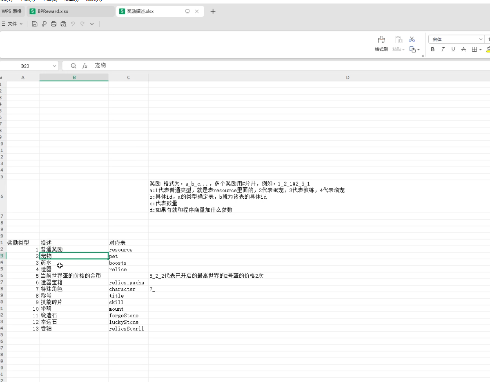
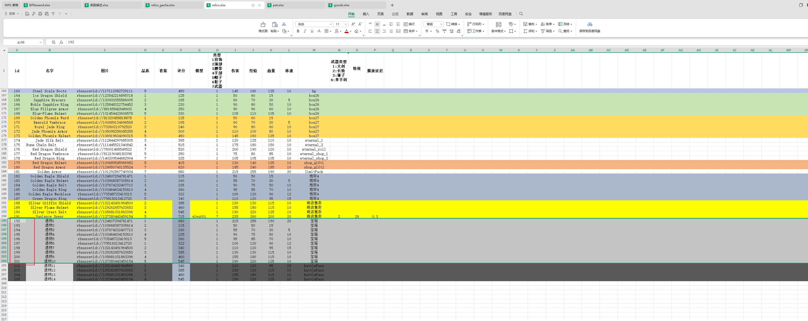
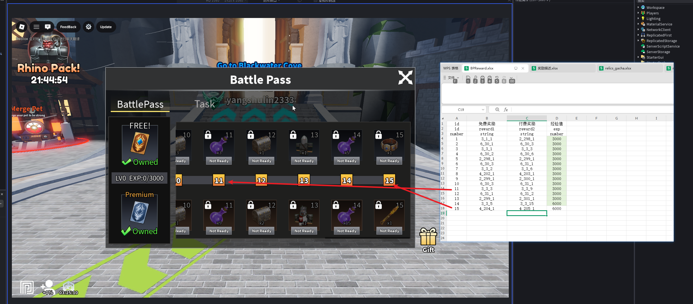
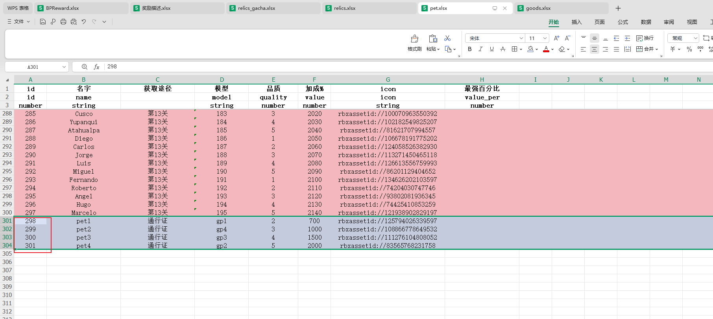
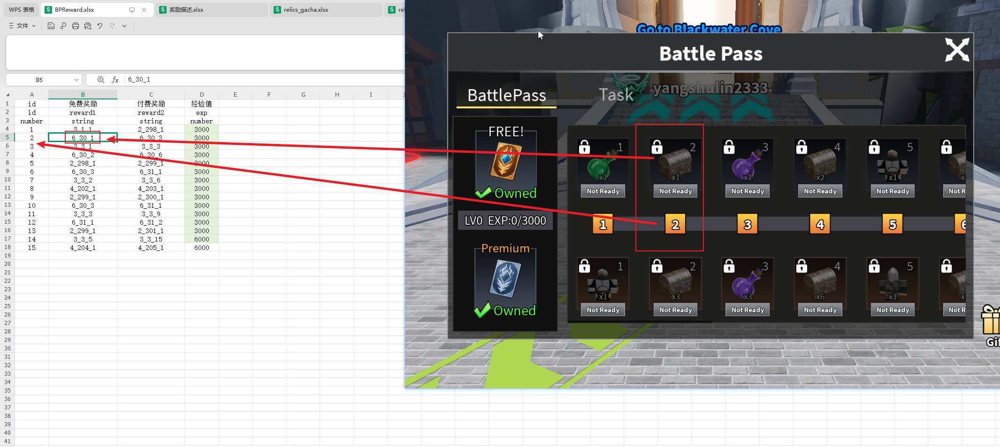
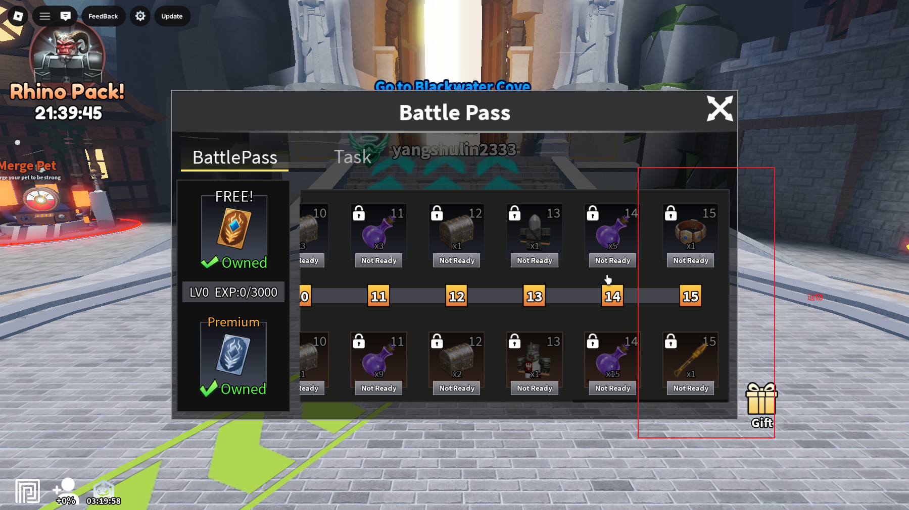
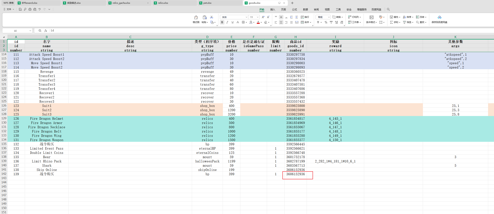
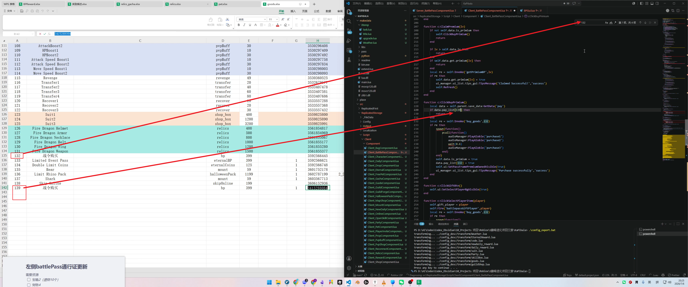

# 左侧 Battle Pass 通行证更新操作手册

> 本手册记录左侧 `BattlePass` 通行证奖励更新流程。  
> 本流程主要改配置表，不展开每张表的通用字段细节；字段细节可参考：[[新关卡更新流程_协作整理版]]、[[商店宝箱更新流程_协作整理版]]。

## 0. 本次资源统计

本次通行证更新需要准备：

| 资源 | 数量 | 配置表 | 说明 |
|---|---:|---|---|
| 遗物宝箱 | 2 个 | `relics_gacha.xlsx` | 每个宝箱内 5 个遗物 |
| 宝箱内遗物 | 10 个 | `relics.xlsx` | 2 个宝箱共 10 个 |
| 直接发放遗物 | 4 个 | `relics.xlsx` | 对应通行证 8 级和 15 级奖励 |
| 宠物 | 4 个 | `pet.xlsx` | 对应通行证奖励里的宠物 |

所以本次总遗物数量是 14 个：宝箱内 10 个 + 直接发放 4 个。

## 1. 操作总顺序

按下面顺序做，避免 `BPReward.xlsx` 里引用到还没配置好的 id。

1. 先读懂 `奖励描述.xlsx` 的奖励格式。
2. 在 `relics.xlsx` 增加 14 个遗物。
3. 在 `relics_gacha.xlsx` 增加 2 个遗物宝箱。
4. 在 `pet.xlsx` 增加 4 个宠物。
5. 回到 `BPReward.xlsx`，按奖励描述配置每一级奖励。
6. 在 `goods.xlsx` 新增或复制本期左侧通行证商品，并填写网页端创建出来的 `商品id`。
7. 打开 `Client_BattlePassComponent.lua`，把上一期战令商品 id 的 5 处引用替换成本期最新商品 id。
8. 保存所有 Excel。
9. 执行 `.\config_export.bat`。
10. 进 Studio Play 测试左侧 Battle Pass 显示、购买和领取。

## 2. 文件位置

| 内容 | 路径 |
|---|---|
| 配置表目录 | `D:\AI\Codex\Codex_Obsidian\10_Projects 项目\Roblox\1巅峰进化项目交接\KaPibala\config` |
| `BPReward.xlsx` | 通行证奖励主表 |
| `奖励描述.xlsx` | 奖励格式和奖励类型说明 |
| `relics.xlsx` | 遗物配置 |
| `relics_gacha.xlsx` | 遗物宝箱配置 |
| `pet.xlsx` | 宠物配置 |
| `goods.xlsx` | Roblox 开发者商品配置 |
| `Client_BattlePassComponent.lua` | 左侧 Battle Pass 客户端购买商品 id 引用 |

后文只写表名时，默认都在 `KaPibala\config` 目录下。

## 3. 先理解 `奖励描述.xlsx`

打开 `奖励描述.xlsx`，先看奖励格式。

参考图：



奖励格式：

```text
a_b_c
```

多个奖励用 `#` 分开：

```text
a_b_c#a_b_c
```

字段含义：

| 字段 | 含义 |
|---|---|
| `a` | 奖励类型 |
| `b` | 具体配置 id，取决于 `a` 对应哪张表 |
| `c` | 数量 |
| 后续字段 | 如果存在，通常是程序额外参数，按已有规则处理 |

奖励类型对照：

| 奖励类型 | 描述 | 对应表 |
|---:|---|---|
| `1` | 普通奖励 | `resource` |
| `2` | 宠物 | `pet` |
| `3` | 药水 | `boosts` |
| `4` | 遗物 | `relics` |
| `5` | 当前世界蛋价格金币 | 特殊规则 |
| `6` | 遗物宝箱 | `relics_gacha` |
| `7` | 特殊角色 | `character` |
| `8` | 称号 | `title` |
| `9` | 技能碎片 | `skill` |
| `10` | 坐骑 | `mount` |
| `11` | 锻造石 | `forgeStone` |
| `12` | 幸运石 | `luckyStone` |
| `13` | 卷轴 | `relicsScorll` |

常用例子：

| 写法 | 含义 |
|---|---|
| `6_30_1` | 发放 `relics_gacha.xlsx.id=30` 的遗物宝箱 1 个 |
| `6_31_2` | 发放 `relics_gacha.xlsx.id=31` 的遗物宝箱 2 个 |
| `2_298_1` | 发放 `pet.xlsx.id=298` 的宠物 1 个 |
| `4_202_1` | 发放 `relics.xlsx.id=202` 的遗物 1 个 |
| `3_3_5` | 发放 `boosts` 表 id 为 3 的药水 5 个 |

注意：如果本次新宝箱 id 是 `30` 和 `31`，那么奖励应写 `6_30_1` 或 `6_31_1`。不要把示例数字误写成其他旧宝箱 id。

## 4. 更新 `relics.xlsx`

本次需要新增 14 个遗物。

参考图：



新增规则：

| 遗物范围 | 用途 | 后续引用位置 |
|---|---|---|
| 10 个遗物 | 放入 2 个遗物宝箱 | `relics_gacha.xlsx.遗物id` |
| 4 个遗物 | 通行证等级直接奖励 | `BPReward.xlsx.reward1/reward2` |

示例中：

| 用途 | 示例 id |
|---|---|
| 第 1 个宝箱内遗物 | `192,193,194,195,196` |
| 第 2 个宝箱内遗物 | `197,198,199,200,201` |
| 直接发放遗物 | `202,203,204,205` |

字段填写参考 `商店宝箱更新流程_协作整理版` 里的 `relics.xlsx` 规则：

1. `id` 接当前最大 id 递增。
2. `名字` 根据素材定义或让 AI 生成。
3. `图片` 填美术素材上传后的 `rbxassetid://...`。
4. `品质` 按奖励档位和强度填写。
5. `模型` 只有图片时不填；有模型时填 `ReplicatedStorage/Resource/Relics` 下的变量名。
6. `类型` 必须和遗物模型部位一致。
7. `伤害 / 经验 / 血量 / 移速` 参考同档遗物填写。
8. 备注列写清来源，例如 `宝箱` 或 `battlePass`。

检查：

| 检查项 | 通过标准 |
|---|---|
| 新增数量 | 共 14 个遗物 |
| 宝箱内遗物 | 10 个，能分成 2 组，每组 5 个 |
| 直接奖励遗物 | 4 个，用于通行证 8 级和 15 级 |
| 模型和类型 | 有模型时，`模型` 与 `类型` 对应 |

## 5. 更新 `relics_gacha.xlsx`

打开 `relics_gacha.xlsx`，新增 2 个宝箱。

参考图：



字段填写：

| 字段 | 怎么填 |
|---|---|
| `id` | 接当前最大 id 递增 |
| `名字` | 自定义宝箱名 |
| `品质` | 按宝箱档位填写 |
| `图标` | 美术给的宝箱 icon |
| `遗物id` / `relics_id` | 每个宝箱填 5 个 `relics.xlsx.id` |
| `权重` / `weight` | 复制同类宝箱权重 |
| `奖励角色` / `character` | 本次通行证宝箱没有强力角色时留空 |

示例：

| 宝箱 | 示例 id | `遗物id` |
|---|---:|---|
| 宝箱 1 | `30` | `192,193,194,195,196` |
| 宝箱 2 | `31` | `197,198,199,200,201` |

检查：

1. 每个宝箱正好 5 个遗物 id。
2. `遗物id` 使用英文逗号 `,`。
3. `BPReward.xlsx` 引用宝箱时，用的是 `relics_gacha.xlsx.id`，例如 `6_30_1`。

## 6. 更新 `pet.xlsx`

打开 `pet.xlsx`，新增 4 个宠物。

参考图：



示例中新增宠物：

| 宠物 | 示例 id | 示例模型 |
|---|---:|---|
| pet1 | `298` | `gp1` |
| pet2 | `299` | `gp4` |
| pet3 | `300` | `gp3` |
| pet4 | `301` | `gp2` |

字段填写：

| 字段 | 怎么填 |
|---|---|
| `id` | 接当前最大 id 递增 |
| `名字` | 根据宠物素材命名 |
| `获取途径` | 填 `通行证` |
| `模型` | 填资源中的宠物模型变量名 |
| `品质` | 按奖励档位填写 |
| `加成%` | 按强度递增或参考已有宠物 |
| `icon` | 美术给的宠物 icon |

检查：

| 检查项 | 通过标准 |
|---|---|
| 新增数量 | 4 个宠物 |
| 获取途径 | 写 `通行证` |
| 模型 | 与 Studio 宠物模型变量名一致 |
| BPReward 引用 | 用 `2_宠物id_数量` |

## 7. 更新 `BPReward.xlsx`

打开 `BPReward.xlsx`。

这里是通行证奖励主表。

参考图：



核心规则：

| 字段 | 含义 |
|---|---|
| `id` | 游戏内通行证等级 |
| `免费奖励` / `reward1` | 免费通行证奖励 |
| `付费奖励` / `reward2` | 付费通行证奖励 |
| `经验值` / `exp` | 升级所需经验或显示经验值 |

`id` 字段直接对应游戏内通行证等级：



### 7.1 按奖励描述填写奖励

先根据 `奖励描述.xlsx` 判断每个奖励类型，再填入 `reward1` 或 `reward2`。

常见写法：

| 奖励内容 | 写法 |
|---|---|
| 宝箱 30，数量 1 | `6_30_1` |
| 宝箱 30，数量 3 | `6_30_3` |
| 宝箱 31，数量 1 | `6_31_1` |
| 宠物 298，数量 1 | `2_298_1` |
| 遗物 202，数量 1 | `4_202_1` |
| 药水 3，数量 15 | `3_3_15` |

多个奖励写法：

```text
6_30_1#2_298_1
```

### 7.2 示例等级配置

下面是当前截图中的示例结构，正式更新时按实际表格填写。

| 等级 id | 免费奖励 `reward1` | 付费奖励 `reward2` | 说明 |
|---:|---|---|---|
| `1` | `3_1_1` | `2_298_1` | 免费药水，付费宠物 |
| `2` | `6_30_1` | `6_30_3` | 宝箱 30 |
| `3` | `3_3_1` | `3_3_3` | 药水 |
| `4` | `6_30_2` | `6_30_6` | 宝箱 30 |
| `5` | `2_298_1` | `2_299_1` | 宠物 |
| `6` | `6_30_3` | `6_31_1` | 宝箱 30 / 31 |
| `7` | `3_3_2` | `3_3_6` | 药水 |
| `8` | `4_202_1` | `4_203_1` | 直接发放遗物 |
| `9` | `2_299_1` | `2_300_1` | 宠物 |
| `10` | `6_30_3` | `6_31_1` | 宝箱 30 / 31 |
| `11` | `3_3_3` | `3_3_9` | 药水 |
| `12` | `6_31_1` | `6_31_2` | 宝箱 31 |
| `13` | `2_299_1` | `2_301_1` | 宠物 |
| `14` | `3_3_5` | `3_3_15` | 药水 |
| `15` | `4_204_1` | `4_205_1` | 直接发放遗物 |

### 7.3 BPReward 检查

| 检查项 | 通过标准 |
|---|---|
| 等级 id | 与游戏内通行证等级一致 |
| 宝箱奖励 | 使用 `6_宝箱id_数量` |
| 宠物奖励 | 使用 `2_宠物id_数量` |
| 遗物奖励 | 使用 `4_遗物id_数量` |
| 免费/付费奖励 | `reward1` 和 `reward2` 不填反 |
| 数量 | 第三段是数量，不是 id |
| 多奖励分隔 | 多个奖励用 `#` |

## 8. 更新 `goods.xlsx` 通行证商品

左侧 Battle Pass 的付费档需要对应 Roblox 网页端开发者商品。配置表里不要沿用上一期旧商品 id。

参考图：



操作步骤：

1. 打开 `goods.xlsx`。
2. 找到上一期左侧通行证商品对应行。
3. 复制上一期通行证商品行到表尾。
4. 新行的 Excel 内部 `id` 按表尾继续递增，不能和旧行重复。
5. `name`、`g_type`、`price`、`limit` 等字段直接复制旧行，除非策划或同事明确要求改价或改规则。
6. 到 Roblox 网页端自行创建本期新的通行证商品。
7. 把网页端创建出来的新商品 id 复制到 `goods.xlsx` 的 `商品id` 字段。
8. 保存 `goods.xlsx`。

检查点：

| 检查项 | 通过标准 |
|---|---|
| Excel 内部 `id` | 新行 id 不重复 |
| `商品id` | 来自 Roblox 网页端新创建的本期通行证商品 |
| 其他字段 | 与上一期同类型通行证商品一致 |
| 旧商品 | 不直接复用上一期 `商品id` |

注意：`goods.xlsx` 里的 Excel 自增 `id` 和 Roblox 网页端的 `商品id` 不是同一个东西。代码里需要替换的通常是网页端商品 id，不是 Excel 行 id。

## 9. 替换 `Client_BattlePassComponent.lua` 里的旧战令 id

配置表商品准备好以后，还需要改客户端代码里的购买商品 id。

参考图：



操作步骤：

1. 打开 `Client_BattlePassComponent.lua`。
2. 全局搜索上一期战令商品 id。
3. 一共需要找到 5 处引用。
4. 将这 5 处全部替换成 `goods.xlsx` 中本期新通行证商品的 `商品id`。
5. 保存代码文件。
6. 重新同步 Rojo；如果 Studio 没更新，断开 Rojo 后再重新连接。

检查点：

| 检查项 | 通过标准 |
|---|---|
| 搜索旧 id | 能找到上一期战令 id 的 5 处引用 |
| 替换结果 | 5 处全部改成本期新 `商品id` |
| 漏改检查 | 再搜索旧 id，结果应为 0 |
| 误改检查 | 只替换左侧 Battle Pass 相关购买 id，不改其他模块商品 id |

风险点：

1. 只改 `goods.xlsx` 不改客户端代码，玩家点击购买时可能仍然购买上一期商品。
2. 只改其中一部分引用，会导致不同入口、弹窗或按钮使用的商品 id 不一致。
3. 搜索替换前先确认旧 id 和新 id，避免把右侧通行证或其他商城商品误替换。

## 10. 保存并导出配置

所有表格保存后，在项目目录执行：

```powershell
.\config_export.bat
```

需要保存的表：

| 表 | 检查 |
|---|---|
| `relics.xlsx` | 14 个遗物已保存 |
| `relics_gacha.xlsx` | 2 个宝箱已保存 |
| `pet.xlsx` | 4 个宠物已保存 |
| `BPReward.xlsx` | 通行证奖励已保存 |
| `goods.xlsx` | 本期通行证商品 `商品id` 已保存 |

如果 Studio 里 Rojo 没同步，断开 Rojo 后重新连接。

## 11. Studio 内测试

进入游戏后打开左侧 Battle Pass。

参考图：


按下面内容测试：

| 测试项 | 通过标准 |
|---|---|
| 等级显示 | `BPReward.xlsx.id` 与 UI 等级一致 |
| 免费奖励 | `reward1` 显示正确 |
| 付费奖励 | `reward2` 显示正确 |
| 宝箱奖励 | 图标、数量、宝箱内容正确 |
| 宠物奖励 | 图标、数量、宠物 id 正确 |
| 遗物奖励 | 8 级和 15 级直接遗物显示正确 |
| 付费购买 | 点击左侧 Battle Pass 购买按钮时，商品 id 是本期新商品 |
| 领取状态 | 未达成显示 `Not Ready`，可领取时状态正常 |
| 领取结果 | 背包或数据中实际获得对应奖励 |

## 12. 上线前最终检查

上线前至少过一遍这张表。

| 分类 | 检查项 |
|---|---|
| 资源统计 | 宝箱 2 个、宠物 4 个、遗物 14 个 |
| `relics.xlsx` | 10 个宝箱遗物 + 4 个直接遗物都存在 |
| `relics_gacha.xlsx` | 2 个宝箱分别绑定 5 个遗物 |
| `pet.xlsx` | 4 个宠物 id、模型、icon 正确 |
| `BPReward.xlsx` | 每一级奖励格式正确 |
| `goods.xlsx` | 本期通行证商品已创建，`商品id` 已填新 id |
| 客户端代码 | `Client_BattlePassComponent.lua` 里旧战令 id 的 5 处引用已替换 |
| 奖励类型 | 宝箱用 `6`，宠物用 `2`，遗物用 `4` |
| 数量字段 | 第三段数量正确，例如 `6_30_1` 是 1 个宝箱 |
| 导出配置 | 已执行 `.\config_export.bat` |
| Studio 测试 | UI 展示、购买、领取、实际发奖都通过 |

## 13. 高风险点

1. `BPReward.xlsx.id` 是通行证等级，不是普通自增配置 id。
2. `6_30_1` 中的 `30` 是 `relics_gacha.xlsx.id`。
3. `4_202_1` 中的 `202` 是 `relics.xlsx.id`。
4. `2_298_1` 中的 `298` 是 `pet.xlsx.id`。
5. 第三段是数量，不是配置 id。
6. 多个奖励要用 `#` 分隔，不能用中文符号。
7. 新增遗物、宝箱、宠物后，必须再回到 `BPReward.xlsx` 引用它们。
8. 只改 Excel 不执行 `config_export.bat`，游戏里可能仍是旧奖励。
9. `goods.xlsx.商品id` 必须是 Roblox 网页端新创建的本期商品 id，不能直接沿用上一期。
10. `Client_BattlePassComponent.lua` 中旧战令 id 一共 5 处需要替换，漏改会导致部分入口仍购买旧商品。
