# 巅峰进化新关卡更新流程（协作整理版）

> 本文用于接手同事离职后的新关卡更新工作。当前阶段是用已有关卡数据模拟新增关卡，边操作边确认规则，最后沉淀成可复用交接文档。

## 0. 文档状态

| 项目 | 状态 |
|---|---|
| 原始速记 | [[更新关卡操作]] |
| 当前整理重点 | 新关卡配置表、Studio 资源摆放、配置导出、GM 测试准备 |
| 配置目录 | `D:\AI\Codex\Codex_Obsidian\10_Projects 项目\Roblox\1巅峰进化项目交接\KaPibala\config` |
| 后续表名约定 | 后文只写表名时，默认都指向上面的 `KaPibala\config` 目录 |
| 本次模拟目标 | 假设新增第 14 关 |
| 当前已知最新正式关卡 | 第 13 关 |
| 后续补充 | 蛋特效替换规则、游戏内完整验收流程 |

## 1. 操作前原则

1. 不直接改线上正式表，先保留一份可回滚备份。
2. 每次只处理一类配置，处理完立刻做字段检查。
3. 新关卡不要只看一行，要按“一关 7 个角色”作为整体检查。
4. 所有 `id`、模型名、资源名、关卡名之间的对应关系要能追踪到 Roblox Studio 里的实际对象。
5. 对不确定字段先标记“待确认”，不要凭感觉补值后直接上线。

## 2. `character.xlsx` 更新规则

### 2.1 文件位置

`KaPibala\config\character.xlsx`

当前主要使用 `Sheet1`。已看到的字段包括：

| 列 | 字段 | 当前用途 |
|---|---|---|
| A | `id` | 角色唯一编号 |
| B | `名字` | 角色名称 |
| C | `图标` | Roblox asset id，美术提供 |
| D | `等级` | 角色等级 |
| E | `品质` | 角色品质 |
| F | `伤害加成` | 角色伤害数值 |
| G | `血量加成` | 角色血量数值 |
| H | `所属关卡` | 关卡名称 |
| I | `关卡排序` | 所属关卡的排序值 |
| J | `模型` | 角色模型编号或模型名 |
| K | `武器类型` | `1:大剑 2:长枪 3:锤子 4:单手剑` |
| L | `特效` | 两位数编码，十位代表武器类型，个位代表品级或特效强度 |
| M | `播放延迟` | 武器特效播放延迟 |
| N | `百分比` | 强力角色识别字段之一 |

### 2.2 新增普通关卡角色

新增一关时，普通关卡角色按 7 行处理。

| 字段 | 操作规则 | 检查点 |
|---|---|---|
| `id` | 从上一行继续递增 | 不能重复、不能跳错 |
| `名字` | 可让 AI 生成同主题英文名 | 最好和关卡主题一致，避免和旧角色重名 |
| `图标` | 美术提供 asset id | 必须是 `rbxassetid://...` 格式 |
| `等级` | 没有强力角色插入时，按上一关继续 `+1` 递增 | 一关 7 个角色应连续 |
| `品质` | 固定顺序：`2, 2, 3, 3, 4, 4, 4` | 每关都按 7 行检查 |
| `伤害加成` | 比上一关最后一位角色更大，按整体强度递增 | 不要小于或等于上一关末尾 |
| `血量加成` | 比上一关最后一位角色更大，按整体强度递增 | 不要小于或等于上一关末尾 |
| `所属关卡` | 填新关卡名称 | 需要和 `stage.xlsx` 的关卡名保持一致，待确认 |
| `关卡排序` | 普通第 14 关角色填 `14` | 不要误填成强力角色的排序值 |
| `模型` | 以 Studio 中 `character` 文件夹下的模型名字为准 | 需要和实际模型对象名完全一致 |
| `武器类型` | 根据实际武器填 `1/2/3/4` | 和 `特效` 十位保持一致 |
| `特效` | 默认按 `武器类型 * 10 + 7` 填 | 如果复制源出现特殊值，先记录并问同事 |
| `播放延迟` | 根据 `武器类型` 一一对应填写 | 见下方播放延迟映射表 |
| `百分比` | 普通关卡角色为空 | 有值通常表示强力角色 |

### 2.3 强力角色的 `关卡排序`

强力角色不是普通关卡 7 个角色的一部分。当前识别方式：

1. `百分比` 字段有值。
2. `等级` 可能为空。
3. `所属关卡` 可能是 `Secret`。
4. `品质` 可能为 `6`。

规则理解：

| 场景 | 应填值 |
|---|---|
| 当前正式最新关卡是第 13 关，模拟新增第 14 关 | 强力角色 `关卡排序` 应改为 `15` |
| 后续正式新增第 15 关 | 强力角色 `关卡排序` 应改为 `16` |

也就是说：强力角色的 `关卡排序 = 最新普通关卡排序 + 1`。

注意：新增第 14 关时，普通 7 个角色的 `关卡排序` 仍是 `14`；只有强力角色行需要放到 `15`。

### 2.4 武器类型、特效、播放延迟

武器类型表：

| 值 | 武器类型 |
|---|---|
| `1` | 大剑 |
| `2` | 长枪 |
| `3` | 锤子 |
| `4` | 单手剑 |

特效字段当前理解：

| 字段逻辑 | 说明 |
|---|---|
| 十位数 | 武器类型，必须和 `武器类型` 字段一致 |
| 个位数 | 品级或强度，`1~7` 逐渐增强 |
| 新关卡默认值 | 个位数默认填 `7` |

示例：

| 武器类型 | 默认特效 |
|---|---|
| `1` 大剑 | `17` |
| `2` 长枪 | `27` |
| `3` 锤子 | `37` |
| `4` 单手剑 | `47` |

播放延迟映射：

| 武器类型 | 武器 | 播放延迟 |
|---|---|---|
| `1` | 大剑 | `0.2` |
| `2` | 长枪 | `0.3` |
| `3` | 锤子 | `0.3` |
| `4` | 单手剑 | `0.25` |

当前发现的待确认点：

| 问题 | 原因 | 建议 |
|---|---|---|
| 表内已有 `28` 这类个位数超过 `7` 的特效值 | 与“个位数 1~7”规则不完全一致 | 问同事确认 `28` 是历史错误、特殊特效，还是规则实际允许超过 7 |

### 2.5 Studio 角色模型准备与 `模型` 字段

这一步用于确定 `character.xlsx` 的 `模型` 字段。正式流程中，角色模型通常由外包团队或美术团队提供；本次把第 11 关角色复制成第 14 关，只是为了模拟跑通流程，不能当成正式资源规则。

操作入口：

| 项目 | 说明 |
|---|---|
| 原始项目 | `99_原始资料\卡皮巴拉.rbxl` |
| 操作原则 | 先复制一份 `.rbxl` 再打开，不直接改原始资料 |
| Studio 路径 | `ReplicatedStorage/Resource/character` |
| 临时编辑方式 | 将 `ReplicatedStorage/Resource/character` 文件夹手动拖到 `Workspace` 下，方便查看、复制、重命名模型 |

正式资源流程：

1. 外包团队提供最新关卡角色模型。
2. 将模型放入或合并到 Studio 的 `character` 资源目录。
3. 检查每个模型对象名。
4. 回填 `character.xlsx` 的 `模型` 字段。

本次模拟流程：

1. 在复制出来的 `.rbxl` 项目中打开 Studio。
2. 将 `ReplicatedStorage/Resource/character` 拖到 `Workspace` 下。
3. 从已有第 11 关角色中复制 7 个模型，临时充当第 14 关角色。
4. 按新关卡编号重命名模型。
5. 以 Studio 里 `character` 文件夹下最终模型名字为准，填入 `character.xlsx.模型`。

当前理解的模型命名规律：

| 规则 | 示例 |
|---|---|
| 模型名从左往右前两位代表关卡数 | `11xxx` 表示第 11 关，`14xxx` 表示第 14 关 |
| 新关卡模型名按关卡号替换前两位 | 用第 11 关模拟第 14 关时，`11011` 可改为 `14011` |
| 一关 7 个普通角色要有 7 个模型名 | 第 14 关应检查是否有 `14011` 到 `14017` 这一组，具体以实际命名为准 |

注意事项：

1. `character.xlsx.模型` 必须和 Studio 里的模型对象名完全一致，包括数字、下划线、大小写。
2. 如果外包给的模型命名和旧规律不一致，先以 Studio 实际对象名为准，再问同事是否需要统一命名。
3. 临时复制第 11 关模型只是为了验证流程；正式上线必须替换为对应新关卡美术模型。
4. 复制或重命名模型后，需要检查角色携带的武器对象是否仍然正常，后续会单独补充武器复制规则。

### 2.6 角色模型内 `weapon` 对象命名规则

`ReplicatedStorage/Resource/character` 下每个角色模型内部的武器对象名必须固定为 `weapon`，不能改成其他名字。

| 对象位置 | 命名要求 |
|---|---|
| `ReplicatedStorage/Resource/character/<角色模型>/weapon` | 子对象名固定为 `weapon` |
| `weapon` 下的 `Handle` | 保持原有结构，不随意改名或删除 |

这个 `weapon` 名字通常会被脚本或资源加载逻辑读取；如果改成其他名字，角色武器可能无法挂载或显示异常。

参考图：

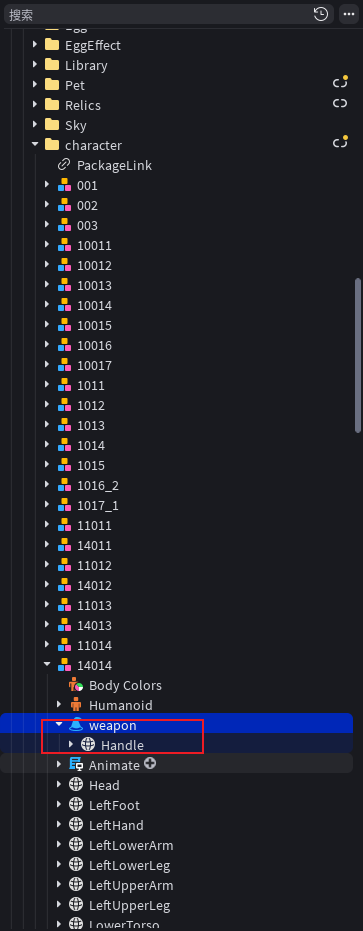

## 3. `character.xlsx` 当前检查清单

操作完 `character.xlsx` 后，按下面逐项检查：

| 检查项 | 通过标准 |
|---|---|
| 一关角色数量 | 新关卡普通角色正好 7 行 |
| `id` | 连续递增，无重复 |
| `关卡排序` | 普通新关卡为新关卡号；强力角色为新关卡号 + 1 |
| `百分比` | 只有强力角色有值，普通角色为空 |
| `品质` | 7 行顺序为 `2,2,3,3,4,4,4` |
| `等级` | 普通角色连续递增 |
| `伤害加成` | 大于上一关最后一个角色 |
| `血量加成` | 大于上一关最后一个角色 |
| `武器类型` 和 `特效` | `特效` 十位等于 `武器类型` |
| `播放延迟` | 必须符合 `武器类型` 映射：`1=0.2`，`2=0.3`，`3=0.3`，`4=0.25` |
| `图标` | 使用美术给的 `rbxassetid://...` |
| `所属关卡` | 和 `stage.xlsx` 里的关卡名一致 |
| `模型` | 和 Studio 中 `character` 文件夹下的模型对象名完全一致 |
| Studio 模型数量 | 新关卡普通角色应有 7 个可对应模型 |

## 4. `stage.xlsx` 更新规则

### 4.1 文件位置

`KaPibala\config\stage.xlsx`

当前主要使用 `Sheet1`。已看到字段：

| 列 | 字段 | 当前用途 |
|---|---|---|
| A | `id` | 关卡编号 |
| B | `名字` | 关卡显示名，也会被其他表引用 |
| C | `解锁需要等级` | 玩家达到指定等级后解锁 |
| D | `模型` | 关卡模型名 |
| E | `icon` | 关卡图标 asset id |
| F | `最后一个蛋id` | 当前关卡最后一个扭蛋 id，对应 `gacha.xlsx.id` 最新值 |

### 4.2 新增关卡字段规则

重要说明：下面的 `Thunder Peak Ruins`、`stage14`、等级值等都是本次模拟流程用的假数据，用来验证更新顺序。正式上线时应以实际地图主题、美术资源和策划确认数值为准。

| 字段 | 操作规则 | 示例 |
|---|---|---|
| `id` | 在上一关基础上递增 | 第 13 关后新增第 14 关，填 `14` |
| `名字` | 根据地图素材特色生成或确认关卡名 | 本次模拟用 `Thunder Peak Ruins` |
| `解锁需要等级` | 按上一关解锁等级 `+7` | 第 13 关为 `85`，第 14 关模拟填 `92` |
| `模型` | 按顺序递增 | `stage13` 后填 `stage14` |
| `icon` | 美术给图后上传，填上传后的 `rbxassetid://...` | 模拟时可临时复制旧值，但正式不能漏换 |
| `最后一个蛋id` | 填当前关卡 `gacha.xlsx` 的最后一个蛋 id | 第 14 关模拟为 `46` |

### 4.3 与 `character.xlsx` 的联动

`stage.xlsx` 的 `名字` 是 `character.xlsx` 中 `所属关卡` 的来源。

本次模拟顺序：

1. 先在 `stage.xlsx` 确定第 14 关名字，例如 `Thunder Peak Ruins`。
2. 再回到 `character.xlsx`。
3. 将第 14 关普通 7 个角色的 `所属关卡` 填为同一个值：`Thunder Peak Ruins`。

注意：这里不要把示例名字写死成规则。正式流程中，`character.xlsx.所属关卡` 必须跟当次 `stage.xlsx.名字` 完全一致。

### 4.4 Studio Stage 场景资源准备

Stage 场景资源在 Studio 中的位置：

`ReplicatedStorage/Resource/stage`

正式资源流程：

1. 外包团队或美术团队提供最新关卡场景资源。
2. 将最新关卡拖入 `ReplicatedStorage/Resource/stage`。
3. 按关卡编号命名，例如第 14 关命名为 `stage14`。
4. 回到 `stage.xlsx`，确认 `模型` 字段与 Studio 中的 Stage 模型名一致。

本次模拟流程：

1. 临时复制第 11 关的 `stage` 资源。
2. 将复制后的关卡资源改名为 `stage14`。
3. 用它充当第 14 关素材，先跑通整体更新流程。

参考图：

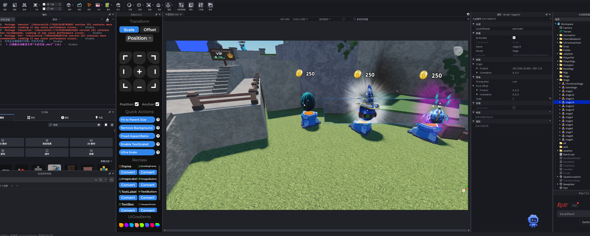

### 4.5 `icon` 截图与上传

`stage.xlsx.icon` 字段需要手动在场景中截图，然后上传得到 `rbxassetid://...`。

| 项目 | 规则 |
|---|---|
| 截图来源 | 当前最新关卡场景，例如 `stage14` |
| 图片尺寸 | `722x130` |
| 填写位置 | `stage.xlsx.icon` |
| 注意事项 | 本次模拟可以临时用旧图，但正式上线必须换成最新关卡截图或美术素材 |

### 4.6 `stage.xlsx` 当前检查清单

| 检查项 | 通过标准 |
|---|---|
| `id` | 比上一关 `+1`，不能重复 |
| `名字` | 与新地图主题一致，并和 `character.xlsx.所属关卡` 完全一致 |
| `解锁需要等级` | 比上一关 `+7`，除非策划另有调整 |
| `模型` | 按 `stage数字` 顺序递增，并能对应 Roblox 里的实际关卡模型 |
| `icon` | 正式上线前必须换成美术提供并上传后的资源 id |
| `最后一个蛋id` | 与当前关卡 `gacha.xlsx` 最后一行 id 一致，例如第 14 关为 `46` |
| Studio Stage 资源 | `ReplicatedStorage/Resource/stage` 下存在对应最新关卡模型，例如 `stage14` |

## 5. `monster.xlsx` 更新规则

### 5.1 文件位置

`monster.xlsx`

说明：从本章节开始，表名默认位于 `KaPibala\config` 目录下。

### 5.2 字段说明

当前主要使用 `Sheet1`。已看到字段：

| 列 | 字段 | 当前用途 |
|---|---|---|
| A | `id` | 怪物唯一编号 |
| B | `名字` | 怪物名称 |
| C | `是否是boss` | 是否为本关 Boss |
| D | `boss特效` | Boss 特效配置 |
| E | `血量` | 怪物血量 |
| F | `大小` | 怪物缩放或体型配置 |
| G | `模型` | 对应 Studio 中怪物模型名 |
| H | `奖励奖杯` | 击杀奖励奖杯 |
| I | `奖励经验值` | 击杀奖励经验 |
| J | `所属关卡` | 所属关卡编号 |
| K | `攻击力` | 怪物攻击力 |
| L | `钻石` | 掉落钻石 |
| M | `概率%` | 掉落概率 |
| N | `掉落活动币` | 掉落活动币数量 |

后面的空列、`原版数值` 等辅助字段当前不需要手动填写，除非同事后续确认有特殊用途。

### 5.3 新增关卡字段规则

新增一关时，怪物也按 7 行处理。

| 字段 | 操作规则 | 检查点 |
|---|---|---|
| `id` | 接着上一关最后一只怪物递增 | 一关 7 个怪物，不能重复、不能跳错 |
| `名字` | 根据怪物素材风格找 AI 生成 | 名字只服务显示和辨识，不要和旧怪物混淆 |
| `是否是boss` | 每关最后一个怪物填 `1` | 前 6 个普通怪物保持空 |
| `boss特效` | Boss 行复制前几关相近 Boss 的特效 | 只填 Boss 行；普通怪物不填 |
| `血量` | 整体高于上一关最后一个 monster，并按合理曲线增长 | 不要低于上一关 Boss，也不要突然异常暴涨 |
| `大小` | 直接复制前一关规律 | 当前理解为固定配置 |
| `模型` | 来自 Studio 的 `ReplicatedStorage/Resource/monster` 文件夹 | 必须和 Studio 里 monster 模型对象名一致 |
| `奖励奖杯` | 按已有增长逻辑调大 | 不要低于上一关同类怪物 |
| `奖励经验值` | 按已有增长逻辑调大 | 不要低于上一关同类怪物 |
| `所属关卡` | 填新关卡编号 | 第 14 关模拟填 `14` |
| `攻击力` | 按已有增长逻辑调大 | 可参考上一关同位置怪物 |
| `钻石` | 按已有增长逻辑调大 | 可参考上一关同位置怪物 |
| `概率%` | 按旧表规律处理 | 如果历史固定为 `10`，不要为了“调大”破坏固定概率 |
| `掉落活动币` | 按已有增长逻辑调大 | 可参考上一关同位置怪物 |

剩余未说明字段：不需要填写，保持空或沿用表格原本状态。

### 5.4 Studio 怪物模型准备与 `模型` 字段

正式资源流程：

1. 外包团队或美术团队提供第 14 关怪物模型。
2. 将模型导入 Studio 的 `ReplicatedStorage/Resource/monster` 文件夹。
3. 根据当前最大怪物模型编号继续往后命名。
4. 回到 `monster.xlsx`，把 `模型` 字段填为 Studio 里实际的 monster 模型对象名。

本次模拟流程：

1. 暂时使用已有怪物素材代替第 14 关怪物。
2. 在 `ReplicatedStorage/Resource/monster` 中复制已有模型。
3. 按当前最大模型编号往后命名，例如当前已有最大编号到 `137`，模拟第 14 关可继续用 `141` 到 `147`。
4. 将这些模型编号填入 `monster.xlsx.模型`。

注意：`monster.xlsx.模型` 字段以 Studio 里的对象名为准，不以 Excel 自己推测为准。

### 5.5 当前已知对象关系

| 字段或对象 | 当前规则 |
|---|---|
| `id` | 对应最新关卡模型里的 `monsterPos` 子对象名字 |
| `模型` | 对应 `resource/monster` 下的模型名字 |
| Boss 位置 | 需要结合 Studio 场景位置继续确认 |
| 出生点 / 传送点 | 需要结合 Studio 场景位置继续确认 |

关键路径：

`ReplicatedStorage/Resource/stage/stage14/monster/monsterPos`

这里的 `monsterPos` 是怪物刷怪或站位点集合。`monsterPos` 下每个点位对象的名字，应该对应 `monster.xlsx` 的 `id` 字段。

示例：

| 表格 | Studio |
|---|---|
| `monster.xlsx.id = 93` | `stage14/monster/monsterPos` 下存在名为 `93` 的点位对象 |
| `monster.xlsx.id = 94` | `stage14/monster/monsterPos` 下存在名为 `94` 的点位对象 |
| 第 14 关 id 为 `93~99` | `monsterPos` 下应改成 `93~99` 对应的一组点位 |

注意：这里对应的是 `monster.xlsx.id`，不是 `monster.xlsx.模型` 字段。`模型` 字段对应的是 `ReplicatedStorage/Resource/monster` 下的怪物模型资源。

参考图：

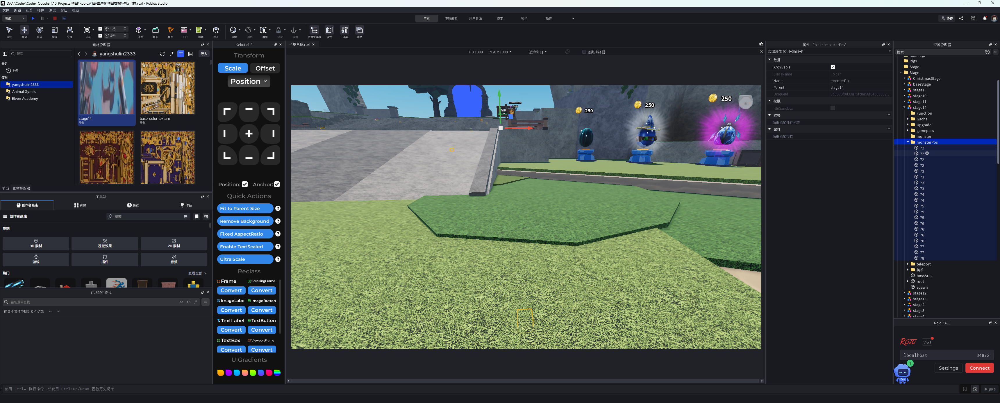

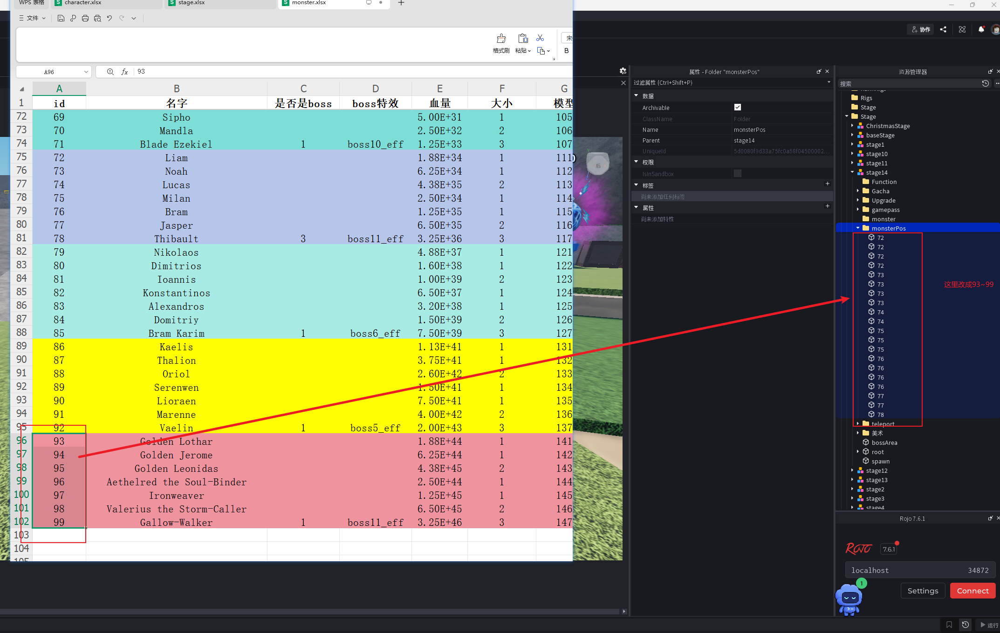

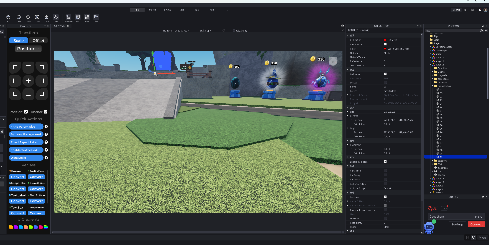

### 5.6 `monster.xlsx` 当前检查清单

| 检查项 | 通过标准 |
|---|---|
| 一关怪物数量 | 新关卡正好 7 行 |
| `id` | 连续递增，无重复 |
| `是否是boss` | 每关只有最后一只怪物填 `1` |
| `boss特效` | 只有 Boss 行填写，并参考前几关 Boss |
| `血量` | 高于上一关最后一个 monster，并符合增长曲线 |
| `大小` | 与前一关规律一致 |
| `模型` | 和 `ReplicatedStorage/Resource/monster` 下模型对象名一致 |
| `所属关卡` | 填新关卡编号，例如第 14 关填 `14` |
| `monsterPos` 点位名 | 最新关卡 `stage14/monster/monsterPos` 下点位对象名与 `monster.xlsx.id` 一致 |
| 奖励与掉落字段 | 奖杯、经验、攻击力、钻石、活动币按旧表曲线合理增大 |
| 空字段 | 剩余字段不额外填写 |

## 6. `playerLv.xlsx` 更新规则

### 6.1 文件位置

`playerLv.xlsx`

说明：表名默认位于 `KaPibala\config` 目录下。

### 6.2 字段说明

当前主要使用 `Sheet1`。已看到字段：

| 列 | 字段 | 当前用途 |
|---|---|---|
| A | `id` | 等级或奖励行编号 |
| B | `图片` | 奖励图片 icon |
| C | `下级经验` | 升到下一级需要的经验 |
| D | `奖励模型id` | 对应 `character.xlsx` 里的角色 `id` |
| E | `脑红数据` | 当前不手动处理，保留表格原状态 |

### 6.3 新增关卡字段规则

新增一关时，`playerLv.xlsx` 也按 7 行角色奖励处理。

| 字段 | 操作规则 | 检查点 |
|---|---|---|
| `id` | 接着上一行递增 7 个 | 对应本关 7 个普通角色奖励 |
| `图片` | 素材会提供，上传后填 `rbxassetid://...` | 正式上线前不能漏换 |
| `下级经验` | 看旧表增长规律新增，必须高于上一关数值 | 不要低于上一行或上一关同位置 |
| `奖励模型id` | 必须与 `character.xlsx.id` 对应 | 不能只按行号猜，因为可能存在 `百分比` 精英/强力角色插入 |

关键点：`奖励模型id` 对应的是 `character.xlsx` 的 `id` 字段，不是 `character.xlsx.模型` 字段，也不是角色名字。

示例：

| `playerLv.xlsx` | `character.xlsx` |
|---|---|
| `奖励模型id = 114` | 找 `character.xlsx.id = 114` 的角色 |
| `奖励模型id = 120` | 找 `character.xlsx.id = 120` 的角色 |

如果 `character.xlsx` 中间有 `百分比` 字段有值的强力角色，不要简单按“新增第几行”推算奖励模型；必须回到 `character.xlsx.id` 实际确认。

### 6.4 `playerLv.xlsx` 当前检查清单

| 检查项 | 通过标准 |
|---|---|
| 行数 | 新关卡补 7 行 |
| `id` | 连续递增，无重复 |
| `图片` | 使用素材提供并上传后的 icon |
| `下级经验` | 高于上一关，并符合旧表增长曲线 |
| `奖励模型id` | 能在 `character.xlsx.id` 中找到对应角色 |
| 辅助字段 | 未确认用途的字段不额外填写 |

## 7. Studio 角色武器资源复制

### 7.1 操作目的

当前关卡 `ReplicatedStorage/Resource/character` 里的每个角色模型内部都有一个固定名为 `weapon` 的武器对象。这个 `weapon` 还需要复制一份到同级资源目录 `ReplicatedStorage/Resource/weapon` 下，供游戏内其他逻辑或展示使用。

### 7.2 操作路径

| 资源 | 路径 |
|---|---|
| 角色模型目录 | `ReplicatedStorage/Resource/character` |
| 角色内部武器对象 | `ReplicatedStorage/Resource/character/<角色模型>/weapon` |
| 武器资源目录 | `ReplicatedStorage/Resource/weapon` |

### 7.3 操作步骤

1. 在 `ReplicatedStorage/Resource/character` 中找到当前关卡角色模型，例如 `14014`。
2. 展开角色模型，确认内部存在名为 `weapon` 的对象。
3. 复制这个 `weapon` 对象。
4. 粘贴到同级资源目录 `ReplicatedStorage/Resource/weapon` 下。
5. 将复制出来的武器对象改名为对应角色名。

当前截图里的资源命名风格看起来更接近“角色模型编号”，例如 `14014`。如果同事确认“对应角色名字”指的是 `character.xlsx.名字` 字段，则按同事规则调整；正式文档当前先按项目现有 `Resource/weapon` 命名风格执行。

参考图：

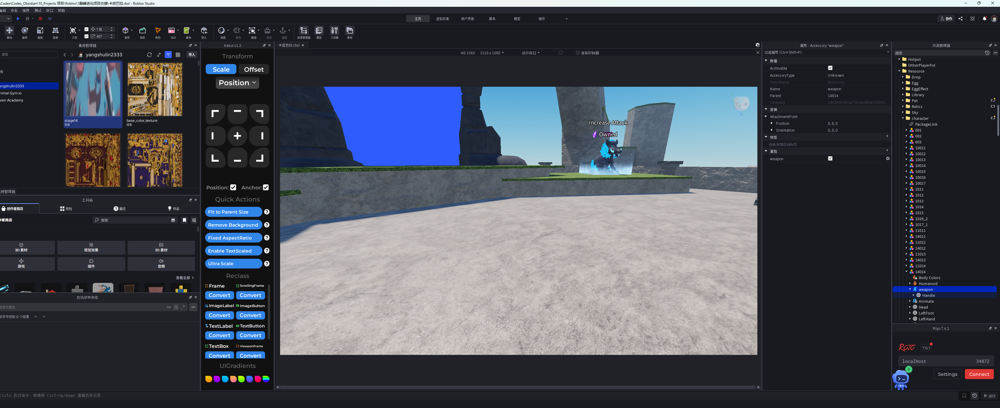

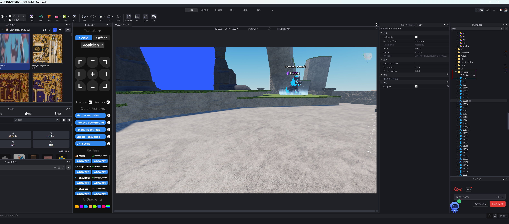

### 7.4 检查清单

| 检查项 | 通过标准 |
|---|---|
| 角色内部武器名 | 每个角色模型内部武器对象都叫 `weapon` |
| `Resource/weapon` 副本 | 当前关卡每个角色的 weapon 都复制了一份 |
| 复制后命名 | 复制到 `Resource/weapon` 后，名称与项目现有命名规则一致 |
| 结构完整 | 复制后的 weapon 内部仍保留 `Handle` 等原有结构 |

## 8. `pet.xlsx` 更新规则

### 8.1 文件位置

`pet.xlsx`

说明：表名默认位于 `KaPibala\config` 目录下。

### 8.2 字段说明

当前主要使用 `Sheet1`。已看到字段：

| 列 | 字段 | 当前用途 |
|---|---|---|
| A | `id` | 宠物唯一编号 |
| B | `名字` | 宠物名称 |
| C | `获取途径` | 宠物来源关卡 |
| D | `模型` | 对应 `ReplicatedStorage/Resource/Pet` 下的模型 |
| E | `品质` | 宠物品质 |
| F | `加成%` | 宠物加成数值 |
| G | `icon` | 宠物图片资源 |
| H | `最强百分比` | 当前不手动处理，保留表格原状态 |

### 8.3 新增关卡字段规则

新增一关时，宠物按 15 个为一组处理。

| 字段 | 操作规则 | 检查点 |
|---|---|---|
| `id` | 接着上一组继续递增 15 个 | 不能重复、不能跳错 |
| `名字` | 根据宠物素材风格让 AI 生成 | 避免和旧宠物重名 |
| `获取途径` | 填最新关卡 | 第 14 关模拟填 `第14关` |
| `模型` | 对应 Studio 的 `ReplicatedStorage/Resource/Pet` 下模型名 | 必须和 Studio 模型对象名一致 |
| `品质` | `1,2,3,4,5` 循环三轮 | 15 个宠物正好三组品质循环 |
| `加成%` | 按旧表规律 `+10` 递增 | 保持连续增长 |
| `icon` | 素材提供，上传后填 `rbxassetid://...` | 正式上线前不能漏换 |

参考图：

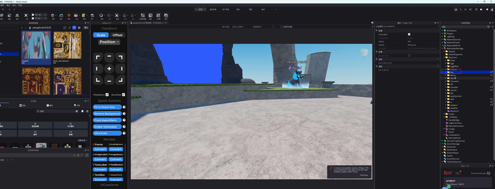

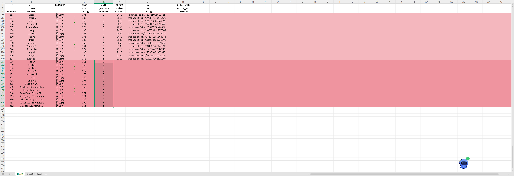

### 8.4 `pet.xlsx` 当前检查清单

| 检查项 | 通过标准 |
|---|---|
| 数量 | 新关卡新增 15 个宠物 |
| `id` | 连续递增，无重复 |
| `获取途径` | 都是最新关卡，例如 `第14关` |
| `模型` | 能在 `ReplicatedStorage/Resource/Pet` 下找到对应模型 |
| `品质` | `1~5` 循环三轮 |
| `加成%` | 按 `+10` 规律递增 |
| `icon` | 使用素材提供并上传后的 icon |

## 9. `gacha.xlsx` 更新规则

### 9.1 文件位置

`gacha.xlsx`

说明：表名默认位于 `KaPibala\config` 目录下。

### 9.2 字段说明

当前主要使用 `Sheet1`。已看到字段：

| 列 | 字段 | 当前用途 |
|---|---|---|
| A | `id` | 扭蛋配置 id |
| B | `价格` | 扭蛋价格 |
| C | `购买类型` | 购买货币类型 |
| D | `关卡` | 所属关卡编号 |
| E | `宠物id` | 此蛋包含的宠物 id 列表 |
| F | `权重` | 宠物抽取权重 |
| G | `图片` | 扭蛋图片 icon |

### 9.3 新增关卡字段规则

新增一关时，扭蛋按 3 个蛋为一组处理。

| 字段 | 操作规则 | 检查点 |
|---|---|---|
| `id` | 接着上一行递增 | 第 14 关模拟为 `44,45,46` |
| `价格` | 比上一关更贵，按旧表增长规律处理 | 不要低于上一关同类型蛋 |
| `购买类型` | 默认填 `3` | 表头含义：`3` = 奖杯 |
| `关卡` | 填最新关卡编号 | 第 14 关填 `14` |
| `宠物id` | 来自 `pet.xlsx.id`，每 5 个宠物为一组，分成三组 | 必须使用英文逗号 `,` 分隔 |
| `权重` | 直接复制前一关同位置蛋的权重 | 不随意改概率 |
| `图片` | 素材提供，上传后填 `rbxassetid://...` | 正式上线前不能漏换 |

`宠物id` 示例：

| 蛋 | `pet.xlsx.id` 范围 | `gacha.xlsx.宠物id` |
|---|---|---|
| 第 1 个蛋 | `298~302` | `298,299,300,301,302` |
| 第 2 个蛋 | `303~307` | `303,304,305,306,307` |
| 第 3 个蛋 | `308~312` | `308,309,310,311,312` |

注意：这里必须使用英文逗号 `,`，不要使用中文逗号 `，`。

### 9.4 与 `stage.xlsx` 的联动

`stage.xlsx.最后一个蛋id` 应填写当前关卡 `gacha.xlsx` 的最后一个蛋 id。

第 14 关模拟数据：

| 表格 | 字段 | 值 |
|---|---|---|
| `gacha.xlsx` | 最新关卡最后一个 `id` | `46` |
| `stage.xlsx` | `最后一个蛋id` | `46` |

参考图：

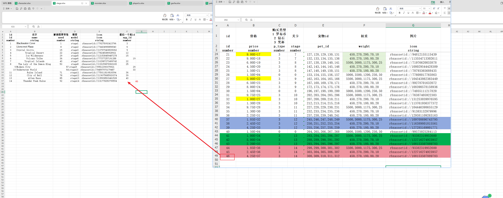

### 9.5 `gacha.xlsx` 当前检查清单

| 检查项 | 通过标准 |
|---|---|
| 数量 | 新关卡新增 3 个蛋 |
| `id` | 连续递增，无重复 |
| `价格` | 比上一关更高，并符合旧表增长曲线 |
| `购买类型` | 默认 `3` |
| `关卡` | 最新关卡编号，例如 `14` |
| `宠物id` | 每组 5 个 pet id，使用英文逗号分隔 |
| `权重` | 复制前一关同位置权重 |
| `图片` | 使用素材提供并上传后的 icon |
| `stage.xlsx.最后一个蛋id` | 等于当前关卡最后一个 `gacha.xlsx.id` |

### 9.6 Studio 场景内 Gacha 对象配置

场景内扭蛋对象位于最新关卡模型下：

`ReplicatedStorage/Resource/stage/stage14/Gacha`

其中重点检查两个子文件夹：

| 子文件夹 | 用途 |
|---|---|
| `Gacha/collider` | 购买蛋的触发块 |
| `Gacha/model` | 场景里展示的蛋和底座模型 |

#### 9.6.1 `Gacha/collider` 命名

`Gacha/collider` 下的触发块对象名必须和 `gacha.xlsx.id` 保持一致。

第 14 关模拟示例：

| `gacha.xlsx.id` | `Gacha/collider` 对象名 |
|---|---|
| `44` | `44` |
| `45` | `45` |
| `46` | `46` |

参考图：

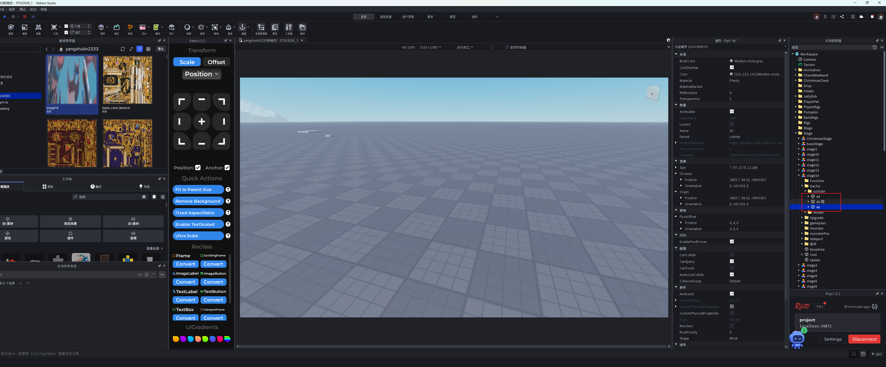

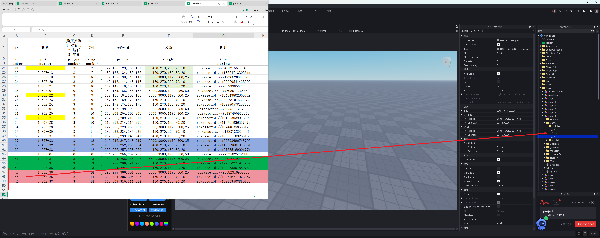

#### 9.6.2 `Gacha/model` 摆放与 PrimaryPart

`Gacha/model` 下放的是场景里可见的蛋和底座。

操作步骤：

1. 把 3 个蛋和对应底座放到 `Gacha/model` 下。
2. 在场景里调整位置，让蛋和底座摆放合理。
3. 每个蛋模型都要设置 `PrimaryPart`。
4. `PrimaryPart` 指向蛋本体或对应的 `Handle`，不要留空。

参考图：

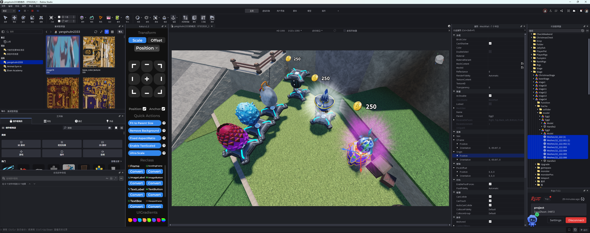

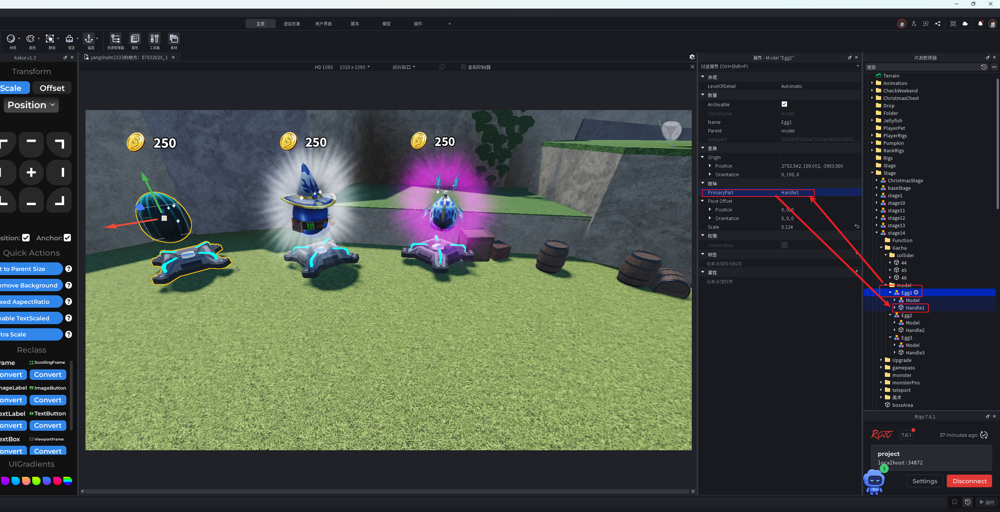

#### 9.6.3 collider 触发块位置

`Gacha/collider` 下的触发块要放在玩家能踩到或碰到的位置。

检查点：

1. 触发块在地面附近，不要悬空太高。
2. 触发块覆盖购买区域。
3. 触发块和对应蛋的位置匹配，避免玩家站在一个蛋旁边却触发另一个蛋。
4. `collider` 对象名仍然要和 `gacha.xlsx.id` 一致。

参考图：

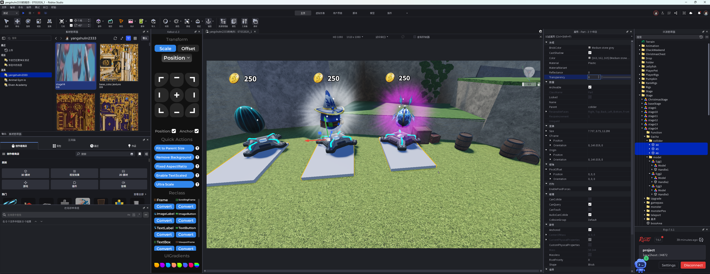

### 9.7 `Resource/Egg` 蛋资源配置

`Resource/Egg` 下的蛋用于游戏内抽蛋 UI 或其他资源引用，和场景里的 `stage14/Gacha/model` 不是同一个位置。

操作路径：

`ReplicatedStorage/Resource/Egg`

操作步骤：

1. 将 `ReplicatedStorage/Resource/Egg` 拖到 `Workspace` 下，方便查看和调整。
2. 将新的 3 个蛋放入 `Egg` 文件夹。
3. 调整蛋模型大小。
4. 将蛋整理为 `Model` 结构。
5. 设置每个蛋模型的 `PrimaryPart`，指向蛋本体。
6. 蛋模型名字必须和 `gacha.xlsx.id` 一致。

第 14 关模拟示例：

| `gacha.xlsx.id` | `Resource/Egg` 模型名 |
|---|---|
| `44` | `44` |
| `45` | `45` |
| `46` | `46` |

参考图：

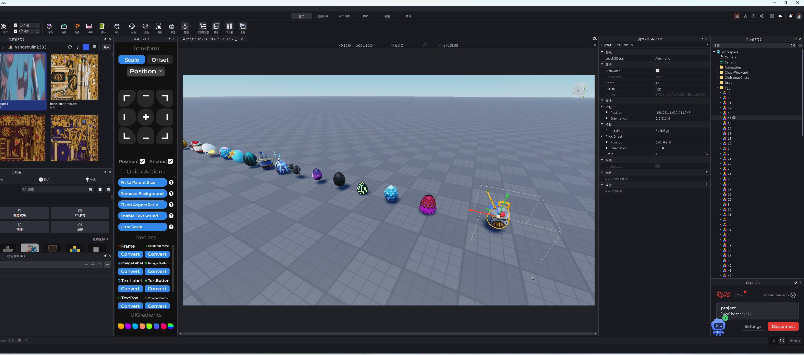

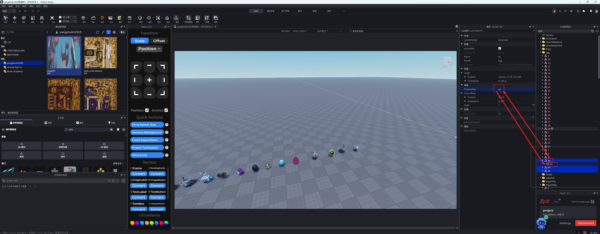

### 9.8 Gacha / Egg 检查清单

| 检查项 | 通过标准 |
|---|---|
| `Gacha/collider` 命名 | 对象名和 `gacha.xlsx.id` 一致 |
| `Gacha/model` 摆放 | 蛋和底座位置合理 |
| 场景蛋 `PrimaryPart` | 每个蛋模型都设置好 PrimaryPart |
| collider 位置 | 玩家在地面上能触发购买 |
| `Resource/Egg` 数量 | 新关卡 3 个蛋都存在 |
| `Resource/Egg` 命名 | 模型名和 `gacha.xlsx.id` 一致 |
| `Resource/Egg` 结构 | 每个蛋是 Model，PrimaryPart 指向蛋本体 |
| `stage.xlsx.最后一个蛋id` | 等于本关最后一个 `gacha.xlsx.id` |

## 10. `upgrade.xlsx` 更新规则

### 10.1 文件位置

`upgrade.xlsx`

说明：表名默认位于 `KaPibala\config` 目录下。

### 10.2 字段说明

当前主要使用 `Sheet1`。已看到字段：

| 列 | 字段 | 当前用途 |
|---|---|---|
| A | `id` | 升级雕像配置 id |
| B | `名字` | 升级项内部名字 |
| C | `属性` | 升级属性类型 |
| D | `加成` | 加成数值 |
| E | `价格` | 升级价格 |
| F | `所属世界` | 所属关卡或世界编号 |
| G | 说明列 | 中文效果说明，表头为空 |

### 10.3 新增关卡字段规则

| 字段 | 操作规则 | 检查点 |
|---|---|---|
| `id` | 接着上一行递增 | 必须和 Stage 里的 `Upgrade` 模型名一致 |
| `名字` | 选择未满的升级类型 | 不要选 `遗物上限+1`、`宠物栏上限+1`，这两个已满 |
| `属性` | 和 `名字` 对应 | 例如生命值对应 `hp`，经验对应 `exp` |
| `加成` | 按旧表同类规则填写 | 不随意破坏同类升级曲线 |
| `价格` | 按旧表同类规则递增 | 新关卡价格应高于旧关卡同类升级 |
| `所属世界` | 填最新关卡编号 | 第 14 关填 `14` |

参考图：

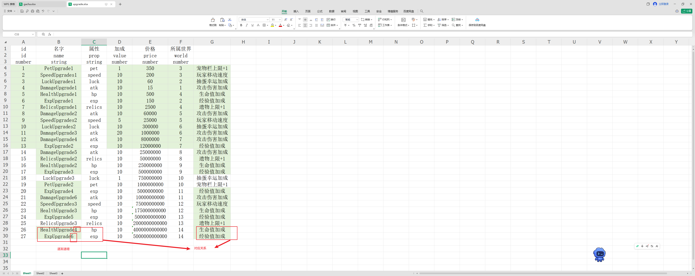

### 10.4 Studio Upgrade 模型与触发块

Stage 内升级雕像路径：

`ReplicatedStorage/Resource/stage/stage14/Upgrade`

操作步骤：

1. 打开最新关卡，例如 `stage14`。
2. 找到 `Upgrade` 文件夹。
3. 将 `Upgrade` 下模型或触发块对象名改成 `upgrade.xlsx.id` 对应的值。
4. 调整触发块位置，让玩家能在地面上正常触发。

示例：

| `upgrade.xlsx.id` | `stage14/Upgrade` 对象名 |
|---|---|
| `26` | `26` |
| `27` | `27` |

参考图：

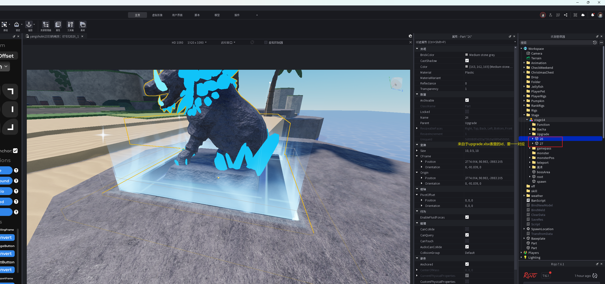

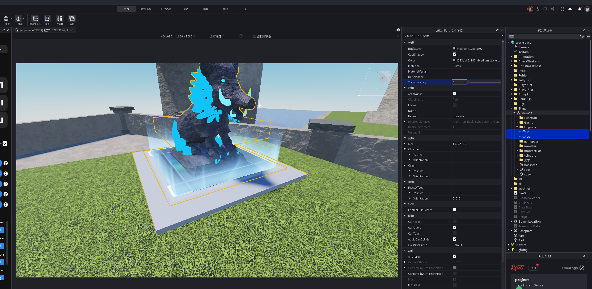

### 10.5 `upgrade.xlsx` 检查清单

| 检查项 | 通过标准 |
|---|---|
| `id` | 连续递增，无重复 |
| `名字` | 不使用已满的 `遗物上限+1`、`宠物栏上限+1` |
| `属性` | 和名字语义一致 |
| `价格` | 按旧表同类升级曲线递增 |
| `所属世界` | 最新关卡编号，例如 `14` |
| Studio 对象名 | `stage14/Upgrade` 下对象名与 `upgrade.xlsx.id` 一致 |
| 触发块位置 | 玩家能正常触发升级 |

## 11. 传送门与唯一 Part 迁移

### 11.1 最新关卡返回上一关

最新关卡需要有传回上一关的传送门。

操作路径示例：

`ReplicatedStorage/Resource/stage/stage14/teleport`

操作步骤：

1. 打开最新关卡，例如 `stage14`。
2. 找到 `teleport` 文件夹。
3. 确认存在返回上一关的传送门，例如返回第 13 关。
4. 修改传送门上的提示文字。
5. 提示文字从 `stage.xlsx` 里取对应关卡名字，不手写猜。

参考图：

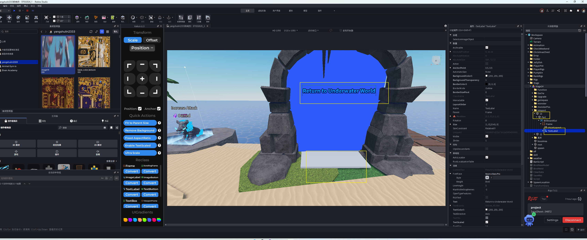

### 11.2 唯一 Part 从上一关迁移到最新关卡

最新关卡放入前，上一关里会有一个所有关卡唯一的 `Part`。

新增第 14 关时：

1. 在上一关 `stage13` 中找到这个唯一 `Part`。
2. 将它从 `stage13` 移动到最新关卡 `stage14`。
3. 移动后确认 `stage13` 不再保留该唯一 `Part`。
4. 确认 `stage14` 中存在该 `Part`。

参考图：

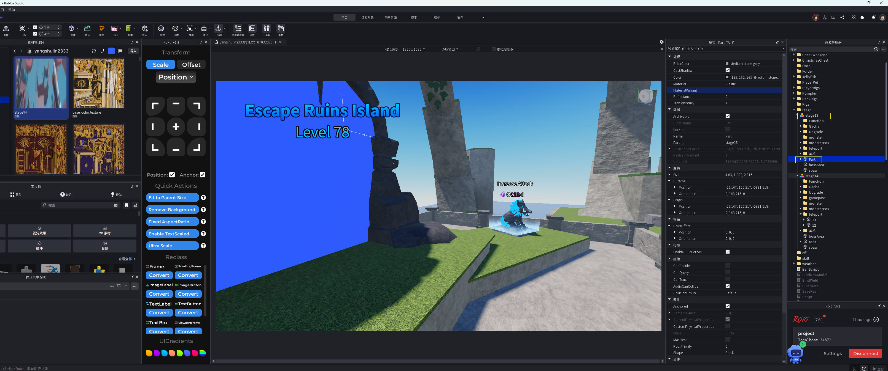

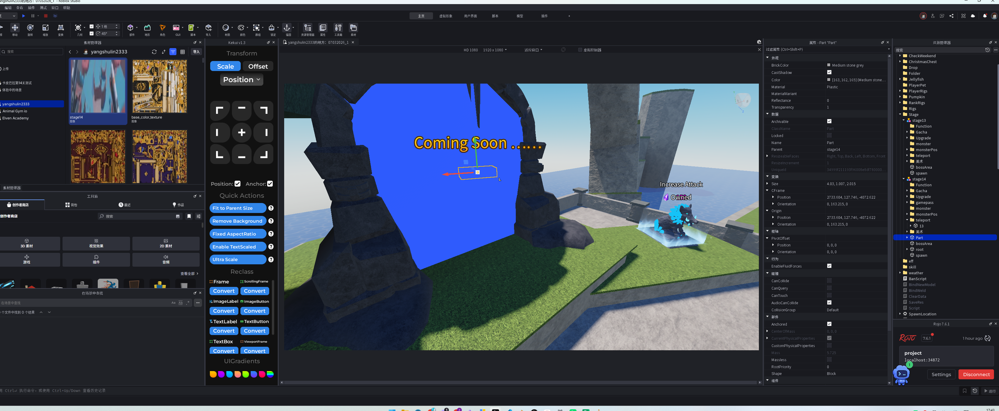

### 11.3 上一关传送到最新关卡

新增最新关卡后，还要回到上一关修改传送门，让玩家能从上一关进入最新关卡。

新增第 14 关时：

1. 回到 `stage13`。
2. 找到 `stage13/teleport`。
3. 修改通往最新关卡的传送门。
4. 传送门文字从 `stage.xlsx` 取最新关卡名字和等级信息。
5. 触发块位置也要检查，保证玩家能触发。

参考图：

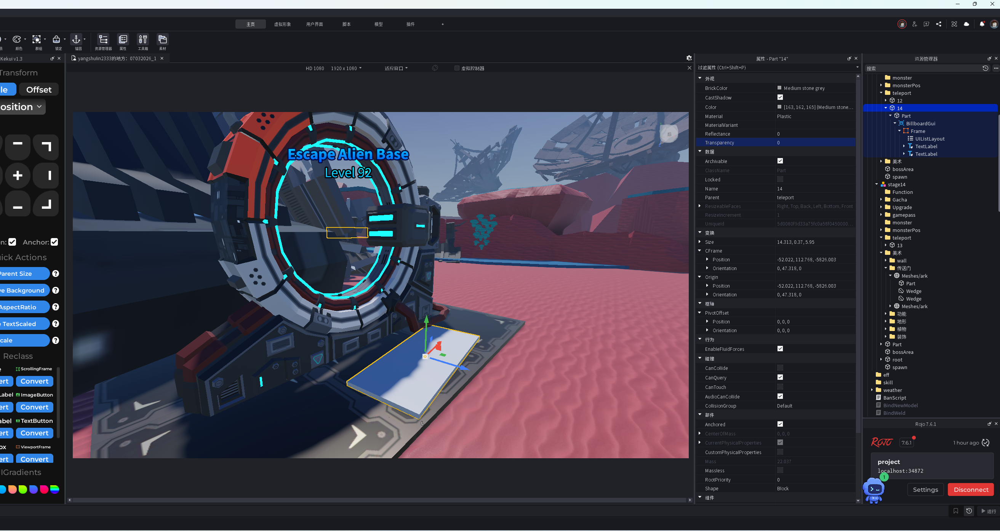

### 11.4 传送门检查清单

| 检查项 | 通过标准 |
|---|---|
| 最新关卡返回上一关 | `stage14` 可以传回 `stage13` |
| 上一关进入最新关卡 | `stage13` 可以传到 `stage14` |
| 传送门文字 | 来自 `stage.xlsx`，与关卡名和等级一致 |
| 触发块位置 | 玩家能正常触发传送 |
| 唯一 Part | 从上一关移动到最新关卡，不能两边都存在 |

## 12. 配置导出与测试准备

本节是所有 Excel 和 Studio 资源改完后的转换与测试准备步骤。

注意：这里的 GM 白名单和 GM 指令只用于测试环境或测试账号，不能当成正式线上运营操作。

### 12.1 保存 Excel 配置表

执行导出前，先确认所有改过的 Excel 表已经保存。

至少包括本次流程中改过的表：

| 表 | 检查点 |
|---|---|
| `character.xlsx` | 新角色、模型、所属关卡、武器类型、特效、播放延迟已保存 |
| `stage.xlsx` | 新关卡、模型、icon、最后一个蛋 id 已保存 |
| `monster.xlsx` | 新怪物、Boss、模型、数值、所属关卡已保存 |
| `playerLv.xlsx` | 新等级奖励和 `character.xlsx.id` 对应 |
| `pet.xlsx` | 新宠物 15 个已保存 |
| `gacha.xlsx` | 新蛋 3 个、宠物 id、权重、图片已保存 |
| `upgrade.xlsx` | 新升级项和 Stage 内 `Upgrade` 对象 id 对应 |

### 12.2 执行配置导出

在项目根目录执行：

```powershell
.\config_export.bat
```

当前路径示例：

`D:\AI\Codex\Codex_Obsidian\10_Projects 项目\Roblox\1巅峰进化项目交接\KaPibala`

导出时终端会逐个显示 `transforming...`。如果最后停在 `press any key to continue...`，说明脚本执行到结束等待按键。

参考图：

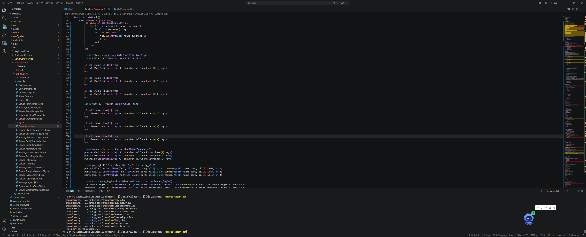

导出后要检查：

| 检查项 | 通过标准 |
|---|---|
| 终端输出 | 没有明显报错 |
| 配置文件 | 对应表已转换成项目使用的配置 |
| Studio 测试 | 新关卡相关配置能被游戏读到 |

### 12.3 打开体验设置里的测试权限

在 Roblox Studio 里打开体验设置，进入安全相关设置。

测试时需要把相关参数打开，截图中已打开的项目包括：

| 设置项 | 用途 |
|---|---|
| 允许 Studio 访问 API 服务 | 允许 Studio 测试访问部分 API 或 DataStore 相关能力 |
| 允许第三方销售 | 项目测试购买相关功能时可能需要 |
| 允许第三方传送 | 测试传送相关功能时可能需要 |
| 允许网络/图像 API | 测试网络、图片、资源加载相关能力 |
| 允许加载第三方素材 | 测试素材加载相关能力 |

参考图：

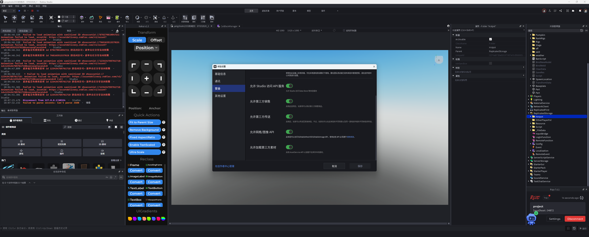

注意：正式发布前是否保持这些开关，需要按项目原规则确认，不要只因为测试方便就直接改线上设置。

### 12.4 将测试账号加入 GM 白名单

GM 指令需要白名单权限。

脚本位置：

`src/ServerStorage/Script/Server/Module/GMCommand.lua`

找到 `white_id_list`，把自己的 Roblox UserId 加进去。

示例：

```lua
[10804390126] = "test2"
```

参考图：

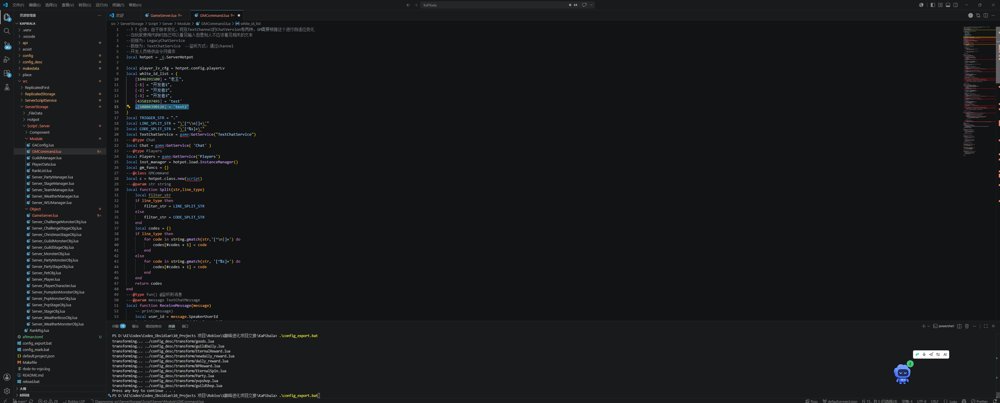

检查点：

| 检查项 | 通过标准 |
|---|---|
| UserId | 使用自己的 Roblox UserId，不要填昵称 |
| 名字说明 | 右侧字符串只是备注，便于识别测试账号 |
| 使用范围 | 只用于测试账号或测试环境 |

### 12.5 使用 GM 指令准备测试进度

进入游戏测试后，在聊天或项目指定的 GM 输入入口输入指令。

常用指令：

```text
.add_lv 97
.add_gems 999999999999999999999999
```

用途：

| 指令 | 用途 |
|---|---|
| `.add_lv 97` | 升级到足够进入最新关卡的等级 |
| `.add_gems 999999999999999999999999` | 增加大量钻石，方便测试购买、升级等流程 |

参考图：

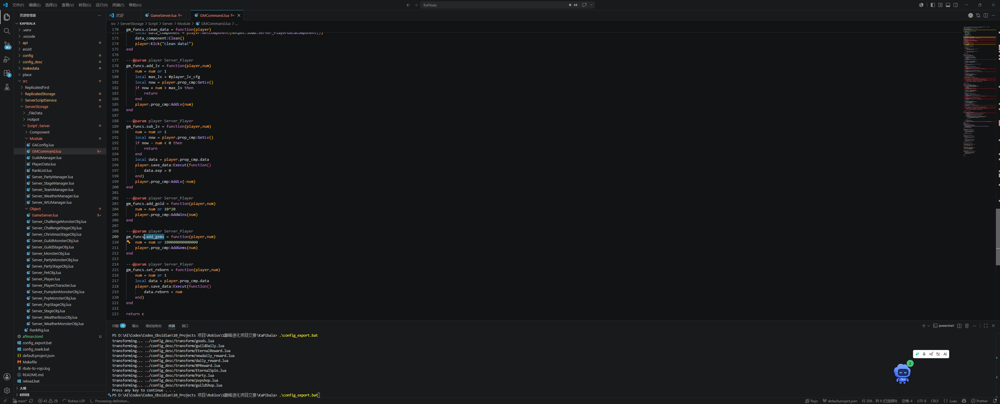

注意：

1. GM 指令必须在白名单账号下才有效。
2. 指令数值是测试用，不代表正式数值。
3. 测试完成后，按项目发布规则确认是否需要移除临时白名单。

### 12.6 导出与测试准备检查清单

| 检查项 | 通过标准 |
|---|---|
| Excel 已保存 | 所有改过的表都保存后再导出 |
| 导出脚本 | `.\config_export.bat` 执行完成，没有明显报错 |
| Studio 设置 | 体验设置里的测试所需权限已打开 |
| GM 白名单 | 自己的 UserId 已加入 `GMCommand.lua` |
| 等级测试 | `.add_lv 97` 后能满足进入最新关卡条件 |
| 钻石测试 | `.add_gems ...` 后能测试购买、升级等消耗流程 |

## 13. 游戏内调试辅助

本节记录的是 Studio 本地测试时的辅助操作，用于快速验证新关卡是否能进入、配置是否生效。它们不是正式上线步骤。

### 13.1 打开 TeleportGui 快速传送

开始游戏后，如果需要直接传送到指定关卡，可以手动打开 `TeleportGui`。

操作路径：

`Players/<自己的角色名>/PlayerGui/TeleportGui`

示例账号路径：

`Players/yangshulin2333/PlayerGui/TeleportGui`

操作步骤：

1. 在 Studio 里开始游戏。
2. 打开 Explorer 里的 `Players`。
3. 展开自己的角色，例如 `yangshulin2333`。
4. 展开 `PlayerGui`。
5. 找到 `TeleportGui`。
6. 在属性面板里把 `Enabled` 勾上。
7. 游戏画面会显示传送界面，可以直接选择关卡进行测试。

参考图：

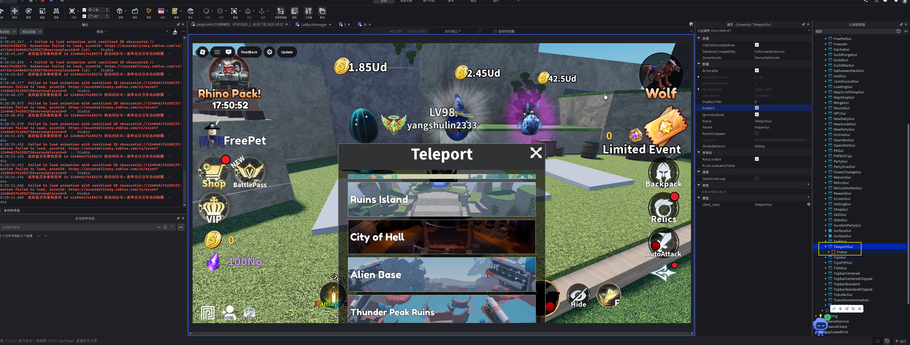

检查点：

| 检查项 | 通过标准 |
|---|---|
| `TeleportGui.Enabled` | 已打开 |
| 传送列表 | 能看到最新关卡，例如第 14 关 |
| 传送结果 | 点击后能进入目标关卡 |
| UI 文案 | 新关卡名称与 `stage.xlsx` 一致 |

### 13.2 Rojo 不同步时的处理

有时候 Rojo 会出现数据没有同步到 Studio 的情况。

排查顺序：

1. 先确认本地文件已经保存。
2. 确认 `.\config_export.bat` 已重新执行。
3. 如果 Studio 里仍然不是最新数据，手动断开 Rojo 连接。
4. 再重新连接 Rojo。
5. 重新进入游戏测试，确认配置和资源是否刷新。

判断标准：

| 现象 | 处理 |
|---|---|
| Excel 已改但游戏仍是旧数据 | 重新导出配置，再检查 Rojo 同步 |
| Studio Explorer 中对象没刷新 | Rojo 断开后重新连接 |
| UI/关卡列表还是旧内容 | 重新开始 Play 测试 |
| 多次重连仍不对 | 回头检查导出产物、文件路径、Rojo 项目映射 |

## 14. 后续待补充章节

以下内容来自原始文档，后续需要一边操作一边补成可执行步骤：

1. 蛋特效
   - `ParticleEmitter` 和 `Particles` 都属于特效。
   - 具体替换规则后续确认。

2. 游戏内完整验证
   - 如何进入第 14 关。
   - 如何验证怪物刷新、Boss、血量和奖励。
   - 如何验证扭蛋、宠物、蛋模型、蛋价格。
   - 如何验证传送门、升级雕像、角色显示。

## 15. 需要问同事的问题

| 优先级 | 问题 | 原因 |
|---|---|---|
| 高 | `特效=28` 这类值是否有效？ | 与“个位数 1~7”规则冲突，不能上线前靠猜 |
| 高 | `模型` 字段为空时是否允许？还是模拟数据未补？ | 新关卡角色能否正常加载模型依赖此字段 |
| 高 | `character.xlsx.所属关卡` 是否必须与 `stage.xlsx.名字` 完全一致？ | 当前理解是必须一致，需同事确认是否有大小写、空格、翻译表要求 |
| 中 | `Resource/weapon` 下复制出来的武器对象应按角色模型编号命名，还是按 `character.xlsx.名字` 命名？ | 截图看更像按模型编号，用户口述是“角色名字”，需要同事最终确认 |
| 中 | `stage.xlsx.icon` 正式截图或素材规格是否固定为 `722x130`？ | 原始文档写过该尺寸，但本次只确认到字段，需确认美术交付规格 |
| 中 | `伤害加成`、`血量加成` 是否有公式或只看递增？ | 线上数值平衡风险 |
| 中 | 强力角色是否只看 `百分比` 字段识别？ | 避免误改普通角色或漏改强力角色 |
