### 地图更新
1. 更新角色表：character.xlsx
	1. 关卡排序中强力角色必须保证为当前最大关卡值加1.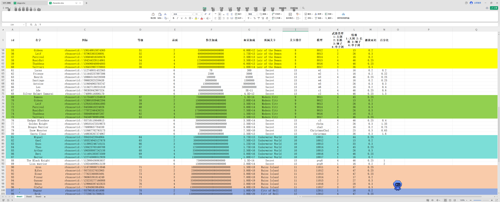
	2. 武器类型特效字段 个位数代表品级，1~7逐渐增强。10位数代表武器类型。播放延迟和10位数对应。
	3. Resource/Character 里的 武器 模型 weapon 变量名 是固定的，不能为其他值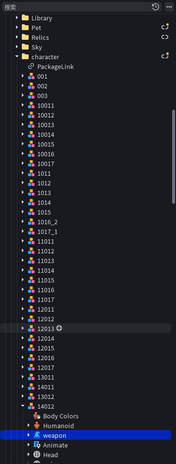
	4. 角色下的weapon对象 需要复制到 weapon 文件夹里，并命名为角色名字
2. 怪物表monster.xlsx 表中的id字段对应地图模型monsterPos
	1. 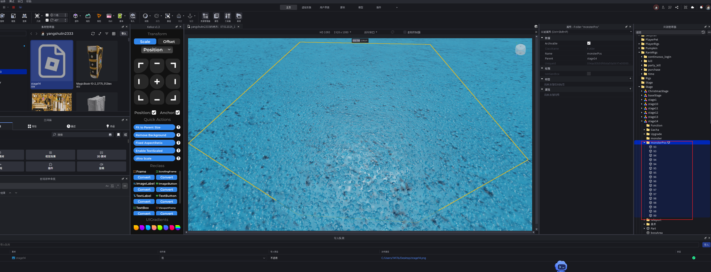
	2. 怪物表monster下的 模型 字段对应的是resource/moster 下的模型名字
	3. boss位置相关
		1. 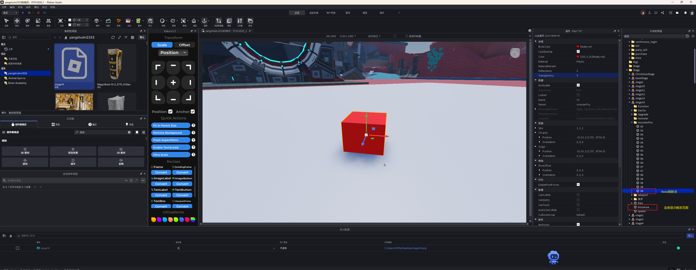
		2. spawn是角色重生/传送 点位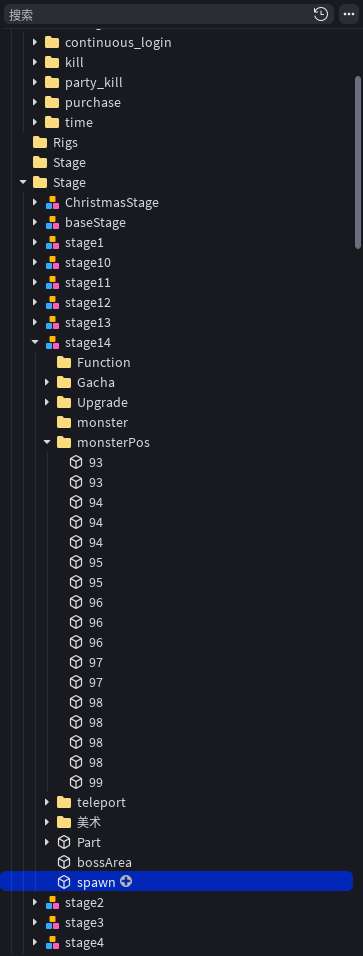

3. 配置表stage，icon字段需要自行手动去场景截图，722x130 大小
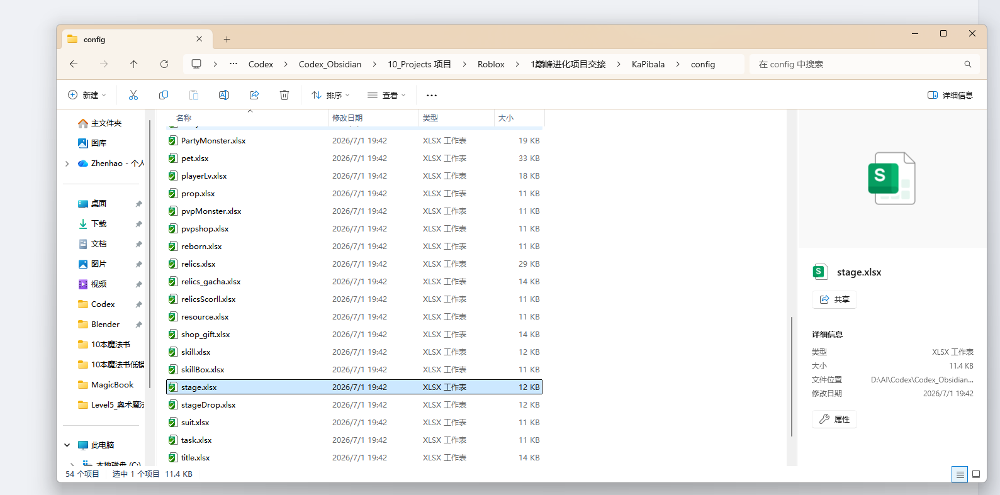
4. 等级表 playerLv.xlsx  的  奖励模型id  字段 对应的是角色模型 character.xlsx 表 里的 id 字段
5. 宠物表pet.xlsx  下的 模型字段  对应的是 resource/pet 文件夹下的模型
### 蛋
#### 路径位置：resource/stage/关卡/gacha

Gacha/collider 的对象名与  gacha.xlsx表里的字段一一对应

Gacha/model下的模型的 PrimaryPart值指向 模型（basepart）
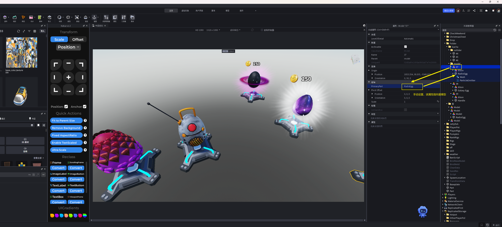

特效替换：ParticleEmitter 和  Particles 都属于特效
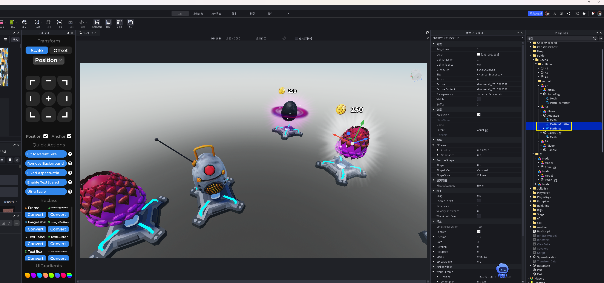

购买蛋 的触发块需要自行调整位置
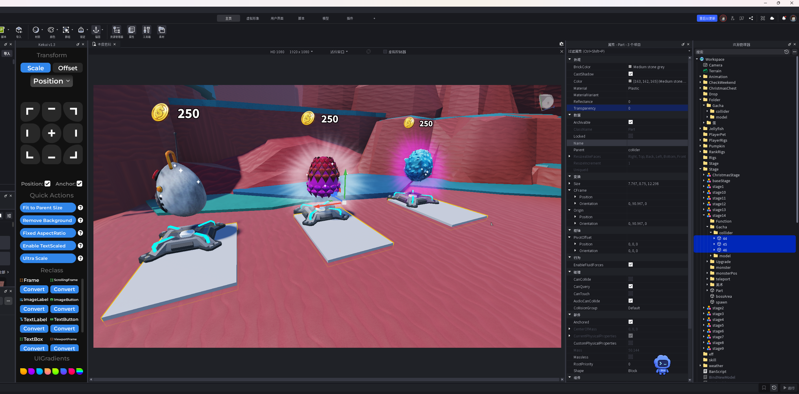

resource/egg/ 下需要复制一份蛋，有用游戏内抽蛋时的UI界面使用，Primary也需要指向模型basepart
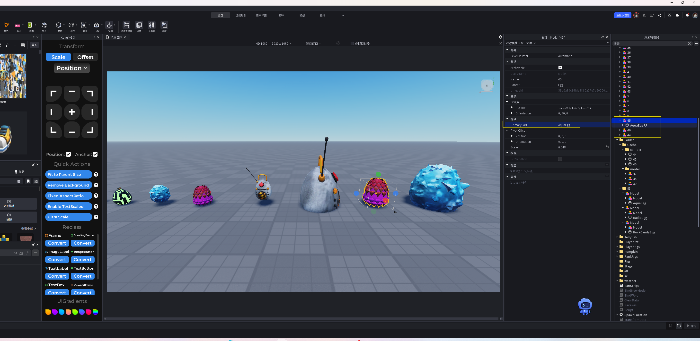

resource/egg/  蛋需要调整大小
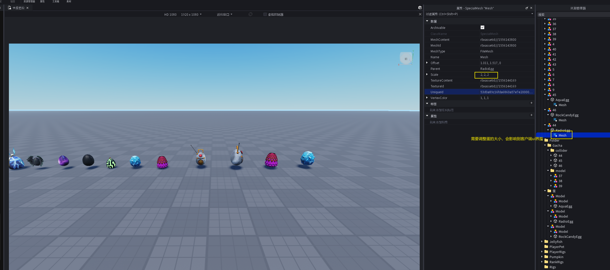

#### 雕像-upgrade.xlsx
upgrade.xlsx表下的 id字段与 stage关卡里的Upgrade文件夹里的模型 保持一致，注意触发块的位置调整

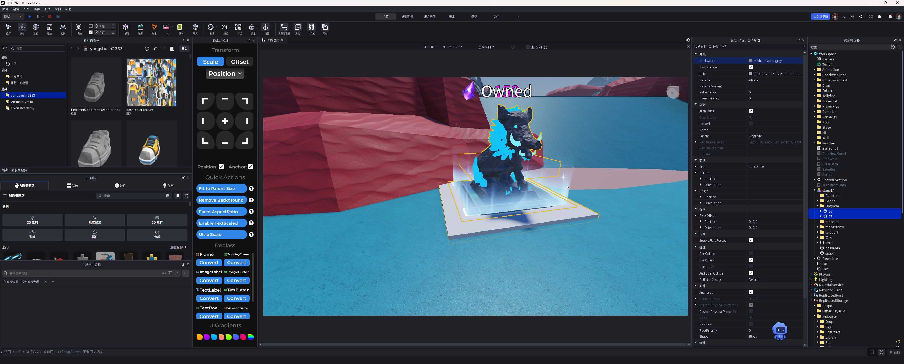

#### 传送-stage.xlsx

最新关卡要可以传回上一关，注意触发块 和  传送的文字，文字来自于stage.xlsx表里的name字段
模型名字也要改成对应关卡数字

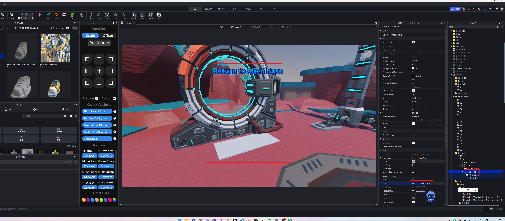

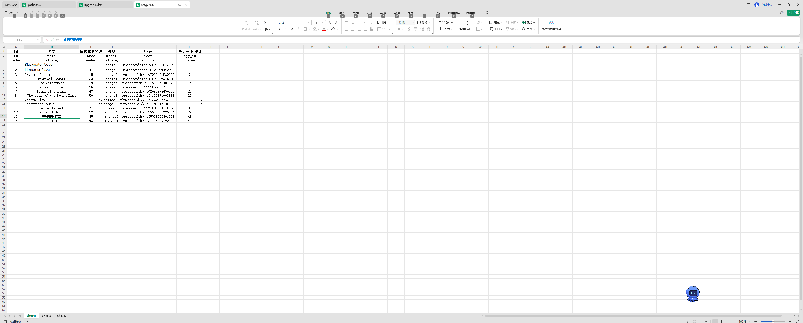

Resource/stage 下具体关卡 存在上一关卡 和 下一关卡 的联系。  最高关卡需可以传送回上一关， 上一关卡需更新传送到最新关卡的功能，即倒数第二关卡的第二个传送门需要进行更新（传送触发块，以及文字显示，值来自于 stage.xlsx表）

需要注意有个part 只存在于最新关卡，也只有一个。
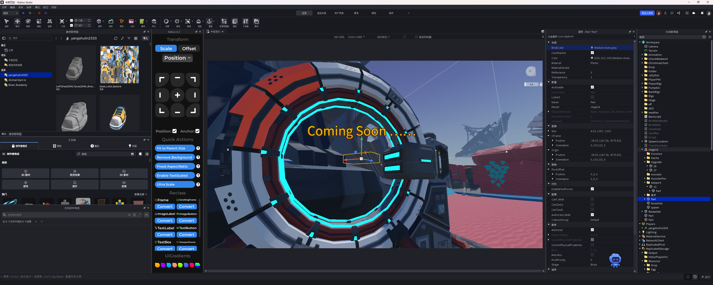
关卡存在承上启下的作用， 有传送

### 转换数据
.\config_export.bat
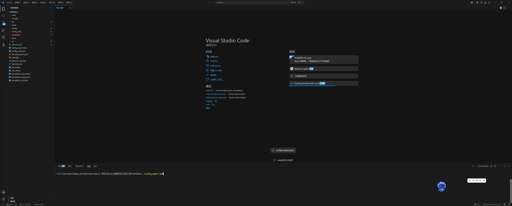

检测：
.add_lv 97

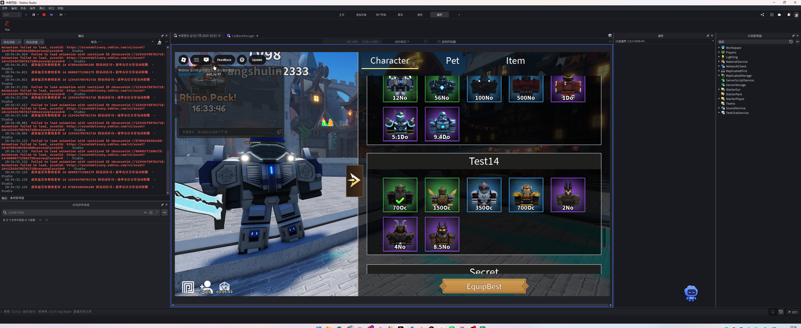