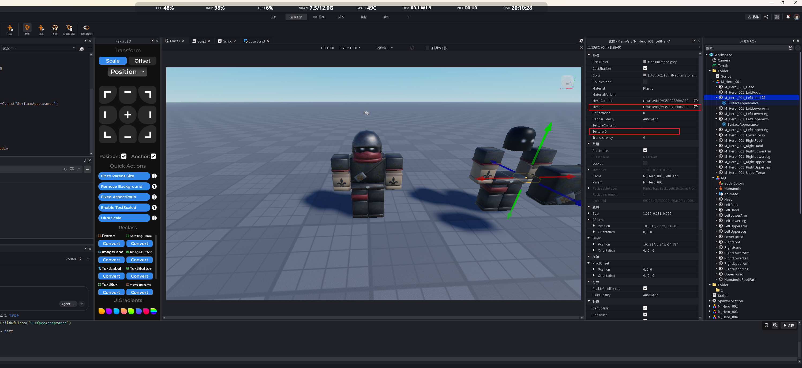
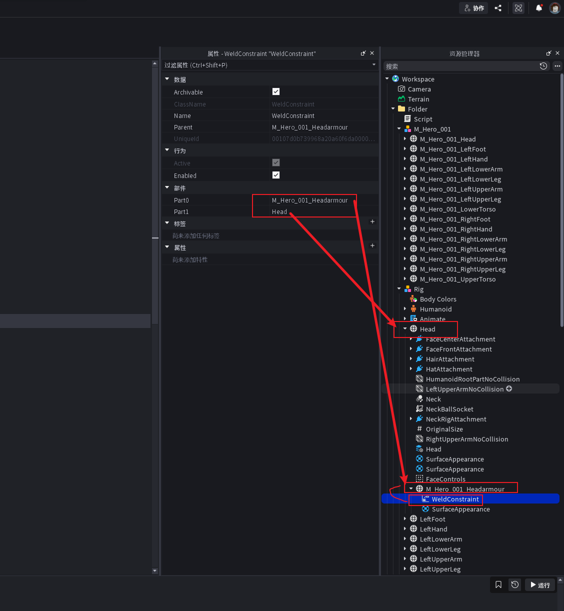
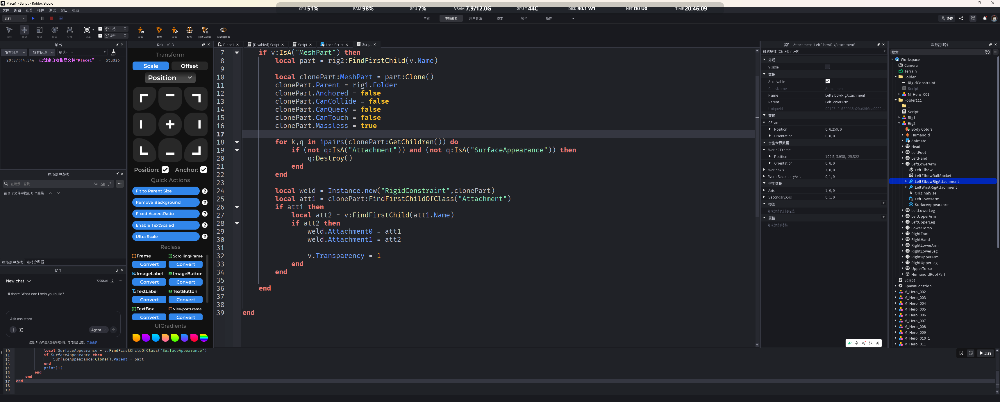
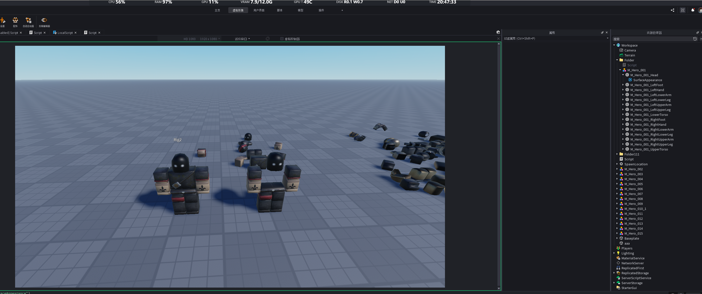
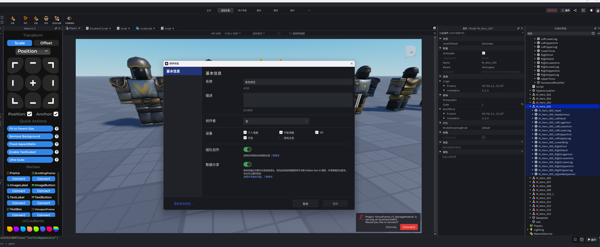

```
local rig:Model = workspace.Folder.Rig
local M_Hero:Model = workspace.Folder.M_Hero_001

for k,v in ipairs(M_Hero:GetChildren()) do
	local name = v.Name
	for x,y in ipairs(rig:GetChildren()) do
		if v.Name:find(y.Name) then
			local part:MeshPart = y
			part:ApplyMesh(v)
			local SurfaceAppearance = v:FindFirstChildOfClass("SurfaceAppearance")
			if SurfaceAppearance then
				SurfaceAppearance:Clone().Parent = part
			end
			print(1)
		end
	end
end


```




MeshId 控制形状，
Texture控制纹理

核心原理就是先创建一个Rig，然后将提供的角色的每一块部分的 MeshId 给替换掉，并把下面的SurfaceAppearance复制过去，如果 没有SurfaceAppearance 就 把 TextureID 复制过去。

还有一种方式就是用 WeldConstraint 对象焊接



## 第2中绑定







当角色的身体部位带有Attachment对象时，将其定位重合
 （本质就是将Attachment 定位到同一位置）

