# Demo001 角色绑定：Rig 网格替换、外壳与附件绑定

> 本文沉淀三种角色外观绑定方式。共同目标是：保留标准 Rig 的 `Humanoid`、关节、动画和碰撞逻辑，只替换或叠加角色外观。

## 一句话说明

把外包或美术提供的角色模型整理成与 R15 对应的 15 个身体部位后，逐个把源 `MeshPart` 的网格与外观信息应用到标准 Rig 的同名部位。这样角色能保持原有动画骨架，而显示为新角色外观。

## 适用范围与方法选择

| 方案 | 适用情况 | 核心结果 | 本文状态 |
| --- | --- | --- | --- |
| 方案 A：Rig 网格替换 | 源角色可整理为 R15 的 15 个身体部位 | 保留 `Humanoid`、`Motor6D`、动画和原有逻辑 | 本文主流程，已整理代码 |
| 方案 B：饰品 + WeldConstraint | 角色是独立的装饰模型、头盔、护肩等不能映射到 R15 的额外部件 | 将额外模型固定跟随某个身体部位 | 已整理单个 MeshPart 饰品的手动流程 |
| 方案 C：双 Rig + RigidConstraint | 皮肤模型与标准 Rig 的尺寸或轮廓差异较大，但双方具备可匹配的 R15 Attachment | 保留标准 Rig 驱动动画，以皮肤外壳完整覆盖原身体 | 已整理测试用自动绑定流程 |

若角色主体与 R15 形状、尺寸基本兼容，优先方案 A；独立头盔、护肩和背饰优先方案 B；若方案 A 出现躯干/四肢缝隙，且皮肤模型带有可匹配的 Attachment，则优先评估方案 C。不要删除标准 Rig 的身体部位来直接替换整套可动画身体。

## 0. 本次操作对象

示例层级：

```text
Workspace
└─ Folder
   ├─ Rig                 -- 标准 R15 目标角色
   └─ M_Hero_002          -- 待绑定的源角色模型
```

- `Rig`：必须保留 `Humanoid`、原有 15 个 R15 身体部位、动画和关节对象。
- `M_Hero_002`：美术模型。本流程只读取它的身体 `MeshPart`，不会删除源模型。
- 先复制一份 `Rig` 或在测试场景操作；确认通过后再替换正式资源。

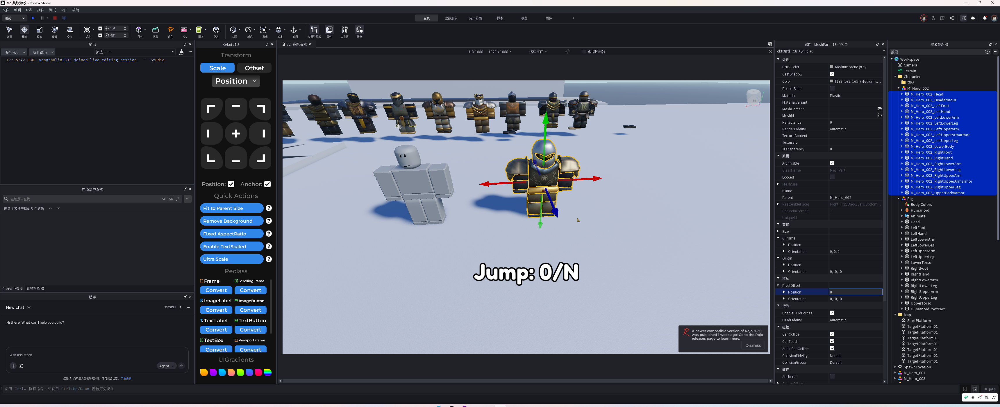

## 1. 源角色预处理

### 1.1 重置每个身体部位的轴点位置

选中源角色的身体 `MeshPart`，在 Properties 中展开 `PivotOffset`，将其中的 `Position` 设为 `0, 0, 0`。

- 目的是减少源网格局部轴点偏移，使它替换到 Rig 对应部位时更容易对齐。
- 这里只处理源身体部位，不要批量修改目标 `Rig` 的 Pivot。
- 如果模型原有旋转靠 PivotOffset 修正，先复制一份模型；重置后需要在测试场景确认朝向是否正常。

### 1.2 只保留标准的 15 个身体部位

先把头盔、护肩、武器、背饰等附件临时移出源模型，只留下可映射到 R15 的主体身体网格。标准 R15 部位为：

| 序号 | Rig 部位名 |
| --- | --- |
| 1 | `Head` |
| 2 | `UpperTorso` |
| 3 | `LowerTorso` |
| 4 | `LeftUpperArm` |
| 5 | `LeftLowerArm` |
| 6 | `LeftHand` |
| 7 | `RightUpperArm` |
| 8 | `RightLowerArm` |
| 9 | `RightHand` |
| 10 | `LeftUpperLeg` |
| 11 | `LeftLowerLeg` |
| 12 | `LeftFoot` |
| 13 | `RightUpperLeg` |
| 14 | `RightLowerLeg` |
| 15 | `RightFoot` |

### 1.3 统一源角色的命名后缀

脚本通过“源部位名的末尾”匹配 Rig 部位名。因此源部位名必须以标准 R15 名称结尾，例如：

| 不规范示例                       | 需要改为                    | 对应 Rig 部位    |
| --------------------------- | ----------------------- | ------------ |
| `M_Hero_002_UpperBodyarmor` | `M_Hero_002_UpperTorso` | `UpperTorso` |
| `M_Hero_002_LowerBodyarmor` | `M_Hero_002_LowerTorso` | `LowerTorso` |

名称前缀可以保留角色编号，例如 `M_Hero_002_`；关键是最后一段必须准确等于 Rig 的部位名。不要重命名 `Rig` 本身的标准部位。

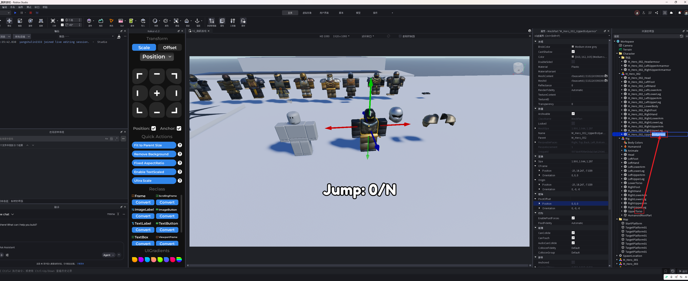

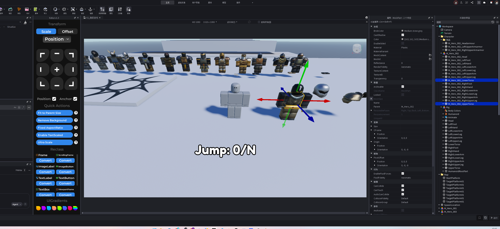

## 2. 核心知识：形状、基础贴图与 SurfaceAppearance

### 2.1 `MeshId`、`TextureID` 分别控制什么

| 项目 | 主要作用 | 本流程中的处理 |
| --- | --- | --- |
| `MeshId` | 网格形状，即头、躯干、手脚的几何外形 | 将源部位网格应用到同名 Rig 部位 |
| `TextureID` | 基础贴图图像 | 源部位没有 `SurfaceAppearance` 时，复制到目标 Rig 部位 |
| `SurfaceAppearance` | MeshPart 的材质外观组件，支持 PBR 类贴图 | 源部位存在时，克隆到目标 Rig 部位 |

### 2.2 `SurfaceAppearance` 是什么

`SurfaceAppearance` 是挂在 `MeshPart` 下的外观对象。它不只是一张颜色贴图，还可以组合多种材质图，使金属、粗糙度、法线细节、透明边缘等外观正确显示。

常见属性包括：

- `ColorMap`：颜色/主视觉贴图。
- `NormalMap`：法线细节，让平面在光照下看起来有凹凸。
- `RoughnessMap`：控制表面粗糙或光滑。
- `MetalnessMap`：控制金属感。
- `AlphaMode`：控制透明或裁切类显示效果。

因此，源部位带有 `SurfaceAppearance` 时，只复制 `MeshId` 往往会出现“形状对了但材质不对”。正确做法是清除目标部位已有的 `SurfaceAppearance` 后，再克隆源部位的对象过去；若源部位没有该对象，再使用 `TextureID` 作为基础贴图。

## 3. 先手动验证一个部位：Head

首次接入一个新角色时，先只替换 `Head`，确认资源可用后再批量处理 15 个部位。

1. 在源角色中选择 `M_Hero_002_Head`，在 `Rig` 中选择 `Head`。
2. 将源 `Head` 的 `MeshId` 复制到 Rig 的 `Head`；也可以通过脚本的 `ApplyMesh()` 完成这一步。
3. 如果源 `Head` 下有 `SurfaceAppearance`，先删除 Rig `Head` 下旧的同类对象，再把源对象复制到 Rig `Head` 下。
4. 如果源 `Head` 没有 `SurfaceAppearance`，复制源 `Head.TextureID` 到 Rig `Head.TextureID`。
5. 在 Studio 视图检查头部形状、贴图、透明部分和朝向。

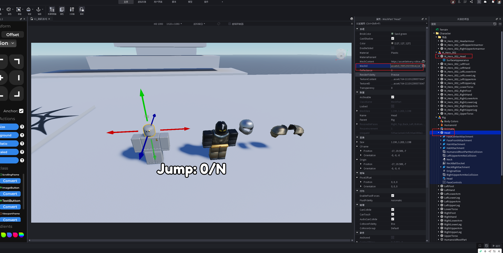

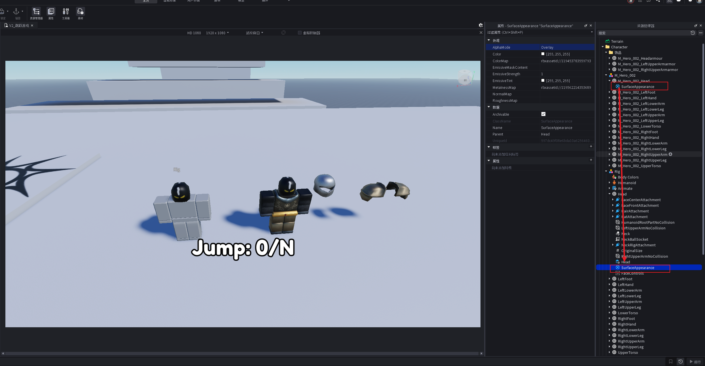

## 4. 通用批量绑定脚本

下面的脚本只处理列出的 15 个 R15 部位；不再使用 `v.Name:find(y.Name)` 的双层模糊匹配，避免意外匹配到附件或名称相近的对象。

运行前确认：

1. `Workspace.Folder.Rig` 是标准 R15 目标模型。
2. `Workspace.Folder.M_Hero_002` 是已完成命名整理的源角色模型。
3. 两个模型都已经备份；源角色附件已先移出。
4. 若源模型名称不同，只修改脚本中的 `SOURCE_MODEL_NAME`。

```lua
-- 在测试场景的 Command Bar 或临时 Script 中执行。
-- 确认结果后，不要把临时 Script 留在正式资源层级中。

local FOLDER_NAME = "Folder"
local RIG_MODEL_NAME = "Rig"
local SOURCE_MODEL_NAME = "M_Hero_002"

-- 只处理标准 R15 身体部位，不处理武器、头盔、背饰等附件。
local BODY_PART_NAMES = {
    "Head",
    "UpperTorso",
    "LowerTorso",
    "LeftUpperArm",
    "LeftLowerArm",
    "LeftHand",
    "RightUpperArm",
    "RightLowerArm",
    "RightHand",
    "LeftUpperLeg",
    "LeftLowerLeg",
    "LeftFoot",
    "RightUpperLeg",
    "RightLowerLeg",
    "RightFoot",
}

local folder = workspace:WaitForChild(FOLDER_NAME)
local rig = folder:WaitForChild(RIG_MODEL_NAME)
local sourceModel = folder:WaitForChild(SOURCE_MODEL_NAME)

assert(rig:IsA("Model"), RIG_MODEL_NAME .. " 必须是 Model")
assert(sourceModel:IsA("Model"), SOURCE_MODEL_NAME .. " 必须是 Model")

local function findSourceMeshPart(bodyPartName: string): MeshPart?
    -- 允许源对象带角色前缀，例如 M_Hero_002_Head，
    -- 但要求最后一段严格等于 R15 的部位名。
    local suffix = "_" .. bodyPartName

    for _, child in ipairs(sourceModel:GetChildren()) do
        if child:IsA("MeshPart") then
            local isExactName = child.Name == bodyPartName
            local hasBodyPartSuffix = child.Name:sub(-#suffix) == suffix

            if isExactName or hasBodyPartSuffix then
                return child
            end
        end
    end

    return nil
end

local function replaceSurfaceAppearance(sourcePart: MeshPart, targetPart: MeshPart)
    -- 旧的 SurfaceAppearance 会覆盖 TextureID，因此先清理，防止叠加或显示旧材质。
    for _, child in ipairs(targetPart:GetChildren()) do
        if child:IsA("SurfaceAppearance") then
            child:Destroy()
        end
    end

    local sourceAppearance = sourcePart:FindFirstChildWhichIsA("SurfaceAppearance")
    if sourceAppearance then
        sourceAppearance:Clone().Parent = targetPart
    else
        -- 源模型没有 PBR 外观对象时，明确复制基础贴图。
        targetPart.TextureID = sourcePart.TextureID
    end
end

local function bindBodyPart(sourcePart: MeshPart, targetPart: MeshPart)
    -- 目标是 Rig 原部位：Humanoid、Attachment、Motor6D 等不被替换或删除。
    targetPart:ApplyMesh(sourcePart)
    replaceSurfaceAppearance(sourcePart, targetPart)
end

local boundCount = 0
local skippedPartNames = {}

for _, bodyPartName in ipairs(BODY_PART_NAMES) do
    local targetPart = rig:FindFirstChild(bodyPartName)
    local sourcePart = findSourceMeshPart(bodyPartName)

    if not targetPart or not targetPart:IsA("MeshPart") then
        table.insert(skippedPartNames, bodyPartName .. "（Rig 中不存在 MeshPart）")
    elseif not sourcePart then
        table.insert(skippedPartNames, bodyPartName .. "（源模型未找到对应部位）")
    else
        bindBodyPart(sourcePart, targetPart)
        boundCount += 1
        print("已绑定：" .. bodyPartName)
    end
end

print(string.format("角色绑定完成：%d / %d", boundCount, #BODY_PART_NAMES))

if #skippedPartNames > 0 then
    warn("以下部位未绑定：\n- " .. table.concat(skippedPartNames, "\n- "))
end
```

脚本执行成功的最低标准是 Output 显示 `角色绑定完成：15 / 15`，并且没有未绑定部位警告。未达到 15 个时，先修正源模型命名或缺失部位，不要直接把半成品用于正式角色资源。

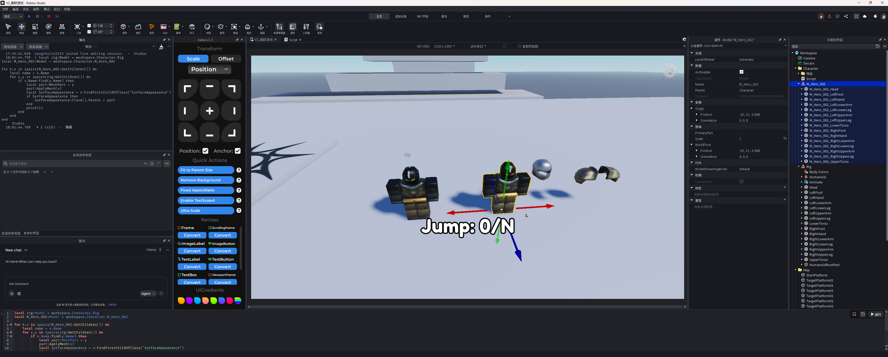

## 5. 为什么这样绑定不会破坏角色动画

这个方案始终把 `Rig` 的原部位作为目标，只更新目标 `MeshPart` 的外观。`Rig` 中的 `Humanoid`、身体 Attachment、`Motor6D` 关节、`Animate` 脚本和碰撞设置仍然保留在原模型上。

前提是新网格的部位拓扑、大小和朝向与 R15 基本兼容。若新角色只是“看起来像人体”但四肢比例、局部坐标或部位切分差异很大，虽然脚本能替换网格，实际走路、手脚旋转和碰撞仍可能异常。

### 5.1 方案 A 的缺陷：源模型与 Rig 尺寸不一致会产生身体缝隙

通过替换 `MeshId`，再复制 `TextureID` 或 `SurfaceAppearance` 的方式，本质上是把新外观应用到**原有 Rig 的身体部位尺寸和关节结构**上。它不能保证源模型的躯干、手臂和腿部比例与这个 Rig 完全一致。

因此，源模型尺寸或部位切分不一致时，常见结果是：

- `UpperTorso` 与 `LeftUpperArm` / `RightUpperArm` 之间出现明显缝隙。
- 上下躯干、大小腿或脚部的接缝过大。
- 单个部位外观看起来正确，但整体轮廓不连贯。

不要为了消除缝隙而随意修改标准 Rig 每个部位的 `Size`。这可能继续影响关节、动画表现和碰撞边界，且很难稳定复用。

### 5.2 何时从方案 A 切换到方案 B

出现下列情况时，把源模型的躯干或四肢当作“独立 MeshPart 外壳”，按第 7 节的 `WeldConstraint` 流程直接绑定到对应 Rig 部位：

| 现象或条件 | 推荐处理 |
| --- | --- |
| 躯干和四肢之间存在明显缝隙 | 源躯干 / 四肢分别焊接到对应 Rig 部位 |
| 源角色比例明显大于或小于 Rig | 使用源部件的 CFrame、角度和 Scale 手动对齐后再焊接 |
| 单个部位无法用 MeshId 替换后保持连贯轮廓 | 不再强行替换该部位，改为直接绑定源 MeshPart |
| 头盔、肩甲、背饰等本来就是独立部件 | 直接使用方案 B |

此时仍要保留 Rig 原有身体部位、`Humanoid`、Attachment 和 `Motor6D`，让它们继续负责动画和行为；源模型部件只负责显示外观。若标准 Rig 本体在源外壳外露，需要另行制定隐藏策略，但不要直接删除 Rig 的身体部位。

## 6. Studio 验收清单

### 6.1 绑定前

- [ ] 源角色和 Rig 都有可回滚备份。
- [ ] 源角色主体恰好有 15 个可映射身体 `MeshPart`。
- [ ] 独立附件、武器和特效已从源身体部位列表中移出。
- [ ] `UpperBodyarmor`、`LowerBodyarmor` 等非标准后缀已改为 `UpperTorso`、`LowerTorso`。
- [ ] 已先手动替换并检查 `Head`。

### 6.2 脚本后

- [ ] Output 显示 `15 / 15`，没有缺失部位告警。
- [ ] 每个 Rig 身体部位都没有重复的 `SurfaceAppearance`。
- [ ] 头、躯干、四肢没有反向、错位、裸露基础色或异常透明。
- [ ] `Rig.Humanoid`、`HumanoidRootPart`、`Animate` 和各部位 Attachment 仍存在。
- [ ] Play 测试中待机、走路、跳跃、转向正常。
- [ ] 附件、武器和特效在动画时没有脱离身体。
- [ ] 独立饰品均已关闭锚固和碰撞，并设置为 `Massless`。

## 7. 方案 B：饰品 + WeldConstraint 手动绑定

当源资源不是标准 R15 身体网格，而是头盔、护肩、翅膀等独立 `MeshPart` 时，不能简单用 `ApplyMesh()` 覆盖 Rig 部位。此时把饰品放到对应身体部位下，手动对齐后用 `WeldConstraint` 固定跟随。源角色与 Rig 尺寸不一致、导致身体缝隙明显时，也可以把源躯干或四肢按同一方式直接绑定为外观外壳。

本节以单个头盔 `MeshPart` 为例。护肩和其他饰品使用同一方法，只是目标身体部位不同。

### 7.1 先确定饰品要跟随的目标部位

| 饰品示例 | 目标 Rig 部位 | 备注 |
| --- | --- | --- |
| 头盔 | `Head` | 头盔不能作为 `Head` 的网格替换内容时，改用本方案 |
| 左肩甲 | `LeftUpperArm` | 先对齐位置、角度和大小，再创建焊接 |
| 右肩甲 | `RightUpperArm` | 不要绑到 `UpperTorso`，否则手臂动画不会带动肩甲 |
| 背饰 | `UpperTorso` | 需要检查跑步和跳跃时是否穿过躯干 |
| 源上躯干外壳 | `UpperTorso` | 用于修复 MeshId 替换造成的躯干/手臂缝隙 |
| 源四肢外壳 | 对应的 `Left*` / `Right*` 部位 | 按实际部位逐件对齐并焊接 |

### 7.2 将饰品拖到对应身体部位下

1. 在 Explorer 中将饰品或源躯体部件 `MeshPart` 拖到 `Rig` 的目标身体部位下。头盔示例为 `Rig.Head`。
2. 保持源部件本身是可单独选择的 `MeshPart`；它是显示外壳，不要删除或替换 Rig 的标准身体部位。
3. 原有 `SurfaceAppearance` 可以保留在饰品自身下，它负责饰品的外观。

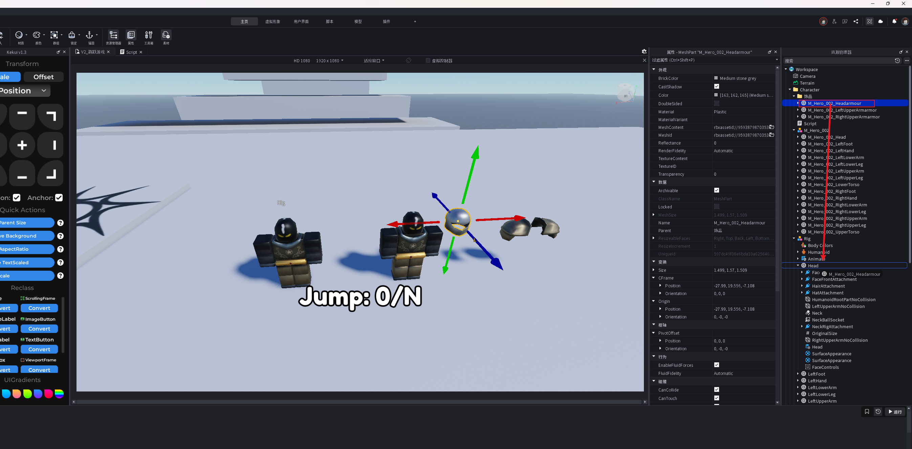

### 7.3 对齐位置、角度和大小

1. 选中目标身体部位，例如 `Rig.Head`，记录它的 `CFrame.Position`。
2. 选中饰品，将饰品 `CFrame.Position` 先设置为目标部位的 Position，使饰品先移动到同一位置。
3. 用 Move / Rotate 把饰品调整到视觉上合适的位置；头盔要包住头部但不要遮挡脸部或穿进脖子。
4. 肩甲等饰品可以在定位阶段调整 `Size` 或 Scale，使比例与角色一致。
5. **先完成定位，再创建 WeldConstraint。** 焊接会锁定当前相对位置；若先焊接再随意移动，后续更难判断偏移来自哪里。

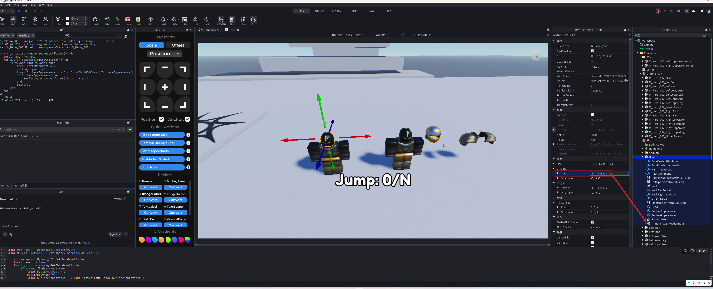

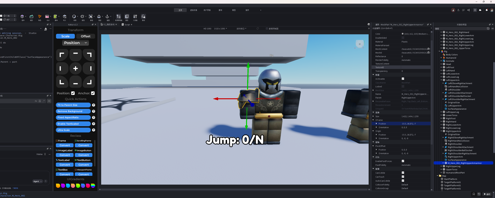

### 7.4 新建 WeldConstraint 并设置 Part0 / Part1

1. 在饰品 `MeshPart` 下新增 `WeldConstraint`。
2. 选中新的 `WeldConstraint`，按下表设置引用。

| WeldConstraint 字段 | 头盔示例 | 含义 |
| --- | --- | --- |
| `Part0` | 头盔自身 `MeshPart` | 被绑定、需要跟随的饰品 |
| `Part1` | `Rig.Head` | 饰品跟随的角色身体部位 |

3. 完成后移动或播放 Rig 动画，头盔应始终跟随 `Head`。

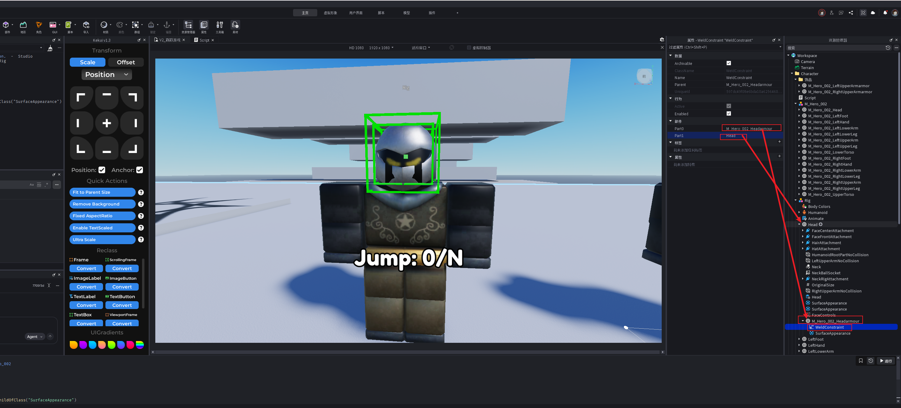

### 7.5 关闭饰品的物理干扰

选中饰品自身 `MeshPart`，设置：

| 属性 | 值 | 原因 |
| --- | --- | --- |
| `Anchored` | `false` | 锚固会阻止饰品跟随角色移动 |
| `CanCollide` | `false` | 饰品不应与玩家、地图或角色自身发生碰撞 |
| `Massless` | `true` | 忽略饰品质量，避免增加角色物理负担 |
| `CanQuery` | `false`（无射线检测需求时） | 防止装饰物被不必要的查询命中 |
| `CanTouch` | `false`（无触碰逻辑时） | 防止装饰物触发触碰事件 |

其中 `Anchored = false`、`CanCollide = false`、`Massless = true` 是本流程的必设项。`CanQuery`、`CanTouch` 只在饰品不承担交互功能时关闭。

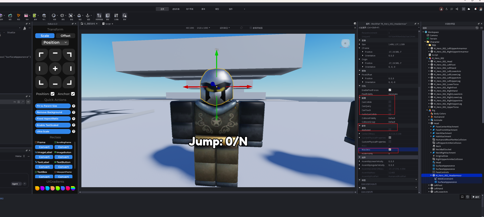

### 7.6 饰品绑定后的验收

- [ ] 头盔或肩甲已经跟随目标部位移动，不会落到地面。
- [ ] Play 测试中走路、跳跃、转向时，饰品没有延迟、抖动或脱离。
- [ ] 饰品不会推开角色、卡住地面或触发意外碰撞。
- [ ] 头盔不会遮住脸部；肩甲不会穿入躯干或阻挡手臂动作。
- [ ] 对每个独立饰品分别检查 `WeldConstraint.Part0` 与 `Part1`，不要复制后忘记改引用。

### 7.7 多部件饰品的边界

本文验证的是单个 `MeshPart` 饰品。若一个头盔或背饰由多个 MeshPart 组成：

1. 先在饰品内部选出一个根部件。
2. 先保证其他饰品子部件能跟随该根部件。
3. 再把根部件按本节方式焊接到 Rig 的目标身体部位。

多部件饰品的内部焊接结构、Attachment 命名和缩放规则尚未在本项目中记录为统一模板，首次接入时应在测试副本中验证后再复用。

## 8. 方案 C：双 Rig + RigidConstraint 自动皮肤绑定

### 8.1 适用场景与核心分工

方案 C 不替换标准 Rig 的网格，也不逐件手动焊接源身体部位。它让标准角色和皮肤角色同时存在，再把皮肤的身体部件克隆为外观外壳，通过 `RigidConstraint` 固定到标准 Rig 的对应 Attachment。

| 对象 | 职责 | 必须保留/满足的内容 |
| --- | --- | --- |
| `Rig1` | 默认角色、运行时骨架 | `Humanoid`、`Motor6D`、标准 R15 身体部位、动画、原 Attachment |
| `Rig2` | 美术提供的模型皮肤 | 与 `Rig1` 同名的身体 `MeshPart`，以及可匹配名称的 Attachment |
| `Rig1.SkinShell` | 脚本生成的皮肤外壳容器 | 保存克隆出的皮肤部件和 `RigidConstraint`，便于检查与回滚 |

`RigidConstraint` 会连接两个 `Attachment`（也可用于 Bone），并让二者保持相同的相对位置与朝向。因此它适合把皮肤的完整身体部件跟随到标准 R15 身体部位，同时保留皮肤模型自身的尺寸和轮廓。Roblox 官方也将这种刚性约束用于把配件连接到角色 Rig。 [RigidConstraint API](https://create.roblox.com/docs/reference/engine/classes/RigidConstraint) / [刚性约束说明](https://create.roblox.com/docs/physics/constraints/rigid)

这与方案 B 的区别是：方案 B 适合少量、需要人工调整的独立饰品；方案 C 适合已具备标准 Attachment 的完整皮肤外壳，可批量处理 15 个身体部位。

### 8.2 前置条件：先检查部位与 Attachment

1. 在测试场景中准备两个 `Model`：`Rig1` 为标准 R15，`Rig2` 为皮肤模型。二者不必摆放在同一位置。
2. `Rig2` 的每个皮肤身体部位必须是 `MeshPart`，名称与 `Rig1` 的标准 R15 部位完全一致，例如都叫 `LeftLowerArm`；本方案不使用“名称后缀包含”的模糊匹配。
3. 每对对应部位至少要有一对**完全同名**的 Attachment。例如皮肤 `LeftLowerArm` 和 `Rig1.LeftLowerArm` 都有 `LeftElbowRigAttachment`。
4. 不要改名、移动或删除 `Rig1` 既有 Attachment；它们是 R15 关节和外壳绑定的定位基准。
5. `Rig2` 只作为源模型。先保留它，直到 Play 测试通过后再决定是否移动到资源目录或删除测试副本。

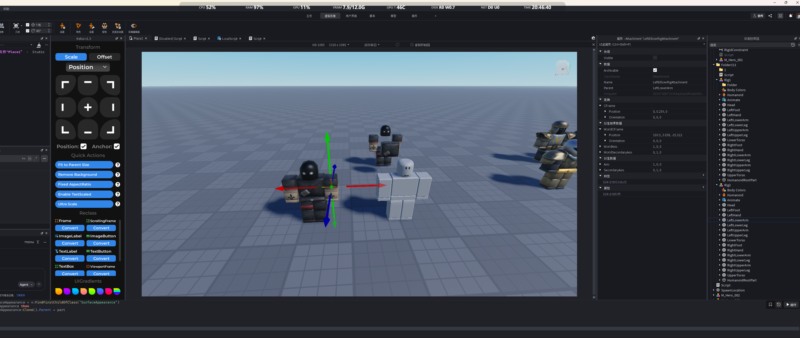

若 `Rig2` 只是一个没有 Attachment 的完整模型，不能直接套用本方案。应先补齐并验证 Attachment，或退回方案 B，手动将源躯干/四肢作为外壳焊接到对应 Rig 部位。

### 8.3 执行前的层级约定

以下脚本以这个测试层级为例；真实项目可修改前 4 个常量，但不要在未备份的正式角色资源上直接运行。

```text
Workspace
└─ Folder111
   ├─ Rig1    -- 标准 R15，负责动画和逻辑
   └─ Rig2    -- 皮肤模型，提供外观和 Attachment
```

脚本只读取 `Rig1`、`Rig2` 的**直接子级** `MeshPart`。这是刻意限制：标准 R15 的 15 个身体部位应位于 Model 直接子级；如果直接使用 `GetDescendants()`，可能把武器、饰品或其他嵌套 MeshPart 错当成身体部位。

### 8.4 通用测试脚本

将以下 Script 放在测试场景中执行。它会：

1. 从 `Rig2` 克隆与 `Rig1` 同名的皮肤部位；
2. 保留皮肤的 Attachment 和 `SurfaceAppearance`，移除其他不需要的子对象；
3. 通过同名 Attachment 对齐皮肤部件并创建 `RigidConstraint`；
4. 将 `Rig1` 对应原身体部位设为透明，但不删除其关节、碰撞与动画结构；
5. 在 Output 输出已绑定和跳过的部位，避免半成品静默进入正式资源。

```lua
-- 只在测试场景运行。Rig1 保留动画和逻辑，Rig2 仅作为皮肤外观来源。
local FOLDER_NAME = "Folder111"
local BASE_RIG_NAME = "Rig1"
local SKIN_RIG_NAME = "Rig2"
local SKIN_FOLDER_NAME = "SkinShell"

local folder = workspace:WaitForChild(FOLDER_NAME)
local rig1 = folder:WaitForChild(BASE_RIG_NAME)
local rig2 = folder:WaitForChild(SKIN_RIG_NAME)

assert(rig1:IsA("Model"), BASE_RIG_NAME .. " 必须是 Model")
assert(rig2:IsA("Model"), SKIN_RIG_NAME .. " 必须是 Model")
assert(
    not rig1:FindFirstChild(SKIN_FOLDER_NAME),
    "Rig1 已存在 " .. SKIN_FOLDER_NAME .. "；先检查或移除上一次测试结果，避免重复绑定"
)

local skinFolder = Instance.new("Folder")
skinFolder.Name = SKIN_FOLDER_NAME
skinFolder.Parent = rig1

local function findMatchingAttachment(
    skinPart: MeshPart,
    rigPart: MeshPart
): (Attachment?, Attachment?)
    for _, child in ipairs(skinPart:GetChildren()) do
        if child:IsA("Attachment") then
            local candidate = rigPart:FindFirstChild(child.Name)
            if candidate and candidate:IsA("Attachment") then
                return child, candidate
            end
        end
    end

    return nil, nil
end

local function cleanClone(clonePart: MeshPart)
    -- Attachment 用于约束定位，SurfaceAppearance 用于保留 PBR 外观。
    for _, child in ipairs(clonePart:GetChildren()) do
        if not child:IsA("Attachment") and not child:IsA("SurfaceAppearance") then
            child:Destroy()
        end
    end

    clonePart.Anchored = false
    clonePart.CanCollide = false
    clonePart.CanQuery = false
    clonePart.CanTouch = false
    clonePart.Massless = true
end

local boundCount = 0
local skipped = {}

for _, rigPart in ipairs(rig1:GetChildren()) do
    if rigPart:IsA("MeshPart") then
        local skinPart = rig2:FindFirstChild(rigPart.Name)
        if not skinPart or not skinPart:IsA("MeshPart") then
            table.insert(skipped, rigPart.Name .. "（Rig2 缺少同名 MeshPart）")
            continue
        end

        local clonePart = skinPart:Clone()
        local skinAttachment, rigAttachment = findMatchingAttachment(clonePart, rigPart)
        if not skinAttachment or not rigAttachment then
            clonePart:Destroy()
            table.insert(skipped, rigPart.Name .. "（找不到同名 Attachment）")
            continue
        end

        cleanClone(clonePart)
        clonePart.Name = rigPart.Name .. "_Skin"
        clonePart.Parent = skinFolder

        -- 先让两个 Attachment 重合，再建立刚性约束，减少创建时的拉扯或跳动。
        clonePart.CFrame = rigAttachment.WorldCFrame * skinAttachment.CFrame:Inverse()

        local constraint = Instance.new("RigidConstraint")
        constraint.Name = "SkinRigidConstraint"
        constraint.Attachment0 = skinAttachment
        constraint.Attachment1 = rigAttachment
        constraint.Parent = clonePart

        -- 原 Rig 继续驱动动画，只隐藏其显示外壳。
        rigPart.Transparency = 1
        boundCount += 1
        print("已绑定皮肤部位：" .. rigPart.Name .. "，Attachment：" .. skinAttachment.Name)
    end
end

print(string.format("RigidConstraint 皮肤绑定完成：%d 个部位", boundCount))

if #skipped > 0 then
    warn("以下部位未绑定：\n- " .. table.concat(skipped, "\n- "))
end
```


### 8.5 验收与回滚

执行脚本后，检查 `Rig1.SkinShell`：每个已绑定皮肤部位应同时拥有保留下来的 Attachment 和名为 `SkinRigidConstraint` 的约束。然后进入 Play 测试。

- [ ] Output 没有 `Rig2 缺少同名 MeshPart` 或 `找不到同名 Attachment` 警告；预期为 15 个时，输出必须是 `15 个部位`。
- [ ] `Rig1` 原有 15 个身体部位、`Humanoid`、`Motor6D`、动画和 Attachment 仍存在；原部位只被隐藏，未被删除。
- [ ] 皮肤外壳保留自身的比例，躯干、手臂和腿部之间没有方案 A 的明显尺寸缝隙。
- [ ] 走路、跳跃、转向、待机时，皮肤没有漂移、抖动、穿插或碰撞卡顿。
- [ ] 生成的皮肤部位均为 `Anchored = false`、`CanCollide = false`、`Massless = true`。
- [ ] 测试未通过时，删除本次生成的 `Rig1.SkinShell` 即可回到绑定前状态；不要删除 `Rig1` 原身体部位或 `Rig2` 源模型。

如果原 Rig 在皮肤缝隙中可见，先检查皮肤外壳是否完整覆盖，再决定是否继续隐藏原 Rig。不要通过删除 R15 部位来解决显示问题，否则会破坏关节、动画或碰撞依赖。

## 9. 常见问题与排查顺序

| 现象 | 优先检查 | 处理方向 |
| --- | --- | --- |
| 脚本只绑定了部分部位 | 源模型名最后一段、是否正好 15 个 MeshPart | 统一为 R15 后缀，再重新执行 |
| 形状对了但材质不对 | 源部位是否有 `SurfaceAppearance` | 有则克隆对象；无则复制 `TextureID` |
| 材质仍显示旧贴图 | Rig 目标部位是否残留旧 `SurfaceAppearance` | 删除旧对象后再克隆源对象 |
| 身体部位错位或朝向不对 | 源部位 `PivotOffset`、网格局部坐标、模型拓扑 | 在备份上重置 PivotOffset Position，并先单独验证该部位 |
| 动画时手脚异常 | 新网格是否真正对应 R15 部位 | 不兼容的主体改用重新拆分/重新导出；附件用方案 B |
| 四肢和躯干缝隙过大 | 源模型与 Rig 的部位尺寸、比例是否一致 | 停止单纯替换 MeshId；将源躯干/四肢按方案 B 直接焊接为外观外壳 |
| 饰品掉在地上或不跟随 | `WeldConstraint.Part0` / `Part1`、`Anchored` | Part0 指向饰品自身、Part1 指向目标身体部位，并关闭 Anchored |
| 饰品推开角色或卡住地图 | `CanCollide`、`Massless` | 关闭 CanCollide，并将 Massless 设为 true |
| 肩甲跟随方向不对 | 目标部位是否选错 | 左右肩甲分别绑定到对应的 `LeftUpperArm` / `RightUpperArm` |
| 方案 C 皮肤部位没有生成 | `Rig2` 是否有同名 `MeshPart` | 先统一 Rig1 / Rig2 的标准 R15 部位名，不要使用模糊后缀匹配 |
| 方案 C 皮肤错位、跳动或被拉走 | 两侧 Attachment 的名称、局部位置和朝向 | 确认是一对同名 R15 Attachment；先修正 Attachment，再重新生成 `SkinShell` |
| 方案 C 再次运行后出现重复皮肤 | `Rig1` 下是否已有 `SkinShell` | 先检查并删除上一次的测试生成物，再重新运行；不要删除 Rig1 原部位 |
| 贴图加载失败 | 素材权限与资源 ID | 先确认该账号/体验有素材使用权限，再检查 `SurfaceAppearance` 各贴图字段 |

## 10. 当前边界与待补充

- 方案 B 已覆盖单个 `MeshPart` 饰品和源躯体外壳的手动绑定；多部件饰品或完整多 MeshPart 身体的内部焊接关系仍需在实际案例中补充。
- 方案 C 的前提是 `Rig2` 已具有与标准 R15 对应的 Attachment。当前文档没有记录“无 Attachment 的整套皮肤模型”如何自动补齐 Attachment；此类资源先走方案 B 或在测试副本中完成 Attachment 规范化。
- 如果后续外包角色不是 R15 兼容的 15 部位模型，应先记录其部位层级、Attachment 名称和需要跟随的目标部位，再决定是重新拆分主体，还是按方案 B 处理为独立饰品。
- 如果角色使用额外特效、武器或 Accessory，还需要单独确认这些对象的绑定点，不应混入 15 个主体 MeshPart 的替换脚本。

## 来源与关联

- 本次 Studio 操作截图：`assets/角色绑定/`。
- 原始零散记录保留在：[[角色绑定 - 副本]]。
- 项目入口：[[../00_入口|巅峰进化项目交接入口]]。
- 相关领域：[[Roblox]]、[[角色模型]]、[[R15]]、[[SurfaceAppearance]]。
- Roblox 官方参考：[RigidConstraint](https://create.roblox.com/docs/reference/engine/classes/RigidConstraint)、[刚性约束](https://create.roblox.com/docs/physics/constraints/rigid)。
