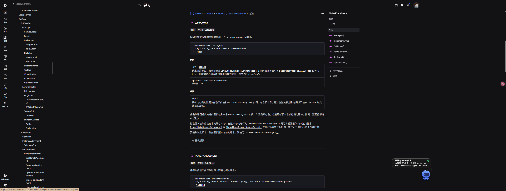

# Storage 最小存储边界

## 定位

当前 Storage 不是完整存储模块。

它只是为了让其他模块能先验证数据逻辑。

当前只包含：

- StorageConfig
- MemoryStorage
- StorageService

不包含：

- DataStore
- ProfileStore
- 数据迁移
- JSON / Excel 导入导出
- 批量维护

## StorageConfig

负责数据规则：

```text
SchemaVersion：数据结构版本
DefaultData：默认数据模板
Validate(data)：检查数据是否合法
```

它不保存玩家数据。

## MemoryStorage

负责内存数据容器：

```text
Open
Get
Set
Update
Remove
```

内部核心字段：

```text
_defaultData：默认模板副本
_validate：校验函数
_dataByKey：真正保存数据的字典
```

## 为什么 Get 返回副本

Lua / Luau 的 table 是引用类型。

如果 `Get()` 直接返回内部真实表，外部代码可以绕过 `Set()` 和校验，直接改坏内部数据。

所以：

```text
Get 返回 deepCopy 后的副本。
真正修改必须走 Set 或 Update。
```

## StorageService

服务器服务层。

它负责：

1. Init 阶段创建 MemoryStorage 对象。
2. Start 阶段监听玩家进入和离开。
3. 提供 Key 接口。
4. 提供 Player 接口。

Key 接口：

```text
OpenKey / GetKey / SetKey / UpdateKey / RemoveKey
```

Player 接口：

```text
OpenPlayer / GetPlayerData / SetPlayerData / UpdatePlayerData / ClosePlayer
```

## 当前 ClosePlayer

当前版本不保存数据。

它只是：

```text
RemoveKey(playerUserId)
```

因为现在用的是 MemoryStorage，服务器关闭后数据会消失。

## 参考资料

原始学习截图：



Roblox 官方 DataStore 文档：

https://create.roblox.com/docs/zh-cn/reference/engine/classes/GlobalDataStore#GetAsync

正式 StorageModule 开发前，需要重新核对官方文档。
