# 《偷一个蛋》竞品拆解（双视频证据版）

> [!summary] 先说结论
> 这个游戏真正成立的，不是“跑步模拟器外加宠物系统”，而是一条任何玩家都能凭常识理解的因果链：**拿走被守护的蛋 → 守卫惊醒追你 → 跑回自己的基地 → 蛋变成自己的宠物 → 宠物持续产钱 → 用收益和训练挑战更高价值的蛋。**
>
> 跑步训练不是独立玩法，而是“能否带着赃物逃回家”的能力准备；宠物也不是纯展示品，而是把一次偷取变成持续收益的资产。多人不参与时，单人闭环仍然完整；多人进入同一目标区后，才可能通过争抢、引走守卫和公开展示资产改变局面。
>
> 新增的 2026-08-23 公开视频进一步确认：**高价值重蛋会直接降低移动速度**，所以速度成长到了后期仍能服务核心动作；巨龙巢穴也能把同一个“偷蛋并返巢”动词改造成限时灾害玩法。与此同时，樱花水晶、蛋变异、递增付费概率和 28.6B/s 限量宠物已经出现明显的系统膨胀与旧资产贬值风险——这些是成熟运营层，不是首版应照抄的核心。

## 1. 样本边界门

| 字段 | 内容 |
| --- | --- |
| 样本边界 sample_boundary | 1 条连续本地录屏，15 分 43.5 秒，3440×1440、60fps；1 条 13 分 51 秒公开 YouTube 实况及人工中文字幕；1 张用户提供的 Roblox 商店页截图；1 条用户提供的多人策略描述；Roblox 分享链接匿名读取时进入登录页。 |
| 可判断范围 supported_judgment_scope | 可判断首段教学、首轮偷取—追逃—孵化/放置—产钱闭环；跑步训练、宠物槽位、孵化计时、融合、图鉴和区域关系；可判断单人可见循环；可判断 2026-08-23 版本中巨龙巢穴事件、重蛋降速、樱花新区/孵化器、蛋变异和付费幸运入口的可见关系。 |
| 不可判断范围 unsupported_judgment_scope | 不能证明 D1/D7/D28 留存、真实收入、完整后期经济、全部区域、守卫 AI 精确规则、掉落/重量概率、服务器人数上限、开发成本；不能证明玩家有意识执行“一人引走、一人偷蛋”；不能把作者所述“全服唯一蛋”推广为所有版本的固定规则。 |
| 关键 unknown key_unknowns | 新手录屏账号是否完全新号；守卫仇恨切换与多人奖励归属；被抓后的精确损失；后期速度是否压平常规追逃；管理员事件轮换节奏；变异概率、Robux 加成和高阶宠物数值的完整经济影响。 |
| 本次置信度上限 | 首段闭环和公开视频中直接展示的活动流程：高；系统关系：中高；多人竞争：中；多人协作、长期经济、留存和商业结果：低或待验证。 |

## 2. 拆解目标与分析路由

| 字段 | 内容 |
| --- | --- |
| dissection_goal | understand_success + transfer_mechanic + improve_prototype |
| 用户真实问题 | 为什么它把“跑步锻炼”与简单机制结合后成立；哪些内容是首版必须复刻的功能关系；多人为什么能产生额外变化。 |
| 主诊断包 | GameDesignOS / game-experience-analyzer：game_dissection_diagnosis |
| 主模式 | holistic_game_analysis |
| 辅助镜头 | gameplay_mechanics、casual_idle_growth 品类路由、problem_diagnosis |
| 品类判断 | **速度成长 + 追逃取物 + 宠物放置收益**，成熟版本再叠加限时环境灾害。两条视频都没有足够的精确跳跃、落点判断或平台失败证据，因此不宜把它直接称为经典 Obby。 |
| 本次不回答 | 不做确定的爆款原因归因，不预测流水，不把当前 CCU 快照当成长期成功证明。 |

## 3. 来源与时效性

| source_id | 来源 | 状态 | 用途 |
| --- | --- | --- | --- |
| video_01 | C:\Users\14176\Videos\2026-08-25 17-23-36.mp4 | 已完整抽帧；时长 15:43.5 | 玩法时间轴和系统证据 |
| screenshot_store_01 | 用户提供的 Roblox 商店页截图 | 已保存在 assets 目录 | 标题、缩略图、页面快照信号 |
| roblox_share_01 | [Roblox 分享链接](https://www.roblox.com/share?code=6291e375e67d4848968bff645498c0e1&type=ExperienceDetails&stamp=1787651215046) | 2026-08-25 匿名读取进入登录页 | 保留官方入口，不用它补写不可见数据 |
| user_context_01 | 用户描述“一人引走目标，第二个人再偷” | 用户提供，未在录屏中独立复现 | 多人机制假设 |
| youtube_01 | [R子_第2频道：管理员事件、新区域与限量宠物实况](https://www.youtube.com/watch?v=JuEI8Z1oKtU) | 发布于 2026-08-23；13:51；已下载分析副本、人工中文字幕并完整抽帧 | 交叉验证中后期、LiveOps、重蛋、变异和付费入口 |

> [!caution] 时效性
> 商店页活跃人数、好评率、版本内容和数值会快速变化。E000 只代表用户截图当时的页面快照；youtube_01 代表 2026-08-23 视频中展示的版本，不保证后续仍采用相同活动、价格、概率和宠物数值。

## 4. 一句话产品承诺

**去守卫眼皮底下偷蛋，抱着蛋逃回家，把偷来的蛋孵成会赚钱的稀有宠物。**

这句话同时包含：

- 一个人人看懂的动作：偷；
- 一个人人看懂的风险：被主人/守卫追；
- 一个人人看懂的归属变化：拿回家就是我的；
- 一个具体收益：孵化、收藏、持续产钱；
- 一个自然的成长理由：跑得更快，才能偷更危险、更值钱的蛋。

## 5. 证据索引

| evidence_id | 时间 / Image ID | event_type | 可观察事实 observed_fact | 支撑判断 | confidence |
| --- | --- | --- | --- | --- | ---: |
| E000 | IMG_STORE_01 | hook_peak | 页面截图显示标题《偷一个蛋》、抱蛋逃跑的缩略图，并显示当时的页面活跃与好评信号。 | 标题和缩略图在点击前已经讲清动作、风险和奖励物。 | 0.95 |
| E001 | 00:00:15.500 | hook_peak | 进入可操作场景后，屏幕中央直接出现“偷一个蛋！”；地面红箭头指向目标区。 | 首个目标没有抽象解释。 | 0.98 |
| E002 | 00:00:24.000 | first_use | 玩家靠近睡着的母鸡与多枚蛋，角色中心出现 E 交互提示。 | 守卫—蛋—拿取关系依靠生活常识即可理解。 | 0.96 |
| E004 | 00:00:26.000 | decision_point | 拿蛋后顶部变成红色“跑!!”，母鸡出现警觉标记，底部出现“放下”。 | 偷取立刻把普通移动变成追逃状态。 | 0.98 |
| E003 | 00:00:46.000 | loop_closure | 返回基地后出现“放置你的宠物！”，黄金鸡显示“常见、$3/s”。 | 被偷的蛋转成可拥有、可持续产出的资产。 | 0.97 |
| E005 | 00:03:36.500 | feature_unlock | 已完成数轮后，系统提示“使用跑步机变得更快吧！”。 | 跑步训练在玩家先理解追逃需求之后才被引入。 | 0.96 |
| E006 | 00:03:49.000 | first_use | 玩家在跑步机上训练，画面连续显示鞋子 +2，左下速度数值上升。 | 跑步机直接提升逃跑能力资源。 | 0.98 |
| E007 | 00:04:02.000 | decision_point | 训练后玩家再次抱蛋返回，顶部再次显示“跑!!”，底部保留“放下”。 | 训练被立刻用回核心偷取循环，而不是独立小游戏。 | 0.96 |
| E008 | 00:05:15.500 | failure_signal | 玩家在守卫/蛋区附近处于低位或倒地姿态，手中没有蛋。 | 可能是被抓后的失败反馈；单帧无法确认精确触发和损失。 | 0.55 |
| E009 | 00:06:15.000 | feature_exposure | 基地中同时显示多枚蛋的成长倒计时、7/7 Active、宠物每秒收益和“即使离线”收益文案。 | 首轮追逃外层包着孵化等待、槽位和放置收益长线。 | 0.97 |
| E010 | 00:09:30.000 | feature_unlock | “熔断机”界面展示宠物库存，旁边图示表达多只同类宠物合成更高阶宠物。 | 重复宠物被转成下一层成长材料。 | 0.94 |
| E011 | 00:10:10.000 | first_use | 熔断机界面中已选择两只不同重量的鸟类宠物。 | 融合通过库存选择完成，宠物重量也成为可见差异轴。 | 0.90 |
| E012 | 00:11:20.000 | reward_claim | 基地中出现 +$888K、+$24、+$35 等收益反馈，右侧显示 9/9 Active。 | 宠物阵容和基地规模把收益增长做成公开视觉奇观。 | 0.96 |
| E013 | 00:12:56.000 | decision_point | 玩家再次处于抱蛋状态，底部出现“放下”；右侧同时保留成长中的蛋计时。 | 短循环持续重复，并与中期孵化队列并行。 | 0.94 |
| E015 | 00:14:10.000 | feature_exposure | “宠物索引”显示区域收藏格、未发现剪影、0/8 进度和速度/现金奖励。 | 收集完成度提供长期目标与奖励承接。 | 0.97 |
| E016 | 00:14:31.000 | feature_exposure | 主通道从绿色地块进入沙漠地块，远处还能看到后续不同环境。 | 区域沿同一条跑动/偷取通道扩展内容。 | 0.92 |
| E017 | 00:15:35.000 | feature_exposure | 画面同时可见冰雪区域与更远处的熔岩区域；左下速度已经大幅提升。 | 长线内容主要通过区域、守卫和蛋价值阶梯延伸。 | 0.90 |
| E018 | USER_CONTEXT | decision_point | 用户描述：一名玩家先吸引守卫，另一名玩家趁机偷蛋。 | 这是与共享仇恨系统相容的多人策略假设，但本录屏未独立验证。 | 0.60 |
| E019 | YT 00:01:00 | feature_exposure | 管理员事件在公共路线生成“当前跑步机 ×4”的临时跑步机。 | 跑步资源也被包装成短时全服事件和回流刺激。 | 0.94 |
| E020 | YT 00:03:00 | feature_unlock | 巨龙巢穴限时开放，目标仍是“偷蛋并带回自己的巢穴”，场地加入吐息、危险地面与安全区。 | 核心动词可被重组成环境灾害玩法。 | 0.97 |
| E021 | YT 00:03:26 | decision_point | 玩家抱蛋时躲入侧墙安全区，等吐息结束再继续返程。 | 事件把纯速度检定扩成看时机和分段冲刺。 | 0.91 |
| E022 | YT 00:03:58.700 | failure_signal | 玩家被吐息命中并送回后，本轮蛋仍留在路线，可继续取回。 | 局部失败可恢复，不会一次失误直接清空整轮。 | 0.88 |
| E023 | YT 00:04:12.500 | decision_point | 活动提示倒计时内带回的蛋越多，最终奖励越好。 | 同一动作被改成限时风险收益优化。 | 0.98 |
| E024 | YT 00:05:14.800 | decision_point | 拿起大型限量蛋后移动明显变慢；作者称该蛋每个服务器只有一枚。 | 重量直接强化训练价值；服务器稀缺可能制造争抢。 | 0.86 |
| E025 | YT 00:05:45 | feature_unlock | 樱花新区把新宠物收集、指定鹤类宠物和孵化器解封串成前置链。 | 后期目标更丰富，但理解成本明显高于首轮偷蛋。 | 0.84 |
| E026 | YT 00:06:00 | feature_exposure | 图鉴显示樱花区域 8 个稀有度槽位、55/86 总进度和速度/现金奖励。 | 新区同时是宠物内容包与全局收集扩展。 | 0.95 |
| E027 | YT 00:08:08 | reward_claim | 交付指定宠物后播放动画并显示“Cherry Blossom Incubator Unlocked”。 | 前置链用强视觉变化明确结算。 | 0.97 |
| E028 | YT 00:08:30 | feature_unlock | 樱花事件每 30 分钟开放：打树收水晶 → 放蛋 → 充能 → 变异。 | LiveOps 增加定时采集和蛋后处理，但偏离主身体动作。 | 0.99 |
| E029 | YT 00:09:18.500 | monetization_prompt | 变异界面显示 Bloom 95%、Spirit Bloom 5%，并提供 49 Robux 概率加成。 | 付费被放在高价值蛋的一次性概率决策上。 | 0.98 |
| E030 | YT 00:11:00 | reward_claim | 限量黄金灼烧龙显示 3,240,000 kg、$28.6B/s，超过作者此前 9.1B 宠物。 | 强峰值同时带来旧阵容快速贬值风险。 | 0.96 |
| E031 | YT 00:11:52.500 | monetization_prompt | 同一枚蛋可继续付费抬高稀有变异机会，后续显示 99 Robux；提高到约 40% 仍未命中。 | 递增付费与一次性随机结果产生强消费张力和挫败风险。 | 0.92 |

## 6. 首段时间轴

| 时间 | 玩家看到/做什么 | 系统作用 |
| --- | --- | --- |
| 00:15 | “偷一个蛋！”+ 地面箭头 | 用一个动词释放控制权，不先讲系统。 |
| 00:24 | 接近睡着的母鸡和蛋，出现 E | 让目标、所有者和风险在同一画面内成立。 |
| 00:26 | 拿蛋；“跑!!”；母鸡警觉；出现“放下” | 把取物立即转成追逃。 |
| 约 00:28–00:40 | 逃回围栏、孵化/取得宠物 | 快速结算首轮成功。 |
| 00:46 | 放置黄金鸡，显示 $3/s | 偷来的东西开始为玩家工作。 |
| 约 00:50 | 玩家主动返回蛋区 | 首轮闭环后无需新教学就愿意复做。 |
| 03:32 | 引导升级宠物围栏 | 基地容量成为钱的去处。 |
| 03:36 | 引导使用跑步机 | 在追逃需求已成立后介绍能力成长。 |
| 03:38–03:52 | 连续训练，速度约从 10 增至 120+ | 20 秒内给出可见能力变化。 |
| 04:02 | 再次抱蛋逃跑 | 立即验证刚获得的速度。 |
| 06:15 | 孵化计时、Active 槽位、离线收益集中出现 | 把短循环接到放置成长。 |
| 09:30–10:10 | 熔断机开放并选择宠物 | 消化重复宠物，延长收藏价值。 |
| 11:20 | 基地收益出现大额跳字 | 通过数值和体积展示成长。 |
| 12:56 | 再次偷蛋 | 证明成长层没有替代核心动作。 |
| 14:10–15:35 | 图鉴、多区域通道 | 用收集和区域阶梯承接长期目标。 |

### 可确认的首轮速度

- 获得控制到第一次接触蛋：约 9 秒；
- 获得控制到第一次“偷蛋—回家—宠物产钱”闭环：约 31 秒；
- 跑步训练直到前三轮偷取之后才出现；
- 训练后约 13 秒内重新进入偷蛋追逃。

这四个时间关系比具体数值更值得迁移。

## 7. 核心循环

### 7.1 一层短循环：30 秒内成立

**观察睡眠守卫与蛋 → 接近并拿蛋 → 守卫惊醒/追击 → 跑回基地 → 孵化或取得宠物 → 放置宠物获得每秒收益**

### 7.2 二层成长循环

**宠物产钱 → 扩充围栏/Active 槽位/训练设施 → 提升速度与承载的成长能力 → 挑战更危险或更高价值的蛋 → 获得更高收益宠物**

### 7.3 三层长线循环

**重复宠物 → 融合更高阶宠物 → 填充图鉴 → 获取额外奖励 → 进入新区域 → 发现新守卫、新蛋和更高收益**

### 7.4 成熟版本的活动变体

**限时入口开放 → 在周期危险中反复偷蛋返巢 → 每轮带回数量决定奖励 → 获得限量重蛋/宠物 → 回到基础孵化和收益体系**

E020–E023 说明，最有效的活动不是凭空加入另一套操作，而是保留“拿蛋、跑、回巢”，只替换压力来源与结算条件。E028 的“打树采水晶”则是另一类外围玩法：它能制造回访时点，但已经不再强化偷蛋追逃，因此不应作为早期原型依据。

### 7.5 为什么跑步和偷蛋能联动

跑步不是“做完训练后数字变大”这么弱的关联，而是直接改变偷取动作的结果概率和目标范围：

1. 偷蛋必然触发追击；
2. 成功条件是把蛋带回安全区；
3. 速度越高，玩家越敢选远、更重或守卫更强的目标；
4. 更好的蛋变成更高收益宠物；
5. 宠物收益反过来解锁更好的训练和基地容量。

公开视频补上了此前缺少的直接证据：大型限量蛋会显著降速（E024）。这使速度不是一次性门槛，而是可被战利品重量持续消耗的能力预算。

因此跑步同时服务：

- **moment_goal**：现在别被抓；
- **session_goal**：这一轮带回更值钱的蛋；
- **mid_term_goal**：解锁更高收益宠物和区域；
- **long_term_goal**：收集、融合、展示和排名。

## 8. 玩家动词清单

| 动词 | 类型 | 玩家实际做什么 | 系统响应 | 目标 | 频率 | 证据 |
| --- | --- | --- | --- | --- | --- | --- |
| 跑/转向 | direct | 在基地、蛋区和区域通道之间移动 | 改变与守卫、安全区、蛋的距离 | 逃脱、探索、返回 | high | E001、E004、E007、E016 |
| 观察 | abstract | 判断守卫是否睡眠、蛋在哪里、路线是否安全 | 决定是否下手和往哪跑 | 降低风险 | high | E002、E004 |
| 拿蛋 | direct | 对蛋按 E | 进入抱蛋状态，守卫警觉，出现“跑!!” | 取得本轮战利品 | high | E002、E004、E013 |
| 放下/带回 | direct | 抱蛋逃到基地或主动放弃 | 成功结算或失去本轮目标 | 完成本轮 | high | E004、E013 |
| 放置宠物 | interface | 把孵出的宠物放入围栏 | 宠物开始按秒产钱 | 把战利品资产化 | medium | E003 |
| 跑步训练 | direct | 在跑步机上持续跑 | 速度每步增加 | 提高追逃能力 | burst-medium | E005、E006 |
| 管理孵化 | interface | 查看成长中蛋和计时 | 延迟兑现新宠物 | 承接离线/中期目标 | medium | E009、E013 |
| 配置 Active | interface | 装备或卸下宠物 | 改变基地收益与槽位占用 | 优化收益 | medium | E009、E012 |
| 融合 | interface + abstract | 选择重复宠物合成 | 消耗重复项，获得更高阶宠物 | 消化重复、提高价值 | low-medium | E010、E011 |
| 查图鉴 | interface | 查看区域收藏进度和奖励 | 暴露缺失目标 | 长期收集 | low | E015 |

> [!important] 80% 时间在做什么
> 当前录屏的大部分可操作时间仍然是“基地 ↔ 蛋区/新区”的移动、观察、拿取与返回。融合、图鉴和孵化队列是承接层，不是游戏的主要身体动作。

## 9. 动作与目标对齐

| 核心动作 | moment_goal | session_goal | mid_term_goal | long_term_goal | self_authored_goal | 对齐判断 |
| --- | --- | --- | --- | --- | --- | --- |
| 偷蛋并逃跑 | 抱着蛋活着回家 | 填满当前围栏 | 获得高收益/高稀有宠物 | 完成图鉴和区域收藏 | 极限偷取、无训练偷高阶蛋 | aligned |
| 跑步训练 | 让下一次逃跑更稳 | 达到某个守卫/区域速度门槛 | 开放更高价值目标 | 速度排名/效率精通 | 最短训练通关、竞速 | aligned，但存在刷数值退化风险 |
| 放置宠物 | 立刻开始产钱 | 提高本局现金流 | 扩围栏和训练设施 | 展示阵容、收藏身份 | 主题围栏/稀有阵容 | aligned |
| 融合重复宠物 | 消化背包重复项 | 提升单位槽位收益 | 追求更高阶宠物 | 完整高阶图鉴 | 最优融合路线 | aligned，但必须后置 |

## 10. 不确定性来源

| 来源 | 具体表现 | 服务的挑战 | 玩家可读性 | 风险 | 证据 |
| --- | --- | --- | --- | --- | --- |
| physical_skill | 距离、转向、追击路线、回基地时机 | 追逃紧张感 | 高 | 速度过高后可能失效 | E004、E007 |
| hidden_information | 守卫何时醒、是否换目标、追到多远 | 下手时机和路线判断 | 部分 | 没有明确反馈会像随机被抓 | E002、E004、E008 |
| other_players | 争抢蛋、占用路线、可能吸引守卫仇恨 | 竞争、协作、搞笑事故 | 部分 | 可能变成抢资源或恶意干扰 | E007、E013、E018 |
| randomness | 宠物种类、稀有度、重量差异 | 重复游玩和惊喜 | 部分 | 具体概率未在样本中确认 | E010、E011、E015 |
| timers | 孵化队列和离线收益 | 回访与并行目标 | 高 | 过早等待会削弱偷取 | E009、E013 |
| live_event | 巨龙吐息周期、安全区窗口、3 分钟结算、每 30 分钟樱花事件 | 分段冲刺、限时优化、回流 | 中高 | 事件过多会让玩家忘记自己为何来玩 | E020–E023、E028 |
| paid_randomness | 单次蛋变异概率与递增 Robux 加成 | 高价值决策与稀有追求 | 高 | 付费后不中会产生强烈后悔和不公平感 | E029、E031 |

## 11. 系统动态图

### 11.1 强化正循环

**偷到更好蛋 → 得到更高收益宠物 → 更快买容量/训练 → 更高速度与更多 Active → 能偷更高价值蛋**

机会：每个成长资源最终都回到“下一次能偷什么”，所以成长不是脱离核心动作的装饰。

风险：如果被动收益或免费倍率膨胀过快，玩家可能不再需要认真判断守卫和路线。

### 11.2 追逃张力

**高价值蛋/更远区域 → 玩家愿意承担更高追击风险 → 守卫和返程距离制造紧张 → 成功后产生明显拥有感**

机会：不需要复杂按键，只靠距离、速度和目标价值就能形成风险收益权衡。

风险：若守卫速度固定、路线单一，训练到阈值后会从追逃退化为无脑往返。

### 11.3 多人共享仇恨动态（待验证）

**一名玩家先进入守卫视野 → 守卫目标被占用 → 另一名玩家获得安全窗口 → 两人分工偷蛋**

这是用户描述且与系统结构相容的策略，但当前材料只能把它列为 **plausible hypothesis**。必须验证：

- 守卫是否只锁定一个玩家；
- 仇恨能否转移；
- 第二名玩家拿蛋后守卫是否改追；
- 奖励归属和蛋刷新是否支持合作，而不是互相抢夺。

### 11.4 展示与遮挡动态

**更稀有/更重宠物 → 模型体积和跳字更夸张 → 财富与身份更可见 → 基地更吸睛**

但 E009、E012 等画面也显示巨型宠物会遮挡玩家、设施和路径。它既是成功的炫耀层，也是明显的可读性成本。

### 11.5 LiveOps 强化与稀释

**复用偷蛋返程的巨龙事件 → 旧玩家无需重新学习 → 环境规则制造新判断 → 活动奖励回流宠物经济**，这是一条健康的扩展路径。

但樱花链变成 **指定宠物解封 → 等 30 分钟 → 打树收水晶 → 充能 → 随机变异 → 递增付费概率** 后，玩家已经在处理一套与偷蛋关系较弱的新流程。视频作者在约 09:09 也直接表达“本来是来偷蛋，却出现很多其他玩法”的困惑。这不是留存失败证据，但它是一个明确的体验稀释信号。

## 12. 资源与经济

| 资源 | 来源 | 消耗/用途 | 在核心循环中的作用 |
| --- | --- | --- | --- |
| 速度（鞋子） | 跑步机按步增长；样本后段还有大额增长信号 | 更快移动、跨区、提高逃脱能力 | 直接降低偷蛋风险 |
| 蛋 | 从守卫附近拿取 | 孵化等待、转成宠物 | 风险战利品 |
| 宠物 | 蛋孵化/成长 | Active 槽位、融合、图鉴 | 把一次偷取变成资产 |
| 现金 | Active 宠物按秒产出、离线收益 | 围栏、基地、训练或相关设施升级 | 连接偷取与成长 |
| 围栏/Active 槽位 | 现金升级 | 容纳更多产钱宠物 | 形成基地扩张 |
| 图鉴进度 | 发现宠物 | 领取速度/现金奖励 | 长期收集牵引 |

录屏中速度从 10、现金从 0 起步，15 分钟后出现百万级速度与十亿级现金。这个加速度可能受到免费奖励、倍率或其他玩家高阶目标影响，不能直接当作标准新号数值曲线；但它明确展示了产品偏好：**短时强膨胀、强跳字、强体积展示。**

## 13. 内容流

| 内容层级 | 当前证据 | 是否改变玩家判断 | 风险 |
| --- | --- | --- | --- |
| repeated_content | 反复在基地与蛋区之间往返 | 是；目标价值、守卫和速度条件会改变是否下手 | 若 AI 与路线不变，会快速被看穿 |
| variation_axis | 守卫种类、蛋计时、宠物稀有度/重量/$s、区域、Active 容量 | 部分 | 只换模型和数值会变成换皮 |
| liveops_variation | 周期吐息、安全区、多蛋计分、限量重蛋 | 是；改变冲刺时机、路线和风险预算 | 应优先于完全独立的采集小游戏 |
| onboarding_to_mastery | 先偷蛋闭环，再围栏，再跑步机，再融合/图鉴/区域 | 是 | 后续系统若过早会掩盖追逃 |
| content_cost | 当前地图以一条长通道和可复用围栏为主 | 低到中 | 大量独立宠物模型和 LiveOps 仍会提高成本 |
| exhausted_point | 速度碾压守卫、被动收入压过偷取时 | needs_more_sample | 必须靠新 AI 行为或多人局面，而不只是更大数字 |
| inflation_point | 新限量宠物单体快速超过旧高阶阵容 | 是；短期兴奋、长期资产贬值 | E030 显示 28.6B/s 新宠物超过此前 9.1B 目标 |

## 14. 受众动机

| 动机 | 动作承载 | 目标承载 | 反馈承载 | 证据 |
| --- | --- | --- | --- | --- |
| drama | 偷、被追、逃回家 | 本轮别丢蛋 | “跑!!”、守卫警觉、放下按钮 | E004、E007 |
| fantasy | 偷蛋者、宠物主人 | 把危险目标变成自己的资产 | 宠物进围栏、开始产钱 | E003 |
| relaxation | 重复往返、短训练、放置收益 | 稳定增长 | 每秒收益、离线收益 | E006、E009 |
| social_status | 展示巨型稀有宠物、排行榜 | 更高钱/速度/稀有阵容 | 巨型模型、收入跳字、公开基地 | E012 |
| mastery | 观察守卫、选路线、控制训练量 | 更高阶目标、竞速 | 成功逃回、区域推进 | E002、E004、E016 |
| collection | 孵化、融合、查索引 | 填满区域图鉴 | 剪影、0/8、领取奖励 | E010、E015 |

## 15. 可玩主题与常识链

| 字段 | 判断 |
| --- | --- |
| 机制奖励什么 | 看准时机、敢承担风险、把战利品带回家、持续扩张收藏。 |
| 机制惩罚什么 | 贪更远/更危险目标但没有足够速度；对守卫状态判断错误。 |
| 玩家被迫权衡什么 | 当前就偷低价值安全蛋，还是训练后尝试高价值危险蛋。 |
| 后果是否具象化 | 是。成功得到可见宠物和持续收入；失败可能丢失抱蛋状态。 |
| 是否容易复述 | 很高。“我偷了它的蛋，它追我；回家后蛋孵成我的宠物。” |
| 主题置信度 | 高（首段机制直接承载），但后期是否仍保留偷窃张力未知。 |

它使用的是几乎不需要教学的生活常识：

1. 动物会保护自己的蛋；
2. 拿走别人的东西会被追；
3. 跑得快更容易逃掉；
4. 蛋会孵出动物；
5. 养的动物能不断产生价值；
6. 同类重复物可以升级成更好的东西。

这正是它比“拖拽某物”“抽象氧气值”更容易理解的原因：每层规则都能被玩家用现实经验预测。

## 16. 多人层：不破坏单人闭环

### 单人已经能完成

E001–E004 显示首轮没有依赖队友：玩家能独自拿蛋、触发追击、回家并获得产钱宠物。多人不是完成主循环的门槛。

### 多人可能增加的变化

- 共享蛋与守卫造成争抢和路线干扰；
- 一人引走守卫，另一人拿蛋；
- 守卫换目标导致意外翻车；
- 公开基地、宠物体积和排行榜形成炫耀；
- 玩家可观察别人成功后选择跟随或抢先。

新增视频让“竞争”比“合作”多了一条中等强度证据：作者在搬运限量重蛋时称其每个服务器只有一枚，并说明自己在公服但其他角色是小号，因此没有真实对手争抢（E024）。这支持“服务器级稀缺能自然制造抢蛋”，但规则来自作者陈述，不足以证明所有版本都固定如此。

“一人引怪、另一人偷”的合作仍未被两条视频直接演示，所以不能因新增视频而把 E018 从假设升级成已确认机制。

### 不建议额外添加的“合作系统”

不需要组队按钮、职业分工、合作技能或专门副本。最有价值的合作来自同一套简单规则：

**守卫同一时刻追谁？蛋同一时刻能被谁拿？谁把风险转移给了谁？**

只要这三个问题成立，多人就会自然产生故事。

## 17. 为什么它成立

1. **标题就是动词。** 玩家在点击前知道自己要做什么。
2. **首轮约 31 秒闭环。** 风险、成功、所有权和收益都在一分钟内出现。
3. **机制都是常识。** 睡眠守卫、偷取、追击、逃跑、孵化、饲养，无需学习专有名词。
4. **跑步有明确工作。** 它直接服务逃脱，而不是一条孤立数值。
5. **奖励可继续使用。** 蛋不是结算分数，而是宠物、现金流、融合材料和图鉴进度。
6. **成长没有马上替代偷取。** 后段仍反复回到拿蛋和返程。
7. **单人稳定，多人增变。** 没人配合也能玩，有人时共享目标和仇恨可能生成新策略。
8. **内容生产方式轻。** 同一条通道、围栏、守卫 AI 和拿取规则可以复用，只替换区域、守卫、蛋和收益阶梯。
9. **核心动词能承载活动。** 巨龙巢穴只加入周期威胁、安全区和多蛋计分，就把基础返程改成新的限时挑战。

## 18. 如果先做功能级复刻：Scope Gate

### P0：只做这 7 个系统

1. 一条基地到蛋区的短路线；
2. 一只会睡眠、被偷后追击的守卫；
3. 一枚可拿取、可放下、可带回家的蛋；
4. 被抓后丢蛋并给清楚反馈；
5. 一台每步增加速度的跑步机；
6. 蛋回家后变成宠物，宠物每秒产钱；
7. 两名玩家共享同一守卫仇恨，单人也能完整成功。

### P1：P0 好玩后再加

- 第二种守卫与第二档蛋价值；
- 3 个同类宠物融合；
- 围栏/Active 槽位升级；
- 一个新区域；
- 简单排行榜或公开基地展示。

### P2：不要进入第一版

- 大量宠物图鉴；
- 离线收益；
- 多条孵化计时队列；
- 多区域长廊；
- 重生、倍率、免费礼包；
- 大量商城入口；
- 巨型宠物体积和复杂特效。
- 管理员活动、每 30 分钟事件和独立采集链；
- 蛋变异、递增 Robux 幸运和限量宠物经济。

> [!danger] 最容易抄错的地方
> 如果先抄宠物数量、融合、图鉴、离线收益、区域和礼包，就会得到一个复杂的宠物模拟器；只有先做出“偷到的一瞬间很紧张、逃回家很爽、失败原因很清楚”，才是在复刻它真正的设计支点。

## 19. 迁移边界

| 字段 | 内容 |
| --- | --- |
| transferable_structure | **受守护物 → 偷取触发追击 → 移动能力决定逃脱 → 带回后变成可使用资产 → 资产支持下一轮成长**；单人闭环完整，多人通过共享仇恨产生协作/竞争。 |
| non_transferable_surface | 原游戏名称、缩略图构图、鸡/蛋/宠物造型、UI、美术配色、地图尺寸、文本、图鉴、具体数值、商城价格、免费礼包、宠物名称和运营节奏。 |
| dependency | 守卫状态必须一眼可读；拿蛋后 1 秒内进入追逃；返程足够短；成功奖励必须立刻变成玩家资产；移动端只需移动+单交互；多人仇恨和归属判定必须稳定。 |
| adaptation_cost | 单守卫灰盒：低；两人共享仇恨和服务器权威归属：中；完整宠物经济、图鉴、区域和 LiveOps：高。 |
| minimum_validation | 先做 1 守卫、1 蛋、1 跑步机、1 宠物、2 人服务器的灰盒，验证首轮理解和重复意愿。 |
| kill_condition | 玩家把主要时间花在挂机跑步而不是偷取；偷蛋像无风险取快递；两人加入后不改变任何路线/时机；失败原因说不清；奖励宠物与下一轮没有关系。 |

对外发布应做**功能关系级借鉴**，而不是名称、资产、界面、地图和数值级照搬。内部学习原型可以高度还原规则关系，但公开版本需要更换表层表达并重新验证。

## 20. P0/P1 问题卡

| priority | issue | evidence_id | root_cause | minimum_fix | validation |
| --- | --- | --- | --- | --- | --- |
| P0 | 把跑步做成独立挂机数值 | E005–E007 | 没有让速度直接改变偷取风险 | 训练后 15 秒内必须出现可挑战的新蛋/守卫 | 玩家能说出“我练速度是为了偷更难的目标” |
| P0 | 把多人做成强制组队 | E001–E004、E018 | 误把涌现合作写成专门合作系统 | 单人可通关；多人只共享守卫、蛋和路线 | 单人完成率不因多人功能下降超过 10 个百分点 |
| P0 | 先做宠物长线而追逃不好玩 | E009–E015 | 抄到内容层，没有抄到因果链 | 第一周只做一只守卫和一枚蛋 | 无宠物图鉴时仍有重复偷取意愿 |
| P1 | 速度成长最终压平风险 | E006、E017 | 守卫只有固定速度检定 | 后续守卫增加路线、预判或换目标，而非只加速度 | 高速玩家仍需至少一次方向/时机判断 |
| P1 | 巨型宠物和跳字遮挡操作 | E009、E012 | 用体积表达身份，没有空间预算 | 操作区限制宠物透明度/最大屏占比 | 目标和返回路线始终可见 |
| P1 | 数值爆炸过快让偷蛋收益失去意义 | E012、E017 | 被动收入、倍率和目标价值同步失控 | 灰盒阶段禁用离线/倍率，仅保留基础收益 | 玩家主要收入仍来自完成偷蛋循环 |
| P1 | LiveOps 新系统稀释“偷一个蛋” | E025、E028 | 用新流程制造更新量，没有先问是否强化核心动词 | 活动优先复用拿蛋、返程和守卫；独立采集系统列入 P2 | 玩家结束活动后仍用“偷蛋逃跑”描述刚才的体验 |
| P1 | 限量宠物快速淘汰旧资产 | E030 | 用数量级跃升制造活动峰值 | 活动奖励提供新路线/外观/侧向能力，限制纯收益跨级 | 旧高阶阵容在更新后仍保留明确用途 |
| P1 | 递增付费后随机落空造成后悔 | E029、E031 | 在一次性高价值蛋上出售概率且结果不可回退 | 原型不做；若后续采用，公开最终概率、设置保底或可积累进度 | 付费测试者能复述成本上限与失败后保留价值 |

## 21. 最小验证计划

| validation_id | 假设 | 最小样本 | 指标 | 通过线 | kill condition |
| --- | --- | --- | --- | --- | --- |
| V001 | 不看文字教程也能理解偷蛋追逃 | 10 名首次玩家，各 5 分钟 | 首次接触蛋时间、首次成功时间、口头复述 | ≥80% 在 45 秒内主动拿蛋；≥70% 在 90 秒内成功；≥80% 能复述规则 | 多数玩家需要解释“蛋有什么用”或不知道往哪里跑 |
| V002 | 跑步是有目的的准备，不是挂机 | 同一批玩家，第一次失败后继续 5 分钟 | 失败后训练比例、训练后再次偷取时间 | ≥60% 在失败/看到高阶目标后主动训练；训练后 60 秒内再次偷取 | 玩家连续训练 2 分钟仍不去偷蛋 |
| V003 | 奖励资产能驱动第二轮 | 10 名玩家 | 首次成功后 60 秒内再次接近蛋区比例 | ≥65% 主动发起第二轮 | 玩家拿到宠物后只等钱或离开 |
| V004 | 多人只增添变化，不阻断单人 | 6 组双人 + 6 名单人 | 成功率、守卫换目标次数、笑声/复述事件、恶意阻断 | 双人组产生至少 1 次可复述的引怪/抢蛋事件；单人成功率差异 ≤10pp | 多人主要体验是抢不到蛋、被守点或奖励归属争议 |
| V005 | 守卫不被速度永久压平 | 3 档速度、每档 20 次偷取 | 成功率、方向变化次数、失败可解释性 | 高速档成功率不超过 90%，且仍需至少一次路线/时机判断 | 高速后只需直线跑，守卫再无决策价值 |

## 22. 下一步开发建议

如果目标是先确认“这套结构是不是适合你”，下一步不要先做完整策划案，先做一个 3–5 天灰盒：

1. 灰盒地图只保留基地、直线蛋区和一只守卫；
2. 角色只有移动和 E 拿蛋；
3. 守卫只有睡眠、警觉、追击、返回四态；
4. 跑步机每步 +1 速度；
5. 蛋回家后立刻生成一只每秒 +1 钱的方块宠物；
6. 第一天先测单人，第二天打开双人共享仇恨；
7. 满足 V001–V004 再进入 P1。

如果灰盒不成立，换题材也不会解决；如果灰盒成立，再用 game-concept-architect 把“蛋、鸡和农场”替换为你自己的日常常识主题。

## 23. 第二独立视频带来的修正

| 问题 | 本地新手录屏 | 2026-08-23 YouTube 实况 | 合并判断 |
| --- | --- | --- | --- |
| 跑步为何长期有用 | 训练后立刻回到偷蛋追逃，但后期风险是否被速度压平未知 | 高价值大型蛋会明显降速 | **重量可持续消耗速度预算**，这是比纯区域速度门槛更自然的成长联动 |
| 核心玩法能否扩活动 | 未覆盖正式 LiveOps | 巨龙巢穴保留偷蛋返巢，加入吐息、安全区、3 分钟和多蛋计分 | **能扩，但应优先改变压力与结算，不要替换玩家动词** |
| 多人自然变化 | 单人闭环成立；引怪合作来自用户描述 | 作者称全服只有一枚限量蛋，但视频由小号填充，未发生真实争抢 | **竞争有中等证据，合作仍待双人实测** |
| 后期区域怎样展开 | 多区域长廊、图鉴、融合可见 | 樱花区加入指定宠物解封、孵化器和定时水晶变异 | 后期内容很快从简单偷取变成多层前置；首版不应照搬 |
| 商业化怎样嵌入 | 可见免费倍率和长线入口 | 变异界面出售 49/99 Robux 的概率提升，仍可能失败 | 转化张力强，但概率透明、保底和失败价值是信任底线 |
| 数值通胀是否存在 | 15 分钟内已经出现百万速度、十亿现金 | 新限量宠物显示 $28.6B/s，直接超过作者旧 9.1B 高阶宠物 | 运营峰值可能用旧资产快速贬值换取短期追逐，不适合 MVP 学习 |

### 对“完全模仿”的实际含义

若目标是先做内部学习原型，应该完全还原的是下面四个关系，而不是把公开视频中的全部成熟系统一起搬进来：

1. 拿蛋后马上进入风险状态；
2. 返程速度决定是否能保住蛋；
3. 更重、更值钱的蛋会重新制造移动压力；
4. 带回的蛋变成能持续产生价值的个人资产。

巨龙事件适合作为核心验证通过后的第一个内容变体。樱花水晶、变异付费和限量数值膨胀都应留在 P2，因为它们验证的是运营能力，不是首轮好不好玩。

## 24. 关键视觉证据卡

### E000 商店页承诺：标题、缩略图和玩法同义

| 解释项 | 内容 |
| --- | --- |
| 可观察事实 | 标题是“偷一个蛋”，主图直接画出玩家抱蛋逃跑和蛇形守卫。 |
| 设计含义 | 玩家点击前已经知道主要动作、战利品和威胁。 |
| 诊断判断 | 标题不是题材名，而是操作指令。 |
| 迁移动作 | 新项目标题和首图也应让玩家一眼复述“做什么、拿到什么、谁会阻止我”。 |
| 置信度 | high |

### E002 目标区：无需专有教程

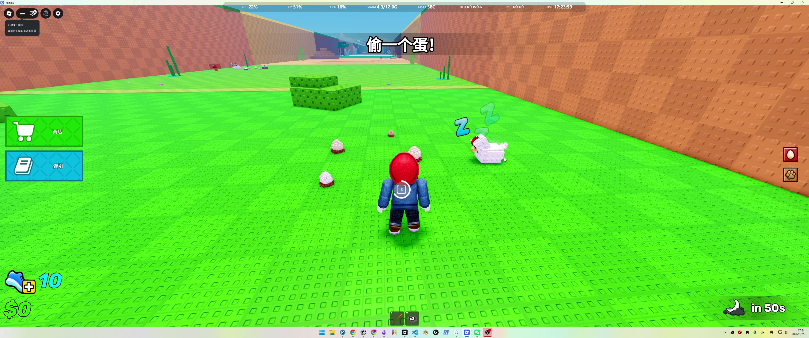

| 解释项 | 内容 |
| --- | --- |
| 可观察事实 | 睡着的母鸡、蛋和 E 交互同时出现在画面中央。 |
| 设计含义 | “蛋属于谁、危险来自谁、我能做什么”在一个画面里完成。 |
| 诊断判断 | 常识承担了大部分教学。 |
| 迁移动作 | 灰盒必须先做到守护者、目标物、交互提示三者同屏。 |
| 置信度 | high |

### E004 拿蛋瞬间：移动被改造成追逃

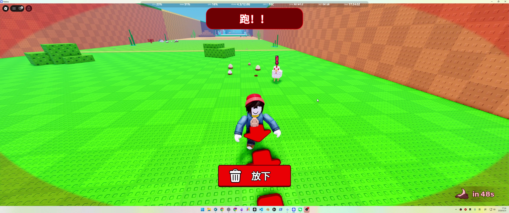

| 解释项 | 内容 |
| --- | --- |
| 可观察事实 | 顶部变成红色“跑!!”，母鸡警觉，玩家抱蛋，底部可放下。 |
| 设计含义 | 同一个移动操作因为状态、目标和威胁变化而产生戏剧性。 |
| 诊断判断 | 这才是核心玩法峰值，不是跑步机本身。 |
| 迁移动作 | 拿取后 1 秒内同时切换警报、追击、抱持和返程目标。 |
| 置信度 | high |

### E003 战利品资产化：偷来的东西马上能用

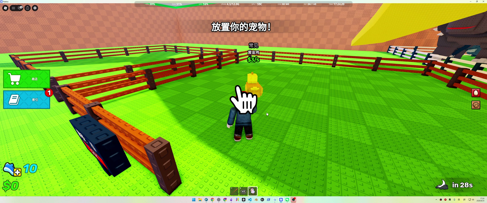

| 解释项 | 内容 |
| --- | --- |
| 可观察事实 | 黄金鸡显示“常见、$3/s”，系统要求放置宠物。 |
| 设计含义 | 一次成功不是抽象分数，而是可拥有、可展示、持续产出的对象。 |
| 诊断判断 | 这是“偷一个蛋”强于普通取物跑酷的关键。 |
| 迁移动作 | MVP 的第一件战利品必须在 10 秒内产生可见持续收益。 |
| 置信度 | high |

### E005–E006 跑步训练：先产生需要，再给能力

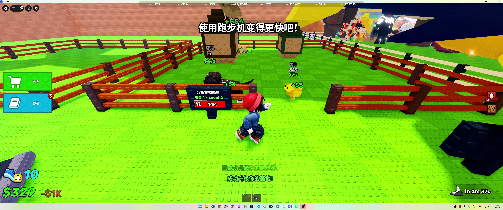

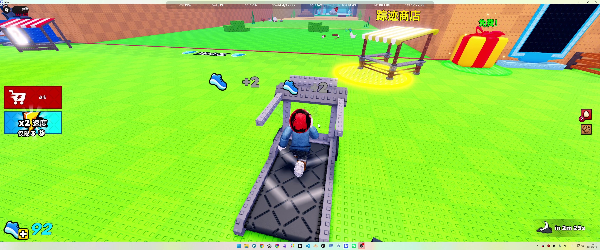

| 解释项 | 内容 |
| --- | --- |
| 可观察事实 | 完成多轮后才提示“使用跑步机变得更快”；训练时每步 +2，速度持续增加。 |
| 设计含义 | 玩家已经知道“为什么需要速度”，所以训练不是无意义劳动。 |
| 诊断判断 | 教学顺序是：先体验追逃，再暴露成长工具。 |
| 迁移动作 | 不要让新玩家出生就站跑步机；至少先完成一次低难度偷取。 |
| 置信度 | high |

### E009 成长层：计时、槽位、收益同时承接

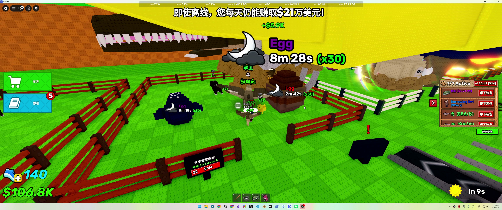

| 解释项 | 内容 |
| --- | --- |
| 可观察事实 | 多枚蛋显示倒计时和倍率，右侧为 7/7 Active 与每秒收益，顶部有离线收益文案。 |
| 设计含义 | 玩家离开短循环后仍有等待、配置和回访目标。 |
| 诊断判断 | 这是长线承接，不应成为第一版前置依赖。 |
| 迁移动作 | P0 只保留一个即时孵化宠物；留存不足再加队列和离线。 |
| 置信度 | high |

### E010 融合：重复收藏被重新赋值

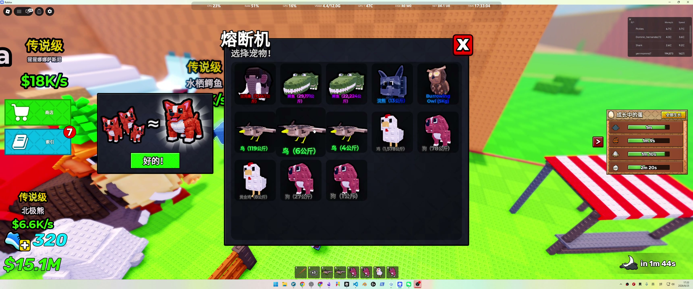

| 解释项 | 内容 |
| --- | --- |
| 可观察事实 | 熔断机展示宠物库存，图示表达多只同类变成更高阶宠物。 |
| 设计含义 | 重复蛋不再只是垃圾掉落，而是升级材料。 |
| 诊断判断 | 融合解决的是中期重复问题，不是首轮乐趣问题。 |
| 迁移动作 | 只有当测试玩家开始抱怨重复宠物时才实现融合。 |
| 置信度 | high |

### E012 展示奇观：收益与体积共同放大

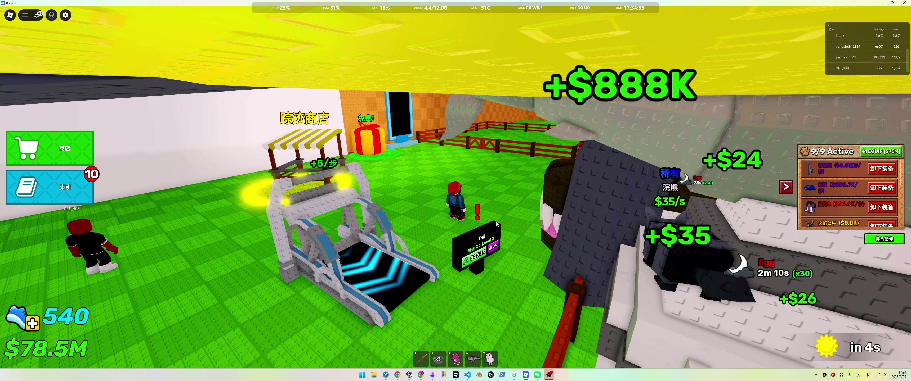

| 解释项 | 内容 |
| --- | --- |
| 可观察事实 | 巨型宠物、+888K 等大额跳字和 9/9 Active 同屏。 |
| 设计含义 | 成长被做成别人也看得见的社会身份。 |
| 诊断判断 | 炫耀力强，但已经明显遮挡角色、设施和路线。 |
| 迁移动作 | 保留稀有宠物的展示差异，同时限制操作区屏占比。 |
| 置信度 | high |

### E015–E017 图鉴与区域：用同一循环扩内容

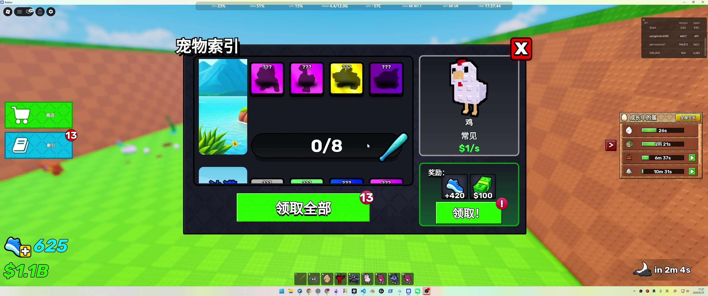

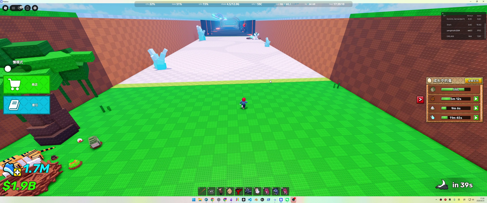

| 解释项 | 内容 |
| --- | --- |
| 可观察事实 | 图鉴按区域显示剪影和奖励；长廊连接绿色、沙漠、冰雪和熔岩环境。 |
| 设计含义 | 内容扩展不要求更换玩家动词，只替换目标、守卫和价值阶梯。 |
| 诊断判断 | 这是低地图成本的内容模板，但需要新判断而不只是换皮。 |
| 迁移动作 | 每个新区至少改变一条守卫行为或路线规则，不能只加速度门槛。 |
| 置信度 | medium-high |

### E020–E023 核心动词的活动复用：巨龙巢穴

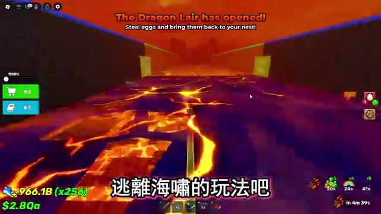

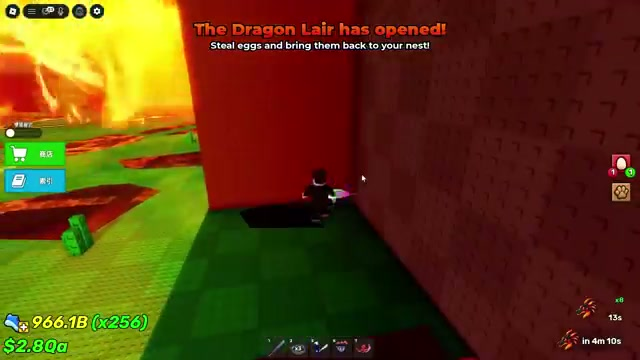

| 解释项 | 内容 |
| --- | --- |
| 可观察事实 | 活动目标仍是偷蛋并带回巢穴；玩家需要在吐息间隙抱蛋冲刺，并躲进安全区域。 |
| 设计含义 | 不增加新操作，仅用周期威胁、掩体和多蛋计分重组基础循环。 |
| 诊断判断 | 这是成熟版本最值得学习的 LiveOps 结构。 |
| 迁移动作 | P0 通过后，优先做一个周期危险区，而不是先做独立采集系统。 |
| 置信度 | high |

### E024 重蛋降速：速度成为可消耗的能力预算

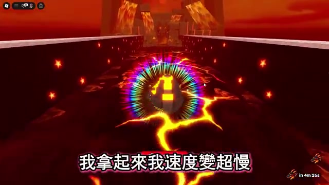

| 解释项 | 内容 |
| --- | --- |
| 可观察事实 | 角色抱起大型限量蛋后返程显著变慢，字幕同步说明速度大幅下降。 |
| 设计含义 | 玩家不是训练到某阈值就永久无风险；更好的战利品会重新吃掉速度优势。 |
| 诊断判断 | 这是“跑步训练为何不显得怪”的关键补充证据。 |
| 迁移动作 | 灰盒第二档蛋直接加入一档负重，不必先造复杂守卫 AI。 |
| 置信度 | high |

### E028–E029 定时采集与蛋变异：运营层开始偏离主动作

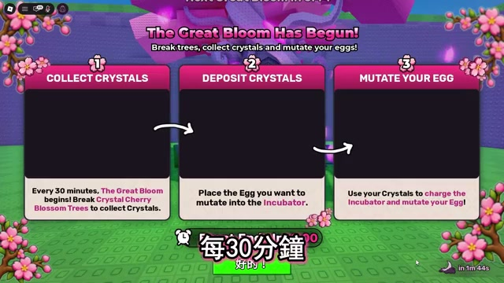

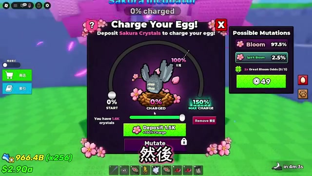

| 解释项 | 内容 |
| --- | --- |
| 可观察事实 | 每 30 分钟开启打树收水晶活动；水晶为蛋充能并触发概率变异，界面提供 49 Robux 的概率加成。 |
| 设计含义 | 它创造回访、资源消耗和高价值付费决策，但教学链、等待和概率风险同步增加。 |
| 诊断判断 | 这是成熟运营系统，不是核心玩法成立的必要条件。 |
| 迁移动作 | 首版全部排除；之后若做，先验证概率透明、失败价值和保底。 |
| 置信度 | high |

### E030 限量宠物峰值：奖励强，但旧资产贬值快

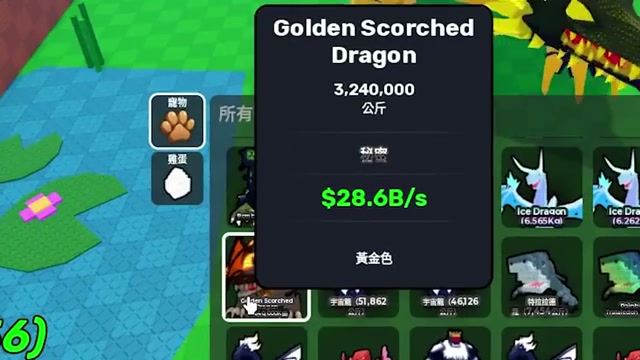

| 解释项 | 内容 |
| --- | --- |
| 可观察事实 | 黄金灼烧龙显示 3,240,000 kg、$28.6B/s，明显超过作者此前提到的 9.1B 高阶宠物。 |
| 设计含义 | 限量活动能制造极强奖励峰值，也会快速让旧收藏失去经济意义。 |
| 诊断判断 | 不能把“更大数字”误认为可持续内容深度。 |
| 迁移动作 | 原型不用指数膨胀；活动奖励优先给侧向能力、外观或新路线资格。 |
| 置信度 | high |

## 25. 附件

- 15 秒间隔全片联系图：assets/偷一个蛋-拆解-2026-08-25/contact-sheets
- 5 秒间隔全片联系图：assets/偷一个蛋-拆解-2026-08-25/contact-sheets-5s
- 重点片段故事板：assets/偷一个蛋-拆解-2026-08-25/storyboards
- 原始关键帧：assets/偷一个蛋-拆解-2026-08-25/keyframes
- YouTube 全片 15 秒联系图：assets/偷一个蛋-拆解-2026-08-25/youtube-JuEI8Z1oKtU/contact-sheets
- YouTube 关键帧：assets/偷一个蛋-拆解-2026-08-25/youtube-JuEI8Z1oKtU/keyframes
- 结构化证据索引：assets/偷一个蛋-拆解-2026-08-25/evidence-index.json
