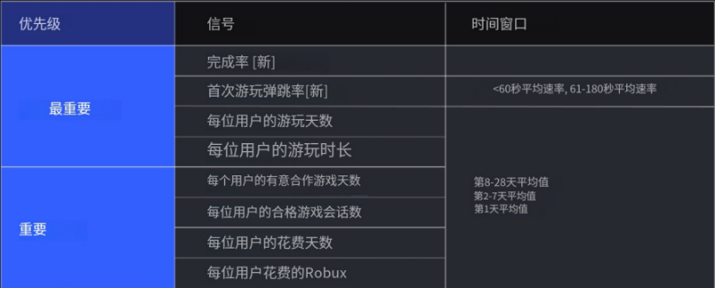

# Roblox 低资源小游戏市场调研（2026-08-25）

> [!important] 时效性说明
> 本文的数据截止时间为 **2026-08-25（Asia/Shanghai）**。Roblox 排行榜、推荐算法、玩家并发和热门题材变化很快；当日榜单只代表一次动态快照。建议每月复核平台数据，在正式立项前重新采样排行榜并实际试玩竞品。

## 1. 调研目标

为“开发资源需求较低的 Roblox 小游戏”筛选值得进入灰盒验证的市场方向。

这里暂时把“低资源”定义为以下工作假设，均需结合实际团队能力确认：

- 首个可玩核心循环能在 **7–14 天内**完成 `[待验证]`；
- 以一张小地图、少量可复用资产和 1–2 个主要动作启动；
- 乐趣主要来自规则、物理、随机事件和玩家互动，而不是持续堆地图、剧情、宠物或武器；
- 能用配置、数值和规则变体更新内容，降低每周手工生产量；
- 移动端优先，尽量避免复杂按键、长教程和高画质依赖。

本轮属于**桌面市场调研 V0.1**，目标是形成候选赛道和验证门槛，不等于已经完成竞品深度试玩或立项。

## 2. 三条结论

### 结论一：小体量游戏仍有机会，但竞争核心已经转向长期留存

Roblox 2026 Q2 披露：季度 DAU 为 **1.23 亿，同比增长 10%**；季度参与时长 **290 亿小时，同比增长 5%**。更关键的是，Top 10 以外体验的参与时长同比增长 **25%**，Robux 消费同比增长超过 **20%**；Top 10 占全平台参与时长约 **20%**，低于三年前同期的 30%。这说明流量仍高度竞争，但平台内容正在变得更分散，长尾并非完全没有空间。

与此同时，推荐系统已从原来的 7 天观察窗口扩展到 **28 天**，明确强化 D8–D28 的长期回访价值。低资源项目不能只追求“首日点进来”，还必须给玩家第二周、第四周回来的理由。



### 结论二：当前市场同时容纳常青大作和“单动词、强承诺”小游戏

2026-08-25 的 Top Playing Now 快照中，Brookhaven、Blox Fruits、Adopt Me、Murder Mystery 2 等常青项目仍然强势；同时也出现了《偷一个蛋》《+1 速度逃脱》《清理所有树叶》《踢一个幸运方块》《养大一只鸡战士》等标题直接描述核心动作的新项目。

这不能证明“做一个同名换皮游戏就会成功”，但能说明一个有效的市场表达规律：

> 玩家在标题和缩略图阶段就应理解：我要做什么、能获得什么、会发生什么冲突或惊喜。

### 结论三：最适合小团队的不是某个题材，而是“低资产、高系统复用”的玩法结构

当前更值得测试的是：

- 一个容易理解的主要动作；
- 一张可重复使用的小地图；
- 由玩家、物理、随机规则产生不同局面；
- 有短期目标、可展示收藏和好友共同游玩；
- 后续更新主要增加规则、事件或可配置物品，而不是重做大型场景。

## 3. 当前平台与市场证据

### 3.1 2026 Q2：平台规模与长尾内容

| 指标                |       2026 Q2 结果 | 对低资源项目的意义          |
| ----------------- | ---------------: | ------------------ |
| DAU               |   1.23 亿，同比 +10% | 平台仍有大规模活跃用户        |
| 参与时长              |   290 亿小时，同比 +5% | 市场总需求仍在增长          |
| Top 10 外参与时长      |          同比 +25% | 长尾内容仍获得增量          |
| Top 10 外 Robux 消费 |        同比超过 +20% | 收入并非只存在于头部         |
| Top 10 时长占比       | 约 20%，三年前同期为 30% | 平台内容集中度有所下降        |
| 日本 / 印度 DAU       |   同比 +67% / +64% | 无文本或低文本、易本地化玩法更有价值 |

> [!caution] 边界
> 这些是平台级数据，不能推导出单个新游戏一定能获得自然流量，也不能替代具体品类、获客成本和留存数据。

![[Assets/Roblox市场调研_2026-08-25/03_Roblox_2026Q2_内容多样性_官方股东信第9页.jpg]]

截图来源：[Roblox 2026 Q2 股东信（SEC 归档）](https://www.sec.gov/Archives/edgar/data/1315098/000162828026051059/ex991-robloxq22026earnin.htm)，第 9 页。访问日期：2026-08-25。

### 3.2 2025 全年搜索趋势

Roblox 官方 2025 Replay 给出的年度搜索前三名为：

1. Brookhaven（2020）
2. Grow a Garden（2025）
3. Steal a Brainrot（2025）

年度趋势同时显示：

- 常青社交角色扮演和当年爆款可以同时占据市场；
- “horror”“roleplay”等宽泛品类词的搜索量高于部分具体游戏名；
- 多人游戏和流行品类的多人版本是高频需求；
- 移动端用户更偏向恐怖、逃脱和 Obby 等立即可玩的内容；
- 地区细分存在差异，例如巴西足球、日本动漫、印度尼西亚和菲律宾的 wall hop。

这组数据来自 2025 全年，适合判断结构性偏好，不应当作 2026-08-25 的实时热度排名。

![[Assets/Roblox市场调研_2026-08-25/04_Roblox2025Replay_搜索趋势与热门品类.jpg]]

截图来源：[The 2025 Roblox Replay](https://about.roblox.com/newsroom/2025/12/roblox-replay-decoded-search-style)。访问日期：2026-08-25。

### 3.3 2026-08-25 当日热门榜单快照

采样时间：**2026-08-25 13:45（Asia/Shanghai）**。数据为页面显示的实时 CCU 和好评率，随时会变化。

|  排名 | 游戏               | 当时 CCU | 好评率 | 初步结构判断           |
| --: | ---------------- | -----: | --: | ---------------- |
|   1 | 偷一个蛋             | 661.9K | 93% | 单动词、收集/争夺承诺；未试玩  |
|   2 | Brookhaven RP    | 319.6K | 85% | 常青社交角色扮演         |
|   3 | Blox Fruits      | 251.3K | 92% | 重内容、重成长，不符合低资源首作 |
|   4 | 森林中的 99 个夜晚      | 186.3K | 90% | 生存恐怖、多人事件        |
|   5 | Adopt Me         | 180.6K | 86% | 社交、收集、长期运营       |
|   6 | Murder Mystery 2 | 174.3K | 90% | 短局社交推理、重复地图      |
|   7 | Steal a Brainrot |   163K | 85% | 社交争夺、收藏、事件运营     |
|   8 | RIVALS           | 117.5K | 93% | PvP 射击，技术和内容成本较高 |
|   9 | Animal Hospital  | 115.3K | 94% | 当期新热门；具体循环待试玩    |
|  10 | +1 速度键盘逃脱        |  99.5K | 97% | 单动作成长 + 逃脱承诺；未试玩 |

榜单第 20–40 名附近还能看到 RNG、种植、Fling Things and People、躲避、清理、排球、挖掘等项目，说明当前热门并非只有一种题材。需要注意：CCU 榜只展示此刻在线人数，不能直接说明 D1/D7/D28 留存、收入、开发成本或获客来源。

![[Assets/Roblox市场调研_2026-08-25/02_Roblox热门榜单TopPlayingNow_2026-08-25.png]]

页面来源：[Roblox Top Playing Now](https://www.roblox.com/charts/top-playing-now)。截图时间：2026-08-25 13:45（Asia/Shanghai）。

## 4. 2026 推荐系统对立项的影响

Roblox 当前公开的主要推荐信号包括：

| 优先级 | 信号 | 设计含义 |
|---|---|---|
| 最重要 | Play through rate | 标题、图标和缩略图必须准确表达真实玩法 |
| 最重要 | First play bounce rate：<60 秒、61–180 秒 | 30 秒内进入操作，3 分钟内出现明确反馈 |
| 最重要 | Play days per user：D1、D2–7、D8–28 | 不能只设计首局，必须设计跨周回访理由 |
| 最重要 | Playtime per user | 核心循环要能自然重复，不能靠长教程拖时长 |
| 重要 | Intentional co-play days | 好友加入后应产生新的合作、竞争或展示价值 |
| 重要 | Qualified play sessions | 每局要形成可识别的完整体验，而非误点后挂机 |
| 重要 | Spend days / Robux spent | 商业化应建立在持续价值上，不宜先于核心乐趣 |

官方说明这些信号以**每名用户的平均表现**计算，小体量游戏不会仅因为绝对玩家数少而天然吃亏。但来自广告、搜索、榜单或外部社媒的用户，可以帮助游戏进入候选池；最终有多少自然推荐，仍取决于通过 Recommended For You 进入的玩家表现。

![[Assets/Roblox市场调研_2026-08-25/01_Roblox推荐系统28天留存_用户提供截图.png]]

截图来源：用户于 2026-08-25 提供的 Roblox 官方 2026-06-15 推荐系统文章页面截图；本轮同时用当前 [Discovery 文档](https://create.roblox.com/docs/discovery) 复核了信号表。

## 5. 低资源候选赛道

评分为本轮调研判断，不是玩家数据；所有方向都需经过实际试玩和灰盒测试。

| 候选方向 | 市场信号 | 资源适配 | 主要优势 | 主要风险 | 本轮建议 |
|---|---|---|---|---|---|
| 单动词社交循环 | 高 | 高 | 标题易懂、资产少、适合收藏与冲突 | 极易同质化；直接复制“Steal X”会失去差异 | **A：优先原型，但必须原创核心冲突** |
| 小地图物理派对 | 中高 | 高 | 玩家行为生成内容，更新可加规则而非地图 | 网络物理、恶意玩家、手机操作需要控制 | **A：优先原型** |
| 一张地图的轻生存恐怖 | 高 | 中 | 搜索需求稳定、可剪辑、适合多人 | AI、声音、随机事件和内容消耗成本较高 | **B：范围受控时测试** |
| 单动作街机运动 | 中 | 中高 | 规则清晰、强对局、适合好友共同游玩 | 动画手感、同步与匹配质量决定成败 | **B：有手感能力时测试** |
| 小空间收集成长 | 高 | 中 | 可离线成长、展示、稀有度和回访 | 经济平衡与持续运营成本常被低估 | **B：需先证明更新成本可控** |
| 开放世界 / 重 RPG / 写实赛车 | 高 | 低 | 市场容量大 | 场景、内容、动画、任务和运营成本过高 | **C：不作为首个低资源项目** |

## 6. 推荐优先验证的玩法结构

### 方向 A：单动作 + 社交冲突 + 可展示成长

不是直接复制“偷某样东西”，而是复用更底层的结构：

```text
看见目标 → 执行一个主要动作 → 获得或失去可见成果
→ 与其他玩家合作/争夺 → 回到个人展示区升级 → 再次冒险
```

可探索的原创动词包括：搬运、装箱、清扫、修复、护送、堆叠、躲避、交换、伪装。

### 方向 B：小地图物理合作/互坑派对

建议原型：

> 2–8 名玩家在一张小地图里搬运不稳定物品完成订单；物品重量、地面状态、路线和临时规则随机变化。玩家可以合作，也会因为物理碰撞和目标竞争制造意外。

玩家目标链：

- **0–30 秒**：拿起物品，立刻理解移动和交付；
- **3–6 分钟**：完成一轮订单，经历合作、失误或抢夺；
- **首局 5–15 分钟**：获得一个可展示收藏、称号或工具外观；
- **长期**：规则轮换、收藏图鉴、好友记录、赛季挑战 `[待测试]`。

## 7. 立项前的淘汰门槛

只有同时满足以下条件，候选概念才进入正式制作：

- [ ] 玩家仅看标题和缩略图，3 秒内能说出主要动作；
- [ ] 进入游戏 30 秒内能完成第一次有效操作 `[待测试]`；
- [ ] 前 60 秒没有必须阅读的长教程；
- [ ] 180 秒内出现一次成功、失败、冲突或惊喜；
- [ ] 同一张地图重复玩三局，局面仍有明显差异；
- [ ] 好友加入后，玩法价值不只是“旁边多一个人”；
- [ ] 下一次更新可通过新规则、事件或配置完成，而不是必须制作新地图；
- [ ] 不依赖未经授权的 IP、流行角色或直接复刻热门游戏；
- [ ] 移动端主要操作不超过 2–3 个核心按钮 `[待测试]`；
- [ ] 核心循环在没有付费的情况下完整成立。

## 8. 下一轮调研计划

### 8.1 竞品样本

先桌面扫描 30 款，再实际试玩其中 12 款：

- 当前 Top Playing Now：10 款；
- 2025–2026 新上升项目：10 款；
- 与候选方向直接相关的中腰部项目：10 款。

每款记录：

- 标题/缩略图承诺；
- 0–30 秒、60 秒、180 秒发生什么；
- 5–15 分钟核心循环；
- D1、D2–7、D8–28 的回访理由推断；
- 好友共同游玩价值；
- 地图、动画、UI、VFX、服务器、内容更新成本；
- 商业化位置与免费体验完整性；
- 可借鉴机制与不可复制的题材/IP/数值。

### 8.2 灰盒验证

从排名最高的三个概念各做一个 1–2 天灰盒 `[待测试]`，只验证：

1. 是否无需解释就会操作；
2. 是否会主动再玩一局；
3. 是否能自然产生可分享的意外；
4. 是否能在不增加新地图的情况下扩展；
5. 服务器和移动端性能是否可控。

## 9. 风险与限制

- 当前榜单仅采样一次，工作日与周末、地区和时段差异尚未覆盖；
- 没有竞品的私有留存、收入、广告投入和开发团队规模数据；
- 本轮未对表中游戏进行系统化 15–20 分钟试玩；
- 2025 Replay 属于年度回顾，不代表 2026-08-25 的即时热度；
- Roblox 的 Build 和生成式工具正在降低制作门槛，预计泛化、低差异内容会进一步增加；
- 官方明确强调非独特体验和高度相似的元数据可能降低曝光，因此不能把换皮当成低风险路线；
- 所有平衡数值、开发周期和留存目标必须通过原型验证，不能直接照搬竞品。

## 10. 资料来源与证据等级

### A 级：当前官方/监管归档

- [Roblox 2026 Q2 股东信（SEC）](https://www.sec.gov/Archives/edgar/data/1315098/000162828026051059/ex991-robloxq22026earnin.htm) — 平台规模、地区增长、长尾内容和 Top 10 占比；发布于 2026-07-30。
- [Optimizing Discovery: How Great Games Reach Millions of Players on Roblox](https://about.roblox.com/newsroom/2026/06/optimizing-discovery-great-games-reach-millions-players-roblox) — 28 天长期留存方向；发布于 2026-06-15。
- [Roblox Creator Hub: Discovery](https://create.roblox.com/docs/discovery) — 当前推荐信号及排序说明；访问于 2026-08-25。
- [Roblox Top Playing Now](https://www.roblox.com/charts/top-playing-now) — 当日 CCU 快照；采样于 2026-08-25 13:45。

### B 级：官方历史趋势

- [The 2025 Roblox Replay](https://about.roblox.com/newsroom/2025/12/roblox-replay-decoded-search-style) — 2025 搜索、品类、设备和地区偏好；发布于 2025-12-16。
- [Build Without Limits on Roblox](https://about.roblox.com/newsroom/2026/07/build-without-limits-on-roblox) — AI/移动创作门槛下降与同一留存排序机制；发布于 2026-07-16。

### C 级：本轮分析推断

- 候选赛道评分、开发周期、按钮数量和灰盒周期均为工作假设；
- 榜单游戏的“初步结构判断”只用于确定试玩样本，不代表完整拆解；
- 竞品机制只可用于发现结构，不应复制未经验证的数值、题材或 IP。

## 11. 关联入口

- [[30_MOC 内容地图/Roblox MOC|Roblox MOC]]
- [[70_LLM_Wiki 知识库/Roblox/index|Roblox 游戏开发 Wiki]]
