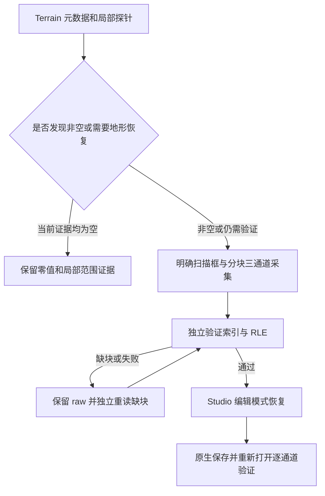

# Xeno 客户端内容归档通用工作流

统一执行与换 AI 交接入口见 [00_通用工作流_AI执行入口](00_通用工作流_AI执行入口.md)。本页规定输入、动作与验收，不限定 AI 品牌或专属接口；终端、UI、用户协助等实现只要提供同等真实证据即可。

这套流程把当前 Roblox 客户端已加载、已复制且可读取的内容，整理成有原始证据、缺失清单和完整性校验的 ZIP。默认阶段 0 只归档原始场景、已有 Source、bytecode 和能取得的资源；以后明确要求时才在副本恢复 Luau 参考源码或生成预览。历史依据见 [[04_成功案例与参考实现]]，具体案例不参与默认参数解析。

**阶段 0 完成标准：目标身份一致，原始捕获可解析，实际取得的场景/Source/bytecode/资源均有相对索引和 hash，成功/缺失清单闭合，ZIP 的文件集合、CRC 和逐文件 SHA256 全部通过。** 默认不要求反编译、Studio 启动、格式转换或静态预览；这些另建派生目录选择执行。 服务端逻辑、未加载地图、权限受限素材及完整玩法恢复需要单独说明，不能用“客户端归档成功”代替。

工具版本、下载地址与引擎 API 属于时间敏感信息。执行时使用 [[08_环境迁移与参数配置]] 的环境发现与 `run.versions`，不锁定历史版本。先核对本机已经安装且可用的工具，只有缺失或明确要求更新时才重新取得安装包。

## 0. 定义任务与输出边界

先确定游戏、要保存的实际场景，以及已有授权的内容范围。大厅、实战 Place、动态生成回合和不同楼层分别记为独立捕获。尽量在地图加载稳定后采集，记录开始、结束时间；采集期间地图变化会影响快照一致性。

先复制共享 `config.example.json` 到 Vault 外的本地配置目录；`environment` 只登记本机角色路径，`run` 只登记本次身份、输入、模式和输出。实际采集器/下载器必须读取生成的本次配置，或由审核过的适配器传参，不把此模板的路径又抄回脚本正文。下表占位名与配置字段的对应见“08”：

| 参数 | 含义 | 验证来源 |
|---|---|---|
| `<GAME_NAME>` | 易识别的游戏简称 | 游戏页面与本次任务 |
| `<PLACE_ID>` | 当前实际 Place | 客户端 `game.PlaceId` |
| `<UNIVERSE_ID>` | 所属 Universe | 客户端 `game.GameId` |
| `<CAPTURE_ID>` | 此次唯一捕获编号 | 日期、时间、场景名组合 |
| `<SCENE_LABEL>` | 大厅、实战或当前地图名 | 当前 Workspace 层级及可读状态 |
| `<FLOOR_OR_ROUND>` | 当前楼层或回合，可为空 | 当前地图状态值及显示标签 |
| `<PLAYER_VERSION>` | 当前运行的 Roblox 版本及 version hash | 当前进程对应文件、客户端日志 |
| `<XENO_WORKSPACE>` | 本次 Xeno 文件工作区 | 本机配置、实际写入验证 |
| `<ARCHIVE_ROOT>` | 原始证据目录 | `artifactRoot` 下的本次相对 capture 目录 |
| `<PACKAGE_ROOT>` | 最终交付目录 | `artifactRoot` 下独立 package 目录 |
| `<STUDIO_EXE>` | 可选 Studio 可执行文件 | 可选阶段才发现并验证 |

推荐在 Vault 外的 artifactRoot 存储二进制、素材和 ZIP；Obsidian 只保存说明、脱敏参数、artifactId/角色/相对路径索引及校验结论。机器路径不写入共享笔记；本地配置不参与笔记同步。本工作流不会要求把 EXE、游戏素材或大压缩包复制进笔记库。

```text
<ARCHIVE_ROOT>/
  target.json                    目标、版本、捕获范围与时间
  artifact-index.json             artifactId、角色、相对路径、大小、SHA256
  effective-config.sanitized.json 本次有效参数；机器路径改为角色
  provenance/                    版本、编码、输入/工具 hash 与匹配依据
  tools/                         导出工具原版、审核版、依赖、许可、hash
  diagnostics/                   Attach、通信和真实 print 验证
  snapshot/                      原始 XML/实际已有 native、start/finish/inventory
  scripts/                       原始可读 Source、bytecode、索引；不默认反编译
  assets/                        下载对象、manifest、失败、独立校验
    supplement-pass-2/           字节码等新证据带来的增量
    transient-recovery/          有界重试或路由修复增量
    hls-dependencies/            有条件的视频清单和明示依赖
  terrain/                       探针、明确扫描框、RLE、恢复与回读验证
  resource-review/               实际动画/模型分类、缓存关联证据
  validation.json                原始捕获静态验收
  native-studio-validation-summary.json  仅可选 native 阶段生成
  complete-package-verification.json
<PACKAGE_ROOT>/                  只放已验收的交付文件
<PACKAGE_ROOT>.zip
```

本次步骤不通过时保留诊断，不在原始目录上反复覆盖。新捕获、新版本、地图推进后的捕获均使用新编号。

## 1. 发现 Xeno，必要时取得工具并记录来源

先使用本地配置指定的 `xenoRoot`，保留完整相对依赖并核对实际文件/hash。缺失时再确认当前发布来源。历史入口见“04”；旧下载 URL 只是 provenance，不能代替当前来源确认。

1. 核对当时维护方的发布入口、版本说明和包装形式，记录最终下载链接与日期；检查重定向后的文件来源。
2. 下载到独立工具目录，完整解压。解压后的依赖、`resources` 等相对目录需要保留。
3. 给下载文件计算 SHA256，并保存文件名、大小、来源、版本与 hash。对来源页面提供的校验值进行比对；自己计算的 hash 用于以后识别同一文件，单独不能证明发布者身份。
4. 阅读此包装随附 ReadMe，只按当前包的要求处理运行库依赖；把实际依赖版本记入 provenance。历史运行库说明见“04”，不作为新环境固定依赖。
5. 确认实际运行的 Roblox 版本。磁盘已安装最新版和当前仍运行的旧版本可能不同，以当前进程对应版本为准。

可用于文件识别的 PowerShell 命令：

```powershell
# 先从已验证的本机配置/发现结果绑定此路径。
Get-FileHash -LiteralPath $downloadedXenoFile -Algorithm SHA256
```

验收：文件完整解压，来源和 hash 已记录，当前 Player 版本可确认，Xeno 可正常打开。

停止条件：来源不清、文件与预期校验不符、解压不完整或包装依赖不明。先解决工具准备问题，再进行 Attach。

历史参考：[下载与初始诊断记录](09_历史案例资源索引.md#hist-xeno-check-diagnostic-summary)、[Legacy ReadMe](09_历史案例资源索引.md#hist-xeno-check-readme)。这些链接记录了当时的来源，版本 1.3.60 不代表下一次执行的最新版本。

## 2. 确认 Place、Universe 和当前地图状态

1. 在实际客户端读取 `game.PlaceId`、`game.GameId`、`game.PlaceVersion`，与目标参数比较。两项身份都匹配才能开始。
2. 大厅传送到实战后重新确认 Place；不能因为 Universe 相同就继续使用大厅配置。
3. 记录当前地图实例路径、名称、实例/BasePart 计数，以及可读取的当前楼层或回合值。对关键状态保存路径、class、value、时间和来源类别。
4. 优先使用当前 Workspace 的地图树与状态值，显示标签可作为交叉证据。玩家的 HighestFloor、任务目标、已解锁关卡、ReplicatedStorage 模板名称只表明相关数据，不能自动当作当前地图。
5. 每个采集步骤开始前再次检查目标身份；对动态场景也检查当前地图/回合是否已变化。

验收：目标 ID 和实际客户端一致；当前场景有可复核证据。未知楼层写“未确认”，不用推测填值。

停止条件：发生传送、回合切换、客户端断开或核心地图状态变化。保留已完成阶段，并在新状态下建立独立捕获。

参考：[带当前会话状态采集的 inventory 实现](09_历史案例资源索引.md#hist-dandy-gameplay-dandysgameplay-inventory-client)。该文件的固定游戏 ID、输出日期和路径均需参数化，不能原样用于新游戏。

## 3. Attach 后验证真实执行

按四层证据区分失败位置：

| 层 | 要检查什么 | 单独通过说明什么 |
|---|---|---|
| UI | Xeno 显示已 Attached | 只说明界面状态 |
| 客户端兼容 | client data/offset 获取情况 | 只说明兼容信息取得 |
| 本地通信 | 实际 listener、loopback 地址、端口、HTTP 与握手 | 本机通信链路可达 |
| 真实执行 | 唯一 print 标记出现在当前 Roblox 输出 | 这次基本执行实际成功 |

完成 Attach 后提交一个带本次编号的无副作用诊断 print，例如说明性标记 `ARCHIVE_DIAG_<CAPTURE_ID>`。核对当前 Roblox 日志或输出，保存标记和时间；只看到编辑器文本或 Attached 不算成功。

替换 `<CAPTURE_ID>` 后，可在 Xeno 编辑器执行以下最小诊断；输出中的目标 ID 也应与任务参数一致：

```luau
print("ARCHIVE_DIAG_<CAPTURE_ID>", game.PlaceId, game.GameId)
```


历史案例曾出现 client data 已取得、UI Attached 而真实 print 缺失；定位为 IPv4/IPv6 loopback 不匹配后才取得连续执行证据，细节保留在“04”。运行时从实际 listener 取得地址/端口，不从案例导入 DLL hash、端口或二进制 offset。

遇到同类问题，先确认实际监听地址、进程、端口和握手，再判断版本兼容。可用配置或正常重启能修复时优先采用。若确需改动二进制，必须先重新分析当前文件，保留原件，验证原 hash 和目标字节、限定修改范围，并提供恢复方式；本页不提供可原址执行的通用补丁。

验收：真实 print 来自当前目标客户端，时间在本次执行后。

停止/重启条件：没有握手、真实 print 未出现、客户端更新、执行器崩溃、版本与 API 缓存不符，或旧缓存状态导致验证矛盾。保存旧诊断；退出并重新启动相关程序，重新确认版本和目标后，从本阶段验证。清理缓存前先确认其作用与备份，不把删除缓存当通用起手动作。

参考：[修复后的运行验证](09_历史案例资源索引.md#hist-xeno-check-repair-verification)、[历史补丁的版本与范围保护实现](09_历史案例资源索引.md#hist-xeno-check-apply-ipv4-fix)。后者只能用于理解校验方法，其固定路径和字节位置不是本流程的执行命令。

## 4. 审核导出器，准备匹配版本的离线依赖

电脑侧处理需要可用的 Python 3，以及参考脚本实际 import 的依赖；先读取脚本和所带依赖说明再准备环境。涉及 Roblox 二进制读取、转换或模型分类的历史实现还使用了 Lune；记录其版本与 decoder 覆盖范围，不能把特定版本缺口当作场景缺失。Roblox Studio 仅在选择原生另存或后续预览时用于编辑验收，默认原始归档不以它可用为前置条件。工具可用性先用版本查询及当前目标的小样本确认，不把某台电脑的绝对路径当通用命令。

1. 保留导出器原版和审核版，记录仓库/下载 URL、版本或 commit、许可证与 SHA256。检查工具加载的每个依赖。
2. 将依赖下载并审核后放到本地工具目录；执行时通过 `readfile` 加载，避免运行过程中临时拉取不确定内容。
3. 准备与当前 Player 引擎版本匹配的 Full API Dump，并验证含 class/property/default 数据。若采用同引擎版本的 Studio dump，保存匹配依据；不能直接沿用历史 version hash。
4. 默认关闭本地/远程反编译、远程 LinkedSource 回退与隐式动态依赖；直接可读取的本地 Source 原样保留，可取得的 bytecode 单独保存。静态解析资源线索不属于生成源码。
5. 对未知或空 class 保留可读子项，并在独立映射清单中记录原 class、name、path 和 fallback。禁止把映射行为隐藏为完全恢复。
6. 将配置集中成目标参数：Place/Universe、workspace、输出路径、引擎版本、排除树和导出选项。检查原始脚本是否还残留旧目标 ID 或本机路径。

默认选项为 XML 原始导出、保存原始 bytecode/可读 Source、关闭 decompile、记录未知 class。排除树由 `run.export.excludeTrees` 配置，默认空数组；确需排除运行时/平台树时保存排除理由与尝试结果，不能把历史排除项自动沿用为“全部可取”。`mode=full` 若为具体导出器的模式名，仍受当前客户端可读范围限制。

验收：依赖、许可证和 API dump 已落地；配置匹配当前版本；动态网络加载和远程反编译回退已审查；文件 API 实际可用。

停止条件：依赖丢失、工具源码与预期补丁结构不同、API dump 缺少必要数据或版本不匹配。先更新工具，不临时绕过断言。

参考：[离线准备与修改记录实现](09_历史案例资源索引.md#hist-dandy-gameplay-prepare-offline-export)、[离线导出 manifest](09_历史案例资源索引.md#hist-dandy-gameplay-offline-export-manifest)。参考脚本自身含历史固定路径/版本，迁移前需要改为本次配置。

## 5. 先 inventory，再 XML 和 bytecode

执行顺序：目标断言 → inventory → XML 导出 → Terrain 探针。每步写开始、结束、成功状态；失败停止后续阶段，不在同一目录补写“成功”。

Inventory 至少保存：

- Place、Universe、PlaceVersion、开始/捕获时间、输出路径、StreamingEnabled。
- 当前可见 service/instance/class 计数与能力检测，如 readfile、writefile、getscriptbytecode、gethiddenproperty。
- 脚本路径、class 与 Source 是否实际可读。
- 去重资源 URI、资源 ID（适用时）、引用对象完整路径、class 与 property。
- Mesh、texture、image、sound、animation、video、字体 family、SurfaceAppearance/MaterialVariant 四类贴图及衣物等明示资源属性。
- 当前地图/楼层/回合状态证据，完成标记。

XML 导出阶段写 `export_start.json`、`export_finish.json`，其中记录目标身份、参数、文件是否存在、大小、XML 头尾是否存在及映射数。完成标记必须在工作真正结束后写；仅文件出现不能判定成功。拒绝覆盖现有 scene，重跑应先保留已有结果或改新捕获目录。

验收：pipeline 的各步骤成功；inventory 身份匹配；`scene.rbxlx` 存在且导出完成记录正确。随后还要通过独立 XML 解析。

参考：[阶段流水线](09_历史案例资源索引.md#hist-dandy-gameplay-dandysgameplay-capture-all)、[导出参数与 start/finish 记录](09_历史案例资源索引.md#hist-dandy-gameplay-dandysgameplay-run-export)。

## 6. 保留原件，独立验证并提取原始脚本资料

1. 把已完成的 Xeno workspace 捕获复制到 `<ARCHIVE_ROOT>/snapshot`；复制前后比较大小和 SHA256。原始 XML、inventory、完成记录和 class remap 保持原样。
2. 重新核对所有记录的 Place/Universe。解析 XML，统计实例与 class，检查空 class、头尾和解析错误。XML 能打开只是结构验收的一部分。
3. 建立脚本索引，逐项记录 artifactId、referent、full path、class、Source 状态、source hash、bytecode 包内相对路径/hash/bytes 与解码错误。直接可读 Source 存入 `readable-original`；编译后原始字节存入 `original-bytecode`，不得先反编译再称原始资料。
4. 去掉导出器生成的包装注释后，独立分类源码。`Remote decompilation is disabled`、`Server Scripts are IMPOSSIBLE to save`、`Ignored`、空脚本和失败信息都不能计为成功恢复的源码。
5. 从 XML 注释中严格 Base64 解码字节码并保存原始 bytes。错误字符串/payload、未知版本和解码失败单独统计，不能计成有效可执行 bytecode。
6. 可静态解析支持的 Luau 字节码格式以扩大明示资源清单，提取字符串 URI、带明确资产属性的常量，以及能证明的静态拼接；不生成 Luau 源码。保存脚本路径、bytecode hash、字符串/常量索引与 offset；运行独立 evidence verifier 后才发布增量 inventory。

| 内容 | 验收含义 | 不能据此宣称 |
|---|---|---|
| 可读 Source | 客户端实际能读到的源文本已保存 | 所有服务端源码已取得 |
| 原始 bytecode | 可访问的编译后 payload 已保存并分类 | 已还原为原始源码、可直接跑通 |
| 静态资源引用 | 原始字节中的引用证据可复核 | 数字常量一定都是 asset id |
| `.rbxm` 模型容器 | 二进制模型文件已保存 | 一定是动画或完整素材 |
| Animation 对象/ID | 记录了引用 | 关键帧数据已下载 |
| KeyframeSequence/Keyframe/Pose 或 CurveAnimation 数据 | 实际动画容器内容可确认 | 原游戏动画行为已完整验证 |

验收：XML 成功解析；复制 hash 一致；每份 Source/bytecode 状态真实；资源增量证据 verifier 通过。失败项可以保留并标记为未覆盖，不能生成“全部源码恢复”结论。

参考：[复制、XML 与脚本提取](09_历史案例资源索引.md#hist-dandy-gameplay-validate-and-extract)、[字节码静态资源提取](09_历史案例资源索引.md#hist-dandy-gameplay-extract-bytecode-resources)、[证据独立验证](09_历史案例资源索引.md#hist-dandy-gameplay-verify-bytecode-resource-evidence)、[实际模型/动画分类](09_历史案例资源索引.md#hist-dandy-gameplay-inspect-downloaded-models)。

## 7. 下载素材、依赖与增量

第一轮只使用本次 inventory 的明示引用；后续使用已取得文件中的可验证依赖和已验证 bytecode 增量。下载器启动前再次检查目标身份，禁止混用其他游戏的清单。

1. 规范化 request key：asset id、内置 URI、thumbnail 类型/对象/尺寸和明示 URL 分别处理。URL 查询 key 按规范大小写处理；`rbxthumb://` 的 id 可能是用户或 gamepass，不能一律送去 assetdelivery。
2. asset id 走官方 assetdelivery；thumbnail 按类型走官方 thumbnail 接口；`rbxasset://` 在当前 Player/Studio 安装 content 根内按路径查找。检查路径仍落在已允许的根目录内。
3. 对明示 HTTP URL、重定向和最终地址检查官方 Roblox/CDN 域名边界。历史成功方案未使用 cookie 或账户凭据；401/403 记录为不可获取。
4. 分块写临时文件，完成后按实际 magic/MIME 识别格式；处理 gzip 响应。API error JSON、错误页面和未完成临时文件不能记成功。
5. 成功对象按 SHA256 存储，记录 request key、来源 URI、最终 origin/path、bytes、hash、extension、mime、attempts 与依赖关系。文件格式依据内容，不单凭 URL 后缀。
6. 从 `run.download` 读取并发、速率、超时、尝试次数和可选大小上限，按环境调整；这些值只是下载策略，不是完成条件。
7. 对 429 遵守 Retry-After；5xx 和网络中断做有界退避重试。401/403/404 已明确失败时保留记录，不反复扫猜。
8. 增量 inventory 排除已请求 key；只加入新证据。合并最终清单时，成功记录优先于早先失败，同时保留历史尝试失败清单。
9. 独立逐文件验证 root 边界、存在性、大小与 SHA256。统计区分“请求成功条数”“物理文件数”“唯一 hash 文件数”和“资源引用数”。

同 Universe 的大厅与实战可复用同一明示 request key 对应且 hash 验证通过的本地文件；需要保存来源 manifest/hash 和复用 provenance。不能凭文件名相似或相同游戏名批量混入素材。

验收：所有 success 都有核验通过的物理文件；所有未取到请求都有最终状态；清单数量能闭合。受限素材不阻止交付当前可用归档，但必须显示真实缺失。

参考：[下载器](09_历史案例资源索引.md#hist-dandy-gameplay-download-assets)、[增量任务](09_历史案例资源索引.md#hist-dandy-gameplay-run-supplement-downloads)、[瞬时故障恢复](09_历史案例资源索引.md#hist-dandy-gameplay-run-transient-recovery)、[独立文件验收](09_历史案例资源索引.md#hist-dandy-gameplay-verify-downloaded-assets)。

### HLS 视频条件分支

先判断实际响应是否为 HLS playlist，而不是完整视频。保存 master 清单，解析其中明示的 variant；若取得 media playlist，再解析其中明示的 segment/init 依赖。相对 URI 按已取得清单的 base URL 解析，保留父子来源关系并核对每个下载文件。

取得清单不等于取得可播放视频。遇到 variant 403、缺 segment、key/DRM 状态无法确认，写明失败并停止该依赖分支；不猜 segment 名、借用 cookie、申请 license 或绕过权限。只有实际取得可合法读取的完整媒体依赖，且另行完成组合与播放验证，才可声称生成了离线视频。本次已验证历史案例没有完成这一步。

2026-10-09 Dandy 大厅的 master 声明 5 个 variant，但所有 variant 返回 403；segments 未能枚举，媒体下载数为零，离线播放文件未生成。实战本次没有取得 HLS 清单。两个事实应分别记录。

参考：[明示 HLS 依赖解析实现](09_历史案例资源索引.md#hist-dandy-gameplay-run-explicit-hls)、[大厅 HLS 最终证据](09_历史案例资源索引.md#hist-dandy-lobby-hls-media-validation)。

### 本地缓存补充条件分支

仅在当前缺失引用能与本地缓存索引精确关联时补充。使用只读数据库查询，先核对 URI/ID、状态与长度，再读取关联 payload，保存关联依据和 hash。没有可靠关联就记录无候选；文件时间、外观与 opaque CDN hash 都不能证明归属。

2026-10-09 Dandy 大厅的精确关联检查没有找到可用候选，没有复制未知 payload；这个结果不证明整个缓存都没有该素材。

参考：[当前缺失引用与缓存关联检查](09_历史案例资源索引.md#hist-dandy-lobby-check-current-missing-cache)、[检查范围与结果](09_历史案例资源索引.md#hist-dandy-lobby-cache-coverage-check)。

## 8. Terrain 原始数据的零值与非空分支

先读取 Terrain 属性、CountCells 和一个以当前玩家/相机附近为中心的小探针。优先 `ReadVoxelChannels` 三通道；若只能使用旧 `ReadVoxels`，记录 liquid 通道没有单独取得的限制。



### 当前指标为零且探针为空

保存 CountCells、probe 范围/尺寸、读取方法、非空数、StreamingEnabled 和未执行扩展扫描的事实。可按任务需要结束地形分支，但只能说明已观察指标；局部空探针不能证明整张世界为空。

历史 Dandy 实战 source 和 Studio 的 CountCells 指标均为零，局部探针为空，未做扩展扫描。文档不应写成“已逐体素验证全世界无地形”。

### 存在非空地形或任务要求恢复

1. 根据实际场景决定明确扫描框、分辨率和 chunk 尺寸；bounds 必须与网格对齐。Terrain.Size/MaxExtents 只当元数据，不直接当占用边界。
2. 每块记录 index、origin、sizeInCells、voxels、状态与文件 hash。完整保留 SolidMaterial、SolidOccupancy、LiquidOccupancy；RLE 数值不得为省空间随意量化。
3. 写入块索引与进度。空块也要有索引，注明 default/空状态，不能通过省略索引表示空。
4. 独立核对 planned 与实际 index 集合、连续性、重复项、失败项、每块尺寸、RLE 累计长度、material mapping、数值有效性、统计与文件集合。
5. 缺块时保留原 raw 证据，独立重读缺失 index，并形成 repair 来源。合并到新的 derived complete 目录，记录两次时间、source hash 和重叠块比较。
6. 默认保存并校验 raw 三通道数据后结束此分支。仅选择可选 native 阶段时，在派生 Studio **Edit** 场景恢复；原始 XML 保持不变，记录写入范围、块数及样本/通道验证。
7. 可选 native 阶段保存 `.rbxl` 后关闭并重开，用原生读取 API 验证已恢复非空块三通道逐体素一致。记录空区域验证范围；只宣称已验证的扫描框和块。

真实坑：Brookhaven 的 producer 报告 1024 块完成，但 raw JSONL 实际只有 982 条，独立校验发现 42 个缺失索引。重读、合并后通过明确扫描框校验；采集跨两个时段。source 与 native 的 CountCells 近似数不同，最终三通道准确比较仍通过，因此不能要求 CountCells 精确相等，也不能单靠它证明完整。

原始数据验收：`completeExplicitBox=true`、失败块为零、索引/RLE 独立校验通过；若选择恢复，另要求恢复后验证记录对应最终 native SHA256。`completeWholeWorld` 只有另有足够证据才可成立；本次历史实现明确为 false。

参考：[小探针](09_历史案例资源索引.md#hist-dandy-gameplay-dandysgameplay-capture-terrain-probe)、[三通道扩展采集](09_历史案例资源索引.md#hist-brookhaven-brookhaven-capture-terrain-full)、[缺索引重读](09_历史案例资源索引.md#hist-brookhaven-brookhaven-terrain-index-repair)、[合并与来源记录](09_历史案例资源索引.md#hist-brookhaven-merge-terrain-capture)、[RLE 独立验收](09_历史案例资源索引.md#hist-brookhaven-validate-terrain-rle)、[Studio 恢复准备](09_历史案例资源索引.md#hist-brookhaven-prepare-brookhaven-terrain-restore)、[原生重新打开后的通道验证](09_历史案例资源索引.md#hist-brookhaven-native-reopen-channel-verification)。

## 9. 可选 native 阶段：Studio 编辑模式保存与审计

本阶段只在明确要求原生另存/地形恢复验证时运行。没有 Studio 或当前 decoder 不支持，不阻止已通过静态验收的原始归档交付，摘要必须写明 native 未生成/未验收。

1. 使用可用的 Roblox Studio 打开本次 XML 的独立副本，保持 Edit，不启动 Play，不执行归档中的原游戏脚本。
2. 检查主要游戏 service、地图、模型与相机；需要恢复 Terrain 时完成前一阶段的编辑操作与验证。
3. 另存为原生 `scene.rbxl`，保留原始 `scene.rbxlx`。核对真实保存文件、大小、SHA256 和 Studio 保存记录，不能把改后缀当转换。
4. 静态回读 native，比较主要服务树、class 分布、脚本对象/Source、关键资源引用和重要属性。以实际属性语义比较旧 ID 与新 Content alias；字体 family、weight、style 单独比较。
5. 将运行时服务/Stats 的删除、Studio 默认项增加、TexturePackContent/HSR 编译缓存变化和 font cache 变化独立列出，逐项解释其影响。
6. 若解析工具报 unsupported binary type，将其记为审计缺口；历史 decoder 的具体缺口见“03/04”。回读缺失不能自动证明 native 丢了该数据。
7. 再次打开最终 native，保存打开/编辑模式证据；Terrain 恢复场景按上一阶段执行重新打开后的通道验证。

验收：真正的 Studio native 保存已确认；主要资源/脚本比较通过或差异已解释；关键地图树与本次范围一致。可正常编辑打开与完整玩法运行是不同验收项，后者未测试就写“未测试”。

停止条件：native 文件不对应本次 source、主地图树或关键资源明显意外丢失、保存失败、未经解释的关键差异。不能仅因“有 rbxl 文件”继续打包。

参考：[原生保存验证记录](09_历史案例资源索引.md#hist-dandy-gameplay-native-studio-save-verification)、[XML/native 比较实现](09_历史案例资源索引.md#hist-dandy-gameplay-audit-rbxl-conversion)、[差异分类与审计摘要实现](09_历史案例资源索引.md#hist-dandy-gameplay-summarize-native-audit)。

## 10. 单场景与多场景交付打包

### 单场景包

默认包以 `snapshot/scene.rbxlx`（或此次实际取得的原始场景）和 README 为入口，保留全部已验收 raw。只有可选 native 阶段实际通过时，才添加根 `.rbxl` 与启动入口。启动器从包根解析相对场景，先用本机配置再发现 Studio；完整解压后使用。`CheckOnly` 只验证场景/hash/所需本机角色，不启动 GUI。

```text
<GAME_NAME>_<SCENE_LABEL>_客户端归档_<CAPTURE_ID>/
  README.txt
  artifact-index.json
  effective-config.sanitized.json
  <GAME_NAME>_<SCENE_LABEL>_场景.rbxl  可选 native 成果
  启动场景.cmd                      仅对应已验证 native
  snapshot/ assets/ scripts/ terrain/ resource-review/ tools/ provenance/
  archive-summary.json
  file-checksums.json
```

README 写清实际捕获场景、Place/Universe、日期、raw/archive 格式、后续可选转换方法、素材可用性、已下载动画数的分类依据、Terrain 范围与缺失。附 artifact-index 的相对路径、有效参数与 hash 覆盖规则。启动入口只打开本地编辑场景，不附带自动 Play 或执行原脚本。

### 多场景总包

大厅和实战，或多个楼层，保持各自独立 raw 资料目录；选择 native 时也保持独立原生场景与入口。与各自内部来源文件比 SHA256。总摘要记录各子包来源、目标身份、捕获时间与范围，不把两个 snapshot 的树合并覆盖。

地图推进前若希望保留该层，必须在地图销毁/替换前独立完成捕获。下一层生成后再建新编号；后面采到第 N 层不能倒推出第 1 到 N-1 层已经保存。仅静态资源相同可通过已验证 request key/hash 复用，地图树仍独立。

### 构建前排除未完成产物

禁止把 `.partial`、`.tmp`、`.lock`、下载临时文件、无证据价值的运行日志、`.git`、`__pycache__`、内部缓存、符号链接及仅用于 audit 的大 readback 文件混进最终包。保留有价值的原始失败、采集/工具 stdout/stderr、版本与校验材料。只读原件、API dump、导出器原版/审核版/patch、许可证、bytecode 与索引必须保留在原始证据包；临时产物用明确白名单区分，不因“中间 XML”而排除唯一 raw。

存在 lock 或 partial 不表示要删除它们；先判断任务是否仍在运行。只有对应阶段成功关闭、manifest 已完成，才把该阶段列入正式交付。

### ZIP 的四项独立验收

1. 每个来源文件复制后重新核对大小和 SHA256，记录 source-copy verification。
2. 生成最终文件集合与 `file-checksums.json`，排除校验清单本身造成的自引用；摘要说明其覆盖规则。
3. ZIP 生成后执行 CRC 全量检查；ZIP entry 集合须与预期交付集合完全一致，不能缺文件或多出未预期文件。
4. 从 ZIP 中重新读取每个 entry，比较未压缩大小和 SHA256；最后再记录整个 ZIP 的大小/SHA256、构建时间和包入口校验；若有 native 启动器，再记录 CheckOnly 结果。

验收：`crcVerification=passed`、`allZipEntrySha256Verified=true`、`allCopiedFileSha256Verified=true`，文件集合一致；带 native 启动器的包再要求 CheckOnly 通过。任何 hash、CRC 或集合不匹配都停止交付，保留出错包及构建证据另行修复。

参考：[单场景构建与逐 entry 验证](09_历史案例资源索引.md#hist-dandy-gameplay-build-dandysgameplay-package)、[多场景总包构建](09_历史案例资源索引.md#hist-dandy-gameplay-build-dandysworld-combined-bundle)、[已完成总包验收](09_历史案例资源索引.md#hist-dandy-gameplay-combined-package-verification)。这些构建脚本包含历史固定 hash、场景名字、日期与源目录，迁移时须先参数化。


## 10A. 为未来恢复保留输入

归档包保存下列实际取得内容，并在 `artifact-index.json` 以角色、artifactId、相对路径、bytes、SHA256 关联：

- 原始 scene、inventory、完整 start/finish/pipeline、未知 class/属性映射与缺失记录。
- 每份原始 bytecode、是否完整/有效、版本/编码/未知字段、referent/fullPath/hash；无需为保存它们先生成源码。
- 可读取的原始 Source；读取失败或服务端未复制的状态，不能用占位源码掩盖。
- 匹配本次 Player 的 API dump 原文件及版本匹配依据；若无法取得，记录缺口和受到影响的导出阶段。
- 导出器原版/审核版、修改 patch、实际依赖、许可证、来源/commit/下载包/hash 与本次有效参数。
- 实际 Player/Xeno/引擎/toolchain 版本、对应输入/工具文件 hash、执行命令参数与原始 stdout/stderr/退出码。
- 下载资源原始响应内容、来源/依赖与 hash；Terrain 原始通道、索引、扫描范围和修复 provenance。

本机安装绝对路径只存不入同步的环境配置；包内记录角色和相对路径。保存这些证据允许以后匹配工具重新尝试恢复，但未知字节码版本、编译优化、缺失内容和工具兼容性仍可能使部分源码不可恢复，也不能还原原变量名、注释或服务端工程。

## 11. 交付摘要与快速验收清单

交付消息至少包含压缩包路径、实际保存场景/楼层、打开方法、范围和关键未覆盖项；详细数字留在包内摘要及 verification JSON。

- [ ] Xeno 下载来源、包装版本、SHA256 与实际 Player 版本已记录。
- [ ] Place 与 Universe 同时匹配；当前地图/楼层有原始证据。
- [ ] Attach 有握手和真实 print，未把 UI 状态当成功。
- [ ] 导出依赖经过审核，匹配 API dump，配置已参数化。
- [ ] pipeline、inventory、export finish 一致，XML 独立解析通过。
- [ ] Source、placeholder、bytecode、error payload 分类清楚，增量证据 verifier 通过。
- [ ] 所有资源 success 文件通过边界/大小/SHA256 验收，最终缺失与历史失败分开。
- [ ] 动画按实际模型 class 数据分类，HLS 是否可播放写实际结果。
- [ ] Terrain 空探针或明确扫描框的范围清楚；非空恢复对应最终 native hash。
- [ ] 默认 raw 场景已解析与校验；可选 native 阶段的“未选/未生成/已通过”明确记录，不借历史 Studio 结果作本次证据。
- [ ] 当前存在的 partial/lock 未混入正式包；各捕获场景互相独立。
- [ ] 文件集合、ZIP CRC、逐 entry SHA256 全部通过；实际有 native 启动器时 CheckOnly 通过。
- [ ] README 和交付摘要明确客户端可读范围、受限资源、未捕获地图及未测试玩法。

**始终保留的界限：** Streaming 开启时只保存当时已经复制/可读的内容；关闭 Streaming 也不等于 server-only 内容可读取。ServerStorage/ServerScriptService 对象存在不证明其私有内容已恢复。不可读属性可能省略或用 fallback；未知 class、二进制 decoder 缺口、内部缓存变化和多时段采集都需记录。下载附件并不会自动把场景里的所有 URI 重写成离线本地引用，因此素材包存在也不等于场景完全离线可用。

## 12. 原始归档完成后的显式可选阶段

只有用户明确请求源码恢复/预览时，将本次配置 mode 切换为对应模式，按 [[06_字节码恢复与场景优化工作流]] 在独立副本继续处理：离线恢复并分级源码、按实际属性和渲染证据清理、部署可用本地素材、修正静态预览入口，再完成新的 native 与 ZIP 验收。原始游戏代码默认停用，仅运行经过审核的独立预览脚本；这项 Play 验收不会证明原玩法已恢复。

本次 [[07_EvoMon优化预览版案例与验收|EvoMon 案例]] 已有源码、资源、预览与打包证据，同时记录了 generic URI 预加载误判、PBR 本地支持缺口、服务快照重名及 Streaming 卸载问题。具体游戏 ID、工具版本、编码与参考脚本参数需要重新核对。

关联入口：[[../../../30_MOC 内容地图/Roblox MOC|Roblox MOC]]、[[../../../70_LLM_Wiki 知识库/Roblox/Roblox 原生动画系统|Roblox 原生动画系统]]、[[08_环境迁移与参数配置]]。
