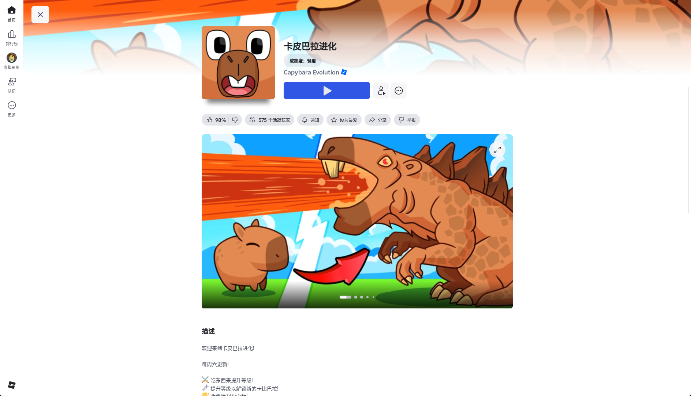
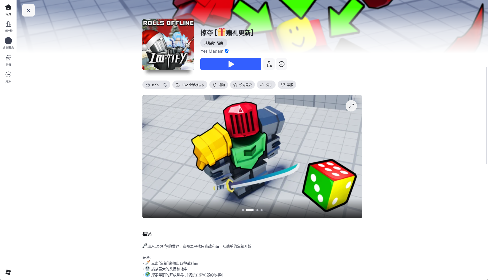
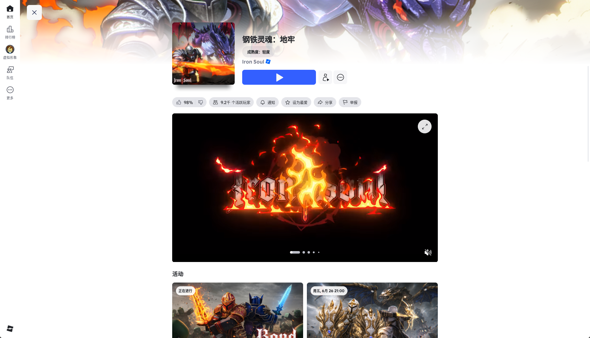
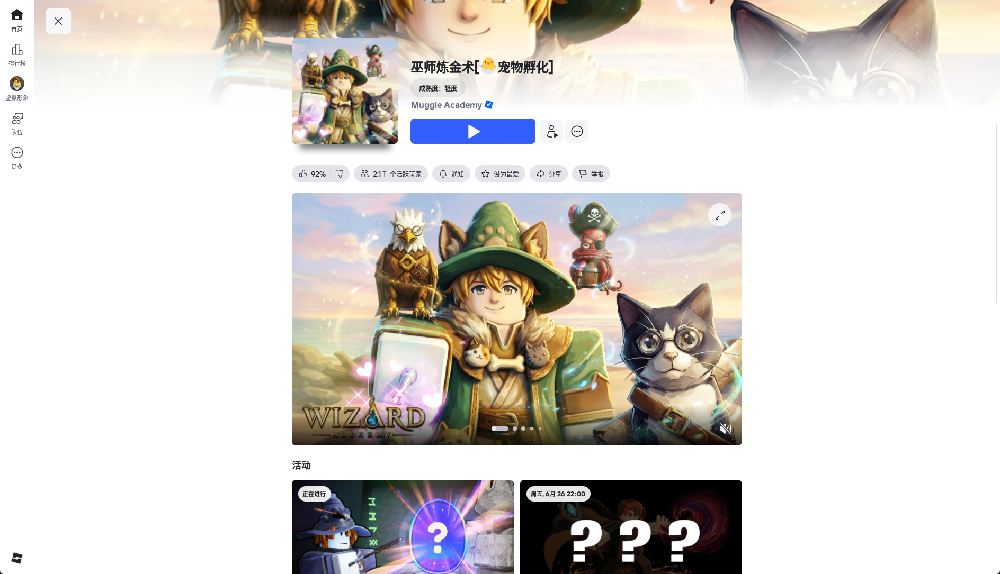
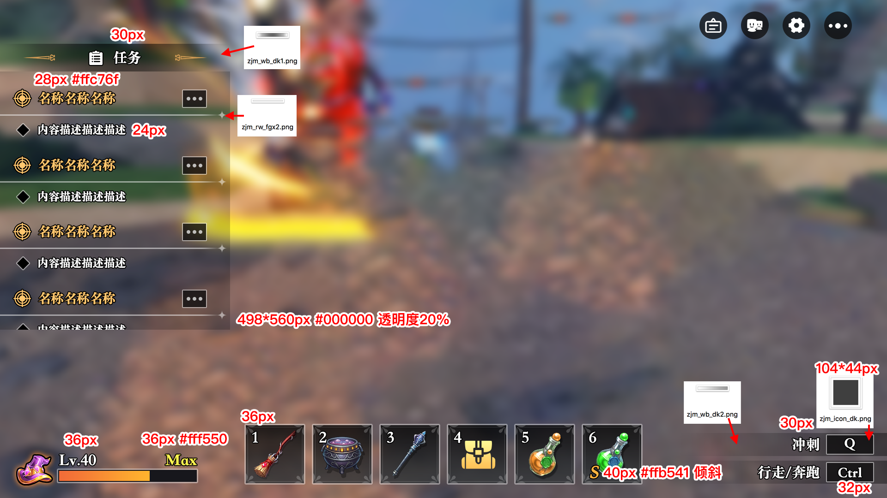
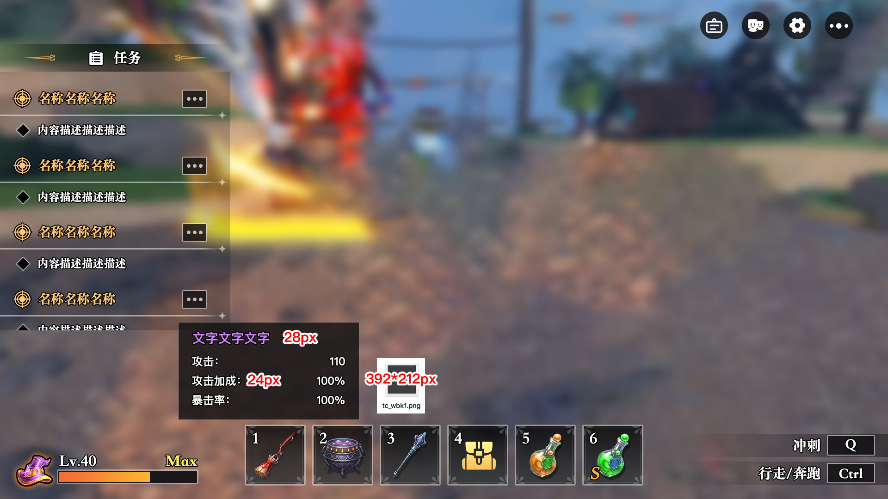
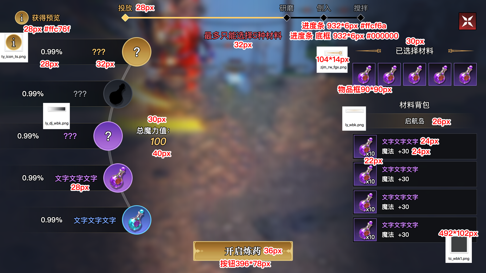
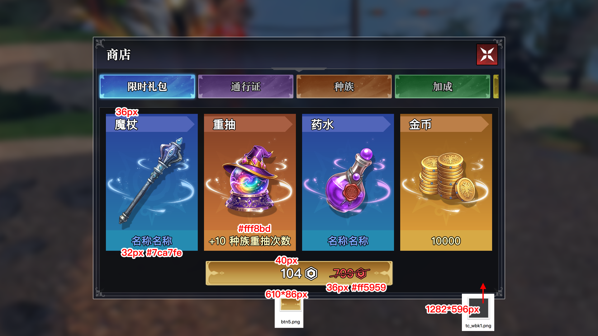
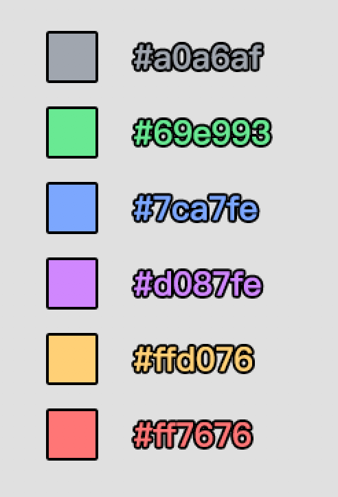

# 合肥线上项目完整制作流程

## 一句话说明

这是把 Roblox 线上热门项目拆解成新项目方案的流程：先观察热门项目，再选择两款以上参考游戏，把它们的玩法、场景和 UI 融合成一个新方向，最后通过截图、UE 标注图、美术效果图和切图资产完成开发交接。

## 为什么重要

这个流程解决的是“项目从哪里来”的问题，而不是单纯解决“代码怎么写”。  
如果只从技术实现开始，很容易做出完整但没人想点的功能；如果先从线上项目观察和首屏吸引力开始，就能更早判断玩家为什么会点击、进入、留下。

这和 [[游戏市场判断框架]] 的思路一致：先做市场和玩家视角校准，再进入 GDD、UI、美术和代码实现。

## 总流程

```text
观察 Roblox 热门项目
-> 选 2 款以上参考游戏
-> 拆玩法 / 场景 / UI / 商业化 / 首屏吸引点
-> 融合成新项目定位
-> 做 UI 截图和 UE 标注图
-> 美术输出效果图
-> 确认后制作切图和组件资产
-> 交给开发搭建 UI / 场景 / 玩法闭环
-> 记录反馈，继续回看线上竞品
```

## 立项阶段：先找两款以上参考游戏

立项不是凭空想一个游戏，而是先看 Roblox 当前哪些项目有热度、有点击理由、有可学习的玩家循环。

选择参考游戏时不要只找一款。只模仿一款容易变成换皮；至少找两款，分别借鉴不同层面的优点：

| 拆解维度 | 应该看什么                    |
| ---- | ------------------------ |
| 玩法   | 玩家 3 秒内在做什么，30 秒内能得到什么反馈 |
| 场景   | 主视觉、地图气氛、敌人或宠物主题         |
| UI   | 主界面布局、按钮密度、任务入口、商店入口     |
| 成长   | 升级、装备、进化、抽卡、宠物、材料        |
| 商业化  | 通行证、礼包、抽卡、药水、加成、限时活动     |
| 首屏   | 缩略图、标题、前几张截图、玩家一眼能不能懂    |

### 例子：巅峰进化

巅峰进化的方向可以理解为：以卡皮巴拉/掠夺 两款游戏作为核心参考，再融合另一款游戏的系统或表现方式，形成“可爱角色 + 进化成长 + 轻度模拟”的新项目。



和


这张图的价值不是“照着画一个卡皮巴拉”，而是拆它的首屏表达：

- 主题非常直接：玩家一眼知道是卡皮巴拉进化。
- 视觉钩子清楚：小动物变成巨大怪兽，有强对比。
- UI 信息少：标题、封面、播放按钮、评分和活跃玩家信息都集中在首屏。
- 适合提炼成玩法问题：玩家如何获得进化资源？进化后能力如何变化？截图怎么表现成长差异？

巅峰进化相关体验反馈已经沉淀在 [[巅峰进化 UX 反馈]]，后续可以把“玩家实际使用中的 UI 摩擦”反向补进新项目设计。

### 例子：当前方向：铁魂 + 巫师炼金术

当前正在学习和拆解的方向是把“铁魂”的战斗、暗黑、装备感，与“巫师炼金术”的炼药、宠物、魔法学院氛围结合。



铁魂适合拆这些内容：

- 战斗幻想：骑士、巨龙、火焰、武器和高对比暗色视觉。
- 成长目标：装备、技能、战斗力、Boss 或副本。
- 活动表达：首屏下面有活动卡，适合学习运营入口怎么放。
- UI 语气：整体更硬核、金属、火焰、史诗感强。



巫师炼金术适合拆这些内容：

- 炼药主题：材料、药水、魔法效果、结果预览。
- 宠物和陪伴感：猫头鹰、猫、魔法宠物能降低硬核战斗的距离感。
- 明亮幻想风格：比铁魂更轻、更适合 Roblox 的休闲玩家入口。
- UI 方向：可以学习炼药、宠物孵化、魔法道具和学院主题的表达。

融合时不要简单相加。一个更清楚的定位可以是：

```text
铁魂提供战斗目标和装备爽点；
巫师炼金术提供炼药系统、宠物陪伴和魔法主题；
新项目需要把“炼药产出”变成“战斗成长”的一部分。
```

## 项目融合规则

每次融合都先回答 5 个问题：

1. 第一款游戏提供什么核心爽点？
2. 第二款游戏提供什么差异化包装？
3. 新项目的 3 秒钩子是什么？
4. 新项目的第一个 5 分钟目标是什么？
5. 哪些内容只是参考，不应该照搬？

对于“铁魂 + 巫师炼金术”，可以先写成：

| 模块 | 来源倾向 | 新项目表达 |
| --- | --- | --- |
| 战斗目标 | 铁魂 | 打怪、Boss、装备、区域推进 |
| 炼药系统 | 巫师炼金术 | 材料投放、概率预览、药水结果 |
| 宠物/伙伴 | 巫师炼金术 | 宠物提供加成或收集目标 |
| UI 气质 | 两者融合 | 暗色战斗底 + 明亮魔法道具 |
| 留存 | 两者融合 | 每天炼药、升级、挑战活动 |

## UI 和美术素材流程

UI 素材不是直接让美术“自由发挥”。更稳定的流程是先给美术明确输入：

```text
线上游戏截图
+ UE 标注图
+ 具体功能说明
+ 尺寸 / 色值 / 字号 / 文件名
-> 美术效果图
-> 用户确认
-> 切图和组件资产
-> 开发按组件落地
```

### UE 标注图的作用

UE 图负责把“我想要这个感觉”变成“美术和开发都能执行”的规格。



这类主界面标注图能传递：

- HUD 大结构：左侧任务栏、顶部功能入口、底部快捷栏、右下按键提示。
- 尺寸要求：例如任务栏宽高、按钮尺寸、快捷栏格子尺寸。
- 字体要求：字号、颜色、描边、倾斜等。
- 素材命名：例如 `zjm_wb_dk1.png`、`zjm_rw_fgx2.png`、`zjm_icon_dk.png`。
- 开发约束：哪些是背景、哪些是按钮、哪些是可复用组件。



tips 图说明除了静态 HUD，还要准备悬浮提示、装备属性弹层、快捷栏反馈等状态图。  
这类状态图很重要，因为开发时最容易漏掉“鼠标悬停、选中、不可用、展开、关闭”等非默认状态。

### 炼药界面是完整玩法 UI



炼药图不是单纯的美术展示，而是一个玩法 UI 规格：

- 顶部流程：投放、研磨、倒入、搅拌。
- 左侧预览：概率、未知结果、总魔力值、弧形节点。
- 右侧材料：已选择材料、材料背包、数量、魔法值。
- 中央区域：投放材料后的表现位置。
- 底部操作：开启炼药、自动炼药、跳过选项。

它适合拆成开发组件：

```text
AlchemyGui
ArcPreviewList
MaterialBagPanel
AlchemyStepPanel
AlchemyResultPanel
```

本地已有更细的炼药分析和交接文档：

- `D:\SVN\新界面\炼药\炼药界面视频初步分析.md`
- `D:\SVN\新界面\炼药\NEXT_CHAT_HANDOFF_炼药UI搭建.md`

### 商店和品质色号是可复用组件



商店图能提炼出通用结构：

- 弹窗底板。
- 页签。
- 商品卡。
- 价格条。
- 关闭按钮。
- 品质和商品类型色彩。



品质色号应该单独沉淀，不要散落在单个界面里。  
后续背包、商店、抽卡、炼药结果、掉落提示都应该复用同一套品质颜色，避免每个页面风格不一致。

## `D:\SVN\新界面` 可以怎么描述

`D:\SVN\新界面` 是一套“新项目 UI 美术与开发交接包”，不是普通截图目录。

当前可以分成这些层：

| 目录 | 作用 |
| --- | --- |
| 根目录 | 主界面 tips、通用品质色号等全局参考 |
| `主界面` | HUD、任务、快捷栏、按键提示、主界面组件 |
| `商店` | 礼包、通行证、种族、加成、商品卡、价格条 |
| `属性` | 角色属性、魔法晋级、种族信息 |
| `抽卡` | 抽卡入口和基础组件 |
| `收藏图鉴` | 图鉴页和分类图标 |
| `新游戏补充` | 新机制补充图，例如施法 |
| `炼药` | 炼药玩法 UI、视频、抽帧、分析、交接文档 |
| `背包` | 背包页、物品分类、品质光效、物品框 |
| `设置` | 设置弹窗、进度条、按钮状态 |
| `邮箱` | 邮件界面 |
| `通用` | 按钮、弹窗、物品框、选项卡、锁、加减、搜索等通用组件 |

对 Codex 和开发来说，它的价值是：

- 可以从标注图还原 UI 层级和组件拆分。
- 可以根据文件名找到切图资产。
- 可以把 UI 从“一整张效果图”拆成可复用的按钮、物品框、弹窗、页签和图标。
- 可以在后续接 Roblox Studio 时减少反复问美术的次数。

## 输出物清单

每个新项目最好都沉淀这些东西：

- [ ] 参考游戏列表：至少 2 款。
- [ ] 每款参考游戏的截图和一句话拆解。
- [ ] 新项目融合定位：玩法、场景、UI、成长、商业化。
- [ ] 3 秒钩子：玩家第一眼看到什么。
- [ ] 5 分钟目标：玩家进来后第一个明确目标。
- [ ] UE 标注图：尺寸、字号、色值、组件命名。
- [ ] 美术效果图：确认后的视觉目标。
- [ ] 切图目录：按页面和通用组件归档。
- [ ] 开发交接文档：当前做哪一步，哪些先不做。
- [ ] 验收截图：Studio 中实际效果和 UE 图对比。

## 风险和边界

- 不要一比一照搬单个游戏。目标是拆优点并融合，不是复制。
- Roblox 平台热度、活跃玩家数、榜单排名都是时间敏感信息；真正立项前要重新核验当前数据。
- 截图只能说明首屏和 UI 结构，不能替代实际体验。最好补 10 到 15 分钟试玩记录。
- 美术确认前不要直接进入大量 UI 实装，否则返工成本高。
- UI 交接图应该保留原始路径和日期，方便以后追溯是哪一版。

## 关联来源

- 用户口述：2026-06-26，关于“学习别人线上项目完整制作流程”的整理需求。
- 本地参考目录：`D:\SVN\新界面`
- 本地标注图：`D:\SVN\切图_正确解压\主界面\1主界面.png`
- 本地炼药分析：`D:\SVN\新界面\炼药\炼药界面视频初步分析.md`
- 本地炼药交接：`D:\SVN\新界面\炼药\NEXT_CHAT_HANDOFF_炼药UI搭建.md`
- 相关笔记：[[游戏市场判断框架]]、[[巅峰进化 UX 反馈]]

## 待确认

- 巅峰进化当时融合的“另一款游戏”具体是哪一款。
- 当前“铁魂 + 巫师炼金术”最终主循环：是偏战斗刷装、炼药养成，还是宠物收集。
- 美术效果图和最终切图之间是否还需要单独建立版本索引。
- `D:\SVN\新界面` 是否要升级成独立的 `81_WorkFlow 工作流/Roblox/UI 美术交接工作流`。
