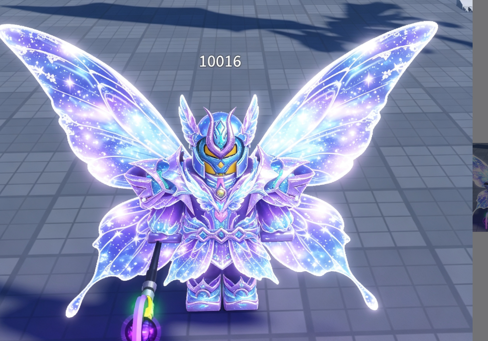

# Roblox 角色模型：Rig 比例锁定与 15+ 分件 Tripo 工作流

## 1. 当前目标

以 Roblox R15 `Rig` 作为唯一的人体比例尺，在效果图阶段锁定角色比例与外观，再把角色设计成 **15 个标准身体部位 + N 个独立饰品**。每个零件分别制作干净的多视图、分别交给 Tripo 生成 3D，最后在 Blender 中对照同一个 Rig 缩放、定位和装配。

本工作流当前只解决模型生产，不包含动画、蒙皮、骨骼、Motor6D、Humanoid、碰撞、战斗逻辑和武器制作。

如果输入已经带有骨骼、蒙皮和动画，请改走 [[../带动画角色导入Roblox工作流/README|带动画角色导入 Roblox 工作流]]。该路线以 Custom Rig 保留原动作，与本页的 R15 分件生成不同。

## 2. 已确认的硬边界

- `Rig` 是没有穿衣服的人体比例尺，只负责身体尺寸、关节位置和装配坐标。
- 最终的 15 个身体部位是角色外层衣服/盔甲模型，局部应包在 Rig 外面；不是把 Rig 整体等比放大。
- 不需要同时把 `Rig` 和 `M_Hero_001` 导入 Blender。`M_Hero_001` 只作为“15 个身体部位 + 饰品”的结构参考。
- 完整角色效果图必须和 Rig 的身体关键点对齐；“总高度接近”不等于比例正确。
- 完整效果图只负责统一造型，不能直接裁切后充当零件输入。每个零件都要重新设计成独立、完整、可识别的物体。
- Tripo 只负责逐件生成 3D，不负责保留整套角色的全局尺寸和位置。
- Blender 中的 Rig 是最终比例、位置和接缝的裁判。
- “整体导出”是一个导出文件包含 15+ 个独立对象，不是把所有零件合并成一个网格。
- 当前角色明确排除：翅膀、武器、手持物、画面编号、场景背景和依赖 Bloom 的发光特效。

## 3. 五种资料各自负责什么

| 资料 | 唯一职责 | 不能代替什么 |
|---|---|---|
| Blender Rig | 身高、宽度、关节、中心线、装配位置 | 不能决定盔甲外观 |
| 完整角色效果图 | 统一轮廓、配色、材质语言、细节密度 | 不能直接作为 15+ 零件模型 |
| 完整角色多视图 | 说明前后左右的结构关系与遮挡关系 | 不能代替零件专用多视图 |
| 零件专用效果图与多视图 | 明确单个零件的完整几何、厚度、接口和背面 | 不能决定全局比例 |
| Blender 装配文件 | 恢复全局缩放、位置、命名和接缝 | 不负责重新设计造型 |

## 4. 标准 15 个身体部位

最终至少保留以下 15 个独立对象，命名可使用项目现有的 `M_Hero_001_` 前缀：

1. `Head`
2. `UpperTorso`
3. `LowerTorso`
4. `LeftUpperArm`
5. `LeftLowerArm`
6. `LeftHand`
7. `RightUpperArm`
8. `RightLowerArm`
9. `RightHand`
10. `LeftUpperLeg`
11. `LeftLowerLeg`
12. `LeftFoot`
13. `RightUpperLeg`
14. `RightLowerLeg`
15. `RightFoot`

这些对象是最终可见的角色外壳。盔甲可以比 Rig 对应部位更厚，但关节中心、段长和左右对称基准必须来自 Rig。

## 5. 当前角色的 N 个饰品候选

根据当前参考图，先确定以下分件方向；最终数量要等完整四视图确认后再冻结：

### 建议独立生成

- `Headarmour`：头盔、中央双角和侧面护片。
- `LeftShoulderArmour`：左肩外扩的大型肩甲。
- `RightShoulderArmour`：右肩外扩的大型肩甲。
- `WaistArmour`：腰带中央宝石与前方主裙甲；如果裙甲较大，再继续拆分。

### 看四视图后决定是否独立

- `ChestCrystal`：胸口核心宝石；若只是浅浮雕则合入 `UpperTorso`。
- `CollarArmour`：高领或颈部护甲；若与胸甲连成完整体则合入 `UpperTorso`。
- `FrontSkirtArmour`、`LeftSkirtArmour`、`RightSkirtArmour`、`BackSkirtArmour`：只有在裙甲明显悬出身体、背面结构独立或合并后会妨碍接缝时才拆开。

### 明确不做

- `Wing` / `BackWing` / 蝴蝶翅膀。
- 法杖、剑、枪或任何手持武器。
- 只存在于渲染里的星光粒子、光晕和拖尾。

判断一个细节是否拆成饰品时，只看三件事：是否明显悬出身体、是否跨越两个身体关节、是否需要独立调整位置。三者都不是时，优先并入对应身体部位，避免无意义碎件。

## 6. 当前参考图分析



### 可以保留的设计语言

- Roblox 块状比例下的重甲骑士轮廓。
- 紫、蓝、青色为主，少量金黄用于面罩和视觉焦点。
- 双角头盔、窄面罩、大肩甲、分层胸甲、腰部花瓣/裙甲、厚重护腿和靴子。
- 水晶、星空、魔法能量感，但要转译为实体凹槽、宝石嵌件、硬表面层级和清晰色块。

### 不能照搬的内容

- 超大半透明蝴蝶翅膀。
- 左侧武器。
- 角色上方数字 `10016`。
- 地面、阴影、背景和摄影透视。
- 高亮 Bloom、白色泛光和粒子。这些会遮住轮廓，Tripo 也可能把光晕误当几何。

### 去掉翅膀后的造型修正

原图的翅膀承担了大量背部体积和视觉重心。删除后，角色容易只剩“横向很宽的肩甲”。完整效果图阶段应检查：

- 肩甲不要无限外扩，保证手臂轮廓仍能单独读取。
- 通过头盔双角、胸口核心和腰部裙甲建立从上到下的主轴。
- 背面仍需设计真实的头盔、胸甲和裙甲结构，不能用空白背面代替翅膀。

这张截图只能作为风格参考，不能直接送入 Tripo：它不是正交全身图，腿部信息有限，翅膀遮挡背部，而且发光严重覆盖几何。

## 7. 标准生产流程

### 阶段 A：导出 Rig 并建立 Blender 比例母版

1. 从 Roblox Studio 单独导出目标 R15 Rig。
2. 在 Blender 导入 Rig，保持其原始身体段长和关节位置。
3. 统一世界中心、朝向和单位；不要先修改 Rig 身材来迁就生成结果。
4. 保存一份只读母版，例如 `R15_Rig_Master.blend`。
5. 建立正交相机：Front、Back、Left、Right。所有后续参考图保持同一姿势、同一中心线和同一画幅。

建议使用对称 A-Pose 或 T-Pose；以实际导出的 Rig 姿势为准。选定后全流程不得混用不同姿势。

### 阶段 B：生成完整角色效果图

1. 先以 Rig 正面渲染作为比例底图。
2. 生成一张完整、无遮挡、全身入镜的角色正面效果图。
3. 角色盔甲可以向外包裹 Rig，但以下关键点必须对齐：头顶、颈部、肩、肘、腕、腰、胯、膝、踝和脚底。
4. 首张正面图先人工确认；未确认前不生成其余视图。

完整角色图必须满足：

- 单个角色，居中，全身可见，不裁脚、不裁角。
- 干净中性背景，均匀柔光，不使用强 Bloom。
- 正交或接近正交的相机，不使用夸张透视和俯拍。
- 无翅膀、无武器、无文字、无数字、无粒子、无地面道具。
- 保留 Roblox 块状身体结构，不能生成人类写实细长比例。
- 手臂与躯干之间留出可读取间隙，腿部之间也要能分辨左右。

### 阶段 C：生成完整角色四视图

在正面设计批准后，再生成 Front、Left、Back、Right。四张图必须锁定：

- 同一角色、同一姿势、同一高度和中心线。
- 同一盔甲层级、颜色分区、装饰数量和左右关系。
- 固定正交 90° 相机；不能把三分之四视角冒充侧视图。
- 背面必须补全头盔、胸甲、腰甲、腿甲的真实结构。

四视图的用途是决定如何分件和补齐遮挡面，不直接当作全部零件的 Tripo 输入。

### 阶段 D：建立 15+ 分件设计表

逐件记录以下字段：

| 字段 | 说明 |
|---|---|
| PartName | 最终对象名 |
| RigSegment | 对应的 Rig 身体部位 |
| ParentPart | 在 Roblox 中预期跟随的身体部位，仅记录，不在本阶段实现 |
| BoundingLandmarks | 零件在 Rig 上的上下左右边界 |
| OverlapZone | 与相邻零件允许的小范围包覆区域 |
| MustBeSeparate | 是否必须独立生成，以及原因 |
| ViewRisks | 哪个面被其他零件遮挡、需要专门补画 |
| Status | 待设计 / 正面已确认 / 四视图已确认 / Tripo 已生成 / Blender 已验收 |

这一阶段是“根据完整设计重新设计零件”，不是从完整效果图裁一块出来。裁图只能帮助观察颜色和纹样，不能作为最终零件图。

### 阶段 E：逐件制作效果图与多视图

每次只处理一个零件：

1. 根据完整四视图和 Rig 边界，重新绘制该零件的独立正面图。
2. 人工确认正面轮廓、厚度、装饰和接口。
3. 再生成该零件的 Front、Left、Back、Right。
4. 把供 Tripo 使用的图片清理为：单个零件、居中、无遮挡、无 Rig、无尺寸线、无文字、干净背景。
5. 当前零件通过后才进入下一件。

零件图必须把完整角色里看不到的部分补齐，例如肩甲内侧、头盔后侧、胸甲背面、裙甲背面和靴底。不能把被遮挡的边缘留成不规则截断面。

### 阶段 F：逐件 Tripo 生成与 Blender 验收

1. 每个零件单独送入 Tripo，优先保证几何轮廓和层级，不依赖复杂贴图掩盖问题。
2. 下载后立即导入 Blender，不要等全部零件生成完再统一检查。
3. 临时切换到纯色/工作室材质查看几何；这里的“白模检查”是 Blender 中忽略材质，不是要求 Tripo 理解一个特殊白模阶段。
4. 对照 Rig 缩放、旋转和定位，检查关节中心与相邻零件接口。
5. 发现比例或形体错误时，回到该零件的效果图/多视图修正，不要靠强行拉伸一个明显错误的 Tripo 网格解决。
6. 通过后应用变换、修正原点、按命名规范保存，并记录验收状态。

左右完全对称的零件可在确认后使用 Blender 镜像减少生成误差；只要纹样、轮廓或配色不对称，就必须分别设计和生成。

### 阶段 G：整套装配与 Roblox 导出

1. 在 Blender 中显示全部 15+ 零件和 Rig，逐项做全身检查。
2. 确认没有明显穿插、离缝、重复外壳、左右反转和不可见背面。
3. 隐藏或排除仅用于比例参考的 Rig；除非后续阶段明确需要，否则不要把参考 Rig 当成最终外观一起导出。
4. 保持 15+ 对象独立，应用必要变换后一次导出为多对象 FBX 或 GLB。
5. 导入 Roblox Studio 后核对对象数量、名称、朝向、比例、Pivot 和材质槽。

到此只证明“模型能够以 15+ 独立对象正确导入”。要成为可直接替换玩家的 R15 角色，后续仍需另做 Rig/Attachment/Motor6D/Humanoid 兼容验证，不属于本工作流当前范围。

## 8. 效果图提示词约束模板

### 完整角色正面图

```text
以提供的 Roblox R15 Rig 轮廓和关节位置为严格比例基准，设计一个全身紫蓝青银河水晶重甲骑士。保留 Roblox 块状比例、双角头盔、窄黄色面罩、分层胸甲、左右大型肩甲、腰部花瓣式裙甲、护腿和厚重靴子。盔甲包裹在 Rig 外侧，但头顶、颈、肩、肘、腕、腰、胯、膝、踝和脚底必须与 Rig 对齐。正面正交视图，对称姿势，单个角色，居中，全身完整可见，干净浅色背景，均匀工作室光照，清晰实体几何与颜色分区。不要翅膀，不要武器，不要手持物，不要文字和数字，不要场景，不要粒子，不要 Bloom 光晕，不要写实人类比例。
```

### 单个零件图

```text
只展示一个独立的 [PartName] 零件，设计必须严格继承已确认完整角色的紫蓝青配色、硬表面层级、水晶嵌件和装饰语言。零件尺寸与 [RigSegment] 的边界对应，并补全外侧、内侧、背面和接缝。单个物体，居中，完整入镜，正交视图，干净浅色背景，均匀工作室光照，实体几何清楚。不要显示身体、Rig、相邻零件、翅膀、武器、文字、尺寸线、粒子或光晕。
```

提示词只是约束，不代替人工比对。每张图仍要回到 Rig 关键点和上一张已批准图进行验收。

## 9. 每件零件的验收清单

- [ ] 只出现一个目标零件，没有身体或相邻零件残留。
- [ ] Front / Left / Back / Right 是同一个设计，不是四个近似变体。
- [ ] 高度、宽度和关节边界能在 Blender 中对齐 Rig。
- [ ] 内侧、背面、底面和接缝已补全。
- [ ] 发光效果已转译为实体宝石、凹槽或色块，没有把光晕当几何。
- [ ] 导入 Blender 后先看纯几何，再看材质。
- [ ] 没有靠非均匀大幅拉伸勉强塞进 Rig。
- [ ] 对象名、原点、左右方向和应用变换状态已记录。

## 10. 常见失败与回退

| 失败 | 原因 | 回退 |
|---|---|---|
| 全身高度一致但手肘、膝盖错位 | 只锁了外接框，没有锁身体关键点 | 回到完整效果图，按 Rig 关键点重做 |
| 15 个零件装起来风格不统一 | 每件独立发挥，没有完整效果图作母设计 | 退回已批准完整四视图，逐件重做设计约束 |
| 零件边缘像被切断 | 直接裁了完整角色截图 | 重新设计独立零件并补齐遮挡面 |
| Tripo 把光晕生成成薄片/噪声 | 输入图依赖 Bloom、透明和粒子 | 改成实体水晶、明确厚度和干净背景 |
| 装配后比例混乱 | 期望 Tripo 保留全局尺度 | 每件导入后立即用同一 Rig 重新标定 |
| 导入 Studio 后只有一个对象 | 在 Blender 中提前 Join 或导出设置合并 | 保持 15+ 对象独立后重新导出 |
| 去掉翅膀后造型头重脚轻 | 原设计依靠翅膀提供体积 | 调整肩宽，加强胸、腰、腿的纵向层级 |

## 11. 当前执行状态与唯一下一步

- 已确定参考结构：R15 Rig + 15 个身体部位 + N 个饰品。
- 已确定当前风格：紫蓝青银河水晶重甲骑士。
- 已排除：翅膀和武器。
- 尚未冻结：完整全身造型、背面设计、最终 N 个饰品数量和每件边界。

**下一步只做一件事：把目标 Rig 导入 Blender，建立并保存正交全身比例母版与正面参考图。** 在这张 Rig 正面图通过之前，不开始生成完整角色效果图，也不提前生成任何零件。
