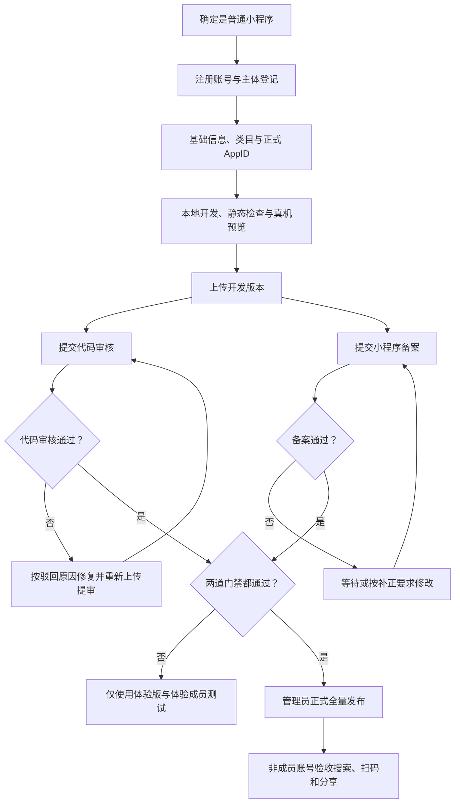

# 微信普通小程序从注册到公开发布工作流

> 适用于个人主体、普通微信小程序的首次上线。平台规则和后台入口会变化；每次执行前应以微信官方后台和文档为准。

## 一句话流程

注册账号与主体 → 完善名称、头像、简介和类目 → 获取正式 AppID → 本地开发与真机预览 → 上传开发版本 → **备案与代码审核并行** → 两者均通过后正式发布 → 用非成员账号验收搜索、扫码和分享。

## 本次试跑基线

本工作流来自 2026-08-18 对“吃啥小决定”的真实试跑，当前事实如下：

- 主体：个人主体、普通小程序。
- 功能：本地随机餐食建议；无登录、无支付、无交易、无用户发布内容、无个人信息收集。
- 类目：工具类信息查询，最终以后台已通过类目为准。
- 已完成：注册、主体核验、基础信息、正式 AppID 绑定、真机测试、`1.0.0` 上传、代码审核通过。
- 当前门禁：小程序备案仍在审核，因此尚未完成“普通用户可搜索并公开访问”的最终验收。
- 备案等待期间：可以用体验版和体验成员测试；朋友不需要、也不应被授予开发者权限。

这意味着：前半程是已验证路径，备案通过后的正式发布与搜索验收仍需在本次账号上补做一次闭环记录。

## 适用与不适用范围

### 适用

- 个人主体普通微信小程序。
- 简单工具、信息展示或本地计算类 MVP。
- 首版尽量不使用登录、支付、UGC、定位、相册、摄像头、手机号等高风险能力。

### 不适用

- 微信小游戏：应单独注册并建立“小游戏”工作流，不要直接套用普通小程序类目和审核结论。
- 电商、直播、医疗、金融、教育等需要特殊资质的业务。
- 虚拟支付、实物交易、UGC、多人互动或服务端敏感数据处理。

## 总体状态流



## 操作边界

| 标记 | 执行者 | 可做事项 |
|---|---|---|
| A | Codex / 自动化 | 创建和修改代码、项目配置、生成非敏感素材、静态扫描、编译检查、整理版本说明和证据清单 |
| C | Codex 协助，管理员确认 | 名称、简介、类目、备案备注、隐私声明、上传、提审和发布前的信息核对 |
| H | 管理员本人 | 密码、邮件验证码、短信验证码、扫码登录、实名资料、人脸核身、`12381` 短信核验、法律协议确认 |
| X | 禁止保存 | 密码、验证码、AppSecret、身份证完整号码、管理员二维码、会话令牌和其他认证凭据 |

原则：A 类可以复用；C 类必须基于真实功能；H 类出现时流程暂停等待管理员完成；X 类不得进入笔记、仓库、聊天截图或客户端代码。

## 门禁总览

| 门禁 | 必须满足 | 核验证据 |
|---|---|---|
| G0 定义范围 | 确认是普通小程序；首版功能和风险边界明确 | 功能清单、明确“不做”列表 |
| G1 账号主体 | 能登录小程序后台，主体和管理员核验成功 | 后台主体状态截图（脱敏） |
| G2 基础信息 | 名称、头像、简介、主服务类目与实际功能一致 | 基础信息和类目“已通过”状态 |
| G3 正式 AppID | 项目使用 `wx...` 正式 AppID，不是测试号或 `gh_...` 原始 ID | 开发者工具显示正确小程序名称 |
| G4 本地质量 | 编译无阻塞错误，核心流程在真机可完成，隐私声明与代码一致 | 编译结果、真机截图、隐私扫描结果 |
| G5 上传 | 后台“开发版本”出现正确版本 | 版本号、上传时间、开发者 |
| G6 代码审核 | 审核通过待发布 | 审核状态和审核说明 |
| G7 备案 | 备案完成/通过 | 备案状态、备案编号（按需脱敏） |
| G8 正式发布 | G6 与 G7 同时通过，管理员确认线上内容 | “线上版本”版本号和发布时间 |
| G9 公开验收 | 非管理员、非体验成员账号可以打开 | 搜索/小程序码/分享中至少两种入口通过 |

## 阶段 0：定义 MVP 与风险边界

1. 明确第一版只解决一个问题，并能在 30–60 秒内体验完核心价值。
2. 写出首版“不做”列表，例如：登录、支付、交易、排行榜、评论、聊天、用户投稿、定位、手机号。
3. 确认内容可以落入个人主体当前可选的真实类目。
4. 若最终目标是小游戏，不要在普通小程序账号上继续堆游戏功能，应另建项目和流程。

**退出条件：** 有一句功能描述、一份页面清单、一份隐私能力清单和一份“不做”列表。

## 阶段 1：注册小程序账号

1. 进入微信公众平台注册入口，账号类型选择“小程序”。
2. 使用未绑定其他微信公众平台账号的邮箱注册。
3. 由管理员完成邮箱激活、平台密码设置和微信扫码确认。
4. 登录后确认后台左上角类型为“小程序”，而不是公众号。

**人工门禁：** 邮箱验证、密码和扫码均由管理员本人完成。

**退出条件：** 可以进入小程序后台首页。

## 阶段 2：主体信息登记

1. 选择真实注册国家/地区和主体类型。
2. 填写主体、管理员姓名、证件和手机号等真实信息。
3. 获取短信验证码并完成管理员身份验证。
4. 提交前逐项核对；工作流只记录“已通过/未通过”，不记录完整身份资料。

**退出条件：** 主体信息提交成功，管理员身份核验成功。

## 阶段 3：完善基础信息与服务类目

### 基础信息

- 名称：清晰反映用途，避免夸大或误导。
- 简称：必须符合后台从名称截取等规则；如果选填且持续报错，可先留空。
- 头像：清晰方形图，版权可确认，格式和大小符合后台提示。
- 简介：说明用户做什么、如何得到结果，不写尚未实现的功能。

### 服务类目

1. 添加与核心功能最接近且当前主体可选的类目。
2. 设为主服务类目。
3. 等待类目状态通过；不要为图快选择餐饮、电商、游戏等不匹配类目。

**退出条件：** 名称、头像和简介正常展示，主服务类目状态为“已通过”。

## 阶段 4：获取并绑定正式 AppID

### 获取位置

后台通常位于：`开发与服务 → 开发管理 → 开发设置 → 开发者 ID`。

- 正式 AppID 以 `wx` 开头。
- `gh_...` 是原始 ID，不能用于替代 AppID。
- 无服务端调用需求时，不要生成 AppSecret。
- AppSecret 永远不能写入小程序客户端、Git 仓库或本工作流。

### 绑定检查

1. 将正式 AppID 写入项目的 `project.config.json`。
2. 检查 `project.private.config.json` 是否存在 `appid`；同名私有配置可能优先覆盖公共配置。
3. 搜索项目内是否还有测试 AppID 或旧 AppID。
4. 关闭并重新导入正确项目目录，再重新编译。
5. 确认开发者工具显示正式小程序名称，上传按钮可用。

**退出条件：** 工具不再提示“测试号 AppID”，且标题/基本信息对应目标小程序。

## 阶段 5：本地开发与静态核验

### 最小项目检查

- `app.js`、`app.json`、`app.wxss` 等全局文件完整。
- 至少一个有效页面，页面路径与 `app.json` 一致。
- 图片和图标路径有效，不依赖电脑绝对路径。
- 不依赖只在本机运行的临时服务。
- 模拟器控制台没有阻塞性报错。

### 隐私与高风险能力扫描

检查代码、组件和第三方 SDK 是否涉及：

- 登录、用户资料、手机号。
- 定位、相册、摄像头、麦克风、通讯录。
- 文件上传、云数据库、用户表单和用户发布内容。
- 支付、订单、虚拟商品、广告和统计 SDK。

可用 `rg` 做初筛，最终仍需人工判断调用是否真实执行：

```powershell
rg -n 'wx\.(login|getUserProfile|getLocation|chooseImage|chooseMedia|chooseAddress)|getPhoneNumber|requestPayment' .
rg -n '"appid"|wx[a-zA-Z0-9]{16}' project.config.json project.private.config.json
```

**退出条件：** 编译通过，核心功能可用，后台隐私声明与代码实际行为一致。

## 阶段 6：真机预览

1. 在微信开发者工具点击“预览”。
2. 管理员或已授权成员扫码。
3. 至少在一台真实手机完成一次端到端流程；条件允许时分别测 Android 和 iOS。
4. 检查首屏、主要按钮、结果页、返回、图片、文字溢出和网络依赖。
5. 保存脱敏截图和发现的问题。

**退出条件：** 真机可以独立完成核心流程，且无阻塞性错误。

## 阶段 7：上传开发版本

1. 确认开发者工具登录的是该 AppID 的管理员或开发者。
2. 点击“上传”。
3. 填写唯一的新版本号，例如 `1.0.0`、`1.0.1`。
4. 项目备注只写本次范围，例如“首次上传：随机餐食建议工具，无登录和支付”。
5. 等待“代码上传成功”。
6. 到后台 `管理 → 版本管理 → 开发版本` 核对版本号、时间和开发者。

**退出条件：** 后台出现与本地一致的开发版本。

## 阶段 8：提交小程序备案

备案应尽早提交，并与开发、代码审核并行推进。

1. 进入“小程序备案”，填写真实主体信息。
2. 填写小程序名称、服务内容和运营说明；描述必须与代码、简介和类目一致。
3. 上传后台要求的真实材料。
4. 管理员本人完成扫码、人脸或其他核身后提交。
5. 等待微信平台初审。
6. 收到 `12381` 短信后，管理员须在短信要求时限内完成工信部短信核验。
7. 等待省通信管理局审核；审核中不要无故撤回或重复提交。

### 备案备注结构

> 本小程序面向【目标用户】，提供【核心功能】。用户通过【操作步骤】获得【结果】。当前版本不包含【登录/支付/交易/UGC/个人信息收集等实际未包含的能力】。

### 时间预期（截至 2026-08-18）

- 微信平台初审：通常 `1–2` 个工作日。
- `12381` 短信核验：收到短信后需在 `24 小时`内完成，否则可能退回。
- 省通信管理局审核：通常 `1–20` 个工作日。
- 一次通过可按约 `2–22` 个工作日规划；这不是全国平均值，也不构成时效承诺。

**退出条件：** 备案状态为“完成”或“通过”。

## 阶段 9：提交代码审核

### 审核表填写

- 版本描述：准确概括本次更新，不能写尚未实现的功能。
- 图片/视频预览：选填时可先留空，若后台或审核明确要求再补。
- 测试账号：无登录功能时选择“无需登录账号即可使用”。不得填写个人微信账号和真实密码。
- 小程序订单中心 path：无交易功能时留空。
- 审核加急：非必要不使用。
- 用户隐私保护指引：必须与代码实际调用一致；未采集时选择“未采集用户隐私”。
- 测试备注：仅在流程特殊时说明入口和操作步骤。

### 处理结果

- 审核中：等待，不要同时重复上传相同版本。
- 审核通过待发布：保留版本，不必因备案仍在审核而重新提审。
- 审核驳回：逐条修复审核说明，上传新版本后重新提交。

**退出条件：** 版本状态为“审核通过待发布”。

## 阶段 10：备案等待期间邀请朋友测试

1. 进入 `管理 → 成员管理`。
2. 将朋友添加为“体验成员”，不要添加为开发者。
3. 在版本管理中将对应开发版本选为体验版。
4. 将体验二维码发给已添加的成员。
5. 测试结束后按需移除成员，保持最小权限。

如果后台在备案未完成时提供“继续发布”，它通常仍会限制搜索和普通用户访问，不能视为公开上线完成。

**退出条件：** 体验成员能扫码进入；非成员不能进入在此阶段是正常现象。

## 阶段 11：正式发布

发布前必须同时满足：

- 代码审核通过。
- 小程序备案通过。
- 基础信息和主服务类目仍有效。
- 管理员确认线上内容与送审内容一致。

操作：进入 `管理 → 版本管理`，找到“审核通过待发布”的版本，首次上线选择全量发布，并完成管理员确认。

**退出条件：** 后台“线上版本”出现正确版本号和发布时间。

## 阶段 12：公开搜索、扫码与分享验收

1. 确认后台允许通过名称搜索，具体入口以当前后台为准。
2. 用非管理员、非体验成员微信账号搜索完整名称，并切换到“小程序”分类。
3. 同时测试小程序码和微信内小程序卡片；这两种方式通常比等待搜索收录更可靠。
4. 新发布后若暂时搜不到，先核对备案、线上版本、搜索设置，再给平台留出收录时间。
5. 打开后完成一次核心流程，确认后台线上版本与实测一致。

**退出条件：** 非成员账号可正常打开，且搜索、小程序码、分享卡片至少两种入口通过。

## 状态模型

| 状态 | 含义 | 下一动作 |
|---|---|---|
| `ACCOUNT_READY` | 账号与主体已就绪 | 完善基础信息和类目 |
| `PROFILE_READY` | 基础信息和主类目通过 | 绑定正式 AppID |
| `DEVELOPING` | 本地开发中 | 编译、真机和隐私核验 |
| `UPLOADED` | 开发版本已上传 | 并行提交备案与代码审核 |
| `CODE_REVIEWING` | 代码审核中 | 等待或按审核意见修复 |
| `CODE_APPROVED` | 代码通过待发布 | 等待备案或进入发布门禁 |
| `FILING_REVIEWING` | 备案审核中 | 留意电话和 `12381` 短信 |
| `FILING_APPROVED` | 备案通过 | 与代码通过状态汇合 |
| `RELEASE_READY` | 代码和备案均通过 | 管理员正式发布 |
| `ONLINE` | 已有线上版本 | 做非成员公开验收 |
| `SEARCHABLE` | 搜索/扫码/分享验收通过 | 进入日常版本迭代 |

## 常见故障与恢复路径

| 现象 | 常见原因 | 恢复路径 | 重新核验 |
|---|---|---|---|
| “请检查完善表单数据” | 页面存在红色字段错误 | 从上到下查红字，重点看简称、头像、简介和必填项 | 红字消失并可提交 |
| 简称不合法 | 不符合名称截取规则 | 按后台规则从全称截取；选填时可先留空 | 输入框不再报错 |
| 找不到类目 | 主体不支持或方向不匹配 | 选择真实核心功能最接近的可用类目 | 类目通过并设为主营 |
| “测试号 AppID 无法使用当前功能” | 项目仍绑定测试号 | 核对正式 `wx...` AppID 及两个配置文件，重开/重导项目 | 工具显示正式名称 |
| 已改 AppID 仍显示测试号 | 私有配置覆盖或缓存未刷新 | 检查 `project.private.config.json`，关闭项目后重导 | 基本信息显示正式 AppID |
| 上传按钮不可用 | 测试 AppID、账号无权限或登录错误 | 换正式 AppID，确认成员权限并重新扫码 | 上传按钮启用 |
| 上传成功但后台无版本 | AppID/账号不一致或后台未刷新 | 比对 AppID、刷新版本管理、核对上传时间 | 开发版本出现 |
| 审核表要求账号密码 | 误选“需要登录” | 无登录项目改选“无需登录账号即可使用” | 账号密码字段消失 |
| 隐私配置失败 | 声明和代码调用不一致 | 扫描 API/SDK；删除非必要调用或补齐指引 | 声明与代码一致 |
| 备案一直审核中 | 正常审核阶段 | 保持电话和短信畅通，不反复提交 | 状态继续推进 |
| 收到 `12381` 短信 | 需完成工信部核验 | 管理员在 24 小时内核验 | 备案继续流转 |
| 代码通过但无线上版本 | 未发布或备案未通过 | 等备案后在版本管理发布 | 出现线上版本 |
| 朋友搜不到 | 未备案、未正式发布、搜索关闭或尚未收录 | 依次核对四项；先分享小程序码 | 非成员账号可打开 |
| 朋友打不开体验版 | 未加入体验成员或二维码失效 | 核对微信号并重新生成体验码 | 体验成员扫码成功 |

## 交接与证据合同

每次换人或换对话，只交接以下非敏感信息：

- 小程序名称、主体类型、服务类目。
- 本地项目绝对路径。
- AppID 是否已绑定；需要记录时只保留公开 AppID 或脱敏值，不记录 AppSecret。
- 当前版本号、当前状态模型状态和最后操作时间。
- 代码审核、备案、发布是否通过。
- 驳回原因、待办、下一人工门禁。
- 脱敏后的后台状态截图和开发者工具日志。

禁止交接：密码、验证码、完整证件号码、AppSecret、二维码、Cookie、token 和登录会话数据。

## 完成定义（Definition of Done）

- [ ] 使用正式 AppID，开发者工具显示正确小程序名称。
- [ ] 编译通过，真机完成核心流程。
- [ ] 后台存在正确的开发版本。
- [ ] 代码审核通过。
- [ ] 小程序备案通过。
- [ ] 管理员已正式全量发布。
- [ ] 后台显示正确线上版本。
- [ ] 非管理员、非体验成员账号可以打开。
- [ ] 搜索、小程序码和分享卡片至少两种入口验收通过。
- [ ] 交接记录不含任何敏感凭据。

## 日常版本迭代

后续每次更新复用短流程：

1. 明确本版功能和风险变化。
2. 若新增登录、支付、位置、相册、广告、统计 SDK、表单或云数据库，先重做隐私/类目核对。
3. 本地测试和真机预览。
4. 递增版本号并上传。
5. 填写真实版本描述并提审。
6. 审核通过后发布。
7. 用非成员账号做回归验收并记录结果。

## 官方参考

- [注册与获取 AppID](https://developers.weixin.qq.com/miniprogram/dev/framework/quickstart/getstart.html)
- [项目配置文件与私有配置优先级](https://developers.weixin.qq.com/miniprogram/dev/devtools/projectconfig.html)
- [发布流程](https://developers.weixin.qq.com/miniprogram/dev/framework/quickstart/release.html)
- [小程序备案操作指引](https://developers.weixin.qq.com/miniprogram/product/record/guidelines.html)
- [小程序备案常见问题](https://developers.weixin.qq.com/miniprogram/product/record/record_faq)
- [用户隐私保护](https://developers.weixin.qq.com/miniprogram/dev/framework/user-privacy/)
- [小程序搜索优化指南](https://developers.weixin.qq.com/miniprogram/dev/framework/search/seo.html)
- [开放的服务类目与材料](https://developers.weixin.qq.com/miniprogram/product/material/)

## Workflow Check

- **Missing gate：** 本次真实账号仍缺“备案通过 → 正式发布 → 非成员搜索验收”证据，不能把当前状态称为完整公开上线。
- **Manual/automatic boundary：** 扫码、验证码、实名、法律协议、`12381` 核验和最终发布确认由管理员本人完成。
- **Verification evidence：** 每道门禁以后台状态、版本号、时间和脱敏截图为准，不以口头“应该成功”代替。
- **Handoff impact：** 任一阶段中断时，只需交接当前状态、已验证证据、阻塞原因和下一动作。
- **Rule/doc update：** 微信后台入口、类目、备案时限或隐私规则变化时，先更新本文件的 `updated` 日期和相应章节再执行。
